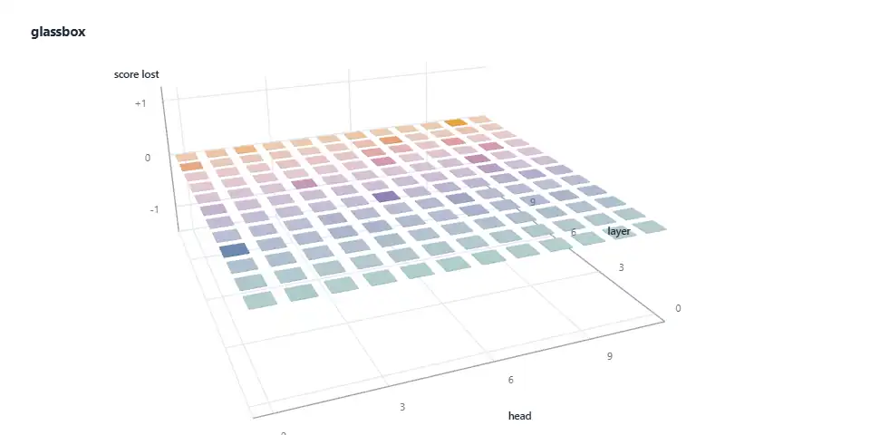

# Glassbox

An interpretability lab Claude Code drives over MCP.



<sub>The repository's own recorded run on GPT-2 small: ablation sweep `E0014` (64 prompts), the circuit in `benchmarks/ioi/report/report.json` (12 of its 30 parts drawn) and verification `V0002` on 200 held-out prompts at full precision.</sub>

## What it is

Glassbox is a lab for reading what a neural network has learned. Claude Code plays the scientist: it runs
experiments on an open-weights model through ten tools, writes down what it expects before each one, and
ends with the algorithm written out as code. That code is then checked against the real model on inputs
the investigation never used.

It is a research prototype. Every investigation in this repository was run on one desktop PC or on the
NDIF research service, and the planted-circuit benchmark it built is already at its ceiling.

## Why it exists

**The problem.** Models are deployed whose internal algorithms nobody has read. Reading one behavior by
hand takes an expert a long time, and most of that time is a loop: guess, test, revise.

**What was missing.** An agent can run that loop, but agents can also look right for the wrong reasons.
They can recall a published circuit instead of finding it, or tell a plausible story about a model that
has no circuit at all. This repository adds the checks: a prediction recorded before every experiment in a
notebook that cannot be edited afterwards, effects compared with null models and random component sets,
and test models whose circuit was planted from a seed and whose answer key the agent cannot see.

**Who it is for.** Interpretability researchers who want an agent to do the repetitive part of circuit
work, and who want every claim in the result tied to an experiment that ran.

## How it works

1. **Start.** The `/investigate` command in `.claude/commands/investigate.md` gives Claude Code a backend,
   a model, a behavior and an experiment budget. Claude Code reaches the lab only through the MCP server.
2. **Load.** `load_model` opens an investigation folder with its own `notebook.jsonl` and `state.json`.
   Reusing a name resumes it; the model reloads on the next experiment.
3. **Pre-register.** `preregister` records the hypothesis, the exact experiment, a prediction (a metric
   path, an operator and a threshold) and the alternatives it separates. Every notebook entry stores the
   sha256 of the one before it, so an edit after the fact breaks the chain.
4. **Run.** `run_experiment` refuses to run without a pre-registration id unless the run is marked
   exploratory. It runs exactly the registered primitive, saves JSON and a plot stamped with backend and
   precision, and scores the prediction: confirmed, refuted or inconclusive.
5. **Verify.** `verify_hypothesis` takes a `predict(tokens, prompt)` function and a claimed circuit. On
   held-out inputs it checks agreement with the model (default at least 0.9), the circuit alone (at least
   0.7 of the metric survives), the circuit ablated (at most 0.5 survives), and that each effect is above
   the 95th percentile of its null distribution.
6. **Label.** Only `local-full` and `ndif` run at full precision, so only they can return `verified`.
   Quantized backends stop at `screening-pass`.
7. **Report.** `write_report` writes `report.md` and `report.html`. It fails if a claim cites nothing, cites
   an experiment that does not exist, or rests only on exploratory runs.


<sub>Bench run seed-1/t1 notebook: 37 hash-chained entries, chain rechecked. Full precision; misses kept in the record.</sub>

## Capabilities

What the code does today.

- **MCP server.** Ten tools: `list_models`, `load_model`, `backend_capabilities`, `preregister`,
  `run_experiment`, `get_plot`, `notebook_append`, `notebook_read`, `verify_hypothesis`, `write_report`.
  `glassbox/mcp/server.py`
- **CLI.** The same tools without MCP (`glassbox tool ...`), notebook chain checks, null runs, the
  modular-addition toy model and the bench commands. `glassbox/cli.py`
- **Primitives.** Fourteen: dataset, baseline, attribution patching, activation patching, path patching,
  ablation, logit lens, direct logit attribution, linear probe, attention patterns, difference of means,
  steering, periodicity, weight SVD. `glassbox/lab`
- **Backends.** `local-full` (TransformerLens, full precision), `local-4bit` (nnsight and bitsandbytes,
  screening), `local-gguf` (llama.cpp through ctypes, read and steer only, screening), `ndif` (nnsight
  remote, full precision). A capability table names a backend that can run any unsupported primitive.
  `glassbox/backends`
- **Notebook and pre-registration.** Append-only, hash-chained, with automatic prediction scoring.
  `glassbox/notebook`
- **Verification and nulls.** Agreement, causal and null-calibrated checks; random-init, weight-shuffled
  and task-shuffled null models. `glassbox/verify`, `glassbox/nulls.py`
- **glassbox-bench.** Small algorithms written in RASP, compiled to weights with Tracr, then obfuscated by
  rotation, permutation and distractor components. Keys are written outside the repository and read only
  by the grader. `glassbox/bench`
- **Model diffing.** Weight-level comparison of two GGUF files. `glassbox/audit`
- **Headless runs.** One fresh `claude -p` session per task with only the glassbox MCP tools allowed.
  `glassbox/headless.py`

Recorded results in the repository, from the run records and their own summaries:

| Run | Result | Precision |
|---|---|---|
| IOI in GPT-2 small, blind | 4 found, 2 partial, 0 missed of 6 published parts; 20 of 26 published heads | full (verified) |
| Modular addition, 1-layer model trained here | 3 found, 2 partial of 5 | full (verified) |
| Induction, 2-layer attention-only model | 4 found, 1 partial of 5 | full (partial: agreement 0.5) |
| glassbox-bench, seeds 1 to 3, 21 tasks | 15 of 15 compiled tasks solved; 1 trained task not verified on every seed | full |
| Null investigations | 1 counted false discovery in 30 | full |
| Scale ladder, four IOI predictions | Hold on GPT-2 small and on official Qwen3.8-27B (4-bit and NDIF) | mixed, labelled per rung |
| Abliterated vs official 27B audit | 3 of 8 pre-registered predictions confirmed, 5 refuted | quantized (screening) |

Sources: [`benchmarks/SCORECARD.md`](benchmarks/SCORECARD.md),
[`benchmarks/glassbox-bench/seed-1/SCORECARD.md`](benchmarks/glassbox-bench/seed-1/SCORECARD.md),
[`ladder/LADDER.md`](ladder/LADDER.md), [`audits/abliteration/AUDIT.md`](audits/abliteration/AUDIT.md).

Known limits, from the repository's own records:

- The three published-circuit benchmarks are blind only in the sense that no hints were given. Claude has
  very likely read those papers.
- glassbox-bench is saturated: every compiled task scored 1.00 on every seed. It shows the loop works end to
  end; it cannot rank scientists. Its seal is an honor system on one PC, not cryptography.
- 29 of the 30 null runs stopped at the baseline because the behavior was absent. That is an easy null.
- No patching or ablation on GGUF. No gradients or attention patterns on NDIF. Null models exist on
  `local-full` only.
- `verify_hypothesis` needs prompts of equal token length.
- The 27B audit is a screening result on quantized files, and its localisation comes from an exploratory
  analysis after five pre-registered predictions failed.


<sub>IOI null calibration (186 null samples, GPT-2 small) and V0002 (200 held-out prompts, full precision). Backends as used in committed runs, not re-run here.</sub>

## Quick start

Requires Python 3.11 or newer. The commands below were run on Windows 11 with Python 3.11.18, uv 0.13.7
and the CPU build of PyTorch, from a clone of this repository. On macOS or Linux use `.venv/bin/python`;
that was not tested.

```bash
python -m uv venv --python 3.11 .venv
python -m uv pip install --python .venv/Scripts/python.exe torch --index-url https://download.pytorch.org/whl/cpu
python -m uv pip install --python .venv/Scripts/python.exe -e ".[dev,gguf]"
python -m uv pip install --python .venv/Scripts/python.exe "transformer-lens<4"
```

The last line matters. `pyproject.toml` asks for `transformer-lens>=2.0`, which today resolves to 4.4.0.
That release removed `HookedTransformer`, and five of the seven test files then fail to import. With 3.9.0
everything passes.

Run the tests. Expect `76 passed, 1 skipped` in under a minute. They use small hand-built models on the
CPU; the skipped test needs a separate Tracr environment.

```bash
.venv/Scripts/python -m pytest
```

Recompute the hash chain of a committed notebook. Expect `OK: 33 chained entries`.

```bash
.venv/Scripts/glassbox notebook verify benchmarks/glassbox-bench/seed-1/runs/t2/notebook.jsonl
```

Print the backend and primitive capability table as JSON.

```bash
.venv/Scripts/glassbox tool backend_capabilities
```

Not run here: adding the server to Claude Code (`claude mcp add glassbox -- python -m glassbox.mcp`) and
an `/investigate` session, a GPU, a GGUF file, NDIF (needs `NDIF_API_KEY` in the server's environment) and
`glassbox bench generate` (needs Tracr in a second environment, see `GLASSBOX_TRACR_PYTHON` in
`glassbox/bench/generate.py`). The server module was imported and lists its ten tools.

## Stack, status, roadmap

**Stack**

| Layer | Built with |
|---|---|
| Lab, notebook, verification | Python 3.11+, PyTorch, NumPy, scikit-learn, matplotlib |
| Full-precision local models | TransformerLens |
| 4-bit and remote models | nnsight, bitsandbytes, accelerate, NDIF |
| GGUF models | llama.cpp through ctypes, `gguf` |
| Interface | MCP Python SDK, Claude Code |
| Planted circuits | RASP and Tracr, in a separate environment |
| Video and figures | Remotion, in `tutorial/` |

**Status**

| Part | State |
|---|---|
| MCP server, CLI, primitives, notebook, verification | Built. 76 tests pass on CPU with TransformerLens 3.9. |
| Install from `pyproject.toml` as written | Tests fail to import with TransformerLens 4.x. |
| local-full, local-4bit, local-gguf, ndif | Each used in committed runs on one PC with two 12 GB GPUs, or on NDIF. Not run in this session. |
| Published-circuit benchmarks | Run once each, blind. IOI and modular addition verified, induction partial. |
| glassbox-bench | Three seeds run and graded. Saturated. |
| Model-diff audit | Screening only, on quantized files. |
| Open cases | Subject-verb agreement in GPT-2: partial, not verified. "a" versus "an": the model does not do it. |

**Roadmap.** From the repository's own list:

1. Patching on GGUF, by overwriting activations inside llama.cpp.
2. Harder glassbox-bench families (deeper programs, superposition, a noisy fine-tune) until the bench is
   no longer saturated, and a task-shuffled null that also checks agreement against the dataset labels.
3. The model-diff audit on unquantized weights, with the follow-up analysis pre-registered.
4. SAE features as a unit of analysis next to heads and neurons; more model families; a searchable atlas of
   small verified circuits per model.

**Documents**

| File | Contents |
|---|---|
| [`.claude/commands/investigate.md`](.claude/commands/investigate.md) | The protocol the scientist follows |
| [`benchmarks/SCORECARD.md`](benchmarks/SCORECARD.md) | Published-circuit benchmarks, per-part verdicts and caveats |
| [`benchmarks/ioi/report/report.md`](benchmarks/ioi/report/report.md) | The blind IOI report on GPT-2 small |
| [`ladder/LADDER.md`](ladder/LADDER.md) | Scale ladder from GPT-2 small to Qwen3.8-27B |
| [`audits/abliteration/AUDIT.md`](audits/abliteration/AUDIT.md) | Abliterated versus official 27B, every refuted prediction |
| [`demos/qwen27b-language/report/report.md`](demos/qwen27b-language/report/report.md) | Language direction and steering in a 27B GGUF, screening |
| [`open_cases/gpt2-agreement/report/report.md`](open_cases/gpt2-agreement/report/report.md) | Subject-verb agreement, unverified |
| [`tutorial/README.md`](tutorial/README.md) | How the video and old figures are rendered |
| [`media/tutorial.mp4`](media/tutorial.mp4?raw=true) | 132-second explainer video, no sound, 6.4 MB download |

## License

MIT. See [`LICENSE`](LICENSE).

The abliteration audit reads prompts from the public contrast set of Arditi et al. 2024; they stay in a
local cache and are not in this repository. Models are not included; each keeps its own license.
