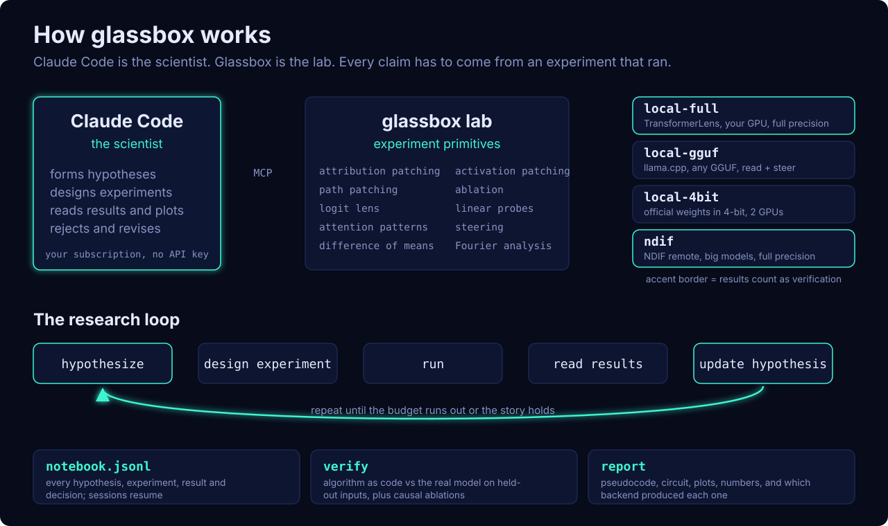
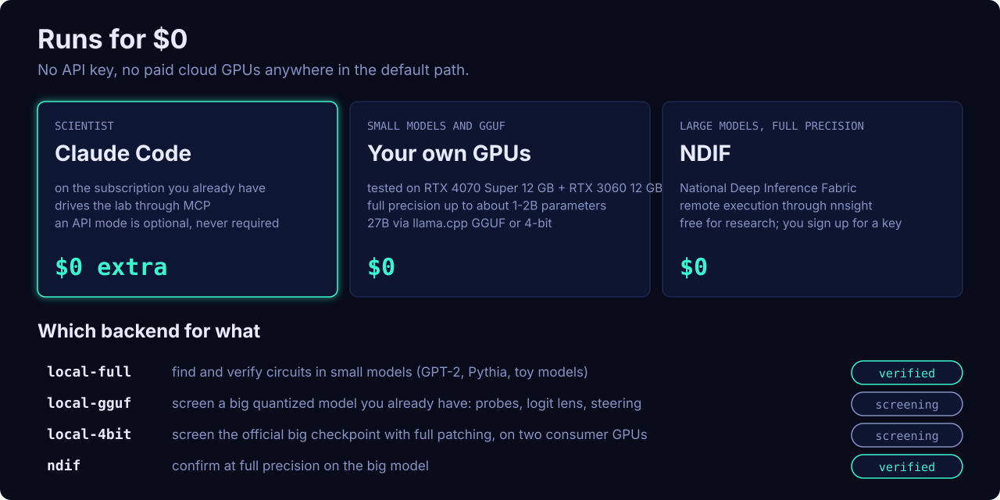
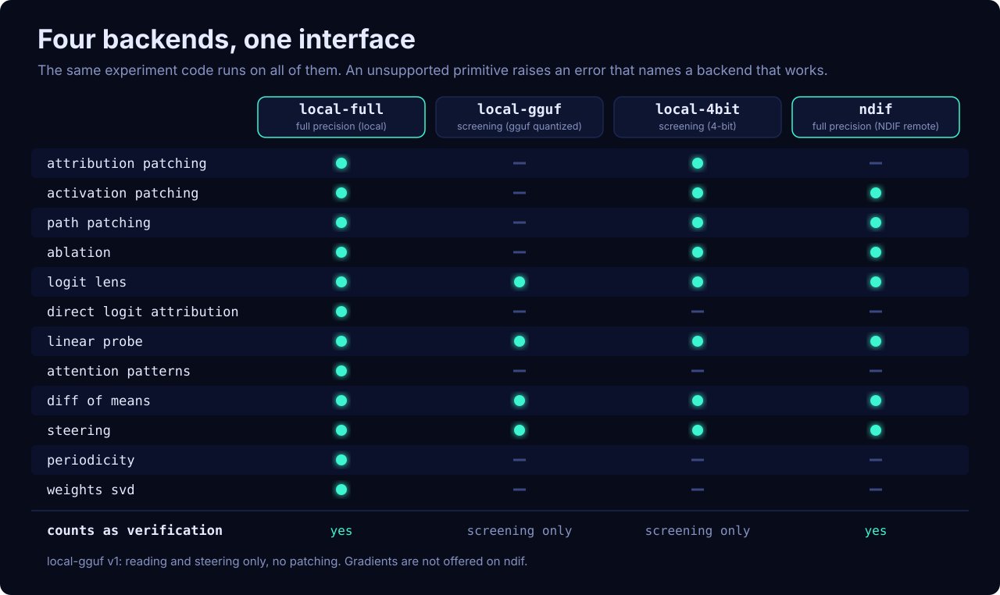
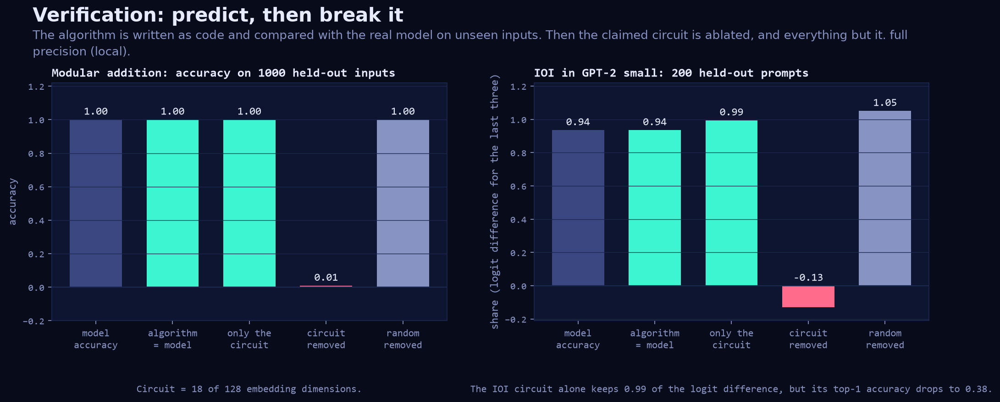

<p align="center"></p>

# glassbox

**Turn black boxes into glass boxes.**

Glassbox is an autonomous interpretability lab. Give it an open-weights model and a behavior ("how does it do modular
addition?", "how does it know which name comes next?"). It runs mechanistic interpretability experiments, recovers the
algorithm the network learned, writes it out as pseudocode, and checks that algorithm against the real model on inputs it
has never seen.

## Why this matters

- We deploy neural networks whose internal algorithms nobody has read.
- Reading them by hand takes an expert weeks per behavior. Most of that work is a loop: guess, test, revise.
- Glassbox runs that loop with an AI scientist, and keeps it honest: every claim must cite an experiment that ran.

## How it works

<p align="center"></p>

Claude Code is the scientist. Glassbox is the lab, exposed as an MCP server with nine tools: `list_models`,
`load_model`, `backend_capabilities`, `run_experiment`, `get_plot`, `notebook_append`, `notebook_read`,
`verify_hypothesis`, `write_report`.

The primitives behind `run_experiment`: attribution patching (cheap first screen), activation patching (residual
stream, heads, MLPs), path patching, mean / zero / resample ablation, logit lens, direct logit attribution, linear
probes, attention patterns, difference-of-means directions, steering, and Fourier analysis of weights and activations.
Each returns structured JSON plus a plot, stamped with the backend and precision that produced it.

[](media/tutorial.mp4)

The full tutorial video is [`media/tutorial.mp4`](media/tutorial.mp4).

## Runs for $0

<p align="center"></p>

- **The scientist** is Claude Code on the subscription you already have. No Anthropic API key is needed or used.
- **Small models and GGUF files** run on your own GPUs.
- **Large models at full precision** run on [NDIF](https://ndif.us), the National Deep Inference Fabric, which is free
  for research.

Hardware everything here was run on: RTX 4070 Super 12 GB + RTX 3060 12 GB, Ryzen 7 7800X3D, 31 GB RAM, Windows 11.

NDIF setup (you do this yourself, glassbox never sees your key outside the process environment):

1. Create an account at <https://login.ndif.us> and copy your API key.
2. Start the MCP server with `NDIF_API_KEY` set in its environment (see the config below). Glassbox reads the key from
   that variable only. It does not write it to disk, logs or reports.
3. `list_models` then shows which models NDIF hosts right now and whether your key is recognised.

## Four backends

<p align="center"></p>

| Backend | What it is | Results count as |
|---|---|---|
| `local-full` | TransformerLens on your GPU, small models at full precision | verified |
| `local-gguf` | llama.cpp on any quantized GGUF file, zero download | screening (gguf quantized) |
| `local-4bit` | official checkpoint, nnsight + bitsandbytes 4-bit, split across GPUs | screening (4-bit) |
| `ndif` | nnsight remote execution on NDIF, large models at full precision | verified |

If a primitive is not supported on a backend, the error names a backend that does support it.

## Bring your own GGUF

`local-gguf` works on the quantized files you already use with llama.cpp. It registers llama.cpp's eval callback (the
mechanism behind its `eval-callback` example) and copies named tensors out of the forward pass.

What works:

- reading the residual stream, attention-block output and MLP output at every layer and token
- logit lens, linear probes, difference-of-means directions, activation statistics
- steering through llama.cpp control vectors (adding a direction to the residual stream at chosen layers)
- before / after comparisons of logits and generated text

What does not work in v1: activation patching, path patching and ablation. llama.cpp can add to the residual stream but
glassbox cannot overwrite activations in it yet. Use `local-4bit` or `ndif` for those.

Point `GLASSBOX_LLAMA_DIR` at your llama.cpp build folder and `GLASSBOX_GGUF_DIR` at your models folder. The bindings
are written for the llama.cpp API as of build 12032 (November 2026); see `glassbox/backends/llama_cpp.py` if your build
is much older.

## Quickstart

```bash
python -m venv .venv && . .venv/bin/activate        # Python 3.11
pip install torch --index-url https://download.pytorch.org/whl/cu130   # pick the CUDA build for your driver
pip install -e ".[dev,gguf]"      # Qwen3.5/3.8 models need transformers >= 5.20
pytest                                              # 38 tests, no GPU needed
```

Add the server to Claude Code (generic config, plain environment variable):

```json
{
  "mcpServers": {
    "glassbox": {
      "command": "python",
      "args": ["-m", "glassbox.mcp"],
      "env": { "NDIF_API_KEY": "<your key, or leave this out if you do not use NDIF>" }
    }
  }
}
```

or `claude mcp add glassbox -- python -m glassbox.mcp`. Then, in Claude Code, from this repo:

```
/investigate local-full gpt2 "Given 'When Mary and John went to the store, John gave a drink to', the model says ' Mary'. How?" budget=40
```

The same tools are available without MCP: `glassbox tool run_experiment '{"primitive": "baseline", ...}'`.
Headless runs use `claude -p` on your subscription (see `benchmarks/run_blind.py`). There is no API mode in v1.

Investigations live in a folder with an append-only `notebook.jsonl`. If you hit a usage limit, start a new session
and run `/investigate` with the same investigation name: it reads the notebook and continues.

## Benchmarks

<p align="center"></p>

Three published circuits, each investigated by a fresh headless Claude Code session that got the `/investigate` prompt,
one paragraph describing the behavior, and the MCP tools. No file access, no web, no hints.

**What "blind" means here.** Claude has very likely read these papers during training. Blind means no hints were
given and every claim in the report comes from an experiment in that session's notebook, never from recall. It does
not mean discovery from zero knowledge.

| Benchmark | Published mechanism (found / partial / missed) | Experiments | Wall clock | Final verification |
|---|---|---|---|---|
| Modular addition, 1-layer transformer trained here | 3 / 2 / 0 of 5 | 16 | 4.6 min | verified |
| Induction, 2-layer attention-only model | 4 / 1 / 0 of 5 | 17 | 8.2 min | partial |
| IOI, GPT-2 small | 4 / 2 / 0 of 6; 20 of 26 published heads | 30 | 10.1 min | verified |

- **Modular addition.** Found the sparse Fourier embedding (frequencies 28, 17, 2, 14, 27), frequency-tuned MLP neurons
  and the matching readout. Missed: it did not show the product (trig identity) step directly.
- **Induction.** Found previous-token head 0.3 feeding induction head 1.6 through K-composition. Partial because the
  model itself is only about 60% accurate on the task, so the written-out algorithm cannot agree with it 90% of the time.
- **IOI.** Found all name movers, negative name movers, S-inhibition and induction heads. Missed 6 of 26 published
  heads (0.10, 2.2, and four backup name movers). Its first circuit failed verification and was revised. The verified
  circuit keeps 99% of the logit difference alone, but its top-1 accuracy drops to 0.38.

Full scorecard, per-head table and caveats: [`benchmarks/SCORECARD.md`](benchmarks/SCORECARD.md). Every run's notebook,
experiment records, plots and report are in `benchmarks/<name>/`.

<p align="center"></p>
<p align="center"></p>
<p align="center"></p>

## The 27B demo: zero download, two consumer GPUs

<p align="center"></p>

**Label: quantized, abliterated community variant, screening result.**

The model is a Q4_K_M GGUF of an abliterated Qwen3.8-27B that was already on disk, loaded through llama.cpp across
both GPUs (7.4 GB + 9.0 GB VRAM, measured). The question: where does the model represent the language of its
continuation, and is there a direction for it? In 16 experiments and 14 minutes the scientist found:

- The prompt language is linearly readable at every layer, so probing alone does not localise it.
- The mean French-minus-English activation at the last token is a causal direction. Added at layer 28 at 0.2 to 0.4 of
  the residual norm, it flips the next-token preference (logit difference +12.9 to -10.3) and the generated text:
  "The fishermen came back from" continues "la mer avec une pêche miraculeuse." Subtracted from French prompts it gives
  English.
- It works at every layer tested from 6 to 58. At layer 62 it only pushes single output tokens ("la la la").
- A control direction of the same size, built from a language-balanced split of the same prompts, changes nothing.

Not verified: GGUF cannot be patched, the weights are quantized, and the abliterated variant is not the official model.
`verify_hypothesis` also failed here because it needs prompts of equal token length; the run used held-out prompt sets
instead and says so. Full record: [`demos/qwen27b-language/`](demos/qwen27b-language/report/report.md).

## Scale ladder

<p align="center"></p>

Does the algorithm found in a small model show up in a big one? The IOI circuit from the GPT-2 benchmark was turned
into four fixed predictions, and one script (`ladder/run_ladder.py`) tests them unchanged on every rung:
P1 the model does the task; P2 which name is repeated is carried at the second subject token (S2) early and has moved
to the final token (END) late; P3 a few late attention heads write the answer; P4 those heads are backed up.

| Rung | Backend, precision | P1 task | P2 hand-off | P3 late heads | P4 backup |
|---|---|---|---|---|---|
| GPT-2 small (124M) | local-full, full precision | 0.91 accuracy | layer 9 of 11 | 9.9, 9.6 | 0.85 left |
| GPT-2 small (124M) | ndif, full precision | 0.81 accuracy | layer 9 of 11 | 9.9, 9.6 | 0.92 left |
| Qwen3.8-27B abliterated GGUF | local-gguf, screening | 0.81 accuracy | cannot patch | cannot patch | cannot patch |
| Qwen3.8-27B official | ndif, full precision | **0.50 accuracy, not met** | layer 55 of 63 | 59.8, 59.6 | 0.85 left |
| Qwen3.8-27B official | local-4bit, screening | not done yet | | | |

**Result.** In GPT-2 small all four predictions hold, locally and on NDIF. In the official Qwen3.8-27B at full
precision on NDIF, three of four hold: the S2-to-END hand-off (between layers 47 and 55 of 63, sampled every 8 layers; a similar relative depth
to layer 9 of 11), a small number of late heads that write the answer (59.8 and 59.6 restore 0.33 and 0.23 of the logit difference
on their own), and backup (ablating the top three leaves 0.85). The behavior check did not meet its preset threshold:
top-1 accuracy was 0.50 on a 6-prompt sample, although the logit difference favours the indirect object by 5.4. So
the same three-stage structure appears at about 220 times the size, but this is not a full confirmation.

Said plainly:

- The 27B NDIF rung used only 6 prompts and sampled 9 to 17 of 64 layers. NDIF's replica had almost no spare GPU
  memory, so larger batches failed.
- NDIF did host Qwen3.8-27B, so no substitute model was needed.
- The model card says Qwen3.8-27B is dense (not MoE) and vision-language. Glassbox loads the text stack only. It is a
  hybrid: 48 linear-attention layers and 16 full-attention layers.
- **Not done yet: the local-4bit rung.** It needs the official safetensors (about 52 GB). Glassbox does not start that
  download without the owner's approval, and that approval has not been given yet.
- This is a scripted protocol with fixed hypotheses, not a blind investigation, and it tests four coarse predictions,
  not the full 26-head circuit.

Details and per-rung notebooks: [`ladder/LADDER.md`](ladder/LADDER.md).

## Open cases (unverified)

Behaviors with no published circuit that we know of for this model. Nothing here is checked against outside ground
truth.

- **Subject-verb agreement across a distractor in GPT-2 small** ("The keys to the cabinet" -> " are").
  Status: **partial, not verified.** 29 experiments, 10.6 minutes, full precision. The run reports that the number is
  read at the subject, partly copied onto the preposition, and moved to the last token by eight heads in two groups
  (5.2, 6.0, 7.4, 8.5 attend to the preposition; 10.5, 10.9, 11.10 to the subject; 4.3 feeds the first group). Ablating
  the eight leaves 6% of the effect; eight control heads leave 100%. The causal checks pass only when all 12 MLPs are
  kept, and the agreement check fails because the verb is the model's top-1 token on only 17% of prompts.
  [`open_cases/gpt2-agreement/`](open_cases/gpt2-agreement/report/report.md)
- **"a" versus "an" in GPT-2 small.** Status: **negative result.** The model does not do it: " an" wins on 0 of 36
  prompts. The run stopped at the baseline after 2 experiments, as the protocol says it should.
  [`open_cases/gpt2-a-an/`](open_cases/gpt2-a-an/report/report.md)

## How verification works

<p align="center"></p>

`verify_hypothesis` runs two independent checks on inputs the investigation has not used:

1. **Agreement.** The hypothesis is an executable `predict(tokens, prompt)` function. Its output is compared with the
   real model's top prediction.
2. **Causal.** Ablate the claimed circuit and the behavior should break. Ablate everything else and it should
   survive. A random set of the same size is ablated as a control.

**Screening versus verified.** Quantized backends (`local-gguf`, `local-4bit`) can reach `screening-pass` at most.
A finding is `verified` only when it passes at full precision: `local-full` for small models, `ndif` for big ones.
Thresholds are explicit in the result (agreement >= 0.9, circuit alone >= 0.7, circuit ablated <= 0.5) and can be
overridden; the report shows the numbers either way.

## Limitations

- **Quantization noise.** 4-bit and GGUF weights are not the weights. Those results are screening only.
- **The abliterated variant differs from the official model** in at least the refusal direction. It is not a stand-in
  for Qwen/Qwen3.8-27B in benchmarks or in the scale ladder.
- **No patching on GGUF in v1.** Read and steer only.
- **NDIF availability.** Which models are hosted changes. Uploads are size-limited, so patching on NDIF copies
  activations between rows of one forward pass instead of uploading them. Gradients (attribution patching) and
  attention patterns are not offered on NDIF in v1.
- **Partial explanations.** Passing verification means the description predicts and controls the behavior on the
  tested distribution. It does not mean it is complete. See the IOI accuracy caveat above.
- **The scientist may know the answer.** The benchmarks cannot rule out that training knowledge guided which
  experiments were chosen.
- **Plan usage limits.** A long investigation can exhaust a Claude Code session. Notebooks resume, but only one
  session should write to an investigation at a time (two concurrent sessions corrupted an early demo run here).
- **Tool gaps found by the blind runs:** direct logit attribution reports heads only, `verify_hypothesis` needs
  equal-length prompts, attention patterns exist only on `local-full`.
- **Hybrid architectures.** Qwen3.8 alternates full attention with linear-attention layers; head-level sweeps must be
  run per layer type.
- The headless runs loaded the repo owner's personal Claude Code instructions (style and note-keeping preferences,
  nothing about interpretability).

## Roadmap

- patching on GGUF (overwrite activations inside llama.cpp)
- SAE features as a unit of analysis next to heads and neurons
- more model families and tokenizer-aware datasets
- a behavior atlas: many small verified circuits per model, searchable

## Repository layout

```
glassbox/backends   one interface, four backends, capability table
glassbox/lab        experiment primitives
glassbox/mcp        MCP server (main interface)
glassbox/notebook   append-only lab notebook
glassbox/verify     agreement and causal checks
glassbox/report     report.md and report.html
benchmarks/         blind runs, ground truth, scorecard
demos/              the 27B demo
ladder/             scale ladder protocol and rungs
open_cases/         unverified investigations
tutorial/           Remotion project for the video
media/              images and video (generated by media/make_assets.py and tutorial/)
```

## Citations

- Wang, Variengien, Conmy, Shlegeris, Steinhardt. *Interpretability in the Wild: a Circuit for Indirect Object
  Identification in GPT-2 small.* 2022. arXiv:2211.00593
- Nanda, Chan, Lieberum, Smith, Steinhardt. *Progress measures for grokking via mechanistic interpretability.* 2023.
  arXiv:2301.05217
- Elhage, Nanda, Olsson, et al. *A Mathematical Framework for Transformer Circuits.* 2021.
  transformer-circuits.pub/2021/framework
- Fiotto-Kaufman, Loftus, et al. *NNsight and NDIF: Democratizing Access to Open-Weight Foundation Model Internals.*
  2024. arXiv:2407.14561
- Nanda and Bloom. *TransformerLens.* 2022. github.com/TransformerLensOrg/TransformerLens
- Gerganov et al. *llama.cpp.* github.com/ggml-org/llama.cpp
- Goldowsky-Dill, MacLeod, Sato, Arora. *Localizing Model Behavior with Path Patching.* 2023. arXiv:2304.05969
- Syed, Rager, Conmy. *Attribution Patching Outperforms Automated Circuit Discovery.* 2023. arXiv:2310.10348
- Turner, Thiergart, et al. *Steering Language Models With Activation Engineering.* 2023. arXiv:2308.10248
- Arditi, Obeso, et al. *Refusal in Language Models Is Mediated by a Single Direction.* 2024. arXiv:2406.11717

## License

MIT. See [LICENSE](LICENSE).
