<p align="center">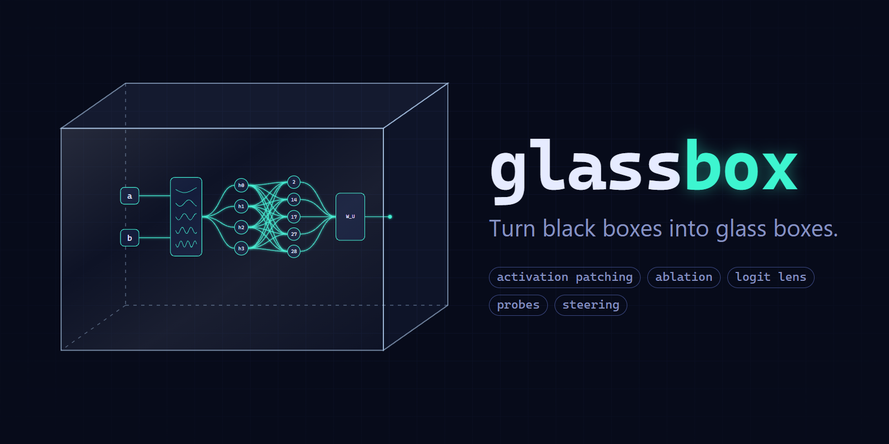</p>

# glassbox

**Turn black boxes into glass boxes.**

Glassbox is an autonomous interpretability lab. Give it an open-weights model and a behavior ("how does it do modular
addition?", "how does it know which name comes next?"). It runs mechanistic interpretability experiments, recovers the
algorithm the network learned, writes it out as pseudocode, and checks that algorithm against the real model on inputs it
has never seen.

## Why this matters

- We deploy neural networks whose internal algorithms nobody has read.
- Reading them by hand takes an expert weeks per behavior. Most of that work is a loop: guess, test, revise.
- Glassbox runs that loop with an AI scientist, and keeps it honest: every claim must cite an experiment that ran.

## How it works

<p align="center"></p>

Claude Code is the scientist. Glassbox is the lab, exposed as an MCP server with ten tools: `list_models`,
`load_model`, `backend_capabilities`, `preregister`, `run_experiment`, `get_plot`, `notebook_append`, `notebook_read`,
`verify_hypothesis`, `write_report`.

Three things keep the scientist honest (details below): every experiment needs a prediction written down first,
every finding is compared with what random choices and random models give, and the whole loop is tested on models
whose circuit was planted and whose answer key the scientist cannot see.

The primitives behind `run_experiment`: attribution patching (cheap first screen), activation patching (residual
stream, heads, MLPs), path patching, mean / zero / resample ablation, logit lens, direct logit attribution, linear
probes, attention patterns, difference-of-means directions, steering, and Fourier analysis of weights and activations.
Each returns structured JSON plus a plot, stamped with the backend and precision that produced it.

[](media/tutorial.mp4)

The full tutorial video is [`media/tutorial.mp4`](media/tutorial.mp4).

## Runs for $0

<p align="center"></p>

- **The scientist** is Claude Code on the subscription you already have. No Anthropic API key is needed or used.
- **Small models and GGUF files** run on your own GPUs.
- **Large models at full precision** run on [NDIF](https://ndif.us), the National Deep Inference Fabric, which is free
  for research.

Hardware everything here was run on: RTX 4070 Super 12 GB + RTX 3060 12 GB, Ryzen 7 7800X3D, 31 GB RAM, Windows 11.

NDIF setup (you do this yourself, glassbox never sees your key outside the process environment):

1. Create an account at <https://login.ndif.us> and copy your API key.
2. Start the MCP server with `NDIF_API_KEY` set in its environment (see the config below). Glassbox reads the key from
   that variable only. It does not write it to disk, logs or reports.
3. `list_models` then shows which models NDIF hosts right now and whether your key is recognised.

## Four backends

<p align="center"></p>

| Backend | What it is | Results count as |
|---|---|---|
| `local-full` | TransformerLens on your GPU, small models at full precision | verified |
| `local-gguf` | llama.cpp on any quantized GGUF file, zero download | screening (gguf quantized) |
| `local-4bit` | official checkpoint, nnsight + bitsandbytes 4-bit, split across GPUs (a 27B fits on 2 x 12 GB with an explicit layout) | screening (4-bit) |
| `ndif` | nnsight remote execution on NDIF, large models at full precision | verified |

If a primitive is not supported on a backend, the error names a backend that does support it.

## Bring your own GGUF

`local-gguf` works on the quantized files you already use with llama.cpp. It registers llama.cpp's eval callback (the
mechanism behind its `eval-callback` example) and copies named tensors out of the forward pass.

What works:

- reading the residual stream, attention-block output and MLP output at every layer and token
- logit lens, linear probes, difference-of-means directions, activation statistics
- steering through llama.cpp control vectors (adding a direction to the residual stream at chosen layers)
- before / after comparisons of logits and generated text

What does not work in v1: activation patching, path patching and ablation. llama.cpp can add to the residual stream but
glassbox cannot overwrite activations in it yet. Use `local-4bit` or `ndif` for those.

Point `GLASSBOX_LLAMA_DIR` at your llama.cpp build folder and `GLASSBOX_GGUF_DIR` at your models folder. The bindings
are written for the llama.cpp API as of build 12032 (November 2026); see `glassbox/backends/llama_cpp.py` if your build
is much older.

## Quickstart

```bash
python -m venv .venv && . .venv/bin/activate        # Python 3.11
pip install torch --index-url https://download.pytorch.org/whl/cu130   # pick the CUDA build for your driver
pip install -e ".[dev,gguf]"      # Qwen3.5/3.8 models need transformers >= 5.20
pytest                                              # 77 tests, no GPU needed
```

Add the server to Claude Code (generic config, plain environment variable):

```json
{
  "mcpServers": {
    "glassbox": {
      "command": "python",
      "args": ["-m", "glassbox.mcp"],
      "env": { "NDIF_API_KEY": "<your key, or leave this out if you do not use NDIF>" }
    }
  }
}
```

or `claude mcp add glassbox -- python -m glassbox.mcp`. Then, in Claude Code, from this repo:

```
/investigate local-full gpt2 "Given 'When Mary and John went to the store, John gave a drink to', the model says ' Mary'. How?" budget=40
```

The same tools are available without MCP: `glassbox tool run_experiment '{"primitive": "baseline", ...}'`.
Headless runs use `claude -p` on your subscription (see `benchmarks/run_blind.py`). There is no API mode in v1.

Investigations live in a folder with an append-only `notebook.jsonl`. If you hit a usage limit, start a new session
and run `/investigate` with the same investigation name: it reads the notebook and continues.

## Benchmarks

<p align="center">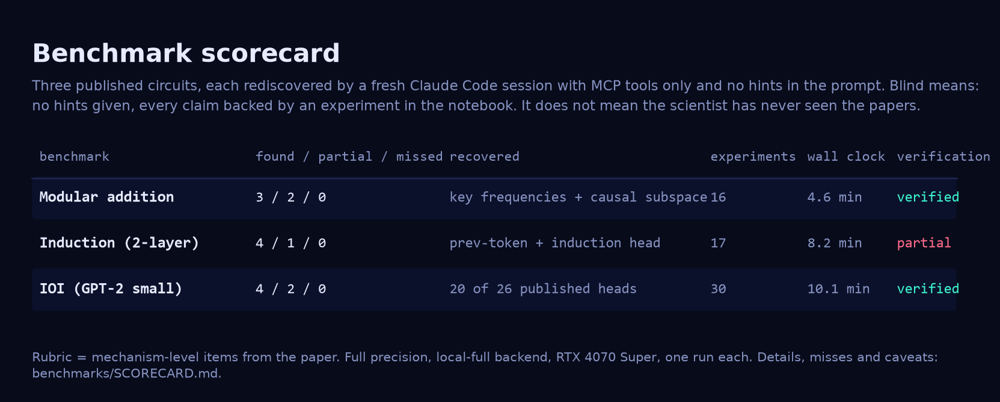</p>

Three published circuits, each investigated by a fresh headless Claude Code session that got the `/investigate` prompt,
one paragraph describing the behavior, and the MCP tools. No file access, no web, no hints.

**What "blind" means here.** Claude has very likely read these papers during training. Blind means no hints were
given and every claim in the report comes from an experiment in that session's notebook, never from recall. It does
not mean discovery from zero knowledge.

| Benchmark | Published mechanism (found / partial / missed) | Experiments | Wall clock | Final verification |
|---|---|---|---|---|
| Modular addition, 1-layer transformer trained here | 3 / 2 / 0 of 5 | 16 | 4.6 min | verified |
| Induction, 2-layer attention-only model | 4 / 1 / 0 of 5 | 17 | 8.2 min | partial |
| IOI, GPT-2 small | 4 / 2 / 0 of 6; 20 of 26 published heads | 30 | 10.1 min | verified |

- **Modular addition.** Found the sparse Fourier embedding (frequencies 28, 17, 2, 14, 27), frequency-tuned MLP neurons
  and the matching readout. Missed: it did not show the product (trig identity) step directly.
- **Induction.** Found previous-token head 0.3 feeding induction head 1.6 through K-composition. Partial because the
  model itself is only about 60% accurate on the task, so the written-out algorithm cannot agree with it 90% of the time.
- **IOI.** Found all name movers, negative name movers, S-inhibition and induction heads. Missed 6 of 26 published
  heads (0.10, 2.2, and four backup name movers). Its first circuit failed verification and was revised. The verified
  circuit keeps 99% of the logit difference alone, but its top-1 accuracy drops to 0.38.

Full scorecard, per-head table and caveats: [`benchmarks/SCORECARD.md`](benchmarks/SCORECARD.md). Every run's notebook,
experiment records, plots and report are in `benchmarks/<name>/`.

<p align="center">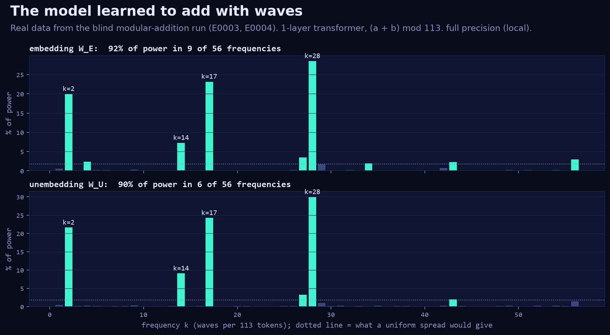</p>
<p align="center">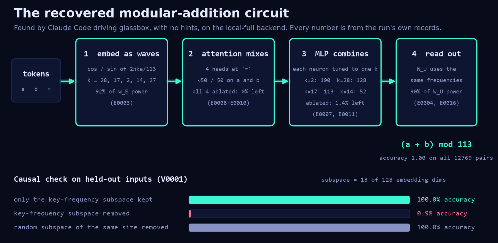</p>
<p align="center">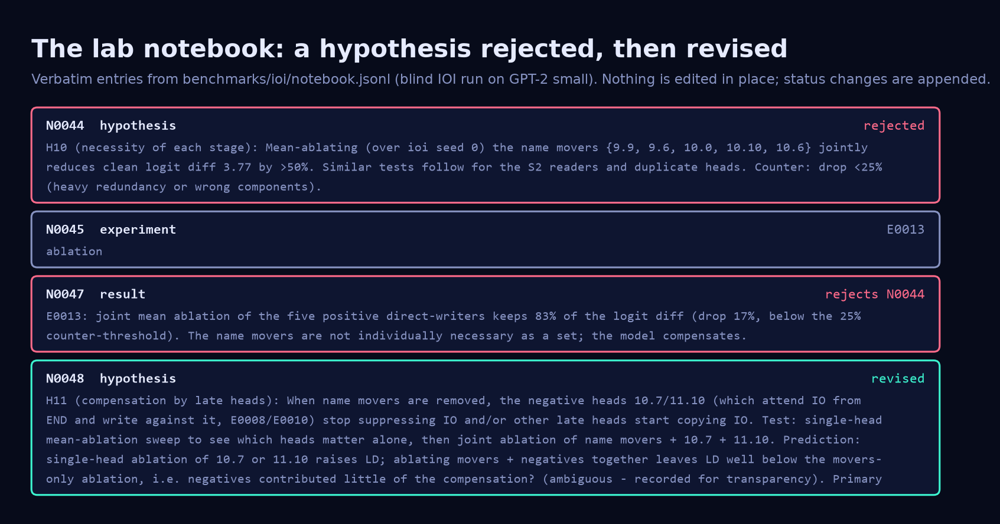</p>

## Pre-registration and null controls

Interpretability agents can look right for the wrong reasons: they can recall a published circuit instead of
finding it, and a plausible story can score well on a model that has no circuit at all (see *Pitfalls in Evaluating
Interpretability Agents* under Related work). Two mechanisms address that here.

<p align="center">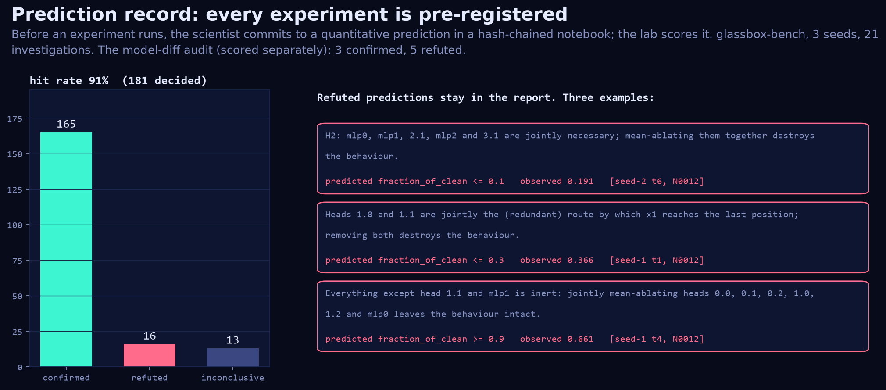</p>

**Pre-registration.** Before an experiment runs, the scientist writes a `prereg` entry: the hypothesis, the exact
experiment, a quantitative prediction (metric, direction, threshold) and what the alternatives would predict.
`run_experiment` refuses to run without a `prereg_id`, and the lab scores the prediction itself: confirmed, refuted or
inconclusive. Runs marked `exploratory` are allowed, are listed separately, and can never be the only support for a
claim. Every notebook entry carries the sha256 of the previous one, so a prediction cannot be edited after the result
is known without breaking the chain:

```bash
glassbox notebook verify benchmarks/glassbox-bench/seed-1/runs/t2/notebook.jsonl     # recomputes the chain
```

Reports now include a prediction record: how many predictions were made, the hit rate, and every refuted prediction.
In the 21 glassbox-bench investigations below, 165 predictions were confirmed, 16 refuted and 13 inconclusive (hit
rate 91% of those decided). In the model-diff audit further down, 3 were confirmed and 5 refuted, and the refuted
ones changed the conclusion. The three original benchmarks were run before pre-registration existed and have no
prediction record.

<p align="center">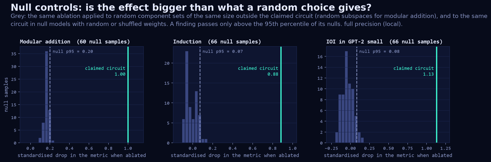</p>

**Null controls.** Three null versions of any investigation: the same architecture with random weights
(`random-init`), the trained weights shuffled inside each matrix (`weight-shuffled`), and the real model scored
against shuffled labels (`task-shuffled`). They are used in two ways.

1. *Null-calibrated verification.* A finding passes only if its effect is above the 95th percentile of a null
   distribution: random component sets of the same size taken from outside the claimed circuit, the same circuit in
   null models, and agreement against shuffled pairings. The result reports the effect, the null mean, the 95th
   percentile and the number of null samples.

   | Benchmark | Circuit ablated: effect vs null p95 | Circuit alone: effect vs null p95 | Agreement vs null p95 | Null samples |
   |---|---|---|---|---|
   | Modular addition | 1.00 vs 0.20 | 1.00 vs 0.08 | 1.00 vs 0.02 | 60 |
   | Induction | 0.88 vs 0.07 | 1.05 vs 0.17 | 0.50 vs 0.10 | 66 |
   | IOI, GPT-2 small | 1.13 vs 0.08 | 0.99 vs 0.01 | 0.94 vs 0.05 | 66 |

   Effects are in units of the model's own clean metric. All three beat their nulls. Induction still fails the fixed
   agreement threshold (0.5 < 0.9) for the reason given above, so its status stays partial. This is a re-check of the
   circuits the original runs claimed (`benchmarks/reverify_nulls.py`), not a new blind run.

2. *Null runs.* `glassbox null-run <investigation>` repeats a whole investigation on each null, with the scientist not
   told that anything is different. Any circuit reported there is a false discovery.

   | Benchmark | Null investigations | Claimed a circuit | False discovery rate |
   |---|---|---|---|
   | Modular addition | 3 | 0 | 0 of 3 |
   | Induction | 3 | 0 | 0 of 3 |
   | IOI, GPT-2 small | 3 | 0 | 0 of 3 |
   | glassbox-bench, seed 1 (7 tasks) | 21 | 1 | 1 of 21 |
   | **All** | **30** | **1** | **1 of 30 (3%)** |

   By null type: random-init 0 of 10, weight-shuffled 0 of 10, task-shuffled 1 of 10.

   - 29 runs stopped at or near the baseline check and reported that the behavior was absent. That is an easy null:
     the behavior is simply not there, and the protocol says to stop. It shows the scientist does not invent a circuit
     when the baseline fails; it does not test subtler cases, such as a model that does the task by a different
     mechanism.
   - The one counted discovery (`seed-1/runs/t2__null-task-shuffled`) is a leak in the null, not an invented circuit.
     In a task-shuffled null the weights are real and only the labels are shuffled. The scientist noticed that the
     labels did not match the model (its report says so in the first lines), switched to explaining the model's own
     outputs, and recovered the planted sort circuit, which is really there. The automatic rule counts any verified
     report on a null as a false discovery, so it is counted. The lesson: task-shuffled is a null for "does the model
     follow these labels", not for "does the model compute something", and agreement should also be checked against
     the dataset labels.
   - Thirty runs cannot put a tight bound on the rate: 1 of 30 is compatible with a true rate of up to about 15% at
     95% confidence.

## glassbox-bench

<p align="center">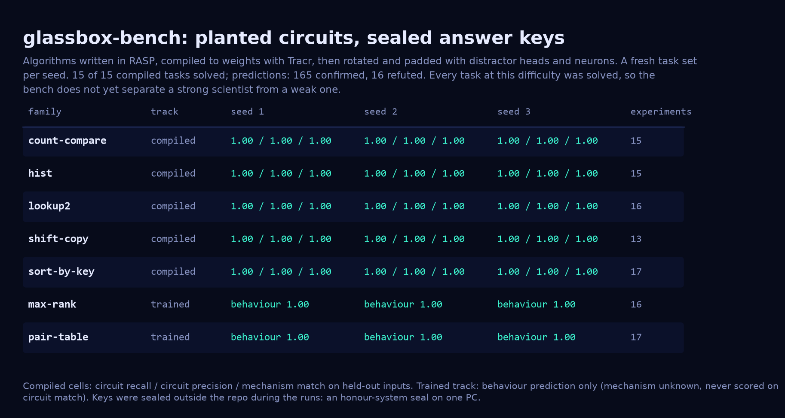</p>

Published circuits are a weak test: the scientist may have read the paper. glassbox-bench makes models whose
mechanism is known exactly and has never been published, because it is drawn from a seed.

- **Compiled track.** A small algorithm is written in RASP and compiled to transformer weights with Tracr, so the
  circuit is known by construction. Five families: token histogram, sort by a hidden key, compare two counts, copy
  from a shifted position, two-step table lookup. Symbols, tables and offsets are drawn from the seed.
- **Obfuscation.** Compiled weights are sparse and axis-aligned, which would give the answer away. So distractor
  heads and MLP neurons are added (they read the real stream and write only where nothing reads), heads and neurons
  are permuted, and the residual stream is rotated by a random orthogonal matrix folded into every weight. Outputs are
  checked to be unchanged after each step.
- **Trained track.** Two small transformers per seed trained on invented functions. Label: **behaviorally specified,
  mechanism unknown.** They are scored on behavior prediction only, never on circuit match.
- **Sealed keys.** `glassbox bench generate --seed N` writes the models into the working tree (git-ignored like all
  weights; the same seed regenerates them) and the answer keys into a folder outside the repo
  (`~/.glassbox-sealed/N/`). The MCP server has no tool that reads that folder, the headless
  scientist has no file access, and grading is a separate command, `glassbox bench grade N`. **This is an
  honor-system seal on one PC, not a cryptographic one**: nothing but process boundaries and the missing file tools
  stops a different setup from reading the keys.
- **Scoring.** Circuit recall and precision against the planted components, mechanism match (the scientist's
  `predict` function against the true algorithm on fresh inputs), behavior prediction, experiments used, wall-clock
  time, prediction hit rate, and whether the final finding beats its null controls.

```bash
glassbox bench generate --seed 4      # needs a second environment with Tracr, see Limitations
glassbox bench run --seed 4           # one fresh headless session per task
glassbox bench grade 4 --reveal       # scores against the sealed keys; --reveal copies the keys into the repo
```

Results on three seeds, seven tasks each, every task investigated blind by a fresh session:

| Seed | Compiled tasks solved | Circuit recall / precision | Mechanism match | Trained: behavior prediction | Predictions confirmed / refuted | Beat nulls | Mean experiments | Total time |
|---|---|---|---|---|---|---|---|---|
| 1 | 5 of 5 | 1.00 / 1.00 | 1.00 | 1.00 (2 tasks) | 58 / 5 (92%) | 7 of 7 | 16.1 | 32 min |
| 2 | 5 of 5 | 1.00 / 1.00 | 1.00 | 1.00 (2 tasks) | 52 / 5 (91%) | 7 of 7 | 14.6 | 32 min |
| 3 | 5 of 5 | 1.00 / 1.00 | 1.00 | 1.00 (2 tasks) | 55 / 6 (90%) | 7 of 7 | 15.7 | 33 min |

Said plainly:

- **The bench is saturated.** Every compiled task was solved with a perfect score on every seed. At this difficulty
  (1 to 4 layers, up to 73 residual dimensions, 2 to 5 planted components among 3 to 16) it shows the loop works end to end; it
  cannot rank scientists. Harder families are the obvious next step.
- **The optional noisy fine-tune was not done.** Obfuscation is rotation, permutation and distractors only. The
  rotated weights are still exactly low-rank, which a fine-tune would blur.
- **One trained task stays "not verified" on all three seeds** (`max-rank`). The scientist's function predicts the
  model on 100% of fresh inputs, but no component could be left out, so there is no circuit smaller than the whole
  model to verify, and the reports say so.
- Tracr models use attention in both directions and no layer norm. They are not small copies of language models.
- The scientist was not told the family of a task. It could in principle recognise the kind of algorithm; the specific
  tables, keys and offsets come from the seed and are in no paper.

Scorecards per seed: `benchmarks/glassbox-bench/seed-N/SCORECARD.md`, with every notebook and report next to them.
The keys of these three graded seeds are published in `benchmarks/glassbox-bench/revealed/`; use a new seed for a
fresh test.

## The 27B demo: zero download, two consumer GPUs

<p align="center">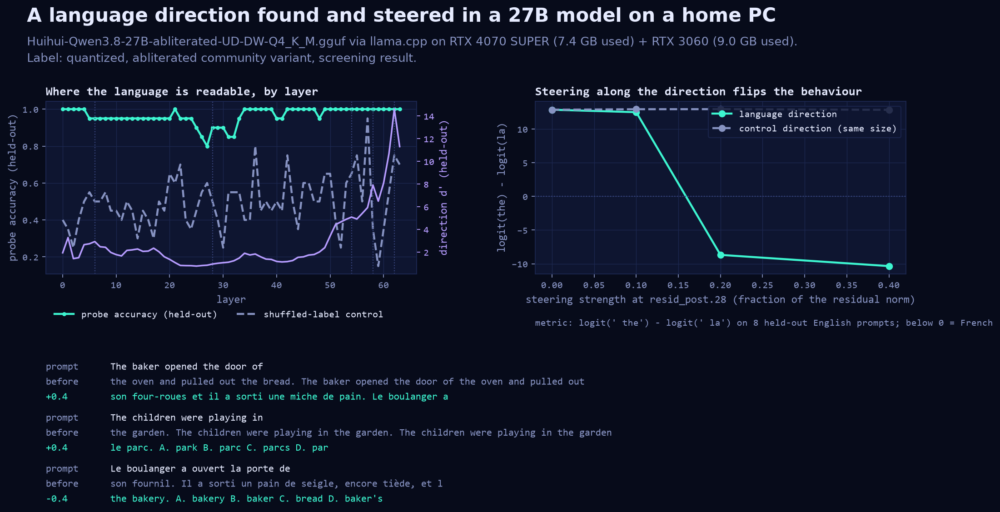</p>

**Label: quantized, abliterated community variant, screening result.**

The model is a Q4_K_M GGUF of an abliterated Qwen3.8-27B that was already on disk, loaded through llama.cpp across
both GPUs (7.4 GB + 9.0 GB VRAM, measured). The question: where does the model represent the language of its
continuation, and is there a direction for it? In 16 experiments and 14 minutes the scientist found:

- The prompt language is linearly readable at every layer, so probing alone does not localise it.
- The mean French-minus-English activation at the last token is a causal direction. Added at layer 28 at 0.2 to 0.4 of
  the residual norm, it flips the next-token preference (logit difference +12.9 to -10.3) and the generated text:
  "The fishermen came back from" continues "la mer avec une pêche miraculeuse." Subtracted from French prompts it gives
  English.
- It works at every layer tested from 6 to 58. At layer 62 it only pushes single output tokens ("la la la").
- A control direction of the same size, built from a language-balanced split of the same prompts, changes nothing.

Not verified: GGUF cannot be patched, the weights are quantized, and the abliterated variant is not the official model.
`verify_hypothesis` also failed here because it needs prompts of equal token length; the run used held-out prompt sets
instead and says so. Full record: [`demos/qwen27b-language/`](demos/qwen27b-language/report/report.md).

## Scale ladder

<p align="center">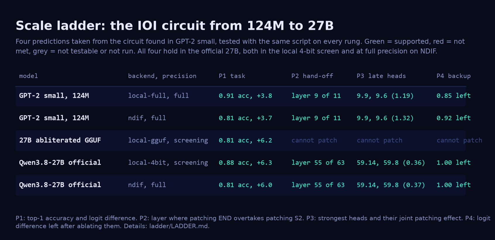</p>

Does the algorithm found in a small model show up in a big one? The IOI circuit from the GPT-2 benchmark was turned
into four fixed predictions, and one script (`ladder/run_ladder.py`) tests them unchanged on every rung:
P1 the model does the task; P2 which name is repeated is carried at the second subject token (S2) early and has moved
to the final token (END) late; P3 a few late attention heads write the answer; P4 those heads are backed up.

| Rung | Backend, precision | P1 task | P2 hand-off | P3 late heads | P4 backup |
|---|---|---|---|---|---|
| GPT-2 small (124M) | local-full, full precision | 0.91 accuracy | layer 9 of 11 | 9.9, 9.6 | 0.85 left |
| GPT-2 small (124M) | ndif, full precision | 0.81 accuracy | layer 9 of 11 | 9.9, 9.6 | 0.92 left |
| Qwen3.8-27B abliterated GGUF | local-gguf, screening | 0.81 accuracy | cannot patch | cannot patch | cannot patch |
| Qwen3.8-27B official | local-4bit, screening | 0.88 accuracy | layer 55 of 63 | 59.14, 59.8, 59.9 | 1.00 left |
| Qwen3.8-27B official | ndif, full precision | 0.81 accuracy | layer 55 of 63 | 59.14, 59.8, 59.9 | 1.00 left |

**Result.** All four predictions hold at every rung that can test them. In GPT-2 small they hold locally and on NDIF.
In the official Qwen3.8-27B they hold in the 4-bit screen on two 12 GB GPUs, and NDIF confirms them at full precision
with nearly identical numbers: the hand-off from S2 to END happens between layers 47 and 55 of 63 (sampled every 8
layers; a similar relative depth to layer 9 of 11), the attention of layer 59 carries the answer, the same three heads
come out on top in both runs (together restoring 0.36 and 0.37 of the logit difference), and ablating them costs almost
nothing because the rest of the network compensates. So the same three-stage structure appears at about 220 times
the size.

Said plainly:

- These are four coarse predictions, not the full 26-head circuit, and this is a scripted protocol with fixed
  hypotheses, not a blind investigation. 16 prompts per rung, one template.
- Backup is much stronger in the 27B than in GPT-2: no single head, and no trio, is necessary.
- An earlier NDIF run with only 6 prompts is kept in `ladder/qwen27b-ndif-first-run`. Its behavior check missed the
  accuracy threshold (0.50), and it named a slightly different top-head trio. The small sample was forced by a memory
  bug in glassbox (analysis passes kept gradients and state caches), which was then fixed; the rerun uses the same 16
  prompts as the other rungs.
- NDIF did host Qwen3.8-27B, so no substitute model was needed.
- The model card says Qwen3.8-27B is dense (not MoE) and vision-language. Glassbox loads the text stack only. It is a
  hybrid: 48 linear-attention layers and 16 full-attention layers.
- The local-4bit rung needed the official safetensors (52 GB download, approved by the owner, deleted afterwards) and
  an explicit device layout: 32 layers plus the embedding on one card, 32 layers plus the unembedding on the other,
  batches of 32 rows.
- The abliterated GGUF is not a stand-in for the official model; it is listed only to show that the behavior is
  present there too.

Details and per-rung notebooks: [`ladder/LADDER.md`](ladder/LADDER.md).

## Auditing a model edit

<p align="center">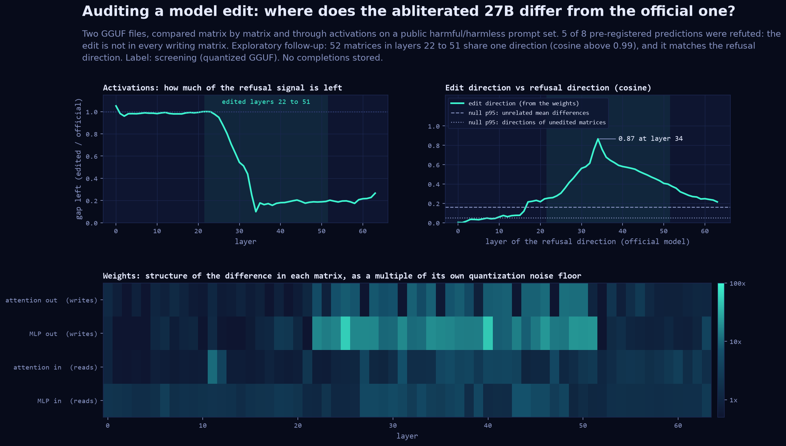</p>

**Label: screening (quantized GGUF).** This is a measurement. Nothing here removes or changes a model's behavior: no
weights are written, no completions to harmful prompts are generated or stored, and no direction vector is published.

The question: given a community "abliterated" Qwen3.8-27B and the official one, both as roughly 4.8-bit GGUF files,
can glassbox find where they differ **without being told where the edit is**? Two independent views:

- **Weights.** 260 matching matrices are dequantized and compared one at a time: how big is the difference, how much
  of it sits in one component, and which direction of the residual stream is that. Two quantizations of the *same*
  weights give the noise floor.
- **Activations.** Both models read 64 harmful and 64 harmless instructions from the public contrast set of Arditi et
  al. 2024 ([andyrdt/refusal_direction](https://github.com/andyrdt/refusal_direction): AdvBench, MaliciousInstruct,
  TDC2023 and HarmBench against Alpaca). Per layer: the harmful-minus-harmless mean direction, and a refusal score
  from the probability that the first answer token starts a refusal. The prompts stay in a local cache.

Eight predictions were written into the hash-chained notebook before the official model was measured. They assumed
the textbook edit: one refusal direction projected out of every matrix that writes to the residual stream.

| Pre-registered prediction | Threshold | Observed | Verdict |
|---|---|---|---|
| The official model refuses the harmful instructions | rate >= 0.8 | 1.00 | confirmed |
| The abliterated model does not | rate <= 0.2 | 0.02 | confirmed |
| At least 80% of writing matrices are structured above the null | >= 0.8 | 0.60 | **refuted** |
| Reading matrices are not edited | <= 0.1 above noise | 0.00 | confirmed |
| The difference is near rank 1 (first / second singular value) | >= 3.0 | 2.7 | **refuted** |
| All edited matrices share one direction (median pairwise cosine) | >= 0.8 | 0.03 | **refuted** |
| That direction is the refusal direction (cosine) | >= 0.5 | 0.08 | **refuted** |
| The refusal signal is gone at every depth (median ratio) | <= 0.25 | 0.71 | **refuted** |

**Five of eight refuted.** The edit is real (refusal drops from 100% to 2%) but it is not the textbook picture, and
the pooled analysis was fooled: quantization noise in writing matrices has a preferred direction of its own, and that
artefact dominated the "shared direction".

An **exploratory follow-up**, designed after seeing those results and labelled as such in the audit record, compared
each matrix with the noise floor of its own kind and asked what the structured ones have in common:

- **Where.** 52 matrices carry the edit: the MLP output of layers 22 to 51 (30 of 30) and the linear-attention output
  of the same layers (22 of 22). They stand 5 to 54 times above their own noise floor (median 11 times) and share one direction
  (cosine above 0.99 with it for every one of them).
- **Where not.** Layers 0 to 21 and 52 to 63, the output matrices of the eight full-attention layers inside the range,
  and every reading matrix (largest cosine with the edit direction: 0.04).
- **What.** The cosine between that weight-derived direction and the official model's refusal direction peaks at
  **0.87 at layer 34**. Nulls, with the best layer picked the same way: directions of unedited matrices 0.05, random
  directions 0.04 (95th percentiles), unrelated mean-difference directions at layer 34 0.16, the quantization
  artefact 0.51.
- **Activations agree.** Along the official direction the abliterated model keeps 99% of the harmful-versus-harmless
  gap up to layer 21, drops below a quarter at layer 33, bottoms out at 10% at layer 34 and stays near 19% after
  that. The signal is reduced, not erased: along its own best direction the abliterated model still separates the
  two classes at the last layer (d' 4.2 against 10.6).

**Confidence.** Location: high (52 matrices agreeing on one direction, plus an independent activation measurement
that changes at the same depth). Identity as the refusal direction: moderate (the layer was chosen after the fact,
64 prompts per class, one token position, and a quarter of the direction's variance is unexplained). Not explained:
30 reading matrices, mostly inside the edited range, show a faint structure of their own (0.2% to 1.2% of the
difference) along unrelated directions. Everything is a screening result: both files are quantized, by different
people, and quantization noise is larger than the edit in every matrix. The audit was not repeated on unquantized
weights.

Full record, including every refuted prediction: [`audits/abliteration/AUDIT.md`](audits/abliteration/AUDIT.md).
Reproduce with `audits/abliteration/run_audit.py` (`prereg`, `activations`, `weights`, `report`, `explore`); the
weight pass takes about 80 minutes on a desktop CPU.

## Open cases (unverified)

Behaviors with no published circuit that we know of for this model. Nothing here is checked against outside ground
truth.

- **Subject-verb agreement across a distractor in GPT-2 small** ("The keys to the cabinet" -> " are").
  Status: **partial, not verified.** 29 experiments, 10.6 minutes, full precision. The run reports that the number is
  read at the subject, partly copied onto the preposition, and moved to the last token by eight heads in two groups
  (5.2, 6.0, 7.4, 8.5 attend to the preposition; 10.5, 10.9, 11.10 to the subject; 4.3 feeds the first group). Ablating
  the eight leaves 6% of the effect; eight control heads leave 100%. The causal checks pass only when all 12 MLPs are
  kept, and the agreement check fails because the verb is the model's top-1 token on only 17% of prompts.
  [`open_cases/gpt2-agreement/`](open_cases/gpt2-agreement/report/report.md)
- **"a" versus "an" in GPT-2 small.** Status: **negative result.** The model does not do it: " an" wins on 0 of 36
  prompts. The run stopped at the baseline after 2 experiments, as the protocol says it should.
  [`open_cases/gpt2-a-an/`](open_cases/gpt2-a-an/report/report.md)

## How verification works

<p align="center"></p>

`verify_hypothesis` runs three checks on inputs the investigation has not used:

1. **Agreement.** The hypothesis is an executable `predict(tokens, prompt)` function. Its output is compared with the
   real model's top prediction.
2. **Causal.** Ablate the claimed circuit and the behavior should break. Ablate everything else and it should
   survive.
3. **Null calibration.** Each of those effects must also be above the 95th percentile of its null distribution
   (random sets of the same size from outside the circuit, null models, shuffled pairings). See
   "Pre-registration and null controls". Null models exist on `local-full` only; other backends use the random-set
   and shuffled-pairing nulls.

**Screening versus verified.** Quantized backends (`local-gguf`, `local-4bit`) can reach `screening-pass` at most.
A finding is `verified` only when it passes at full precision: `local-full` for small models, `ndif` for big ones.
Thresholds are explicit in the result (agreement >= 0.9, circuit alone >= 0.7, circuit ablated <= 0.5) and can be
overridden; the report shows the numbers either way.

## Limitations

- **Quantization noise.** 4-bit and GGUF weights are not the weights. Those results are screening only.
- **The abliterated variant differs from the official model**: the audit above places an edit in the output matrices
  of layers 22 to 51. It is not a stand-in for Qwen/Qwen3.8-27B in benchmarks or in the scale ladder.
- **The audit is a screening result on quantized files** and its localisation comes from an exploratory analysis,
  after five of eight pre-registered predictions failed.
- **No patching on GGUF in v1.** Read and steer only.
- **NDIF availability.** Which models are hosted changes. Uploads are size-limited, so patching on NDIF copies
  activations between rows of one forward pass instead of uploading them. Gradients (attribution patching) and
  attention patterns are not offered on NDIF in v1.
- **Partial explanations.** Passing verification means the description predicts and controls the behavior on the
  tested distribution. It does not mean it is complete. See the IOI accuracy caveat above.
- **The scientist may know the answer.** The benchmarks cannot rule out that training knowledge guided which
  experiments were chosen.
- **Plan usage limits.** A long investigation can exhaust a Claude Code session. Notebooks resume, but only one
  session should write to an investigation at a time (two concurrent sessions corrupted an early demo run here).
- **Tool gaps found by the blind runs:** direct logit attribution reports heads only, `verify_hypothesis` needs
  equal-length prompts, attention patterns exist only on `local-full`.
- **glassbox-bench is at its ceiling** and its seal is an honor system; see that section.
- **Tracr needs its own environment.** It depends on JAX versions that conflict with the main stack, so
  `bench generate` calls it in a second virtual environment (`pip install git+https://github.com/google-deepmind/tracr.git`,
  then set `GLASSBOX_TRACR_PYTHON`). Running and grading existing seeds does not need it. Bench models are stored
  and run in float64, because one compiled family (sort) was not exact after rotation in float32.
- **Null models exist on `local-full` only.** Random-init and weight-shuffled copies of a 27B model are not built.
- **Pre-registration is enforced by the lab, not by the model's goodwill**, but a scientist can still write vague
  predictions. The report lists every prediction so a reader can judge them.
- **Hybrid architectures.** Qwen3.8 alternates full attention with linear-attention layers; head-level sweeps must be
  run per layer type.
- The headless runs loaded the repo owner's personal Claude Code instructions (style and note-keeping preferences,
  nothing about interpretability). Sentences about those in the closing messages of the newer runs were replaced by
  a marker (`benchmarks/scrub_sessions.py`); notebooks, records and reports are untouched.

## Roadmap

- patching on GGUF (overwrite activations inside llama.cpp)
- harder glassbox-bench families (deeper programs, superposition, the noisy fine-tune) until the bench stops being
  saturated; a task-shuffled null that also checks agreement against the dataset labels
- the model-diff audit on unquantized weights, with the follow-up analysis pre-registered this time
- SAE features as a unit of analysis next to heads and neurons
- more model families and tokenizer-aware datasets
- a behavior atlas: many small verified circuits per model, searchable

## Repository layout

```
glassbox/backends   one interface, four backends, capability table
glassbox/lab        experiment primitives
glassbox/mcp        MCP server (main interface)
glassbox/notebook   append-only lab notebook
glassbox/verify     agreement, causal and null-calibrated checks
glassbox/nulls.py   null models and null-run summaries
glassbox/bench      glassbox-bench: task generator (RASP, Tracr, obfuscation) and grader
glassbox/audit      model diffing: weight-level comparison of two GGUF files
glassbox/report     report.md and report.html
benchmarks/         blind runs, ground truth, scorecard, null runs, glassbox-bench results
audits/             the abliterated-versus-official audit
demos/              the 27B demo
ladder/             scale ladder protocol and rungs
open_cases/         unverified investigations
tutorial/           Remotion project for the video
media/              images and video (generated by media/make_assets.py and tutorial/)
```

## Related work

- **Planted circuits.** RASP (Weiss, Goldberg, Yahav 2021) is a language for the computations a transformer can do;
  Tracr (Lindner et al. 2023) compiles RASP programs into transformer weights and was proposed as ground truth for
  interpretability methods. glassbox-bench uses both, and adds obfuscation and sealed keys so that an agent, not only
  a method, can be graded.
- **Why agent evaluations mislead.** *Pitfalls in Evaluating Interpretability Agents* (Haklay, Prakash, Pandey,
  Torralba et al. 2026) shows that agents can score well by recalling published circuits or by telling plausible
  stories. Pre-registration, null runs and unpublished planted circuits are this repo's answer to those pitfalls;
  the saturation and honor-system caveats above are where it still falls short.
- **Interpretability agents.** MAIA (Rott Shaham, Schwettmann et al. 2024) gives a vision-language model a toolbox of
  interpretability experiments. *Automated Interpretability and Feature Discovery in Language Models with Agents*
  (Marin-Llobet, Ferrando 2026) and *Can Language Model Agents be Helpful Circuit Explainers in Mechanistic
  Interpretability?* (Khan, Kohli, Yao, Sun et al. 2026) study agents for feature discovery and circuit explanation.
  Glassbox differs in emphasis, not in kind: a general coding agent over MCP, free hardware paths, and a protocol
  built around refutable predictions.
- **Explaining activations in words.** Anthropic's *Natural Language Autoencoders* (2026) train a model to describe
  activations directly. Glassbox does not learn explanations; it tests hand-stated ones causally.
- **Refusal directions.** Arditi et al. 2024 showed that refusal in chat models is mediated by one direction and can
  be removed by projecting it out of the weights. The audit above measures whether a given file carries that kind of
  edit; it does not perform one.

## Citations

- Weiss, Goldberg, Yahav. *Thinking Like Transformers.* 2021. arXiv:2106.06981
- Lindner, Kramár, Farquhar, Rahtz, McGrath, Mikulik. *Tracr: Compiled Transformers as a Laboratory for
  Interpretability.* 2023. arXiv:2301.05062
- Haklay, Prakash, Pandey, Torralba, et al. *Pitfalls in Evaluating Interpretability Agents.* 2026. arXiv:2603.20101
- Rott Shaham, Schwettmann, et al. *A Multimodal Automated Interpretability Agent.* 2024. arXiv:2404.14394
- Marin-Llobet, Ferrando. *Automated Interpretability and Feature Discovery in Language Models with Agents.* 2026.
  arXiv:2605.01555
- Khan, Kohli, Yao, Sun, et al. *Can Language Model Agents be Helpful Circuit Explainers in Mechanistic
  Interpretability?* 2026. arXiv:2606.24026
- Anthropic. *Natural Language Autoencoders Produce Unsupervised Explanations of LLM Activations.* Transformer
  Circuits Thread, 2026. transformer-circuits.pub/2026/nla
- Wang, Variengien, Conmy, Shlegeris, Steinhardt. *Interpretability in the Wild: a Circuit for Indirect Object
  Identification in GPT-2 small.* 2022. arXiv:2211.00593
- Nanda, Chan, Lieberum, Smith, Steinhardt. *Progress measures for grokking via mechanistic interpretability.* 2023.
  arXiv:2301.05217
- Elhage, Nanda, Olsson, et al. *A Mathematical Framework for Transformer Circuits.* 2021.
  transformer-circuits.pub/2021/framework
- Fiotto-Kaufman, Loftus, et al. *NNsight and NDIF: Democratizing Access to Open-Weight Foundation Model Internals.*
  2024. arXiv:2407.14561
- Nanda and Bloom. *TransformerLens.* 2022. github.com/TransformerLensOrg/TransformerLens
- Gerganov et al. *llama.cpp.* github.com/ggml-org/llama.cpp
- Goldowsky-Dill, MacLeod, Sato, Arora. *Localizing Model Behavior with Path Patching.* 2023. arXiv:2304.05969
- Syed, Rager, Conmy. *Attribution Patching Outperforms Automated Circuit Discovery.* 2023. arXiv:2310.10348
- Turner, Thiergart, et al. *Steering Language Models With Activation Engineering.* 2023. arXiv:2308.10248
- Arditi, Obeso, et al. *Refusal in Language Models Is Mediated by a Single Direction.* 2024. arXiv:2406.11717

## License

MIT. See [LICENSE](LICENSE).
