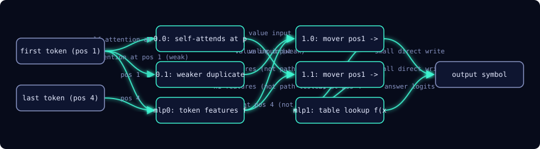
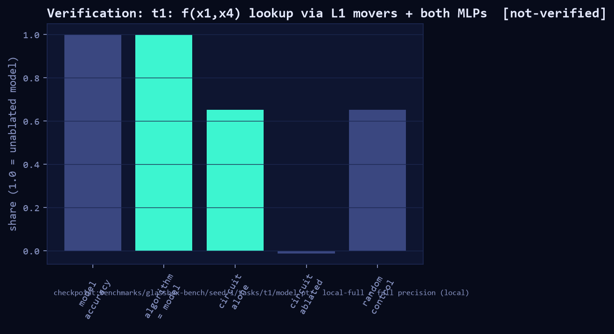
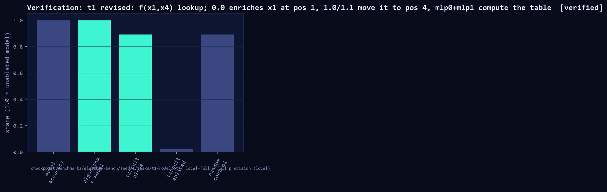
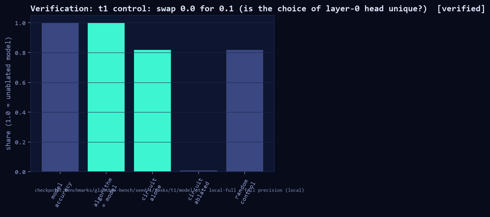
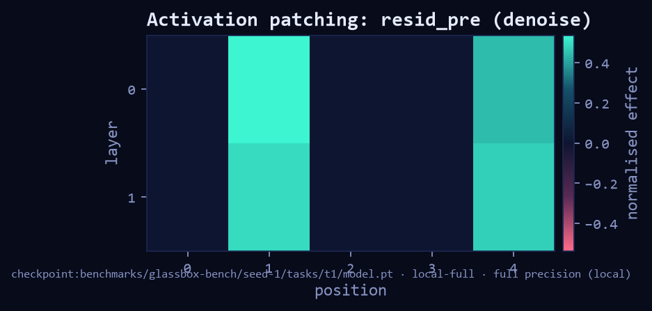
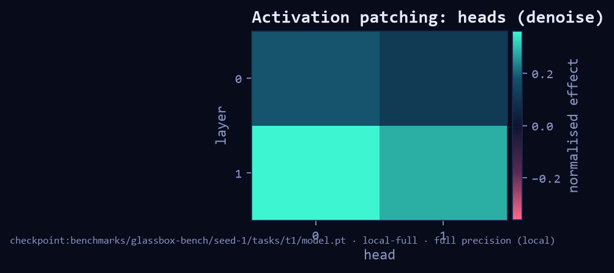
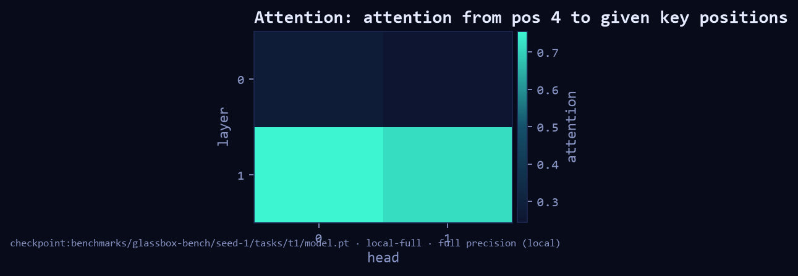
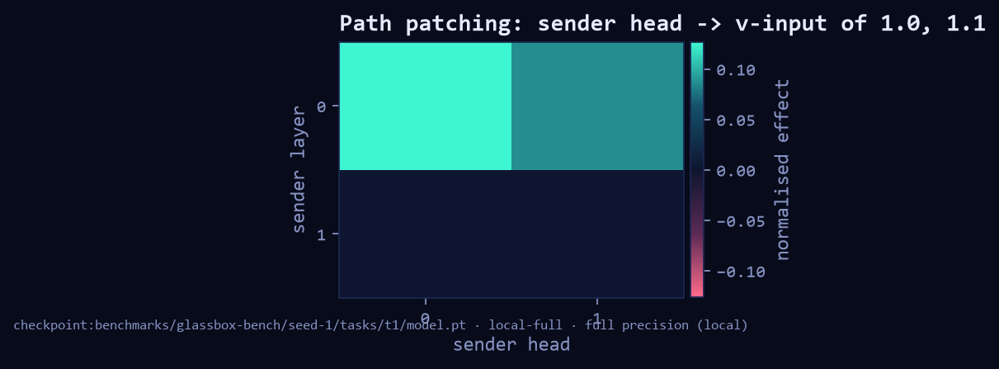

# t1: a two-token lookup table f(first, last) in a 2-layer, 2-head transformer

**Behavior:** Input BOS + 4 tokens from 6 symbols (ids 2..7 = lo, po, nu, pe, ko, fo); the model outputs one symbol at the last position. All numbers are from the local-full backend (full precision).  
**Model:** `checkpoint:benchmarks/glassbox-bench/seed-1/tasks/t1/model.pt` on `local-full`  
**Status:** partial / not verified · verified (function and a sufficient+necessary circuit); layer-0 head choice not unique  
**Experiments run:** 16 · **Backends used:** full precision (local)  
**Written:** 2026-11-13 12:46

## Summary

The model computes an unstructured 6x6 lookup table of the FIRST input token (pos 1) and the LAST input token (pos 4); the two middle tokens are ignored. The table reproduces the model's output on 600/600 held-out inputs across three unused seeds. Mechanism: layer-0 heads self-attend at pos 1 and enrich the x1 representation; layer-1 heads 1.0 and 1.1 both attend from pos 4 to pos 1 and move x1 to the last position; mlp0 and mlp1 hold the table and write most of the answer logits. Verified circuit: {0.0, 1.0, 1.1, mlp0, mlp1}. Head 0.1 is the weakest component and can be removed with no loss of accuracy, but it is not inert: it is a weaker duplicate of 0.0, and the pair is mutually redundant (either one suffices; removing both drops accuracy to 76%). No component of this model was found to be strictly without effect.

## The recovered algorithm

```python
def predict(tokens, prompt):
    # only pos 1 and pos 4 matter (E0005); table read off the model's outputs (E0001), 200/200 on V0001, V0002, V0003
    T = {2: [3, 6, 4, 3, 6, 3],
         3: [2, 7, 3, 3, 5, 4],
         4: [2, 6, 5, 7, 2, 5],
         5: [7, 7, 2, 7, 3, 6],
         6: [4, 3, 4, 6, 6, 6],
         7: [6, 3, 4, 4, 6, 5]}
    a = tokens[1]   # enriched at pos 1 by 0.0 (/0.1) (E0015, E0016), moved to pos 4 by 1.0 and 1.1 (E0012, E0009)
    d = tokens[4]   # already at the output position
    return T[a][d - 2]   # computed by mlp0 + mlp1 (E0010)

As strings (rows = first token, columns = last token lo po nu pe ko fo):
 lo: po ko nu po ko po
 po: lo fo po po pe nu
 nu: lo ko pe fo lo pe
 pe: fo fo lo fo po ko
 ko: nu po nu ko ko ko
 fo: ko po nu nu ko pe
```

## Circuit



## Claims and evidence

| # | Claim | Evidence | Produced by |
|---|---|---|---|
| 1 | The model performs the behaviour perfectly on its own labels: accuracy 1.0, mean logit difference 15.1. | E0002 | full precision (local) |
| 2 | The output is a function of the first and last input tokens only. Patching the residual stream at pos 2 or pos 3 changes the metric by less than 0.4%, while pos 1 and pos 4 carry 0.54 and 0.44 at layer 0. | E0005, E0001 | full precision (local) |
| 3 | The function is the 6x6 lookup table given in the pseudocode: it matches the model on 200/200 held-out inputs in each of three unused seeds (null agreement about 0.18). | V0001, V0002, V0003 | full precision (local) |
| 4 | x1 is still at pos 1 when layer 1 starts (resid_pre.1 @ pos 1 effect 0.50) and is moved to the last position by heads 1.0 and 1.1, which attend pos 4 -> pos 1 with weight 0.75 and 0.72; denoising them restores 36% and 28% of the metric. | E0005, E0012, E0009, E0006 | full precision (local) |
| 5 | The two movers are the main route but joint mean-ablation leaves 37% of the logit difference, more than the predicted 30% (prediction refuted); single ablations leave 62-69%. | E0007, E0014, E0003 | full precision (local) |
| 6 | The MLPs carry the table: denoising mlp0 output restores 79% and mlp1 74% of the metric; mean-ablating either leaves 22% / 30%. Heads write only about 2.9 of 15.1 logits directly and the direct-path effect of 1.0/1.1 is 0.11/0.07 of their 0.36/0.28 total, so the heads act mostly through mlp1. | E0010, E0004, E0011, E0013, E0009 | full precision (local) |
| 7 | Layer-0 heads are not inert (two predictions refuted): denoising 0.0 / 0.1 restores 19% / 11%, most of it (13% / 9%) through the value input of the mover heads; at pos 1 they self-attend with weight 0.64 / 0.61, i.e. they enrich the x1 representation that is later copied. | E0009, E0015, E0016 | full precision (local) |
| 8 | Core circuit {1.0, 1.1, mlp0, mlp1} is necessary (ablated: accuracy 0.225, fraction -0.01) but not sufficient alone: with both layer-0 heads mean-ablated the fraction is 0.65 (bar 0.70) and accuracy 0.76. This verification failed. | V0001, E0008 | full precision (local) |
| 9 | Circuit {0.0, 1.0, 1.1, mlp0, mlp1} passes all checks on held-out seed 102: circuit ablated -> accuracy 0.22, fraction 0.02; everything else (head 0.1) ablated -> accuracy 1.00, fraction 0.89; all effects beyond the null controls. | V0002 | full precision (local) |
| 10 | The layer-0 head is not uniquely identified: the control circuit with 0.1 instead of 0.0 also passes (only 0.0 ablated -> accuracy 1.00, fraction 0.82). The two layer-0 heads are a redundant pair with 0.0 the stronger (single mean-ablation 0.82 vs 0.88). | V0003, V0002, V0001, E0014 | full precision (local) |

## Verification

### V0001: t1: f(x1,x4) lookup via L1 movers + both MLPs  (full precision (local))

| check | value |
|---|---|
| status | not-verified |
| held-out inputs | 200 |
| model accuracy | 1.000 |
| algorithm agrees with model | 1.000 |
| algorithm accuracy vs ground truth | 1.000 |
| circuit size | 4 of 6 components |
| metric kept with ONLY the circuit | 0.652 |
| metric kept with the circuit ABLATED | -0.012 |
| random same-size ablation (control) | 0.652, 0.652, 0.652 |

At least one check failed; the explanation is partial or wrong. See the numbers.



### V0002: t1 revised: f(x1,x4) lookup; 0.0 enriches x1 at pos 1, 1.0/1.1 move it to pos 4, mlp0+mlp1 compute the table  (full precision (local))

| check | value |
|---|---|
| status | verified |
| held-out inputs | 200 |
| model accuracy | 1.000 |
| algorithm agrees with model | 1.000 |
| algorithm accuracy vs ground truth | 1.000 |
| circuit size | 5 of 6 components |
| metric kept with ONLY the circuit | 0.891 |
| metric kept with the circuit ABLATED | 0.020 |
| random same-size ablation (control) | 0.891, 0.891, 0.891 |

Passed at full precision, and every effect exceeds its null distribution.



### V0003: t1 control: swap 0.0 for 0.1 (is the choice of layer-0 head unique?)  (full precision (local))

| check | value |
|---|---|
| status | verified |
| held-out inputs | 200 |
| model accuracy | 1.000 |
| algorithm agrees with model | 1.000 |
| algorithm accuracy vs ground truth | 1.000 |
| circuit size | 5 of 6 components |
| metric kept with ONLY the circuit | 0.817 |
| metric kept with the circuit ABLATED | 0.008 |
| random same-size ablation (control) | 0.817, 0.817, 0.817 |

Passed at full precision, and every effect exceeds its null distribution.



## Key plots

**E0005: activation_patching** (full precision (local))



**E0009: activation_patching** (full precision (local))



**E0012: attention_patterns** (full precision (local))



**E0015: path_patching** (full precision (local))



## Limitations

- No component is strictly inert in my measurements. Head 0.1 is the best candidate for 'not part of the circuit' (removing it keeps accuracy 1.0 and 89% of the margin), but swapping the roles of 0.0 and 0.1 also verifies (V0003), so which layer-0 head belongs in the circuit is a matter of degree, not a clean cut.
- Three of ten scored predictions were refuted (E0007, E0009, E0015) and one was inconclusive because mlp_out patching is not per-position on this backend (E0010).
- MLP-mediated edges (mlp0 -> movers, mlp0 -> mlp1) are inferred from layer-level patching and ablation; path patching with MLP senders errored, so those edges are not directly tested.
- The split of work between mlp0 and mlp1 inside the table lookup is not resolved; I did not look for neurons or features.
- Residual 37% of margin after ablating both movers is unexplained: it may be what x4 alone supports, or x1 leaking through the diffuse layer-0 attention at pos 4.
- The table has no formula I could find; it is reported as a lookup. All 36 cells were observed in the seed-0 data.

## Open questions

- Is the table a composition of simpler maps (e.g. a function of features of x1 and x4) that mlp0 and mlp1 factor between them?
- Why does the model keep two movers and two enrichers: pure redundancy from training, or do they specialise by token?
- What exactly does mlp0 contribute at pos 1 versus pos 4?

## Prediction record

10 experiments were pre-registered, 10 were run: **6 confirmed, 3 refuted, 1 inconclusive**. Hit rate (confirmed / decided): **67%**.

Refuted predictions (shown, not hidden):

| prereg | experiment | hypothesis | predicted | observed |
|---|---|---|---|---|
| N0012 | E0007 | Heads 1.0 and 1.1 are jointly the (redundant) route by which x1 reaches the last position; removing both destroys the behaviour. | `summary.fraction_of_clean <= 0.3` | 0.366 |
| N0014 | E0009 | Layer-0 heads do not carry input-specific information that the output depends on: denoising head 0.0 alone recovers almost nothing, whereas layer-1 heads recove | `data.effect[0][0] between [-0.1, 0.1]` | 0.186 |
| N0028 | E0015 | Layer-0 heads influence the answer mainly through mlp0 (same layer), not by writing directly into the value input of the layer-1 mover heads: the direct path 0. | `data.effect[0][0] < 0.06` | 0.126 |

Exploratory runs (no pre-registration; they cannot be the only support for a claim): E0003, E0004, E0006, E0011, E0013.

## Experiments

| id | primitive | backend / precision | seconds | pre-registration |
|---|---|---|---|---|
| E0001 | dataset | full precision (local) | 0.21 | exploratory |
| E0002 | baseline | full precision (local) | 0.48 | N0004: confirmed |
| E0003 | ablation | full precision (local) | 0.29 | exploratory |
| E0004 | ablation | full precision (local) | 0.25 | exploratory |
| E0005 | activation_patching | full precision (local) | 0.29 | N0008: confirmed |
| E0006 | attention_patterns | full precision (local) | 0.25 | exploratory |
| E0007 | ablation | full precision (local) | 0.24 | N0012: refuted |
| E0008 | ablation | full precision (local) | 0.3 | N0013: confirmed |
| E0009 | activation_patching | full precision (local) | 0.24 | N0014: refuted |
| E0010 | activation_patching | full precision (local) | 0.24 | N0015: inconclusive |
| E0011 | direct_logit_attribution | full precision (local) | 0.25 | exploratory |
| E0012 | attention_patterns | full precision (local) | 0.26 | N0021: confirmed |
| E0013 | path_patching | full precision (local) | 0.3 | exploratory |
| E0014 | ablation | full precision (local) | 0.28 | N0027: confirmed |
| E0015 | path_patching | full precision (local) | 0.3 | N0028: refuted |
| E0016 | attention_patterns | full precision (local) | 0.23 | N0031: confirmed |
| V0001 | verify | full precision (local) |  | verification |
| V0002 | verify | full precision (local) |  | verification |
| V0003 | verify | full precision (local) |  | verification |

## Notebook trail

- `N0001` *decision*: Loaded checkpoint:benchmarks/glassbox-bench/seed-1/tasks/t1/model.pt on local-full (full precision (local)).
- `N0002` *experiment*: dataset (E0001)
- `N0003` *hypothesis* **[revised]**: H1 (function): From 150 inspected rows of E0001, the output is a deterministic function of only the first input token (pos 1) and the last input token (pos 4); the middle tokens (pos 2,3) are irrelevant. It is an unstructured 6x6 lookup table f(x1,x4) (ids): rows x1=2..7, cols x4=2..7: 2:[3,6,4,3,6,3] 3:[2,7,3,3,5,4] 4:[2,6,5,7,2,5] 5:[7,7,2,7,3,6] 6:[4,3,4,6,6,6] 7:[6,3,4,4,6,5]. H2 (mechanism, to test): some attention head at the last position moves x1 from pos 1 to pos 4, and MLP(s) at pos 4 compute the table.
- `N0004` *prereg*: The model does the benchmark behaviour confidently: its own top-1 output matches the dataset answers (which are its own outputs) with a clear logit margin.
- `N0005` *experiment*: The model does the benchmark behaviour confidently: its own top-1 output matches the dataset answers (which are its own  (E0002)
- `N0006` *experiment*: shape-finding screen: per-head mean ablation (E0003)
- `N0007` *experiment*: shape-finding screen: per-MLP mean ablation (E0004)
- `N0008` *prereg*: Only positions 1 and 4 carry information the output depends on; the middle tokens (pos 2,3) are causally irrelevant. Patching the residual stream at pos 2 at layer 0 has negligible effect.
- `N0009` *experiment*: Only positions 1 and 4 carry information the output depends on; the middle tokens (pos 2,3) are causally irrelevant. Pat (E0005)
- `N0010` *experiment*: shape-finding: where does each head look from the last position (E0006)
- `N0011` *result*: Baseline 100% / logit diff 15.1 (E0002). Residual patching (E0005, denoise): only pos 1 (0.54 @L0, 0.50 @L1) and pos 4 (0.44 @L0, 0.48 @L1) matter; pos 2,3 are |effect|<0.004 -> H1's 'only x1 and x4' holds causally. x1 information is still at pos 1 entering layer 1, so the move to pos 4 must happen in layer 1. Exploratory screens: both layer-1 heads attend pos4->pos1 (0.72, 0.79; E0006), layer-0 heads diffuse (max 0.30 on self). Single mean-ablations (E0003/E0004): mlp0 -> 22% of clean, mlp1 -> 30%, 1.0 -> 66%, 1.1 -> 69%, 0.0 -> 83%, 0.1 -> 88%. H2 refined: 1.0 and 1.1 are redundant movers of x1 to pos 4; mlp0 and mlp1 do the table; layer-0 heads are candidates for 'no part'. (E0002, E0005, E0003, E0004, E0006)
- `N0012` *prereg*: Heads 1.0 and 1.1 are jointly the (redundant) route by which x1 reaches the last position; removing both destroys the behaviour.
- `N0013` *prereg*: Layer-0 heads 0.0 and 0.1 play no essential part: jointly mean-ablating them leaves most of the behaviour.
- `N0014` *prereg*: Layer-0 heads do not carry input-specific information that the output depends on: denoising head 0.0 alone recovers almost nothing, whereas layer-1 heads recover a sizeable share.
- `N0015` *prereg*: MLP1 at the last position performs the final table lookup and writes the answer; its clean output at pos 4 restores a large share of the metric.
- `N0016` *experiment*: Heads 1.0 and 1.1 are jointly the (redundant) route by which x1 reaches the last position; removing both destroys the be (E0007)
- `N0017` *experiment*: Layer-0 heads 0.0 and 0.1 play no essential part: jointly mean-ablating them leaves most of the behaviour. (E0008)
- `N0018` *experiment*: Layer-0 heads do not carry input-specific information that the output depends on: denoising head 0.0 alone recovers almo (E0009)
- `N0019` *experiment*: MLP1 at the last position performs the final table lookup and writes the answer; its clean output at pos 4 restores a la (E0010)
- `N0020` *result*: REFUTED (E0007): joint mean-ablation of 1.0+1.1 leaves 36.6% of clean logit diff, not <=30%. The two heads are the main but not provably the only x1 route (or the residual 37% is what x4 alone supports). REFUTED (E0009): head 0.0 denoising restores 18.6% (0.1: 11.3%), so layer-0 heads are not inert; they carry some input-specific signal. Layer-1 heads restore 36% (1.0) and 28% (1.1). CONFIRMED (E0008): joint mean-ablation of 0.0+0.1 keeps 67.7%. INCONCLUSIVE (E0010): mlp_out patching is not per-position on this backend (metric path missing); whole-layer denoise: mlp0 0.79, mlp1 0.74. Revision: layer-0 heads are minor contributors, not 'no part' in the strict sense; whether they belong in the circuit is decided by the verification's sufficiency/necessity checks. (E0007, E0008, E0009, E0010)
- `N0021` *prereg*: On fresh inputs, both layer-1 heads attend from the last position (4) mainly to position 1 (the first input token), i.e. they are the x1 movers.
- `N0022` *experiment*: shape-finding: who writes the answer direction (E0011)
- `N0023` *experiment*: On fresh inputs, both layer-1 heads attend from the last position (4) mainly to position 1 (the first input token), i.e. (E0012)
- `N0024` *experiment*: shape-finding: direct-path effect of each head on logits (E0013)
- `N0025` *verification*: t1: f(x1,x4) lookup via L1 movers + both MLPs: not-verified. At least one check failed; the explanation is partial or wrong. See the numbers. (V0001)
- `N0026` *result*: V0001 (seed 101, held out): the lookup table f(x1,x4) agrees with the model on 200/200 -> H1 (function) supported. Circuit {1.0,1.1,mlp0,mlp1}: ablated -> accuracy 0.225, fraction -0.01 (necessity passes); alone (0.0+0.1 mean-ablated to corrupt) -> fraction 0.652, accuracy 0.76, below the 0.7 bar -> NOT verified. So the layer-0 heads are needed for ~24% of inputs; the 4-component circuit is incomplete. E0012 confirmed: 1.0 and 1.1 attend pos4->pos1 at 0.75 / 0.72 on seed 1. Exploratory: heads' direct logit contribution is only 2.9 of 15.1 logits (E0011), direct-path effect of 1.0/1.1 0.11/0.07 vs total 0.36/0.28 and ~0 for layer-0 heads (E0013) -> heads act mostly through the MLPs. (V0001, E0012, E0011, E0013)
- `N0027` *prereg*: Of the two layer-0 heads, 0.1 is the less important: mean-ablating it alone on fresh inputs keeps at least 80% of the logit difference (and 0.0 costs more).
- `N0028` *prereg*: Layer-0 heads influence the answer mainly through mlp0 (same layer), not by writing directly into the value input of the layer-1 mover heads: the direct path 0.0 -> {1.0,1.1}.v carries less than a third of 0.0's total 0.186 denoising effect.
- `N0029` *experiment*: Of the two layer-0 heads, 0.1 is the less important: mean-ablating it alone on fresh inputs keeps at least 80% of the lo (E0014)
- `N0030` *experiment*: Layer-0 heads influence the answer mainly through mlp0 (same layer), not by writing directly into the value input of the (E0015)
- `N0031` *prereg*: Layer-0 heads contribute by enriching the pos-1 representation of x1 that the movers later copy: at query position 1 head 0.0 attends mostly to position 1 itself (not BOS), so its output there is x1-specific.
- `N0032` *experiment*: Layer-0 heads contribute by enriching the pos-1 representation of x1 that the movers later copy: at query position 1 hea (E0016)
- `N0033` *verification*: t1 revised: f(x1,x4) lookup; 0.0 enriches x1 at pos 1, 1.0/1.1 move it to pos 4, mlp0+mlp1 compute the table: verified. Passed at full precision, and every effect exceeds its null distribution. (V0002)
- `N0034` *verification*: t1 control: swap 0.0 for 0.1 (is the choice of layer-0 head unique?): verified. Passed at full precision, and every effect exceeds its null distribution. (V0003)
- `N0035` *result*: E0014 (seed 2) confirmed: single mean-ablation fractions 1.0 0.62, 1.1 0.68, 0.0 0.82, 0.1 0.88. REFUTED (E0015): direct path 0.0 -> value input of 1.0/1.1 restores 12.6% (0.1: 8.7%), i.e. most of the layer-0 heads' total effect (18.6% / 11.3%, E0009) flows into what the movers copy, not only via mlp0. E0016 confirmed: at pos 1, heads 0.0/0.1 self-attend 0.64/0.61 -> they enrich the x1 representation at pos 1. V0002 (seed 102) VERIFIED with circuit {0.0,1.0,1.1,mlp0,mlp1}: agreement 200/200; circuit ablated -> acc 0.22, fraction 0.02; only 0.1 ablated -> acc 1.00, fraction 0.89. Control V0003 (seed 103) with 0.1 swapped for 0.0 also passes: only 0.0 ablated -> acc 1.00, fraction 0.82. Together with V0001 (both layer-0 heads ablated -> acc 0.76, fraction 0.65): the layer-0 heads are a partly redundant pair; one of them is enough for correct argmax, 0.0 carries more margin. No component is strictly inert. (E0014, E0015, E0016, V0002, V0003)
- `N0036` *hypothesis* **[revised]** -> N0003: H1 (function = 6x6 table of x1,x4) supported: 200/200 agreement on three held-out seeds (V0001-V0003), pos 2,3 causally inert (E0005). H2 revised: movers 1.0/1.1 + mlp0 + mlp1 are the core but not sufficient alone (V0001 failed sufficiency, 0.65 / acc 0.76; E0007 refuted 'sole route' at 0.37 vs 0.30). Layer-0 heads are not inert (E0009, E0015 refuted): they self-attend at pos 1 and enrich x1 before it is moved; they are mutually redundant (V0002, V0003).
