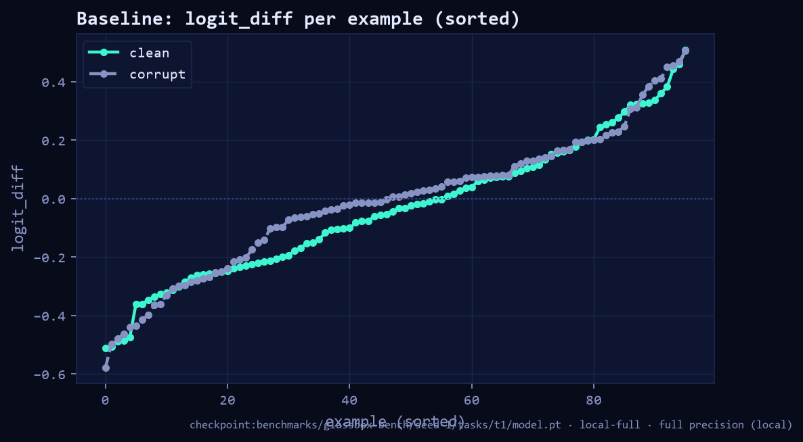
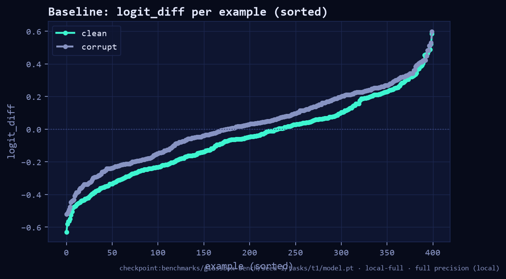
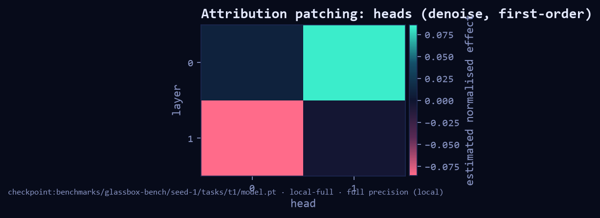

# t1 (seed-1): the loaded checkpoint does not perform the labelled behaviour - no circuit claimed

**Behavior:** BOS + 4 tokens from 6 symbols -> one symbol at the last position (bench task t1, glassbox-bench seed-1).  
**Model:** `checkpoint:benchmarks/glassbox-bench/seed-1/tasks/t1/model.pt` on `local-full`  
**Status:** unverified (no verification run) · null result: no behaviour, no mechanism  
**Experiments run:** 5 · **Backends used:** full precision (local)  
**Written:** 2026-11-13 13:17

## Summary

On local-full (full precision) the loaded checkpoint agrees with the dataset answers on 1.0% (n=96) and 3.3% (n=400) of inputs, below the 1/6 chance level, with a mean logit difference between the labelled answer and the foil of about -0.04 (std 0.23). Its predictions are mostly 'pe' and sometimes the non-symbol 'PAD'. The model therefore does not do the behaviour, and per protocol the investigation stops: no heads or MLPs are claimed as a circuit and no verification was run. Separately, the dataset labels themselves follow a simple rule (a lookup on the first and last input token, middle tokens ignored; 255 of 256 inspected rows), but that rule describes the labels, not the weights that were loaded.

## The recovered algorithm

```python
# No algorithm is attributed to the loaded model (E0003, E0005: accuracy 0.010 / 0.033).
# For reference only - the rule the dataset LABELS follow (hand-tabulated from E0001, E0002; NOT implemented by this checkpoint):
# T[first][last], token ids 2..7
# T = {2:[3,6,4,3,6,3], 3:[2,7,3,3,5,4], 4:[2,6,5,7,2,5], 5:[7,7,2,7,3,6], 6:[4,3,4,6,6,6], 7:[6,3,4,4,6,5]}
# label = T[tokens[1]][tokens[4]-2]   (one exception seen: [0,4,6,4,4] -> 6)
```

## Claims and evidence

| # | Claim | Evidence | Produced by |
|---|---|---|---|
| 1 | The loaded checkpoint does not reproduce the dataset answers: accuracy 0.010 on 96 inputs (pre-registered >=0.99, refuted) and 0.033 on 400 fresh inputs (pre-registered <=0.20, confirmed); chance is 0.167. Backend: local-full, full precision. | E0003, E0005 | full precision (local) |
| 2 | The model has no preference for the labelled answer over the foil: mean logit difference -0.037 (std 0.24) and -0.051 (std 0.23), indistinguishable from the corrupt-input values (-0.012, +0.022). | E0003, E0005 | full precision (local) |
| 3 | The model's outputs are not confined to the six symbols: example predictions are mostly 'pe' and include 'PAD'. | E0003, E0005 | full precision (local) |
| 4 | The dataset labels are consistent with a lookup table on (first token, last token) that ignores the two middle tokens (255/256 rows inspected by hand; one exception). This is a property of the labels only; the baselines show the loaded weights do not implement it. | E0001, E0002, E0003, E0005 | full precision (local) |

## Key plots

**E0003: baseline** (full precision (local))



**E0005: baseline** (full precision (local))



**E0004: attribution_patching** (full precision (local))



## Limitations

- No verify_hypothesis run: with no behaviour there is no hypothesis to verify; status is neither verified nor screening-pass.
- The label rule was tabulated by hand from two dataset samples (256 rows); it was not tested by the lab and is reported only as context.
- What the loaded model does compute (near-constant 'pe' with tiny margins) was not characterised beyond the baseline example predictions.
- The single attribution screen (E0004) is exploratory and its effects are on a ~0.05-logit gap, i.e. noise; nothing is concluded from it.
- 20 of 25 experiments were left unused on purpose.

## Open questions

- The task statement says the dataset answers are the model's own outputs; for the weights loaded here that is false. Is the checkpoint at this path (or in this investigation) a random-init null substitute, or is the dataset mislabelled?

## Prediction record

2 experiments were pre-registered, 2 were run: **1 confirmed, 1 refuted, 0 inconclusive**. Hit rate (confirmed / decided): **50%**.

Refuted predictions (shown, not hidden):

| prereg | experiment | hypothesis | predicted | observed |
|---|---|---|---|---|
| N0003 | E0003 | The model reproduces its own labelled outputs on the bench dataset (labels are its own argmax), so the behaviour exists and is deterministic. | `summary.clean_accuracy >= 0.99` | 0.010 |

Exploratory runs (no pre-registration; they cannot be the only support for a claim): E0004.

## Experiments

| id | primitive | backend / precision | seconds | pre-registration |
|---|---|---|---|---|
| E0001 | dataset | full precision (local) | 0.14 | exploratory |
| E0002 | dataset | full precision (local) | 0.21 | exploratory |
| E0003 | baseline | full precision (local) | 0.4 | N0003: refuted |
| E0004 | attribution_patching | full precision (local) | 0.42 | exploratory |
| E0005 | baseline | full precision (local) | 0.46 | N0008: confirmed |

## Notebook trail

- `N0001` *decision*: Loaded checkpoint:benchmarks/glassbox-bench/seed-1/tasks/t1/model.pt on local-full (full precision (local)).
- `N0002` *experiment*: dataset (E0001)
- `N0003` *prereg*: The model reproduces its own labelled outputs on the bench dataset (labels are its own argmax), so the behaviour exists and is deterministic.
- `N0004` *experiment*: dataset (E0002)
- `N0005` *experiment*: The model reproduces its own labelled outputs on the bench dataset (labels are its own argmax), so the behaviour exists  (E0003)
- `N0006` *experiment*: attribution_patching (E0004)
- `N0007` *result*: Baseline prediction REFUTED (E0003, local-full): the loaded checkpoint reproduces the dataset answers on only 1/96 inputs (clean_accuracy 0.0104, chance for 6 symbols ~0.167); mean logit diff -0.037 +/- 0.24, the same as on corrupt inputs (-0.012). All four example predictions are 'pe'. The dataset labels themselves (E0001, E0002) are a near-perfect lookup on (first token, last token) with middle tokens ignored (255/256 rows by hand tabulation; one exception [4,6,4,4]->6), but the loaded weights do not compute it. Exploratory attribution screen (E0004): total metric gap between clean and corrupt is ~0.05 logits, i.e. there is no signal to localise; attributions are dominated by the last position's own embedding. Working conclusion: this model does not perform the behaviour. (E0001, E0002, E0003, E0004)
- `N0008` *prereg*: The loaded checkpoint does not perform the labelled behaviour: on a fresh, larger sample its accuracy against the dataset answers stays at or below chance (the E0003 failure was not a sampling fluke).
- `N0009` *experiment*: The loaded checkpoint does not perform the labelled behaviour: on a fresh, larger sample its accuracy against the datase (E0005)
- `N0010` *decision*: Stop at step 1. Two independent baselines (E0003 n=96 seed 0: accuracy 0.010; E0005 n=400 seed 2: accuracy 0.033, pre-registered <=0.20 confirmed) show the loaded checkpoint does not produce the dataset answers; logit diff between labelled answer and foil is ~0 (-0.04/-0.05, std 0.23), and predictions include 'pe' and even the non-symbol 'PAD'. There is no behaviour to explain, so no circuit is claimed and verify_hypothesis is not run (nothing to verify; any circuit would be fitted to noise). The stated premise 'answers are the model's own outputs' does not hold for the weights that were loaded. (E0003, E0005)
