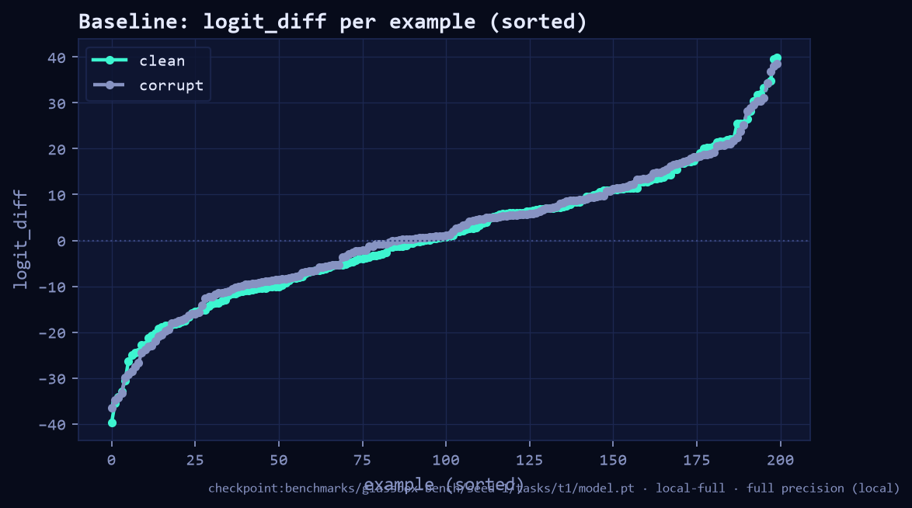

# t1 (null-task-shuffled): no behaviour to explain, baseline at chance

**Behavior:** BOS + 4 tokens from 6 symbols -> one output symbol at the last position, scored against the answers of dataset task 'bench' (benchmarks/glassbox-bench/seed-1/tasks/t1).  
**Model:** `checkpoint:benchmarks/glassbox-bench/seed-1/tasks/t1/model.pt` on `local-full`  
**Status:** unverified (no verification run) · no mechanism: baseline at chance  
**Experiments run:** 2 · **Backends used:** full precision (local)  
**Written:** 2026-11-13 13:20

## Summary

On local-full (full precision) the model's top token matches the scored answer on 19% of 200 inputs, which is chance for 6 symbols (16.7%); the mean logit difference is 1.10 with std 14.96, indistinguishable from the corrupt-input value 1.46. The pre-registered prediction (accuracy >= 0.9) was refuted. The investigation was stopped at step 1: no function was recovered, no circuit is claimed, and verify_hypothesis was not run. 2 of 25 experiments used.

## The recovered algorithm

```python
# No algorithm recovered. The scored labels are not predictable from the model's output (E0002),
# so no predict() is offered.
```

## Claims and evidence

| # | Claim | Evidence | Produced by |
|---|---|---|---|
| 1 | The model does not produce the scored answers: clean accuracy 0.19 on 200 inputs (chance 0.167), mean logit diff 1.10 +/- 14.96 vs 1.46 on corrupt inputs (local-full, full precision). | E0002 | full precision (local) |
| 2 | The pre-registered prediction that accuracy would be >= 0.9 was refuted; the alternative 'answers unrelated to the model's outputs' fits the observed number. | E0002 | full precision (local) |

## Key plots

**E0002: baseline** (full precision (local))



## Limitations

- No mechanism, function, or component attribution is claimed. No held-out verification was run because there was nothing to verify.
- Observation, not a tested claim: the four example predictions in E0002 (lo, nu, fo, po) equal the first four answers listed by the dataset view in E0001, while the 'expected' labels used for scoring differ. This suggests the model is deterministic and confident, and that the scoring labels are decoupled from the inputs (as the investigation name 'null-task-shuffled' implies). It rests on 4 examples and one exploratory run.
- Only one dataset seed (0, n=200) was examined.

## Open questions

- Under un-shuffled labels (the model's own outputs), what function does the model compute and which heads/MLPs implement it? That needs a separate investigation with a non-null dataset.

## Prediction record

1 experiments were pre-registered, 1 were run: **0 confirmed, 1 refuted, 0 inconclusive**. Hit rate (confirmed / decided): **0%**.

Refuted predictions (shown, not hidden):

| prereg | experiment | hypothesis | predicted | observed |
|---|---|---|---|---|
| N0003 | E0002 | The model reproduces the dataset answers at the last position (the answers are stated to be its own outputs), so there is a behaviour to explain. | `summary.clean_accuracy >= 0.9` | 0.190 |

## Experiments

| id | primitive | backend / precision | seconds | pre-registration |
|---|---|---|---|---|
| E0001 | dataset | full precision (local) | 0.19 | exploratory |
| E0002 | baseline | full precision (local) | 0.47 | N0003: refuted |

## Notebook trail

- `N0001` *decision*: Loaded checkpoint:benchmarks/glassbox-bench/seed-1/tasks/t1/model.pt on local-full (full precision (local)).
- `N0002` *experiment*: dataset (E0001)
- `N0003` *prereg*: The model reproduces the dataset answers at the last position (the answers are stated to be its own outputs), so there is a behaviour to explain.
- `N0004` *experiment*: The model reproduces the dataset answers at the last position (the answers are stated to be its own outputs), so there i (E0002)
- `N0005` *result*: Baseline (local-full, full precision) REFUTED my prediction: clean_accuracy 0.19 on 200 inputs (predicted >= 0.9), mean logit diff 1.10 +/- 14.96 (corrupt 1.46). With 6 output symbols, 0.19 is chance level (1/6 = 0.167). The model does not reproduce the answers the lab scores against. Observation: the 4 example_predictions in E0002 (lo, nu, fo, po) equal the first four answers listed by the dataset primitive in E0001 (2,4,7,3), while E0002's 'expected' (fo, ko, ko, lo) differ. So the labels used for scoring are not the ones the dataset view lists; they look decoupled from the inputs (consistent with the investigation name 'null-task-shuffled'). Only 4 examples, so this is an observation, not a tested claim. (E0001, E0002)
- `N0006` *decision*: Stop at step 1. The scored behaviour is at chance (E0002), so there is no input->label mechanism to localise; any heads/MLPs I named would be explaining noise. No circuit search, no predict(), no verify_hypothesis. Write a negative report. 2 of 25 experiments used.
