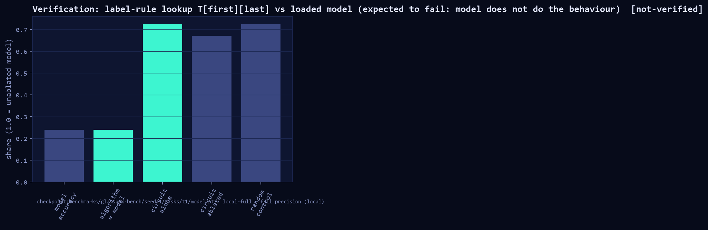
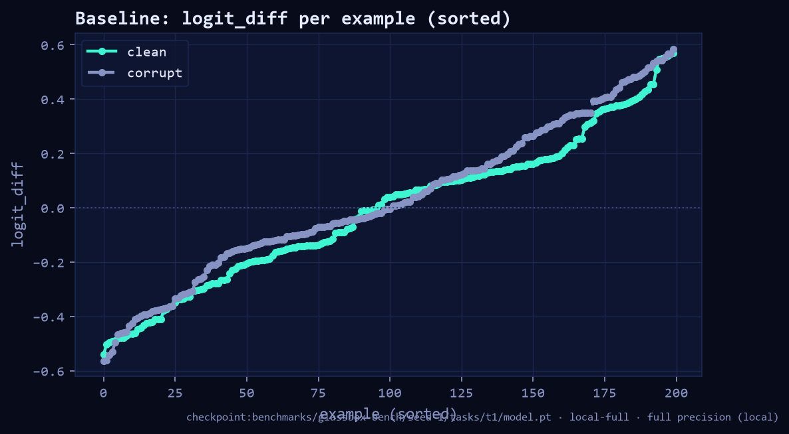
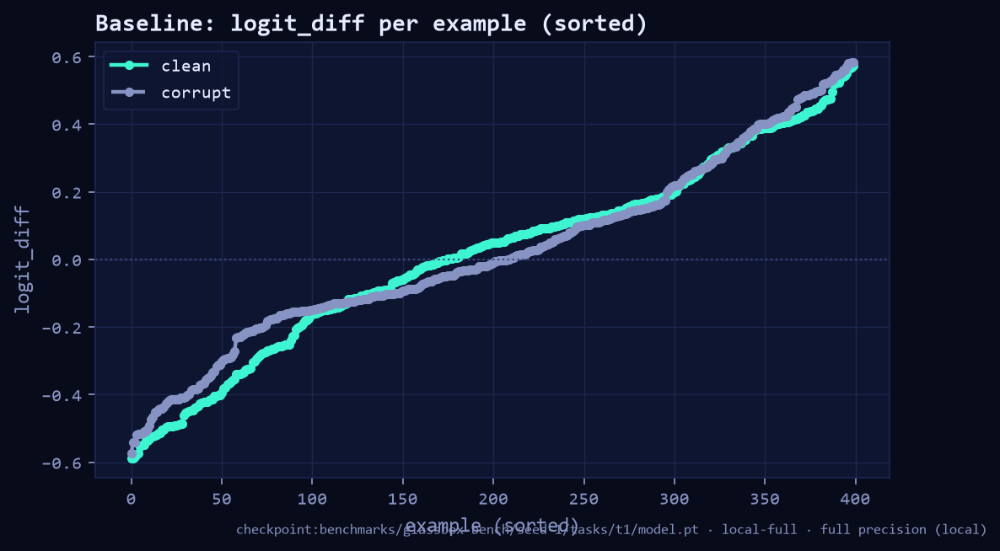

# t1 (null-weight-shuffled): the loaded checkpoint does not perform the labelled behaviour

**Behavior:** BOS + 4 tokens from 6 symbols -> one output symbol at the last position; dataset task 'bench', path benchmarks/glassbox-bench/seed-1/tasks/t1.  
**Model:** `checkpoint:benchmarks/glassbox-bench/seed-1/tasks/t1/model.pt` on `local-full`  
**Status:** partial / not verified · no mechanism: behaviour absent (not verified)  
**Experiments run:** 4 · **Backends used:** full precision (local)  
**Written:** 2026-11-13 13:19

## Summary

All numbers are from local-full (full precision). The dataset labels follow a clean rule: the output is a 6x6 lookup on the first and last input token, with the two middle tokens ignored (200/200 inputs in E0001, 200/200 held-out in V0001). The loaded checkpoint, however, does not produce those labels: accuracy 26% (E0002, n=200) and 27.5% (E0004, n=400) against chance 17% and about 33% for a constant guess of the most common label, with a mean logit difference of about 0 (+/-0.28), the same as on corrupted inputs. The label rule agrees with the model on 24% of held-out inputs (V0001). Mean-ablating the nominal circuit or everything else leaves accuracy unchanged (0.275 / 0.255). There is no behaviour in these weights for a circuit to implement, so no circuit is claimed. The investigation was stopped at step 1 as the protocol prescribes, using 4 of 25 experiments plus one verification.

## The recovered algorithm

```python
# Rule that generates the DATASET LABELS (not what the loaded weights compute):
def label_rule(tokens):
    T = {2:[3,6,4,3,6,3], 3:[2,7,3,3,5,4], 4:[2,6,5,7,2,5],
         5:[7,7,2,7,3,6], 6:[4,3,4,6,6,6], 7:[6,3,4,4,6,5]}
    return T[tokens[1]][tokens[4]-2]   # first input token x last input token; tokens[2], tokens[3] ignored
# Loaded model: near-flat logits, frequently outputs 'ko'; no recovered algorithm.
```

## Circuit


## Claims and evidence

| # | Claim | Evidence | Produced by |
|---|---|---|---|
| 1 | The loaded checkpoint does not reproduce the dataset answers: accuracy 0.26 (n=200) and 0.275 (n=400), mean logit difference ~0, indistinguishable from corrupted inputs. | E0002, E0004 | full precision (local) |
| 2 | The dataset labels are exactly a lookup on (first token, last token); this rule scores 1.0 against the labels on held-out inputs but agrees with the loaded model on only 0.24. | V0001, E0004 | full precision (local) |
| 3 | No set of components carries the behaviour: mean-ablating heads 1.0 + mlp0 + mlp1, or everything else, leaves accuracy at 0.275 / 0.255, and the necessity effect does not beat the null controls. | V0001, E0002 | full precision (local) |

## Verification

### V0001: label-rule lookup T[first][last] vs loaded model (expected to fail: model does not do the behaviour)  (full precision (local))

| check | value |
|---|---|
| status | not-verified |
| held-out inputs | 200 |
| model accuracy | 0.240 |
| algorithm agrees with model | 0.240 |
| algorithm accuracy vs ground truth | 1.000 |
| circuit size | 3 of 6 components |
| metric kept with ONLY the circuit | 0.725 |
| metric kept with the circuit ABLATED | 0.671 |
| random same-size ablation (control) | 0.725, 0.725, 0.725 |

At least one check failed; the explanation is partial or wrong. See the numbers.



## Key plots

**E0002: baseline** (full precision (local))



**E0004: baseline** (full precision (local))



## Limitations

- The task statement says the dataset answers are the model's own outputs; that did not hold for the weights loaded in this investigation (26-27.5% match). Either the dataset and checkpoint are mismatched or the weights are a scrambled control, as the investigation name suggests. I did not inspect any files to find out which.
- I did not characterise what the loaded weights compute instead (the logits are near-flat); only that it is not the labelled function.
- The attribution screen E0003 is exploratory and, with clean and corrupt metrics both ~0, uninformative.
- The 6x6 label table was read off 200 samples by hand (E0001); V0001 confirmed it on 200 more.

## Open questions

- Does the unshuffled t1 checkpoint implement the first-x-last lookup with one attention head moving the first token to the last position and an MLP doing the table lookup? Untested here.
- Why is agreement (0.24) slightly above the task-shuffled null max (0.235)? Likely a shared bias toward the frequent label 'ko', not a mechanism.

## Prediction record

2 experiments were pre-registered, 2 were run: **1 confirmed, 1 refuted, 0 inconclusive**. Hit rate (confirmed / decided): **50%**.

Refuted predictions (shown, not hidden):

| prereg | experiment | hypothesis | predicted | observed |
|---|---|---|---|---|
| N0004 | E0002 | The model produces its own recorded outputs deterministically on the bench dataset (answers are its own argmax), so accuracy vs. answers is ~1 with a positive l | `summary.clean_accuracy >= 0.98` | 0.260 |

Exploratory runs (no pre-registration; they cannot be the only support for a claim): E0003.

## Experiments

| id | primitive | backend / precision | seconds | pre-registration |
|---|---|---|---|---|
| E0001 | dataset | full precision (local) | 0.19 | exploratory |
| E0002 | baseline | full precision (local) | 0.45 | N0004: refuted |
| E0003 | attribution_patching | full precision (local) | 0.36 | exploratory |
| E0004 | baseline | full precision (local) | 0.53 | N0008: confirmed |
| V0001 | verify | full precision (local) |  | verification |

## Notebook trail

- `N0001` *decision*: Loaded checkpoint:benchmarks/glassbox-bench/seed-1/tasks/t1/model.pt on local-full (full precision (local)).
- `N0002` *experiment*: dataset (E0001)
- `N0003` *hypothesis* **[rejected]**: H1 (function): on all 200 inputs of E0001 the output is fully determined by the pair (first input token at pos 1, last input token at pos 4); the two middle tokens (pos 2, 3) never matter. The map is an unstructured 6x6 lookup table T[a][d] (ids): a=2:[3,6,4,3,6,3] a=3:[2,7,3,3,5,4] a=4:[2,6,5,7,2,5] a=5:[7,7,2,7,3,6] a=6:[4,3,4,6,6,6] a=7:[6,3,4,4,6,5] for d=2..7. No arithmetic rule found. H2 (mechanism, untested): an attention head at the last position reads the token at pos 1, and an MLP combines it with the last token to do the lookup; pos 2/3 carry no causal effect.
- `N0004` *prereg*: The model produces its own recorded outputs deterministically on the bench dataset (answers are its own argmax), so accuracy vs. answers is ~1 with a positive logit difference.
- `N0005` *experiment*: The model produces its own recorded outputs deterministically on the bench dataset (answers are its own argmax), so accu (E0002)
- `N0006` *experiment*: first screen + learn output shape (E0003)
- `N0007` *result*: Baseline prediction REFUTED (E0002, local-full, full precision): the loaded checkpoint reproduces the dataset answers on only 26% of 200 inputs (chance 1/6 = 17%; always answering the most common label 'ko' would score about 33%). Mean logit difference -0.009 +/- 0.27, i.e. indistinguishable from the corrupt baseline (0.03). The loaded weights do not perform the labelled behaviour. Exploratory attribution screen (E0003) has clean and corrupt metrics both ~0, so its effects are not interpretable as a circuit. Note: the dataset LABELS themselves follow a clean rule (H1: lookup on first and last token, 200/200 in E0001), but that is a property of the labels, not of the weights loaded here. (E0002, E0003)
- `N0008` *prereg*: The failure in E0002 is not a sampling fluke: on a fresh sample the loaded checkpoint again fails to reproduce the dataset answers (accuracy no better than a constant guess of the most common label).
- `N0009` *experiment*: The failure in E0002 is not a sampling fluke: on a fresh sample the loaded checkpoint again fails to reproduce the datas (E0004)
- `N0010` *verification*: label-rule lookup T[first][last] vs loaded model (expected to fail: model does not do the behaviour): not-verified. At least one check failed; the explanation is partial or wrong. See the numbers. (V0001)
- `N0011` *hypothesis* **[rejected]** -> N0003: Rejected as a description of the loaded model. The lookup T[first][last] reproduces the dataset labels 200/200 (V0001 algorithm_accuracy_vs_ground_truth = 1.0) but agrees with the loaded checkpoint on only 24% of held-out inputs (V0001), and the checkpoint matches the labels on 26% / 27.5% (E0002, E0004), with logit difference ~0. H2 (circuit) was never testable: there is no behaviour for a circuit to carry; ablating the nominal circuit or its complement leaves accuracy at 0.26-0.28 (V0001). Decision: stop per protocol, report no mechanism.
