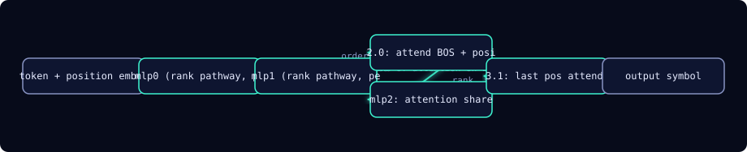
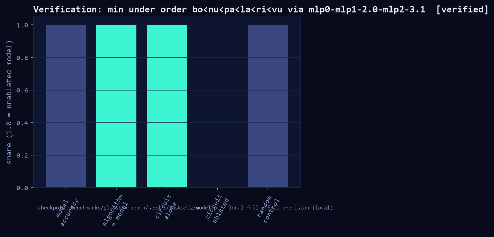
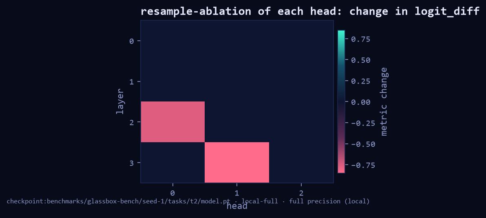
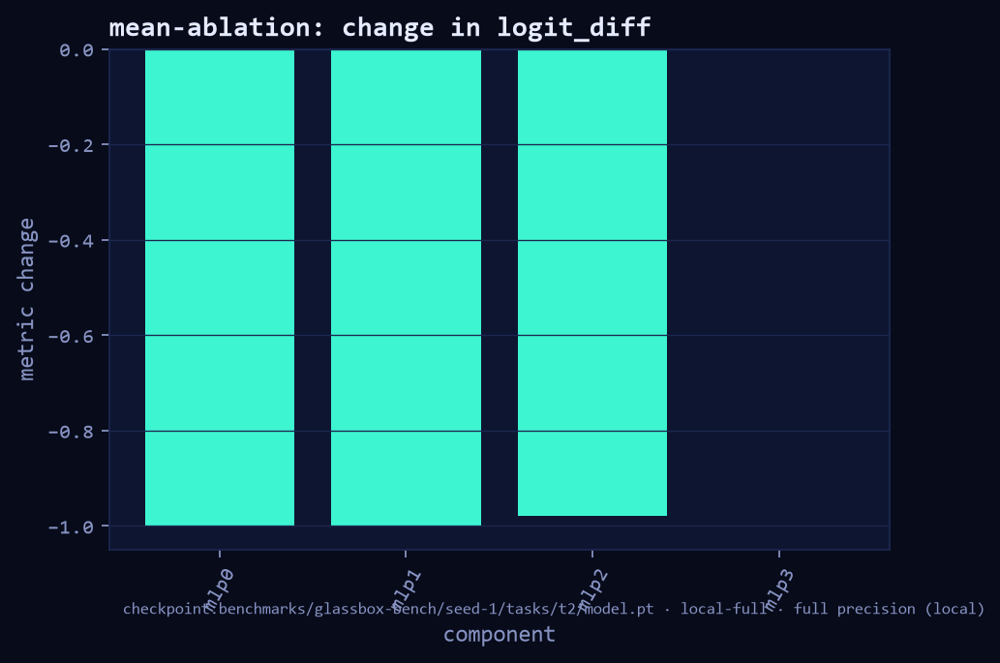
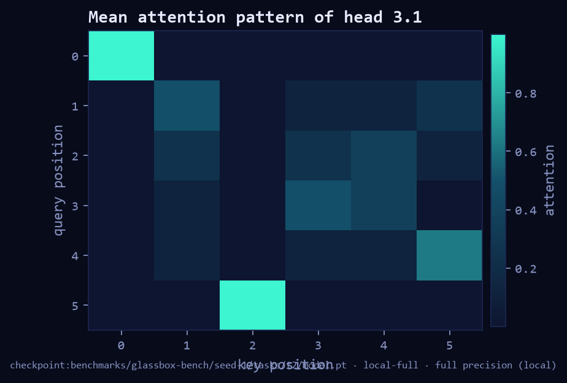
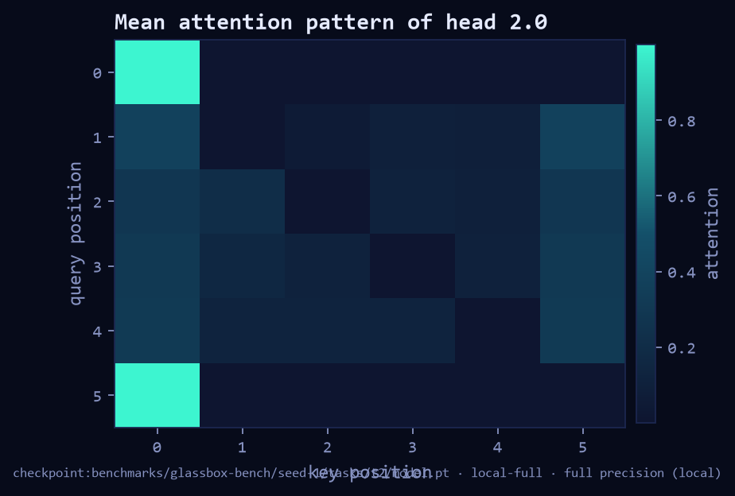

# t2: minimum of 5 symbols under a fixed order, computed by mlp0 -> mlp1 -> 2.0 -> mlp2 -> 3.1

**Behavior:** Input BOS + 5 tokens from {bo, la, nu, pa, ri, vu}; the model outputs one symbol at the last position.  
**Model:** `checkpoint:benchmarks/glassbox-bench/seed-1/tasks/t2/model.pt` on `local-full`  
**Status:** verified · verified  
**Experiments run:** 18 · **Backends used:** full precision (local)  
**Written:** 2026-11-13 12:50

## Summary

All numbers are from the local-full backend (full precision). The model outputs the minimum of the five input symbols under the fixed order bo < nu < pa < la < ri < vu (token ids 1 < 4 < 5 < 3 < 6 < 7). A hand-written predict() implementing that agrees with the model on 1000/1000 held-out inputs (V0001). The circuit is five components out of 16: mlp0, mlp1, head 2.0, mlp2 and head 3.1. mlp0 -> mlp1 -> 2.0 -> mlp2 is a serial rank pathway: 2.0 at each position attends to BOS plus the positions whose symbol outranks its own, which gives each position a rank. That rank enters head 3.1 through its keys; 3.1 at the last position attends to the position holding the minimum symbol and writes that symbol straight to the logits. The other 10 heads and mlp3 play no part: ablating all of them together changes nothing.

## The recovered algorithm

```python
rank = {bo:0, nu:1, pa:2, la:3, ri:4, vu:5}
# mlp0, mlp1 (per position) + head 2.0 (attend BOS + positions that outrank me) + mlp2:
#   every position gets its rank among the 5 symbols
# head 3.1 (last position): attend to the lowest-ranked position, copy its symbol to the logits
return min(tokens[1:], key=rank)
```

## Circuit



## Claims and evidence

| # | Claim | Evidence | Produced by |
|---|---|---|---|
| 1 | The model performs the behaviour perfectly on the bench dataset (accuracy 1.0, n=200). | E0002 | full precision (local) |
| 2 | The function is min over the 5 symbols under the order bo<nu<pa<la<ri<vu (first read off the dataset examples): predict() agrees with the model on 1000/1000 held-out inputs (task-shuffled null agreement p95 = 0.46). | V0001 | full precision (local) |
| 3 | Heads 2.0 and 3.1 are the only heads that matter: resample ablation leaves 0.23 and 0.15 of the clean logit difference; all 10 other heads stay at 1.0. | E0010, E0003, E0005 | full precision (local) |
| 4 | mlp0, mlp1 and mlp2 are each necessary (mean ablation leaves 0.0001, 0.0001, 0.02 of clean); mlp3 is not (1.0). | E0011, E0004 | full precision (local) |
| 5 | The 11 non-circuit components (10 heads + mlp3) can be mean-ablated jointly with no loss (fraction of clean 1.0); on held-out data the circuit alone keeps accuracy 1.0 and ablating the circuit drops the metric to 0.0001 of clean (accuracy 0.276). | E0012, V0001 | full precision (local) |
| 6 | Head 3.1 at the last position attends to the position of the minimum symbol (0.9999 attention on 8 constructed inputs with the unique minimum at position 2) and writes the answer directly to the logits (direct-path effect 1.0). | E0008, E0016 | full precision (local) |
| 7 | Head 2.0 attends to BOS plus positions whose symbol comes later in the order than its own: when the last token is the unique maximum (vu), all of its attention (1.0) goes to BOS; it never attends to its own position. | E0009, E0007 | full precision (local) |
| 8 | The rank information from 2.0 reaches 3.1 through its key input (path effect 0.3825) and not through its query (0.0). Denoising mlp0, mlp1 or mlp2 alone restores exactly the same 0.3825, consistent with one serial pathway mlp0 -> mlp1 -> 2.0 -> mlp2 -> 3.1 keys that decides where 3.1 looks, while the copied symbol comes from the token itself. | E0014, E0015, E0018, E0013, E0017 | full precision (local) |

## Verification

### V0001: min under order bo<nu<pa<la<ri<vu via mlp0-mlp1-2.0-mlp2-3.1  (full precision (local))

| check | value |
|---|---|
| status | verified |
| held-out inputs | 1000 |
| model accuracy | 1.000 |
| algorithm agrees with model | 1.000 |
| algorithm accuracy vs ground truth | 1.000 |
| circuit size | 5 of 16 components |
| metric kept with ONLY the circuit | 1.000 |
| metric kept with the circuit ABLATED | 0.000 |
| random same-size ablation (control) | 1.000, 1.000, 1.000 |

Passed at full precision, and every effect exceeds its null distribution.



## Key plots

**E0010: ablation** (full precision (local))



**E0011: ablation** (full precision (local))



**E0008: attention_patterns** (full precision (local))



**E0009: attention_patterns** (full precision (local))



## Limitations

- What mlp0 and mlp1 each compute was not isolated; only that both are necessary and sit on the same serial pathway as 2.0 and mlp2. The edges mlp0 -> mlp1 -> 2.0 and 2.0 -> mlp2 are inferred from layer order plus the identical 0.3825 denoising effects, not from direct path patching (the path_patching primitive rejected MLP senders).
- The labels 'ordering key' and 'attention share -> rank' for mlp1 and mlp2 are interpretation; the measured facts are the attention pattern of 2.0 and the key-path effect.
- How ties between equal symbols are broken inside 2.0 was not tested; it does not affect the output since tied positions hold the same symbol.
- The ri < vu leg of the order was read off a single example in the dataset listing (E0001); it is supported afterwards only by the 1000/1000 held-out agreement, without a count of how many of those inputs contain only ri and vu.
- The value path token -> 3.1 is inferred from the path-patching effect being 0.38 rather than 1.0; it was not patched directly.
- In V0001 all three random same-size ablations left the metric at 1.0, which suggests the random control is drawn from non-circuit components; I did not check how it is sampled.

## Open questions

- What do mlp0 and mlp1 compute individually, and why are two MLP layers used before the first useful attention head?
- Do positions other than the last also receive a sorted output from 3.1 (its attention from other positions is sharp too in E0006), i.e. is this a full sort of which only the last element is read?

## Prediction record

10 experiments were pre-registered, 10 were run: **10 confirmed, 0 refuted, 0 inconclusive**. Hit rate (confirmed / decided): **100%**.

No prediction was refuted.

Exploratory runs (no pre-registration; they cannot be the only support for a claim): E0003, E0004, E0005, E0006, E0007, E0013, E0017.

## Experiments

| id | primitive | backend / precision | seconds | pre-registration |
|---|---|---|---|---|
| E0001 | dataset | full precision (local) | 0.29 | exploratory |
| E0002 | baseline | full precision (local) | 0.76 | N0004: confirmed |
| E0003 | ablation | full precision (local) | 0.9 | exploratory |
| E0004 | ablation | full precision (local) | 0.76 | exploratory |
| E0005 | ablation | full precision (local) | 0.87 | exploratory |
| E0006 | attention_patterns | full precision (local) | 0.15 | exploratory |
| E0007 | attention_patterns | full precision (local) | 0.14 | exploratory |
| E0008 | attention_patterns | full precision (local) | 0.1 | N0011: confirmed |
| E0009 | attention_patterns | full precision (local) | 0.11 | N0013: confirmed |
| E0010 | ablation | full precision (local) | 0.92 | N0015: confirmed |
| E0011 | ablation | full precision (local) | 0.62 | N0016: confirmed |
| E0012 | ablation | full precision (local) | 0.59 | N0017: confirmed |
| E0013 | path_patching | full precision (local) | 0.82 | exploratory |
| E0014 | path_patching | full precision (local) | 0.8 | N0022: confirmed |
| E0015 | path_patching | full precision (local) | 0.86 | N0023: confirmed |
| E0016 | path_patching | full precision (local) | 0.64 | N0024: confirmed |
| E0017 | activation_patching | full precision (local) | 0.7 | exploratory |
| E0018 | activation_patching | full precision (local) | 0.69 | N0029: confirmed |
| V0001 | verify | full precision (local) |  | verification |

## Notebook trail

- `N0001` *decision*: Loaded checkpoint:benchmarks/glassbox-bench/seed-1/tasks/t2/model.pt on local-full (full precision (local)).
- `N0002` *experiment*: dataset (E0001)
- `N0003` *hypothesis* **[open]**: H1 (function): the output is the minimum of the 5 input symbols under the fixed order bo(1) < nu(4) < pa(5) < la(3) < ri(6) < vu(7). Read off the 120 examples in E0001 (all clean answers I checked fit; the ri<vu leg rests on a single corrupt example [6,6,7,7,7]->6, so it is the weakest part). Alternatives: mode / first / last token (ruled out by e.g. [5,5,4,6,7]->4).
- `N0004` *prereg*: The model performs its behaviour reliably on the bench dataset: its own top-1 output matches the dataset answer, with a clearly positive logit difference.
- `N0005` *experiment*: The model performs its behaviour reliably on the bench dataset: its own top-1 output matches the dataset answer, with a  (E0002)
- `N0006` *experiment*: First screen, also to learn the output shape of the ablation sweep. (E0003)
- `N0007` *experiment*: Screen of MLP layers, mean ablation. (E0004)
- `N0008` *experiment*: Zero ablation screen: catches heads whose output is constant across inputs (invisible to mean ablation). (E0005)
- `N0009` *experiment*: Shape check + where does 3.1 look from the last position. seed 0 n=12 = the 12 examples printed as strings in E0001. (E0006)
- `N0010` *experiment*: Where does 2.0 look, all query positions. (E0007)
- `N0011` *prereg*: Head 3.1 is the output mover: from the last position it attends to the position holding the minimum symbol (order bo<nu<pa<la<ri<vu) and copies it. On 8 hand-built inputs whose unique minimum sits at position 2, 3.1's attention from position 5 goes almost entirely to position 2.
- `N0012` *experiment*: Head 3.1 is the output mover: from the last position it attends to the position holding the minimum symbol (order bo<nu< (E0008)
- `N0013` *prereg*: Head 2.0 implements a rank count: at each position it attends to BOS plus the positions whose symbol comes later in the order bo<nu<pa<la<ri<vu than its own (so 1/(1+count) lands on BOS, which mlp2 turns into a rank that 3.1 matches against position). If the last token is the unique maximum (vu) nothing outranks it, so 2.0 at position 5 attends only to BOS.
- `N0014` *experiment*: Head 2.0 implements a rank count: at each position it attends to BOS plus the positions whose symbol comes later in the  (E0009)
- `N0015` *prereg*: Among the 12 heads only 2.0 and 3.1 are needed. Under resample ablation on a fresh sample, 3.1 loses most of the logit difference (and 2.0 too), while every other head stays at ~1.0.
- `N0016` *prereg*: mlp0, mlp1 and mlp2 are each necessary and mlp3 is not: on a fresh sample, mean-ablating mlp2 removes the behaviour (and so do mlp0 and mlp1), while mlp3 has no effect.
- `N0017` *prereg*: The circuit is exactly {mlp0, mlp1, 2.0, mlp2, 3.1}. Mean-ablating everything else at once (the other 10 heads and mlp3) leaves the behaviour intact.
- `N0018` *experiment*: Among the 12 heads only 2.0 and 3.1 are needed. Under resample ablation on a fresh sample, 3.1 loses most of the logit d (E0010)
- `N0019` *experiment*: mlp0, mlp1 and mlp2 are each necessary and mlp3 is not: on a fresh sample, mean-ablating mlp2 removes the behaviour (and (E0011)
- `N0020` *experiment*: The circuit is exactly {mlp0, mlp1, 2.0, mlp2, 3.1}. Mean-ablating everything else at once (the other 10 heads and mlp3) (E0012)
- `N0021` *experiment*: Shape check for path_patching (MLP senders raised ValueError: senders must be heads). Which heads reach 3.1 through its key input. (E0013)
- `N0022` *prereg*: The rank information computed by 2.0 (and processed by mlp2) reaches 3.1 through its KEY input: each key position advertises its rank, and the last position's query selects the one ranked lowest. Denoising the 2.0 -> 3.1 key path restores a substantial part of the behaviour on a fresh sample.
- `N0023` *prereg*: 3.1's QUERY at the last position does not depend on 2.0 (it is a fixed 'give me the lowest-ranked position' query); the rank information enters through the keys only. Path-patching 2.0 into 3.1's query input has essentially no effect.
- `N0024` *prereg*: 3.1 writes the answer symbol directly to the logits (nothing downstream is needed: mlp3 is inert). Path-patching 3.1 -> logits restores nearly all of the behaviour.
- `N0025` *experiment*: The rank information computed by 2.0 (and processed by mlp2) reaches 3.1 through its KEY input: each key position advert (E0014)
- `N0026` *experiment*: 3.1's QUERY at the last position does not depend on 2.0 (it is a fixed 'give me the lowest-ranked position' query); the  (E0015)
- `N0027` *experiment*: 3.1 writes the answer symbol directly to the logits (nothing downstream is needed: mlp3 is inert). Path-patching 3.1 ->  (E0016)
- `N0028` *experiment*: Shape check + at which positions does each MLP matter (layer x position). (E0017)
- `N0029` *prereg*: mlp0 -> mlp1 -> 2.0 -> mlp2 form one serial 'rank' pathway that only decides WHERE 3.1 looks (its keys); the symbol that 3.1 copies comes straight from the token embedding, not through the MLPs. So denoising any one of mlp0/mlp1/mlp2 (all positions) restores exactly as much as the 2.0 -> 3.1 key path did on the same sample (0.3825 in E0014), not the full behaviour.
- `N0030` *experiment*: mlp0 -> mlp1 -> 2.0 -> mlp2 form one serial 'rank' pathway that only decides WHERE 3.1 looks (its keys); the symbol that (E0018)
- `N0031` *result*: Circuit = {mlp0, mlp1, 2.0, mlp2, 3.1}. Each is necessary (E0010 resample: 3.1 -> 0.15, 2.0 -> 0.23 of clean; E0011 mean: mlp0/mlp1 -> 0.0001, mlp2 -> 0.02, mlp3 -> 1.0); the other 10 heads + mlp3 jointly mean-ablated leave 1.0 of clean (E0012). 3.1 at the last position attends to the position of the minimum symbol (0.9999 on constructed inputs, E0008) and writes the logits directly (E0016 = 1.0). 2.0 attends BOS + positions whose symbol outranks its own (BOS-only when own symbol is the unique max, E0009). Rank pathway mlp0->mlp1->2.0->mlp2 enters 3.1 via keys (E0014 0.3825) not queries (E0015 0.0); each MLP denoised alone gives the same 0.3825 (E0018). Not determined: what mlp0 and mlp1 compute individually, and how ties are broken inside 2.0. (E0002, E0008, E0009, E0010, E0011, E0012, E0014, E0015, E0016, E0018)
- `N0032` *verification*: min under order bo<nu<pa<la<ri<vu via mlp0-mlp1-2.0-mlp2-3.1: verified. Passed at full precision, and every effect exceeds its null distribution. (V0001)
