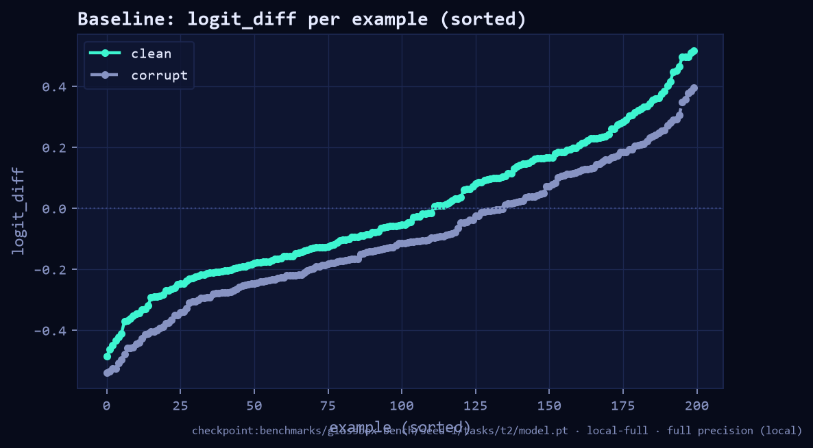
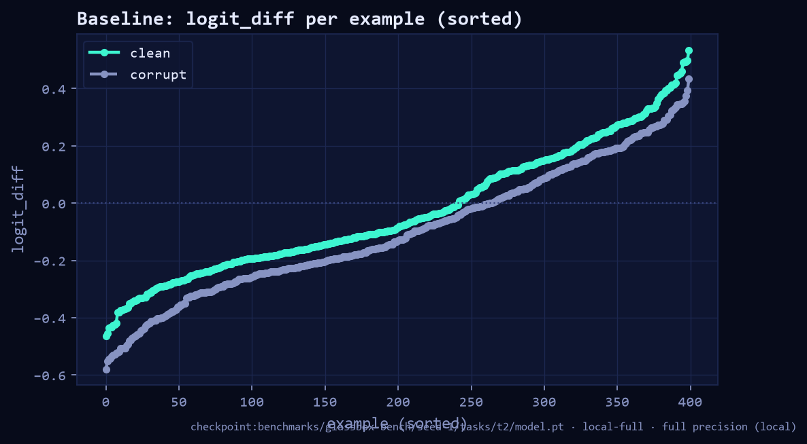

# t2 (null-random-init): the loaded checkpoint does not perform the behaviour

**Behavior:** BOS + 5 tokens from 6 symbols -> one symbol at the last position (glassbox-bench seed-1 task t2). Asked: recover the function and the heads/MLPs implementing it.  
**Model:** `checkpoint:benchmarks/glassbox-bench/seed-1/tasks/t2/model.pt` on `local-full`  
**Status:** unverified (no verification run) · no behaviour - nothing to explain  
**Experiments run:** 3 · **Backends used:** full precision (local)  
**Written:** 2026-11-13 13:22

## Summary

Negative result. On local-full (full precision) the loaded checkpoint agrees with the dataset's answers at chance level: 17.5% on 200 prompts (E0002) and 12.25% on 400 fresh prompts (E0003), against 16.7% chance for 6 symbols. The mean logit difference between the labelled answer and the foil is ~0 (-0.009 and -0.029, std ~0.23) and is no larger on clean than on corrupt prompts. The model therefore does not compute the function the labels encode, and the investigation was stopped at step 1 as the protocol requires. No function, no circuit and no predict() are claimed for this model; verify_hypothesis was deliberately not run.

## The recovered algorithm

```python
# No algorithm recovered: the loaded model's outputs are unrelated to the dataset answers (E0002, E0003).
# No predict() is offered.
```

## Claims and evidence

| # | Claim | Evidence | Produced by |
|---|---|---|---|
| 1 | The loaded checkpoint does not produce the dataset's answers: argmax agreement is 17.5% on 200 prompts, at chance (16.7%), with mean logit diff -0.009 +/- 0.229 (local-full, full precision). My pre-registered prediction of >=98% was refuted. | E0002 | full precision (local) |
| 2 | The chance-level result replicates on an independent sample: 12.25% agreement on 400 prompts (seed 2), mean logit diff -0.029 +/- 0.223, below both the 30% threshold and the ~60% a majority-label predictor would reach (local-full). | E0003 | full precision (local) |
| 3 | Because the behaviour is absent, no attention head or MLP layer can be said to implement it; no circuit is claimed. | E0002, E0003 | full precision (local) |

## Key plots

**E0002: baseline** (full precision (local))



**E0003: baseline** (full precision (local))



## Limitations

- Only the baseline was measured (3 of 25 experiments used); no component-level experiments were run because there is no behaviour to attribute.
- The task statement says the dataset's answers are the model's own outputs; that is not true of the checkpoint as loaded here. I did not determine why (the investigation name suggests a null control with re-initialised weights, but that was not measured).
- Side observation, not a claim about this model: in the 64 labels inspected in E0001 (exploratory) the answers are consistent with a fixed priority rule bo > nu > pa > la > {ri, vu} (output the highest-priority symbol present). This describes the labels only, is unverified beyond those 64 examples, and the ri/vu order was not observed.

## Open questions

- Is this checkpoint an intentional null (random-init) variant of the t2 model, with labels taken from the original?
- Does the original t2 model implement the priority rule suggested by the labels?

## Prediction record

2 experiments were pre-registered, 2 were run: **1 confirmed, 1 refuted, 0 inconclusive**. Hit rate (confirmed / decided): **50%**.

Refuted predictions (shown, not hidden):

| prereg | experiment | hypothesis | predicted | observed |
|---|---|---|---|---|
| N0003 | E0002 | The model deterministically does the behaviour: on the bench dataset its top output at the last position equals the recorded answer (the dataset's answers are i | `summary.clean_accuracy >= 0.98` | 0.175 |

## Experiments

| id | primitive | backend / precision | seconds | pre-registration |
|---|---|---|---|---|
| E0001 | dataset | full precision (local) | 0.19 | exploratory |
| E0002 | baseline | full precision (local) | 0.83 | N0003: refuted |
| E0003 | baseline | full precision (local) | 1.34 | N0006: confirmed |

## Notebook trail

- `N0001` *decision*: Loaded checkpoint:benchmarks/glassbox-bench/seed-1/tasks/t2/model.pt on local-full (full precision (local)).
- `N0002` *experiment*: dataset (E0001)
- `N0003` *prereg*: The model deterministically does the behaviour: on the bench dataset its top output at the last position equals the recorded answer (the dataset's answers are its own outputs), with a clear logit margin.
- `N0004` *experiment*: The model deterministically does the behaviour: on the bench dataset its top output at the last position equals the reco (E0002)
- `N0005` *result*: Baseline REFUTED my prediction (local-full, full precision): on 200 bench prompts (seed 1) the loaded checkpoint's argmax matches the dataset answer on only 17.5% (chance for 6 symbols = 16.7%); mean logit diff -0.009 +/- 0.229, same as on corrupt prompts (-0.097). The loaded model does not produce the dataset's answers. Hypothesis 'model does the behaviour' rejected. Side observation on the labels only (E0001, 64 examples, not a claim about this model): labels are consistent with a priority rule bo > nu > pa > la > {ri, vu}. (E0002)
- `N0006` *prereg*: The loaded checkpoint does not compute the dataset's function at all: its agreement with the dataset answers is at chance level on an independent sample, so E0002 was not a sampling fluke.
- `N0007` *experiment*: The loaded checkpoint does not compute the dataset's function at all: its agreement with the dataset answers is at chanc (E0003)
- `N0008` *decision*: Stop: replication E0003 (400 prompts, seed 2, local-full) gives 12.25% agreement, logit diff -0.029 +/- 0.223. Two independent baselines at chance. The loaded checkpoint does not perform the behaviour, so there is no mechanism to localise; no circuit is claimed and verify_hypothesis is not run (any circuit would be fitted to noise). 22 of 25 experiments left unused. (E0002, E0003)
