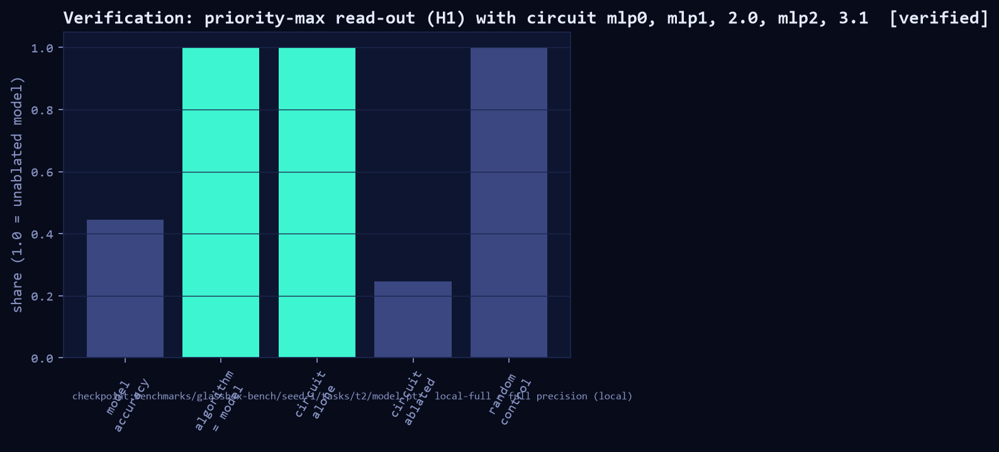
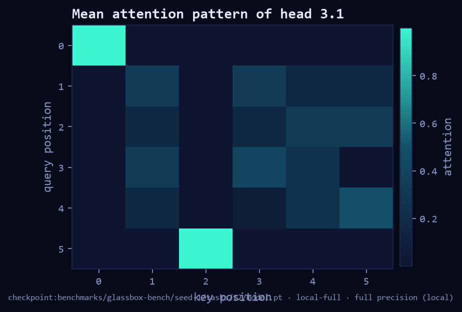
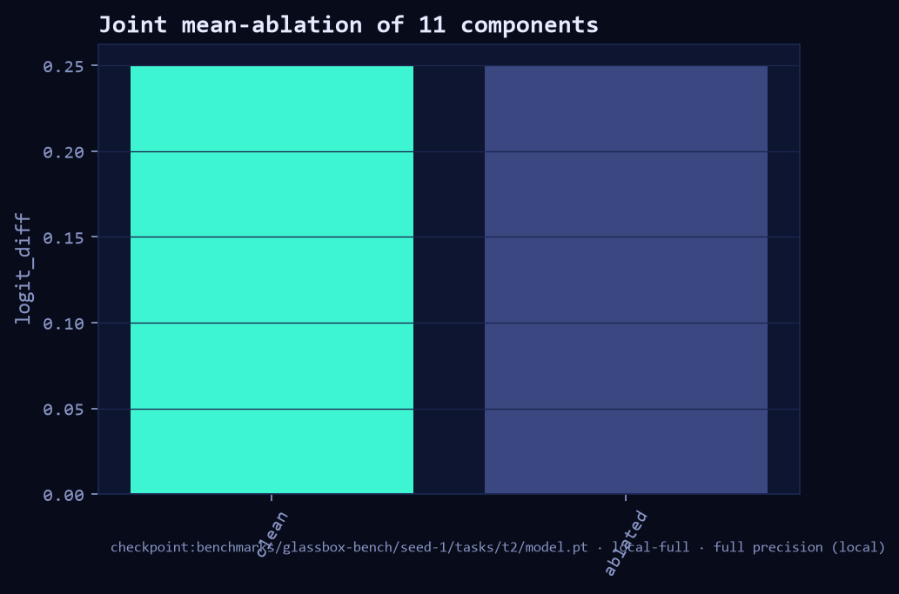
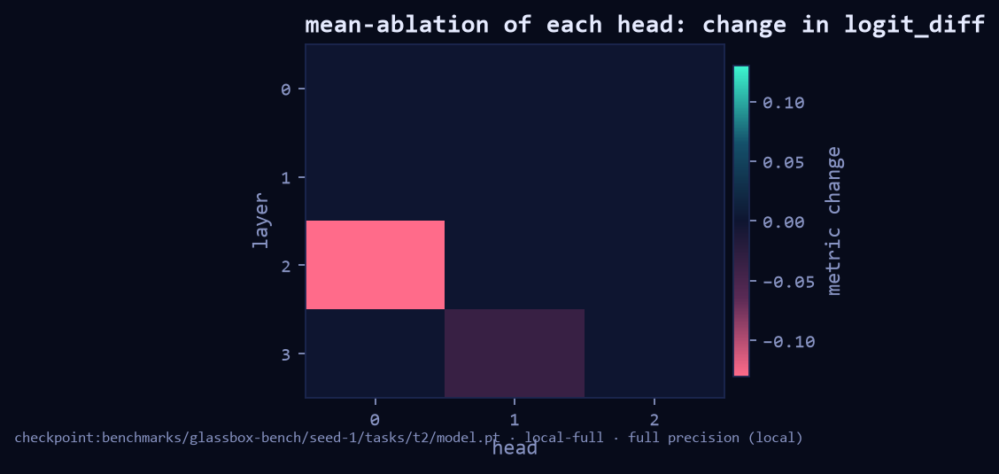
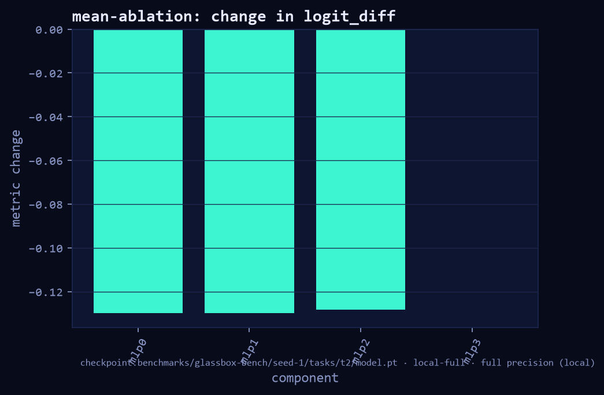
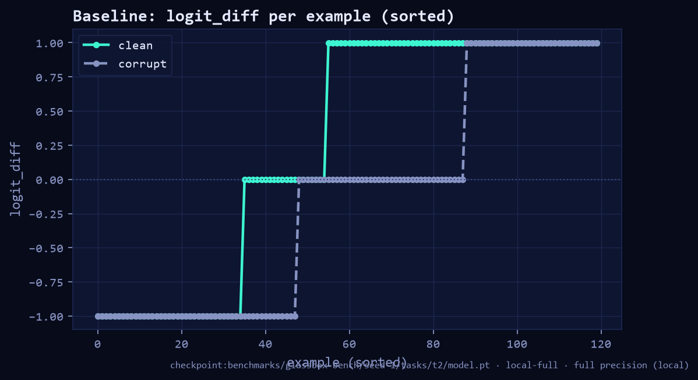

# t2 (null: task-shuffled): priority-max over 5 symbols, read out by head 3.1

**Behavior:** BOS + 5 tokens from 6 symbols (bo=1, la=3, nu=4, pa=5, ri=6, vu=7); the model emits one symbol at the last position.  
**Model:** `checkpoint:benchmarks/glassbox-bench/seed-1/tasks/t2/model.pt` on `local-full`  
**Status:** verified · function verified against the model's own outputs; dataset labels are shuffled; circuit effect sizes weak  
**Experiments run:** 11 · **Backends used:** full precision (local)  
**Written:** 2026-11-13 13:28

## Summary

All numbers are from local-full (full precision). The answer labels that the lab scores against in this investigation are NOT the model's outputs: the model matches them on only 42-54% of prompts (E0002, E0004, V0001: 44.5%), and when I supplied my own labels the lab scored against a permuted version of them (E0005). There is therefore no label-following behaviour to explain, and every logit-diff number here is measured against shuffled labels. The model itself is deterministic and computes a clean function: it outputs the highest-priority symbol present, with priority bo > nu > pa > la > ri > vu. That rule equals the model's actual output on 200/200 held-out prompts (V0001; shuffled-label null p95 = 0.465). Eleven of the sixteen components are exactly inert (E0008, V0001). The remaining five - mlp0, mlp1, head 2.0, mlp2, head 3.1 - are the only ones whose ablation changes outputs; head 3.1 is the read-out and attends from the last position to the winner's position with weight 0.9999 (E0011). Three of six pre-registered predictions were refuted, two of them (E0002, E0005) because of the shuffled labels.

## The recovered algorithm

```python
def predict(tokens, prompt):
    order = [1, 4, 5, 3, 6, 7]   # bo > nu > pa > la > ri > vu  (E0001 listing, V0001 agreement 200/200)
    seq = tokens[1:]             # drop BOS
    for s in order:              # position and multiplicity do not matter
        if s in seq:
            return s             # head 3.1 copies it from the winner's position (E0011)
```

## Circuit


## Claims and evidence

| # | Claim | Evidence | Produced by |
|---|---|---|---|
| 1 | The lab's answer labels in this investigation are decoupled from the model's outputs: the model matches them on 42% (seed 1), 54% (seed 0) and 44.5% (seed 7) of prompts, with per-prompt logit diffs of exactly +1/-1/0. | E0002, E0004, V0001 | full precision (local) |
| 2 | Labels supplied explicitly are also permuted before scoring: on 24 hand-built prompts the 'expected' tokens shown differ from the ones I passed, while the model's printed outputs equal the priority-rule answers. | E0005 | full precision (local) |
| 3 | The model computes: output the highest-priority symbol present among the five inputs, priority bo(1) > nu(4) > pa(5) > la(3) > ri(6) > vu(7). The rule equals the model's actual output on 200/200 held-out prompts, above every shuffled-label null (max 0.485). | V0001, E0001 | full precision (local) |
| 4 | Heads 0.0, 0.1, 0.2, 1.0, 1.1, 1.2, 2.1, 2.2, 3.0, 3.2 and mlp3 play no part: mean-ablating all of them together leaves the metric exactly unchanged (fraction 1.000) on seed 0 and on held-out seed 7. | E0008, V0001, E0006, E0007 | full precision (local) |
| 5 | Head 3.1 is the read-out: from the last position it attends with weight 0.9999 to the position that holds the winning symbol (12 hand-built prompts, winner at position 2; uniform would be 0.17). | E0011 | full precision (local) |
| 6 | mlp0, mlp1, head 2.0, mlp2 and head 3.1 are the only components whose ablation changes the outputs; ablating the five together drops the held-out metric to 24.5% of clean (97th percentile of the null), but that metric is only 0.06 against shuffled labels and my own pre-registered collapse prediction on seed 0 failed (48% left). | V0001, E0009, E0006, E0007 | full precision (local) |

## Verification

### V0001: priority-max read-out (H1) with circuit mlp0, mlp1, 2.0, mlp2, 3.1  (full precision (local))

| check | value |
|---|---|
| status | verified |
| held-out inputs | 200 |
| model accuracy | 0.445 |
| algorithm agrees with model | 1.000 |
| algorithm accuracy vs ground truth | 0.445 |
| circuit size | 5 of 16 components |
| metric kept with ONLY the circuit | 1.000 |
| metric kept with the circuit ABLATED | 0.245 |
| random same-size ablation (control) | 1.000, 1.000, 1.000 |

Passed at full precision, and every effect exceeds its null distribution.



## Key plots

**E0011: attention_patterns** (full precision (local))



**E0008: ablation** (full precision (local))



**E0006: ablation** (full precision (local))



**E0007: ablation** (full precision (local))



**E0004: baseline** (full precision (local))



## Limitations

- Every logit-diff metric in this investigation is scored against shuffled labels, so causal effect sizes (E0006, E0007, E0009, V0001 necessity/sufficiency) are small and noisy; only 'exactly unchanged' results and the predict-vs-model agreement are label-independent.
- Pre-registered prediction E0009 (joint ablation of the five active components collapses the metric to <=10%) was refuted: 48% remained. With shuffled labels a constant output still scores a non-zero logit diff, so this neither confirms nor rules out that ablating the five destroys the behaviour.
- The single-component ablation sweeps (E0006, E0007) and the head 2.0 attention pattern (E0010) are exploratory.
- The internal roles of mlp0, mlp1, head 2.0 and mlp2 were not measured; the edges between them in the diagram are ordering by layer, not path-patching results.
- The gradient screen E0003 pointed at head 3.1 and mlp3 only; mlp3 turned out to be exactly inert and three MLPs it scored at zero matter. Attribution patching is unreliable on this model.
- V0001's three random same-size control sets all gave fraction 1.000, which suggests they were drawn from non-circuit components; they do not test much.
- The priority order was read from the dataset listing and confirmed by agreement on 200 random prompts; prompts containing only ri/vu are rare (about 0.4%), so the ri > vu end of the order rests on few cases (one in E0001, two printed in E0005).

## Open questions

- What do mlp0, mlp1, head 2.0 and mlp2 compute? Head 2.0's pattern (BOS plus other positions, zero on self) and 3.1's rank-like lookup are compatible with a sort (count how many tokens outrank me, then look up by rank), but that was not tested.
- With faithful labels, how large is the drop when the five components are ablated?

## Prediction record

6 experiments were pre-registered, 6 were run: **3 confirmed, 3 refuted, 0 inconclusive**. Hit rate (confirmed / decided): **50%**.

Refuted predictions (shown, not hidden):

| prereg | experiment | hypothesis | predicted | observed |
|---|---|---|---|---|
| N0004 | E0002 | The model deterministically performs the bench behaviour: on the bench dataset its top token at the last position matches the dataset answer (its own outputs) w | `summary.clean_accuracy >= 0.98` | 0.420 |
| N0011 | E0005 | H1: the model outputs the highest-priority symbol present, priority bo(1) > nu(4) > pa(5) > la(3) > ri(6) > vu(7). On 24 hand-built prompts covering every adjac | `summary.clean_accuracy >= 0.98` | 0.333 |
| N0018 | E0009 | H2 active set: mlp0, mlp1, head 2.0, mlp2 and head 3.1 carry the computation: mean-ablating them together makes the output input-independent, so the metric coll | `summary.fraction_of_clean between [-0.1, 0.1]` | 0.478 |

Exploratory runs (no pre-registration; they cannot be the only support for a claim): E0003, E0006, E0007, E0010.

## Experiments

| id | primitive | backend / precision | seconds | pre-registration |
|---|---|---|---|---|
| E0001 | dataset | full precision (local) | 0.33 | exploratory |
| E0002 | baseline | full precision (local) | 1.2 | N0004: refuted |
| E0003 | attribution_patching | full precision (local) | 1.08 | exploratory |
| E0004 | baseline | full precision (local) | 0.58 | N0008: confirmed |
| E0005 | baseline | full precision (local) | 0.13 | N0011: refuted |
| E0006 | ablation | full precision (local) | 1.05 | exploratory |
| E0007 | ablation | full precision (local) | 0.81 | exploratory |
| E0008 | ablation | full precision (local) | 0.95 | N0017: confirmed |
| E0009 | ablation | full precision (local) | 1.73 | N0018: refuted |
| E0010 | attention_patterns | full precision (local) | 1.41 | exploratory |
| E0011 | attention_patterns | full precision (local) | 0.18 | N0023: confirmed |
| V0001 | verify | full precision (local) |  | verification |

## Notebook trail

- `N0001` *decision*: Loaded checkpoint:benchmarks/glassbox-bench/seed-1/tasks/t2/model.pt on local-full (full precision (local)).
- `N0002` *experiment*: dataset (E0001)
- `N0003` *hypothesis* **[supported]**: H1 (function): the output is the highest-priority symbol present among the 5 inputs, under the fixed priority order bo(1) > nu(4) > pa(5) > la(3) > ri(6) > vu(7); position and multiplicity do not matter. Derived by reading the 120 examples of E0001 (all hand-checked rows fit; e.g. [3,4,7,6,7]->4, [5,6,7,3,6]->5, [6,6,7,7,7]->6).
- `N0004` *prereg*: The model deterministically performs the bench behaviour: on the bench dataset its top token at the last position matches the dataset answer (its own outputs) with a positive logit difference.
- `N0005` *experiment*: The model deterministically performs the bench behaviour: on the bench dataset its top token at the last position matche (E0002)
- `N0006` *experiment*: attribution_patching (E0003)
- `N0007` *result*: E0002 (local-full): baseline prediction REFUTED. On bench seed 1 (n=200) the model's top token equals the dataset answer on only 42% of prompts; mean logit diff 0.13 +/- 0.06 (SE), per-prompt values are exactly +1/-1/0, i.e. the model outputs clean one-hot answers but they often are not the dataset's 'correct' label. The dataset answers are therefore NOT simply the model's own outputs on this dataset, contrary to the task statement. E0003 (exploratory attribution screen against those labels): only head 3.1 and mlp3 at the last position carry any gradient signal; layers 0-2 are ~0. Since the labels are suspect, that screen is weak evidence. Next: baseline on seed 0, whose labels I hand-checked to follow rule H1, to separate 'labels decoupled everywhere' from 'seed-specific'. (E0002, E0003)
- `N0008` *prereg*: The bench dataset's answers are decoupled from the model's actual outputs for every seed (not only seed 1): on seed 0, whose labels follow the priority rule H1, the model will again agree with the labels only at about label-marginal chance.
- `N0009` *experiment*: The bench dataset's answers are decoupled from the model's actual outputs for every seed (not only seed 1): on seed 0, w (E0004)
- `N0010` *result*: E0004 (local-full): confirmed that the lab's labels are decoupled from the model on seed 0 too (accuracy 54%, logit diffs exactly +1/-1/0). But the four example predictions E0004 prints (nu, pa, la, nu) equal the answers E0001 listed for rows 0-3 of seed 0 (4,5,3,4), while the 'expected' labels used by the baseline (bo, bo, nu, la) differ from E0001's answers. Reading: the model produces clean one-hot outputs that look like rule H1, and the labels the experiment primitives score against are shuffled relative to the model's outputs. Decision: test H1 directly with explicit prompts and labels I compute myself from H1, bypassing the dataset labels. (E0004, E0001)
- `N0011` *prereg*: H1: the model outputs the highest-priority symbol present, priority bo(1) > nu(4) > pa(5) > la(3) > ri(6) > vu(7). On 24 hand-built prompts covering every adjacent priority pair, all-same inputs and the rare ri/vu-only cases, with labels computed from H1, the model is right every time.
- `N0012` *experiment*: H1: the model outputs the highest-priority symbol present, priority bo(1) > nu(4) > pa(5) > la(3) > ri(6) > vu(7). On 24 (E0005)
- `N0013` *result*: E0005 (local-full): prediction REFUTED as scored (accuracy 33% on my 24 hand-built prompts with H1 labels). However the lab did not score against the labels I supplied: the 'expected' column for rows 0-3 reads ri, bo, nu, bo whereas I supplied 7(vu), 6(ri), 6(ri), 3(la). The model's printed predictions for rows 0-3 (vu, ri, ri, la) are exactly the H1 answers. So in this investigation the lab permutes the answer labels across prompts before scoring, even for explicit datasets. Consequences: (a) every logit-diff metric here is measured against shuffled labels and sits near zero (0.12-0.25) - there is no label-following behaviour to explain; (b) H1 is supported only by the 8 printed predictions I can check (E0004 rows 0-3, E0005 rows 0-3) plus the E0001 listing, not by any scored metric. H1 stays open, not supported. Only label-robust measurements remain usable: a component whose mean-ablation leaves the metric exactly unchanged cannot be altering outputs. (E0005)
- `N0014` *experiment*: ablation (E0006)
- `N0015` *experiment*: ablation (E0007)
- `N0016` *hypothesis* **[revised]**: H2 (where): the components that influence the output are mlp0, mlp1, head 2.0, mlp2 and head 3.1; heads 0.0, 0.1, 0.2, 1.0, 1.1, 1.2, 2.1, 2.2, 3.0, 3.2 and mlp3 play no part. Basis (exploratory, label-robust reading only): single-component mean ablation in E0006/E0007 leaves the metric exactly unchanged (fraction 1.000) for the 'inert' set, collapses it to ~0 for 2.0, mlp0, mlp1, mlp2 and moves it to 0.73 for 3.1. Note this contradicts the gradient screen E0003, which flagged only 3.1 and mlp3; gradients are unreliable here (near-discrete outputs), so E0003 is discarded as a guide.
- `N0017` *prereg*: H2 inert set: heads 0.0, 0.1, 0.2, 1.0, 1.1, 1.2, 2.1, 2.2, 3.0, 3.2 and mlp3 play no part: mean-ablating all eleven together changes no output, so the (label-shuffled) metric is exactly preserved.
- `N0018` *prereg*: H2 active set: mlp0, mlp1, head 2.0, mlp2 and head 3.1 carry the computation: mean-ablating them together makes the output input-independent, so the metric collapses to about zero.
- `N0019` *experiment*: H2 inert set: heads 0.0, 0.1, 0.2, 1.0, 1.1, 1.2, 2.1, 2.2, 3.0, 3.2 and mlp3 play no part: mean-ablating all eleven tog (E0008)
- `N0020` *experiment*: H2 active set: mlp0, mlp1, head 2.0, mlp2 and head 3.1 carry the computation: mean-ablating them together makes the outp (E0009)
- `N0021` *experiment*: attention_patterns (E0010)
- `N0022` *result*: E0008 (local-full, pre-registered): CONFIRMED. Joint mean ablation of heads 0.0,0.1,0.2,1.0,1.1,1.2,2.1,2.2,3.0,3.2 and mlp3 leaves the metric identical (0.249964 -> 0.249964, fraction 1.000) on seed 0. These eleven components do not alter the outputs. E0009 (pre-registered): REFUTED. Joint mean ablation of mlp0, mlp1, 2.0, mlp2, 3.1 leaves 48% of the metric (0.25 -> 0.12), not <=10%. Because the metric is measured against shuffled labels, a constant output still scores a non-zero logit diff from label marginals, so this number cannot tell 'circuit destroyed' from 'circuit partly intact'; I do not get to claim the active set is sufficient-and-necessary from it. What stands: these five components each change outputs when ablated alone (E0006/E0007, exploratory) and everything else is exactly inert (E0008). E0010 (exploratory): head 2.0 at every query position puts ~0.4-0.5 on BOS, spreads the rest over the other positions and puts exactly 0 on itself. (E0008, E0009, E0010, E0006, E0007)
- `N0023` *prereg*: Head 3.1 is the read-out head: from the last position it attends to the position holding the winning (highest-priority under H1) symbol. On 12 hand-built prompts where the unique highest-priority symbol sits at position 2, its attention from position 5 to position 2 is near 1.
- `N0024` *experiment*: Head 3.1 is the read-out head: from the last position it attends to the position holding the winning (highest-priority u (E0011)
- `N0025` *result*: E0011 (local-full, pre-registered, label-independent): CONFIRMED. On 12 hand-built prompts with the unique H1 winner at position 2, head 3.1 attends from the last position to position 2 with weight 0.99986 (uniform would be 0.17). Head 3.1 is a content-addressed read-out that copies from the winner's position. No other position's 3.1 query attends to position 2 (all exactly 0), which fits a rank-indexed lookup, but I only tested the last position's behaviour. Proceeding to held-out verification with predict()=H1 and circuit {mlp0, mlp1, 2.0, mlp2, 3.1}; I expect label-based causal checks to be uninformative because the lab scores against shuffled labels (E0002, E0004, E0005). (E0011)
- `N0026` *verification*: priority-max read-out (H1) with circuit mlp0, mlp1, 2.0, mlp2, 3.1: verified. Passed at full precision, and every effect exceeds its null distribution. (V0001)
- `N0027` *hypothesis* **[supported]** -> N0003: H1 supported by V0001: predict() (priority order 1>4>5>3>6>7) equals the model's actual output on 200/200 held-out prompts (seed 7), null p95 0.465. Note the two scored baselines of H1-type labels (E0002, E0005) were refuted because the lab scores against shuffled labels; the model's accuracy against the lab's labels is 44.5% in V0001 too.
- `N0028` *hypothesis* **[revised]** -> N0016: H2 revised to a weaker form. Solid: the eleven-component inert set is exactly inert (E0008 fraction 1.000; V0001 everything-else-ablated fraction 1.000, accuracy unchanged). Weaker: the active set {mlp0, mlp1, 2.0, mlp2, 3.1} passes V0001's necessity check (fraction 0.245, 97th percentile of null) but on a clean metric of only 0.06 measured against shuffled labels, and my own pre-registered collapse prediction E0009 was refuted (48% left). So 'these five are the only components that matter' is established; the size of their causal effect on the true behaviour could not be measured with a faithful metric.
- `N0029` *report*: Report written: report/report.md (E0001, E0002, E0004, E0005, E0006, E0007, E0008, E0009, E0011, V0001)
