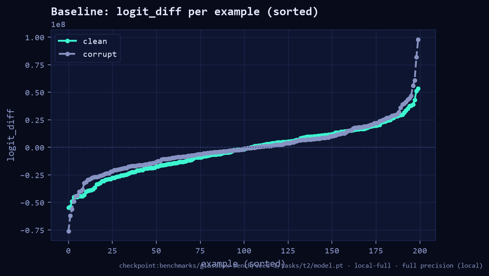

# t2 (null-weight-shuffled): the model does not perform the behaviour; no circuit claimed

**Behavior:** BOS + 5 tokens from 6 symbols -> one symbol at the last position (glassbox-bench seed-1 task t2).  
**Model:** `checkpoint:benchmarks/glassbox-bench/seed-1/tasks/t2/model.pt` on `local-full`  
**Status:** unverified (no verification run) · no behaviour - nothing to explain  
**Experiments run:** 2 · **Backends used:** full precision (local)  
**Written:** 2026-11-13 13:23

## Summary

Negative result. At full precision on local-full, the loaded checkpoint matches the dataset answers on 12% of 200 prompts (E0002), at or below chance (1/6), with logit differences of order 1e7 and random sign. The pre-registered prediction (accuracy >= 0.95) was refuted. The investigation was stopped after the baseline as the protocol requires: there is no behaviour to localise, so no function, heads or MLPs are attributed to this model and no verification was run. The dataset labels alone are consistent with 'minimum of the inputs under the order bo < nu < pa < la < {ri, vu}' (E0001), but this model does not compute that.

## The recovered algorithm

```python
# No algorithm recovered: the model's outputs do not follow the dataset answers (E0002).
# Observation about the LABELS only (E0001, 64 examples; not a claim about the model):
#   answer == min(tokens[1:], key=rank) with rank bo < nu < pa < la < {ri, vu}
```

## Claims and evidence

| # | Claim | Evidence | Produced by |
|---|---|---|---|
| 1 | The loaded model does not do the behaviour: 12% agreement with the dataset answers on 200 prompts, at or below the 1/6 chance level (local-full, full precision). | E0002 | full precision (local) |
| 2 | Its output logits are not a calibrated readout: logit differences have mean -2.9e6 and std 2.1e7, with random sign. | E0002 | full precision (local) |
| 3 | The dataset labels in the inspected sample are consistent with a minimum under the order bo < nu < pa < la < {ri, vu}; this describes the labels, and the model fails to reproduce it. | E0001, E0002 | full precision (local) |

## Key plots

**E0002: baseline** (full precision (local))



## Limitations

- Only the baseline was run (2 of 25 experiments); no component-level experiment was performed, by design, because the behaviour is absent.
- The label rule was read off 64 examples and never tested against the model; the relative order of ri and vu is unresolved.
- No verify_hypothesis run: status is neither verified nor partial, it is 'no behaviour'.

## Open questions

- The task statement says the dataset answers are the model's own outputs, yet this checkpoint does not reproduce them; consistent with the weights having been altered (the investigation name suggests a weight-shuffled null), but that was not tested here.

## Prediction record

1 experiments were pre-registered, 1 were run: **0 confirmed, 1 refuted, 0 inconclusive**. Hit rate (confirmed / decided): **0%**.

Refuted predictions (shown, not hidden):

| prereg | experiment | hypothesis | predicted | observed |
|---|---|---|---|---|
| N0003 | E0002 | The model reliably produces its dataset answers (which look like 'minimum of the 5 tokens under the order bo<nu<pa<la<{ri,vu}') at the last position. | `summary.clean_accuracy >= 0.95` | 0.120 |

## Experiments

| id | primitive | backend / precision | seconds | pre-registration |
|---|---|---|---|---|
| E0001 | dataset | full precision (local) | 0.19 | exploratory |
| E0002 | baseline | full precision (local) | 0.92 | N0003: refuted |

## Notebook trail

- `N0001` *decision*: Loaded checkpoint:benchmarks/glassbox-bench/seed-1/tasks/t2/model.pt on local-full (full precision (local)).
- `N0002` *experiment*: dataset (E0001)
- `N0003` *prereg*: The model reliably produces its dataset answers (which look like 'minimum of the 5 tokens under the order bo<nu<pa<la<{ri,vu}') at the last position.
- `N0004` *experiment*: The model reliably produces its dataset answers (which look like 'minimum of the 5 tokens under the order bo<nu<pa<la<{r (E0002)
- `N0005` *result*: Baseline refuted (E0002, local-full, full precision, n=200, seed 1): the loaded checkpoint reproduces the dataset answers on only 12% of prompts, at or below chance (1/6 = 16.7% uniform; the labels are skewed to 'bo', so a constant guesser would do better). Logit differences are of order 1e7 with mean -2.9e6 and std 2.1e7, i.e. sign-random and numerically blown up, not a calibrated readout. The dataset labels themselves (E0001, n=64, seed 0) are all consistent with 'minimum of the 5 input tokens under the order bo < nu < pa < la < {ri, vu}' (ri vs vu not resolved in the sample), but that is a property of the labels, not of this model: the model does not compute it. (E0001, E0002)
- `N0006` *decision*: Stop after the baseline. The model does not perform the behaviour (accuracy 0.12, E0002), so there is no mechanism to localise; any heads/MLPs surfaced by patching against a chance-level metric with 1e7-scale logits would be noise. No circuit is claimed and no verify_hypothesis is run, since a circuit claim would be unsupported. 23 of 25 experiments left unspent.
