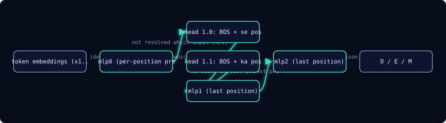
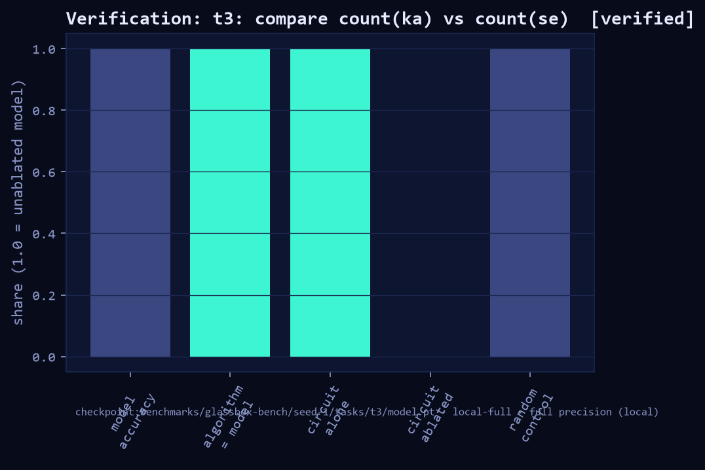
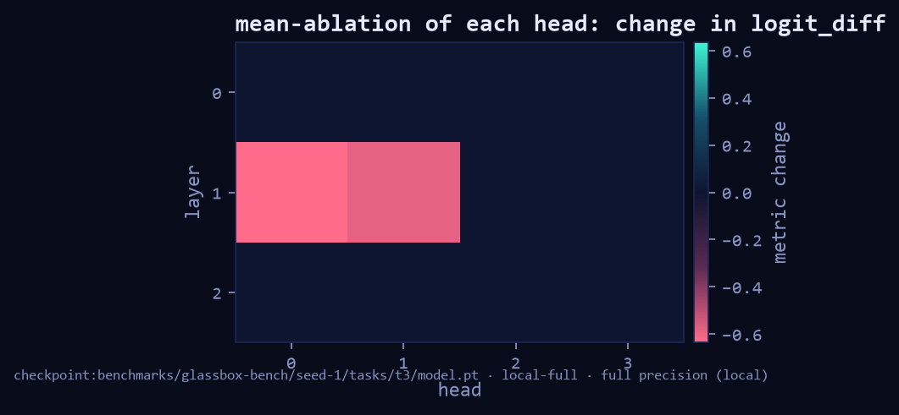
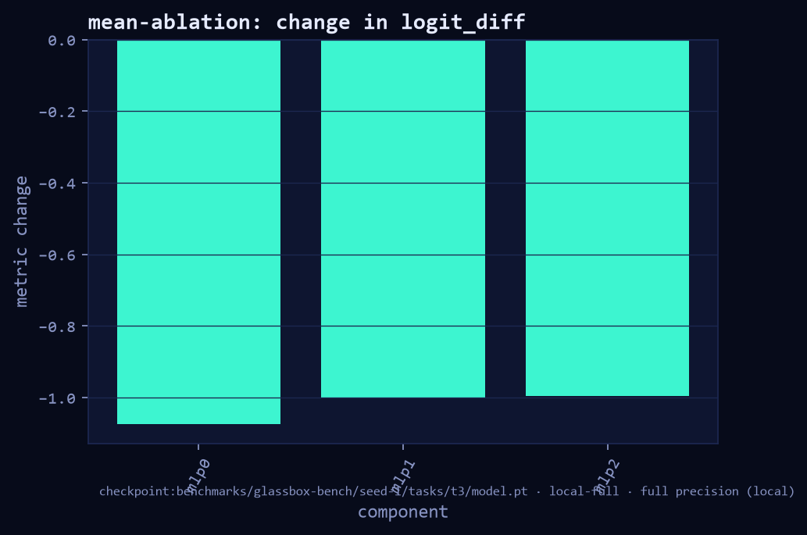
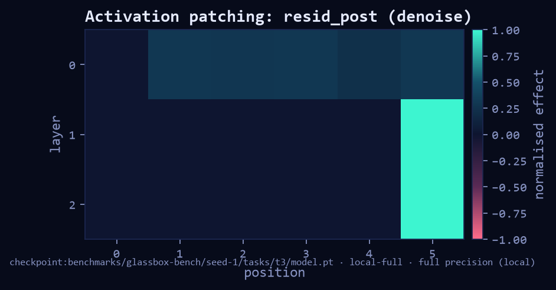

# glassbox-bench seed-1 t3: compare count(ka) with count(se)

**Behavior:** BOS + 5 tokens from {ba, ka, ne, se, va, ve}; the model outputs one of D / E / M at the last position.  
**Model:** `checkpoint:benchmarks/glassbox-bench/seed-1/tasks/t3/model.pt` on `local-full`  
**Status:** verified · verified  
**Experiments run:** 17 · **Backends used:** full precision (local)  
**Written:** 2026-11-13 12:54

## Summary

The model outputs M if the input contains more 'ka' (id 3) than 'se' (id 5), E if it contains fewer, and D if the counts are equal. The circuit is heads 1.0 and 1.1 plus all three MLP layers. Head 1.0 attends uniformly over BOS and every 'se' position, head 1.1 uniformly over BOS and every 'ka' position, so each encodes one count as 1/(1+count) attention on BOS. After layer 1 everything needed sits at the last position, and mlp1/mlp2 turn it into the D/E/M output. The other ten heads (0.0-0.3, 1.2, 1.3, 2.0-2.3) play no part. All numbers are from local-full (full precision). Held-out verification V0001: status verified.

## The recovered algorithm

```python
def predict(tokens, prompt):
    xs = tokens[1:]                      # drop BOS
    n_ka = count(x == 3 for x in xs)     # head 1.1 (BOS + ka positions)
    n_se = count(x == 5 for x in xs)     # head 1.0 (BOS + se positions)
    if n_ka > n_se: return 10            # M
    if n_ka < n_se: return 9             # E
    return 8                             # D
```

## Circuit



## Claims and evidence

| # | Claim | Evidence | Produced by |
|---|---|---|---|
| 1 | The model performs the task deterministically: clean accuracy 1.0 on 200 inputs. | E0002 | full precision (local) |
| 2 | The function is sign(count(ka) - count(se)) mapped to M (more ka), E (more se), D (equal): the predict() code agrees with the model on 400/400 held-out inputs (seed 7), against a task-shuffled null of 0.34. | V0001 | full precision (local) |
| 3 | Heads 1.0 and 1.1 are necessary: jointly mean-ablating them leaves 0.01 of the clean metric. | E0010, E0003 | full precision (local) |
| 4 | Heads 0.0, 0.1, 0.2, 0.3, 1.2, 1.3, 2.0, 2.1, 2.2, 2.3 play no part: jointly mean-ablating all ten leaves 1.0 of the clean metric. | E0011, E0003, V0001 | full precision (local) |
| 5 | Each of mlp0, mlp1 and mlp2 is necessary: resample-ablating any one alone leaves -0.01 of the clean metric (mean ablation: -0.075, 0.0, 0.004). | E0012, E0013, E0014, E0004 | full precision (local) |
| 6 | Head 1.0 attends uniformly over BOS plus every 'se' position (BOS weight 0.25 with three se, 0.5 with one se); the pattern does not depend on the query position. | E0008, E0006 | full precision (local) |
| 7 | Head 1.1 attends uniformly over BOS plus every 'ka' position (BOS weight 0.5 with one ka, 1/3 with two ka). | E0009, E0007 | full precision (local) |
| 8 | Before layer 1 the task information is spread over the five token positions (patching any single position restores 0.23-0.29); after layer 1 the last position alone restores 1.0. | E0017, E0016 | full precision (local) |
| 9 | The five-component circuit is necessary and sufficient on held-out data: ablating it gives 0.0 of clean (accuracy 0.345, chance level), ablating the other ten components gives 1.0; both beat their null distributions. | V0001 | full precision (local) |

## Verification

### V0001: t3: compare count(ka) vs count(se)  (full precision (local))

| check | value |
|---|---|
| status | verified |
| held-out inputs | 400 |
| model accuracy | 1.000 |
| algorithm agrees with model | 1.000 |
| algorithm accuracy vs ground truth | 1.000 |
| circuit size | 5 of 15 components |
| metric kept with ONLY the circuit | 1.000 |
| metric kept with the circuit ABLATED | -0.000 |
| random same-size ablation (control) | 1.000, 1.000, 1.000 |

Passed at full precision, and every effect exceeds its null distribution.



## Key plots

**E0003: ablation** (full precision (local))



**E0004: ablation** (full precision (local))



**E0017: activation_patching** (full precision (local))



## Limitations

- The division of labour between mlp0, mlp1 and mlp2 was not measured: only that each is individually necessary. The circuit-diagram edges into and between MLPs are ordering by layer, not measured paths.
- Path patching from an MLP sender (mlp0 -> heads 1.0/1.1) raised a tool error, so whether mlp0 feeds the heads' keys or values is unknown.
- Attention patterns for 1.0 and 1.1 were confirmed on two hand-built prompts each (one exploratory, one pre-registered), plus matching dataset-mean BOS attention (E0005, exploratory); not checked exhaustively over all inputs.
- The function was first read off the seed-0 dataset listing by inspection, then tested; agreement is on 400 sampled inputs out of 7776 possible, not exhaustive.

## Open questions

- What exactly does mlp0 compute per position, and do heads 1.0/1.1 read it through keys or values?
- How do mlp1 and mlp2 split the comparison of the two 1/(1+count) signals?

## Prediction record

9 experiments were pre-registered, 9 were run: **9 confirmed, 0 refuted, 0 inconclusive**. Hit rate (confirmed / decided): **100%**.

No prediction was refuted.

Exploratory runs (no pre-registration; they cannot be the only support for a claim): E0003, E0004, E0005, E0006, E0007, E0015, E0016.

## Experiments

| id | primitive | backend / precision | seconds | pre-registration |
|---|---|---|---|---|
| E0001 | dataset | full precision (local) | 0.2 | exploratory |
| E0002 | baseline | full precision (local) | 0.54 | N0004: confirmed |
| E0003 | ablation | full precision (local) | 0.62 | exploratory |
| E0004 | ablation | full precision (local) | 0.35 | exploratory |
| E0005 | attention_patterns | full precision (local) | 0.38 | exploratory |
| E0006 | attention_patterns | full precision (local) | 0.11 | exploratory |
| E0007 | attention_patterns | full precision (local) | 0.1 | exploratory |
| E0008 | attention_patterns | full precision (local) | 0.1 | N0012: confirmed |
| E0009 | attention_patterns | full precision (local) | 0.1 | N0013: confirmed |
| E0010 | ablation | full precision (local) | 0.35 | N0014: confirmed |
| E0011 | ablation | full precision (local) | 0.35 | N0015: confirmed |
| E0012 | ablation | full precision (local) | 0.35 | N0020: confirmed |
| E0013 | ablation | full precision (local) | 0.35 | N0021: confirmed |
| E0014 | ablation | full precision (local) | 0.34 | N0022: confirmed |
| E0015 | activation_patching | full precision (local) | 0.49 | exploratory |
| E0016 | activation_patching | full precision (local) | 0.59 | exploratory |
| E0017 | activation_patching | full precision (local) | 0.56 | N0028: confirmed |
| V0001 | verify | full precision (local) |  | verification |

## Notebook trail

- `N0001` *decision*: Loaded checkpoint:benchmarks/glassbox-bench/seed-1/tasks/t3/model.pt on local-full (full precision (local)).
- `N0002` *experiment*: dataset (E0001)
- `N0003` *hypothesis* **[supported]**: H1 (function, from reading E0001 inputs/outputs): the output compares the count of 'ka' (id 3) with the count of 'se' (id 5) among the 5 input tokens: M (10) if count(ka) > count(se), E (9) if count(ka) < count(se), D (8) if equal. Hand-checked on ~45 of the 120 seed-0 examples without exception. To be tested on held-out seeds via verify_hypothesis.
- `N0004` *prereg*: The model reliably produces its own benchmark answers (the behaviour exists and the dataset labels are the model's outputs).
- `N0005` *experiment*: The model reliably produces its own benchmark answers (the behaviour exists and the dataset labels are the model's outpu (E0002)
- `N0006` *experiment*: First screen: mean-ablate each head individually to learn output shape and candidate heads. (E0003)
- `N0007` *experiment*: First screen: mean-ablate each MLP individually. (E0004)
- `N0008` *experiment*: Look at output shape and where head 1.0 attends from the last position. (E0005)
- `N0009` *experiment*: Single prompt BOS ka ka se va ve: which keys does head 1.0 attend to? (E0006)
- `N0010` *experiment*: Single prompt BOS ka ka se va ve: which keys does head 1.1 attend to? (E0007)
- `N0011` *hypothesis* **[supported]**: H2 (circuit, from exploratory screens E0003-E0007): only heads 1.0 and 1.1 and all three MLPs (mlp0, mlp1, mlp2) carry the behaviour; heads 0.0-0.3, 1.2, 1.3, 2.0-2.3 are inert. Head 1.0 attends uniformly over BOS + every 'se' position (BOS weight = 1/(1+count(se))); head 1.1 attends uniformly over BOS + every 'ka' position (BOS weight = 1/(1+count(ka))). The MLPs downstream turn the two counts into the comparison D/E/M.
- `N0012` *prereg*: Head 1.0 attends uniformly over BOS plus every 'se' (id 5) position, so its BOS attention from the last position is 1/(1+count(se)).
- `N0013` *prereg*: Head 1.1 attends uniformly over BOS plus every 'ka' (id 3) position, so its BOS attention from the last position is 1/(1+count(ka)).
- `N0014` *prereg*: Heads 1.0 and 1.1 are jointly necessary: mean-ablating both destroys the behaviour.
- `N0015` *prereg*: The ten heads 0.0-0.3, 1.2, 1.3, 2.0-2.3 play no part: mean-ablating all of them together leaves the behaviour intact.
- `N0016` *experiment*: Head 1.0 attends uniformly over BOS plus every 'se' (id 5) position, so its BOS attention from the last position is 1/(1 (E0008)
- `N0017` *experiment*: Head 1.1 attends uniformly over BOS plus every 'ka' (id 3) position, so its BOS attention from the last position is 1/(1 (E0009)
- `N0018` *experiment*: Heads 1.0 and 1.1 are jointly necessary: mean-ablating both destroys the behaviour. (E0010)
- `N0019` *experiment*: The ten heads 0.0-0.3, 1.2, 1.3, 2.0-2.3 play no part: mean-ablating all of them together leaves the behaviour intact. (E0011)
- `N0020` *prereg*: mlp0 is necessary for the behaviour.
- `N0021` *prereg*: mlp1 is necessary for the behaviour.
- `N0022` *prereg*: mlp2 is necessary for the behaviour.
- `N0023` *experiment*: mlp0 is necessary for the behaviour. (E0012)
- `N0024` *experiment*: mlp1 is necessary for the behaviour. (E0013)
- `N0025` *experiment*: mlp2 is necessary for the behaviour. (E0014)
- `N0026` *experiment*: Shape check + at which positions does each MLP's output matter? (E0015)
- `N0027` *experiment*: Shape check: residual stream patching by layer and position. (E0016)
- `N0028` *prereg*: Layer 1 (heads 1.0/1.1 + mlp1) gathers all task information into the last position: after layer 1 the residual stream at position 5 alone determines the output, whereas before layer 1 it is spread over the token positions.
- `N0029` *experiment*: Layer 1 (heads 1.0/1.1 + mlp1) gathers all task information into the last position: after layer 1 the residual stream at (E0017)
- `N0030` *verification*: t3: compare count(ka) vs count(se): verified. Passed at full precision, and every effect exceeds its null distribution. (V0001)
- `N0031` *result*: Circuit = heads 1.0, 1.1 + mlp0, mlp1, mlp2 (local-full, full precision). Joint mean-ablation of 1.0+1.1 -> 0.01 of clean (E0010); joint mean-ablation of the other ten heads -> 1.0 of clean (E0011); resample-ablating each MLP alone -> -0.01 of clean (E0012, E0013, E0014). Head 1.0 attends uniformly over BOS + 'se' positions (BOS weight 0.25 with 3 se, E0008; 0.5 with 1 se, E0006); head 1.1 uniformly over BOS + 'ka' positions (0.5 with 1 ka, E0009; 1/3 with 2 ka, E0007). After layer 0 information is spread over token positions (each 0.23-0.29), after layer 1 it sits entirely at position 5 (effect 1.0, E0017). Held-out verification V0001 (seed 7, n=400): predict() agreement 1.0, circuit ablated 0.0 of clean (accuracy 0.345), everything else ablated 1.0, status verified. (E0006, E0007, E0008, E0009, E0010, E0011, E0012, E0013, E0014, E0017, V0001)
- `N0032` *hypothesis* **[supported]** -> N0003: predict() implementing sign(count(ka) - count(se)) -> M/E/D agrees with the model on 400/400 held-out inputs (V0001, seed 7).
- `N0033` *hypothesis* **[supported]** -> N0011: All pre-registered tests held (E0008-E0014, E0017) and V0001 passed necessity and sufficiency. Not resolved: the internal division of labour between mlp0, mlp1 and mlp2 (path patching from an MLP sender errored, so what mlp0 feeds the heads was not measured).
