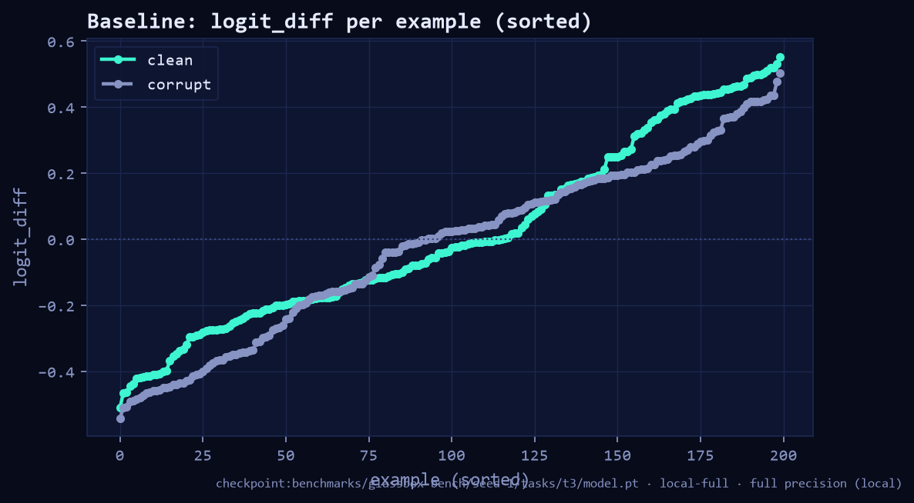

# t3 (glassbox-bench seed-1): no behaviour to explain - the checkpoint does not compute the dataset's function

**Behavior:** BOS + 5 tokens from 6 symbols (ba, ka, ne, se, va, ve); one output symbol (D, E or M) expected at the last position.  
**Model:** `checkpoint:benchmarks/glassbox-bench/seed-1/tasks/t3/model.pt` on `local-full`  
**Status:** unverified (no verification run) · null finding - no mechanism  
**Experiments run:** 2 · **Backends used:** full precision (local)  
**Written:** 2026-11-13 13:30

## Summary

On the local-full backend (full precision) the checkpoint does not perform the behaviour. On 200 prompts its top-1 accuracy against the dataset answers is 0.055, below uniform chance over the 11-token vocabulary (0.091); the mean logit difference between the correct and an incorrect output symbol is 0.015 (std 0.28) on clean prompts and -0.020 on corrupt prompts. The sampled predictions are an input symbol ('ne'), not an output symbol. The pre-registered prediction that accuracy would be >= 0.9 was refuted. Per protocol the investigation stopped here: with no behaviour there is no circuit to localise, so no heads or MLP layers are claimed and no verification was run.

## The recovered algorithm

```python
# No algorithm recovered. The model does not produce the dataset answers (E0002),
# so no predict() is offered and the claimed circuit is empty: [].
```

## Claims and evidence

| # | Claim | Evidence | Produced by |
|---|---|---|---|
| 1 | The checkpoint does not perform the behaviour: top-1 accuracy 0.055 on 200 prompts (uniform chance over 11 tokens is 0.091), mean correct-minus-incorrect logit diff 0.015 +/- 0.28 (local-full, full precision). | E0002 | full precision (local) |
| 2 | The model's logit diff does not distinguish clean from corrupt prompts (0.015 vs -0.020), so there is no input-dependent signal for the answer to patch or attribute. | E0002 | full precision (local) |
| 3 | No attention head or MLP layer is claimed as part of a circuit; the claimed circuit is empty because there is no behaviour to implement. | E0002 | full precision (local) |

## Key plots

**E0002: baseline** (full precision (local))



## Limitations

- Only the baseline was run (2 of 25 experiments). No component-level experiment was performed, by design: localising a circuit for a behaviour the model does not show would fit noise.
- The function the model itself computes at the last position (it appears to emit an input symbol, 'ne', in the 4 sampled predictions) was not characterised; only 4 example predictions were inspected.
- The task statement says the dataset answers are the model's own outputs; E0002 contradicts that for this checkpoint. Either the checkpoint or the dataset labels are not what the task statement describes. I could not determine which from inside the lab.
- By hand inspection the seed-0 labels fit 'more ka than se -> M, more se than ka -> E, tie -> D' on 63 of 64 examples (E0001). This describes the labels, not this model, and was not tested by an experiment.

## Open questions

- Is this checkpoint an untrained / random-initialised model paired with another model's labels?
- What does the checkpoint output across the full input space, and is that output input-dependent at all?

## Prediction record

1 experiments were pre-registered, 1 were run: **0 confirmed, 1 refuted, 0 inconclusive**. Hit rate (confirmed / decided): **0%**.

Refuted predictions (shown, not hidden):

| prereg | experiment | hypothesis | predicted | observed |
|---|---|---|---|---|
| N0003 | E0002 | The loaded checkpoint reproduces the dataset's answers (which on seed 0 fit 'compare count of ka vs count of se: more ka -> M, more se -> E, tie -> D' on 63/64  | `summary.clean_accuracy >= 0.9` | 0.055 |

## Experiments

| id | primitive | backend / precision | seconds | pre-registration |
|---|---|---|---|---|
| E0001 | dataset | full precision (local) | 0.97 | exploratory |
| E0002 | baseline | full precision (local) | 3.43 | N0003: refuted |

## Notebook trail

- `N0001` *decision*: Loaded checkpoint:benchmarks/glassbox-bench/seed-1/tasks/t3/model.pt on local-full (full precision (local)).
- `N0002` *experiment*: dataset (E0001)
- `N0003` *prereg*: The loaded checkpoint reproduces the dataset's answers (which on seed 0 fit 'compare count of ka vs count of se: more ka -> M, more se -> E, tie -> D' on 63/64 examples), so top-1 accuracy at the last position is high.
- `N0004` *experiment*: The loaded checkpoint reproduces the dataset's answers (which on seed 0 fit 'compare count of ka vs count of se: more ka (E0002)
- `N0005` *result*: Baseline (local-full, full precision, n=200, seed 1): the checkpoint does NOT perform the behaviour. Top-1 accuracy against the dataset answers is 0.055 (below uniform chance over the 11-token vocab, 0.091). Mean logit diff correct-minus-incorrect is 0.015 +/- 0.28 on clean and -0.020 on corrupt, i.e. indistinguishable from zero and from each other. Example predictions are the input symbol 'ne', never an output symbol D/E/M. Pre-registered prediction (accuracy >= 0.9) REFUTED. The hypothesis 'the model reproduces the dataset answers' is rejected. Side note, not a claim about the model: the seed-0 dataset labels (E0001) fit 'more ka than se -> M, more se than ka -> E, tie -> D' on 63/64 examples by hand inspection, but this checkpoint does not compute those labels, so there is no mechanism to localise. (E0001, E0002)
- `N0006` *decision*: Stop after baseline per protocol step 1: accuracy is at/below chance, so there is no behaviour to explain. No circuit search, no verify_hypothesis (any 'circuit' found from here would be fit to noise). Report as a null finding with 2 of 25 experiments used.
