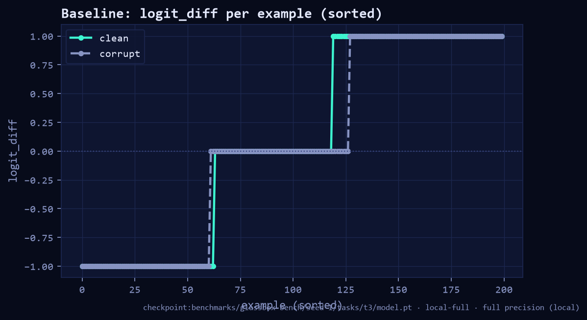
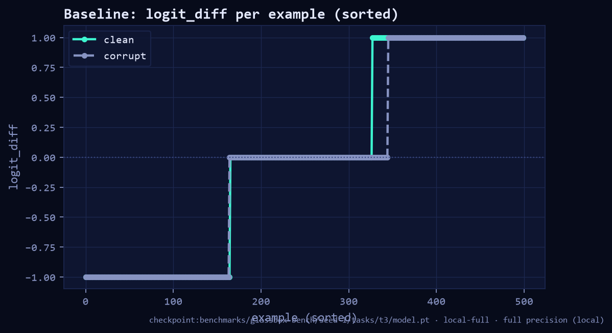

# t3 (null-task-shuffled): no behaviour to explain

**Behavior:** BOS + 5 tokens from 6 symbols -> one output symbol (D/E/M) at the last position, as labelled by dataset task 'bench' at benchmarks/glassbox-bench/seed-1/tasks/t3.  
**Model:** `checkpoint:benchmarks/glassbox-bench/seed-1/tasks/t3/model.pt` on `local-full`  
**Status:** unverified (no verification run) · null result: no mechanism claimed  
**Experiments run:** 3 · **Backends used:** full precision (local)  
**Written:** 2026-11-13 13:33

## Summary

The model does not produce the answers this dataset supplies. At full precision (local-full) its top output matches the dataset answer on 40.5% of 200 inputs (seed 0) and 34.6% of 500 fresh inputs (seed 1); chance for three output symbols is about 33%. The mean logit difference between the labelled answer and the foil is 0.016 on clean inputs versus -0.018 on corrupt inputs. Per the protocol the investigation stopped at step 1: with labels unrelated to the model's output there is no function to recover against this dataset and no circuit to attribute. No algorithm, no circuit and no verification are claimed.

## The recovered algorithm

```python
# No algorithm recovered. The dataset answers are at chance relative to the model's output (E0002, E0003),
# so no predict() is offered and verify_hypothesis was not run.
```

## Claims and evidence

| # | Claim | Evidence | Produced by |
|---|---|---|---|
| 1 | On 200 inputs (seed 0) the model's output equals the dataset answer 40.5% of the time, refuting the pre-registered prediction of >= 90%. | E0002 | full precision (local) |
| 2 | On 500 fresh inputs (seed 1) agreement is 34.6%, inside the pre-registered near-chance band 0.25-0.42; mean logit diff 0.016 clean vs -0.018 corrupt. The labels are statistically unrelated to the model's output. | E0003 | full precision (local) |
| 3 | No attention head or MLP layer is claimed as part of a circuit, because there is no above-chance behaviour to attribute. | E0002, E0003 | full precision (local) |

## Key plots

**E0002: baseline** (full precision (local))



**E0003: baseline** (full precision (local))



## Limitations

- The model may well compute some deterministic function of its input; this investigation did not characterise it, because the only labels available (the dataset's) do not track the model's output and every patching/ablation metric in the lab is defined against those labels.
- Seed 0 at n=200 gave 40.5%, about 2 standard errors above 1/3; the n=500 replication at 34.6% indicates that was sampling noise, but a small label-marginal overlap is not excluded.
- No mechanism experiments (patching, ablation, attention patterns) were run; 22 of 25 budgeted experiments unused.
- verify_hypothesis was not run: there is no hypothesis to verify.

## Open questions

- What function does the model compute on its true outputs? Answering needs a dataset whose answers are the model's actual argmax outputs.
- The task description says the answers are the model's own outputs; the measurements contradict that for this dataset path. Is the dataset a deliberate shuffled-label control?

## Prediction record

2 experiments were pre-registered, 2 were run: **1 confirmed, 1 refuted, 0 inconclusive**. Hit rate (confirmed / decided): **50%**.

Refuted predictions (shown, not hidden):

| prereg | experiment | hypothesis | predicted | observed |
|---|---|---|---|---|
| N0003 | E0002 | The dataset answers are the model's own outputs, so the model reproduces them at the last position nearly perfectly. | `summary.clean_accuracy >= 0.9` | 0.405 |

## Experiments

| id | primitive | backend / precision | seconds | pre-registration |
|---|---|---|---|---|
| E0001 | dataset | full precision (local) | 1.04 | exploratory |
| E0002 | baseline | full precision (local) | 1.49 | N0003: refuted |
| E0003 | baseline | full precision (local) | 2.72 | N0006: confirmed |

## Notebook trail

- `N0001` *decision*: Loaded checkpoint:benchmarks/glassbox-bench/seed-1/tasks/t3/model.pt on local-full (full precision (local)).
- `N0002` *experiment*: dataset (E0001)
- `N0003` *prereg*: The dataset answers are the model's own outputs, so the model reproduces them at the last position nearly perfectly.
- `N0004` *experiment*: The dataset answers are the model's own outputs, so the model reproduces them at the last position nearly perfectly. (E0002)
- `N0005` *result*: Baseline refuted (local-full, full precision): the model matches the dataset answers on only 40.5% of 200 clean inputs (chance for 3 output symbols is ~33%); mean logit diff 0.09 clean vs 0.06 corrupt. The dataset labels are not what the model outputs. Also, by hand on E0001's 64 rows I found no consistent rule (e.g. rows 7,5,1,6,7->E vs 7,5,3,6,7->D and ka-heavy rows on both M and D sides contradict any simple count comparison). One replication on a fresh seed with larger n before stopping. (E0002)
- `N0006` *prereg*: The dataset labels are statistically unrelated to the model's outputs: accuracy stays near chance (1/3) on a fresh, larger sample, and the 0.405 in E0002 was sampling noise or class-marginal overlap.
- `N0007` *experiment*: The dataset labels are statistically unrelated to the model's outputs: accuracy stays near chance (1/3) on a fresh, larg (E0003)
- `N0008` *decision*: Stop: no behaviour to explain. On 500 fresh inputs (seed 1) the model agrees with the dataset answers 34.6% of the time (chance 1/3), mean logit diff 0.016 clean vs -0.018 corrupt (E0003); seed 0 gave 40.5% on 200 (E0002). The labels this dataset supplies are not related to what the model outputs, so any circuit 'found' against this metric would be a false discovery. No mechanism search, no verify_hypothesis run. 22 of 25 experiments unused. (E0002, E0003)
