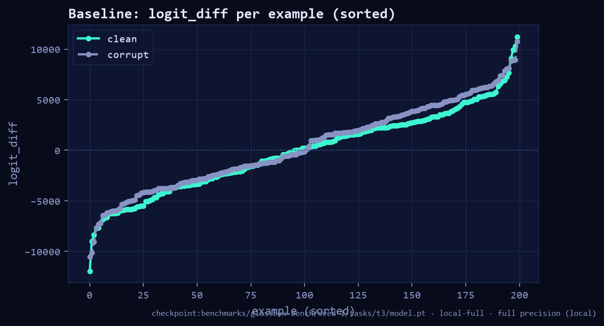
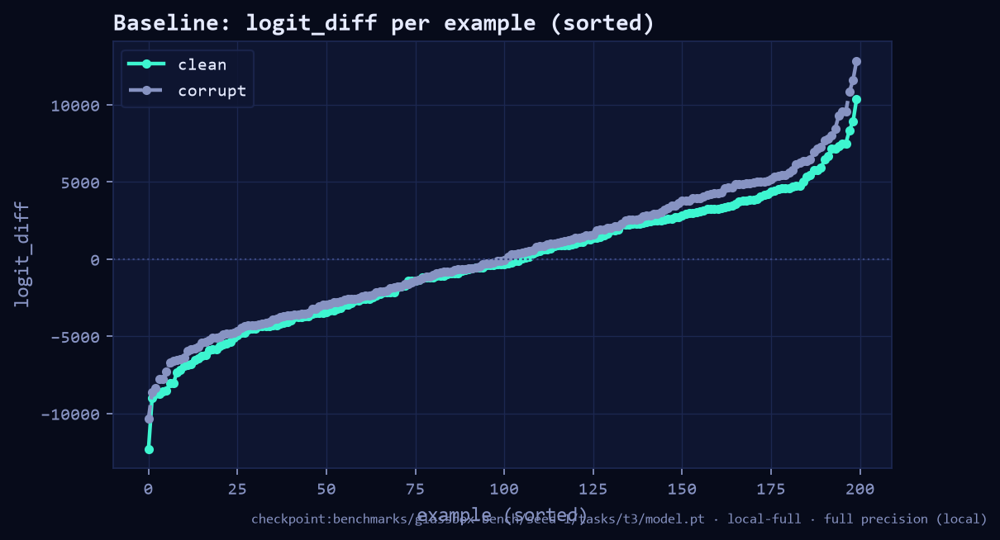

# t3 (null-weight-shuffled): the checkpoint does not perform the labelled behaviour; no circuit claimed

**Behavior:** BOS + 5 tokens from 6 symbols (ba, ka, ne, se, va, ve); the model is said to output one symbol (D, E or M) at the last position, with dataset answers equal to the model's own outputs.  
**Model:** `checkpoint:benchmarks/glassbox-bench/seed-1/tasks/t3/model.pt` on `local-full`  
**Status:** unverified (no verification run) · no behaviour found (null result)  
**Experiments run:** 3 · **Backends used:** full precision (local)  
**Written:** 2026-11-13 13:31

## Summary

On local-full (full precision) the loaded checkpoint reproduces the dataset's answers on 4% of 200 inputs, on two independent seeds (E0002, E0003). That is below 3-way chance. The logit difference between labelled answer and foil has mean near zero relative to a standard deviation of about 4100, and the top-1 prediction is often an input symbol (va, ve) rather than an output symbol. There is therefore no behaviour to explain: no function, no circuit and no predict() are claimed, and verification was deliberately not run. The investigation stopped after 3 of 25 experiments.

## The recovered algorithm

```python
# No algorithm recovered.
# The checkpoint's outputs do not match the dataset answers (4% agreement, E0002/E0003),
# so any predict() would describe the labels, not the model.
```

## Claims and evidence

| # | Claim | Evidence | Produced by |
|---|---|---|---|
| 1 | The checkpoint does not reproduce the dataset answers: clean accuracy 0.04 on 200 inputs (seed 1), logit diff mean -107, std 4096. The pre-registered prediction of >=0.99 accuracy was refuted. | E0002 | full precision (local) |
| 2 | The failure replicates on an independent sample: clean accuracy 0.04 on 200 inputs (seed 2), logit diff mean -281, std 4097; pre-registered prediction of <=0.2 confirmed. | E0003 | full precision (local) |
| 3 | No attention head or MLP layer is claimed as part of a circuit, because there is no above-chance behaviour for a circuit to implement. | E0002, E0003 | full precision (local) |

## Key plots

**E0002: baseline** (full precision (local))



**E0003: baseline** (full precision (local))



## Limitations

- Only the baseline was measured; no component-level experiments were run, since without a behaviour their effects would be uninterpretable.
- The 64 dataset labels seen in E0001 mostly fit 'E if count(se) > count(ka), M if count(ka) > count(se), D if equal' (62/64 by hand). This describes the labels only, was not tested against the model, and is not a claim about this checkpoint.
- Accuracy of 4% is below 1/3 chance over D/E/M, consistent with the model often predicting tokens outside the output set; the distribution of its predictions was not characterised further.

## Open questions

- Why do the dataset answers not match this checkpoint's outputs: is the checkpoint a weight-shuffled null of the model that generated the labels?
- Does the checkpoint compute any structured function of its input at all, or are its outputs effectively arbitrary?

## Prediction record

2 experiments were pre-registered, 2 were run: **1 confirmed, 1 refuted, 0 inconclusive**. Hit rate (confirmed / decided): **50%**.

Refuted predictions (shown, not hidden):

| prereg | experiment | hypothesis | predicted | observed |
|---|---|---|---|---|
| N0003 | E0002 | The model deterministically outputs one of D/E/M at the last position; since dataset answers are its own outputs, baseline accuracy is ~1 with a clear positive  | `summary.clean_accuracy >= 0.99` | 0.040 |

## Experiments

| id | primitive | backend / precision | seconds | pre-registration |
|---|---|---|---|---|
| E0001 | dataset | full precision (local) | 0.41 | exploratory |
| E0002 | baseline | full precision (local) | 1.47 | N0003: refuted |
| E0003 | baseline | full precision (local) | 1.01 | N0006: confirmed |

## Notebook trail

- `N0001` *decision*: Loaded checkpoint:benchmarks/glassbox-bench/seed-1/tasks/t3/model.pt on local-full (full precision (local)).
- `N0002` *experiment*: dataset (E0001)
- `N0003` *prereg*: The model deterministically outputs one of D/E/M at the last position; since dataset answers are its own outputs, baseline accuracy is ~1 with a clear positive logit margin.
- `N0004` *experiment*: The model deterministically outputs one of D/E/M at the last position; since dataset answers are its own outputs, baseli (E0002)
- `N0005` *result*: Baseline refuted (E0002, local-full, full precision): on 200 bench inputs (seed 1) the loaded checkpoint reproduces the dataset's answers on only 4% of inputs; logit diff mean -107 with std 4096 (corrupt mean +354), and its top prediction is often an input symbol ('va') rather than an output symbol D/E/M. The checkpoint does not perform the behaviour the dataset labels describe. Side observation from the E0001 labels only (not from the model): 62/64 labels fit 'compare count(se) vs count(ka)', but the model does not compute those labels, so this is not a mechanism claim. (E0001, E0002)
- `N0006` *prereg*: The checkpoint does not perform the labelled behaviour at all: the E0002 failure replicates on an independent sample, with accuracy at or below chance for a 3-way output (1/3).
- `N0007` *experiment*: The checkpoint does not perform the labelled behaviour at all: the E0002 failure replicates on an independent sample, wi (E0003)
- `N0008` *decision*: Stop at step 1. Two independent baselines (E0002 seed 1, E0003 seed 2; n=200 each, local-full full precision) both give 4% accuracy against the dataset answers, below 3-way chance, with logit-diff std ~4100 and top predictions frequently being input symbols. The checkpoint does not perform the labelled behaviour, so there is no mechanism to localise. No circuit is claimed and verify_hypothesis is not run: any circuit or predict() would be fitted to labels the model does not produce. 22 of 25 experiments left unused. (E0002, E0003)
