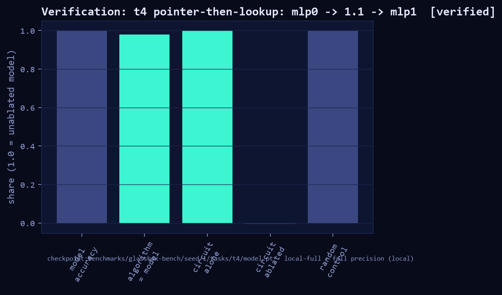
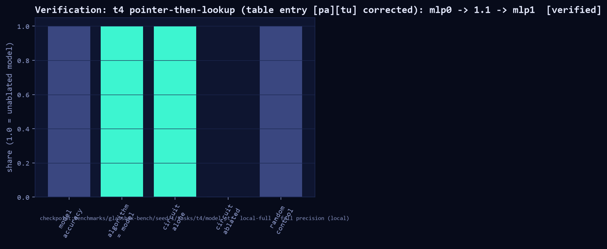
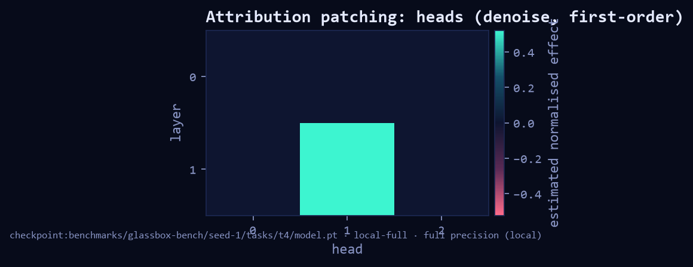
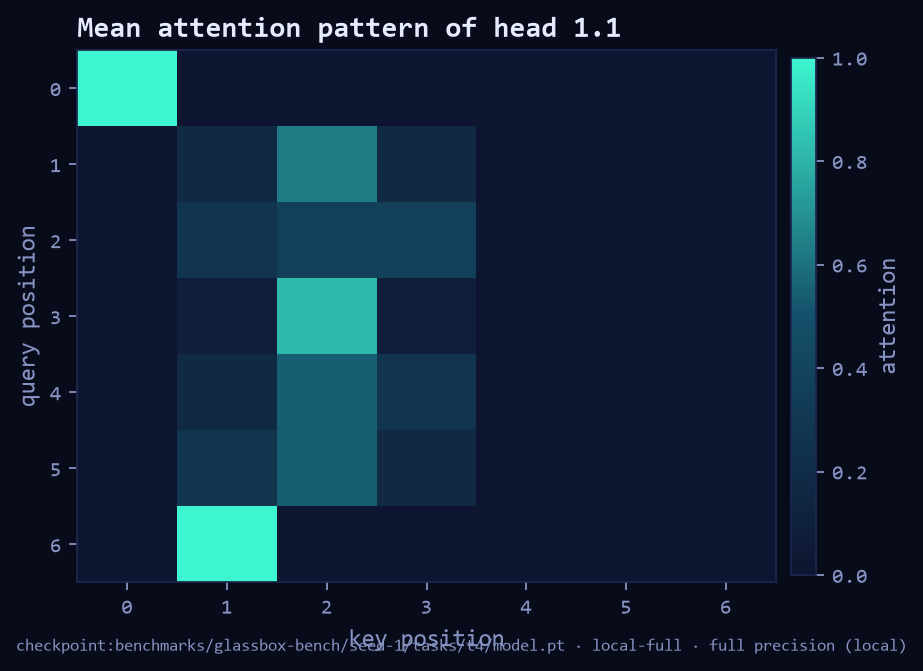
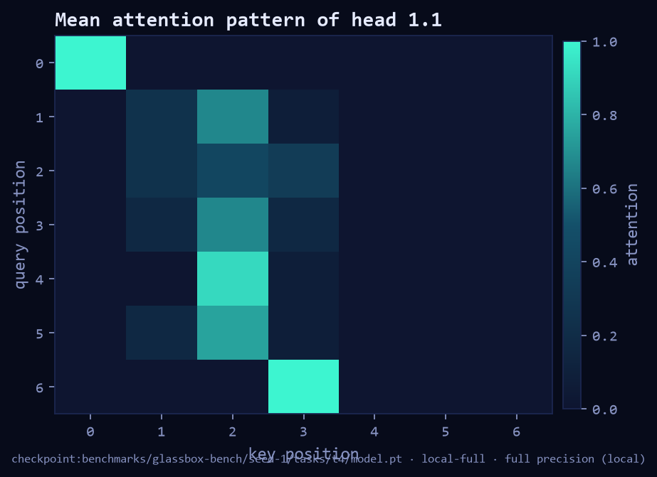
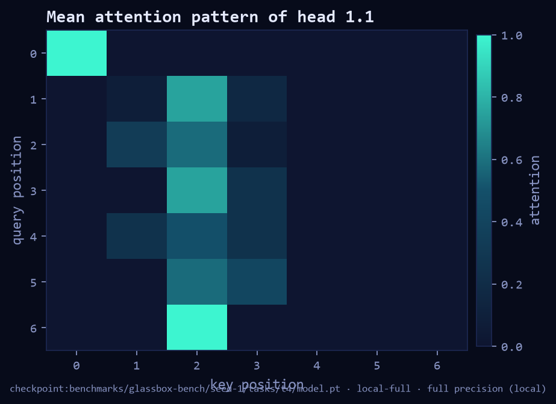
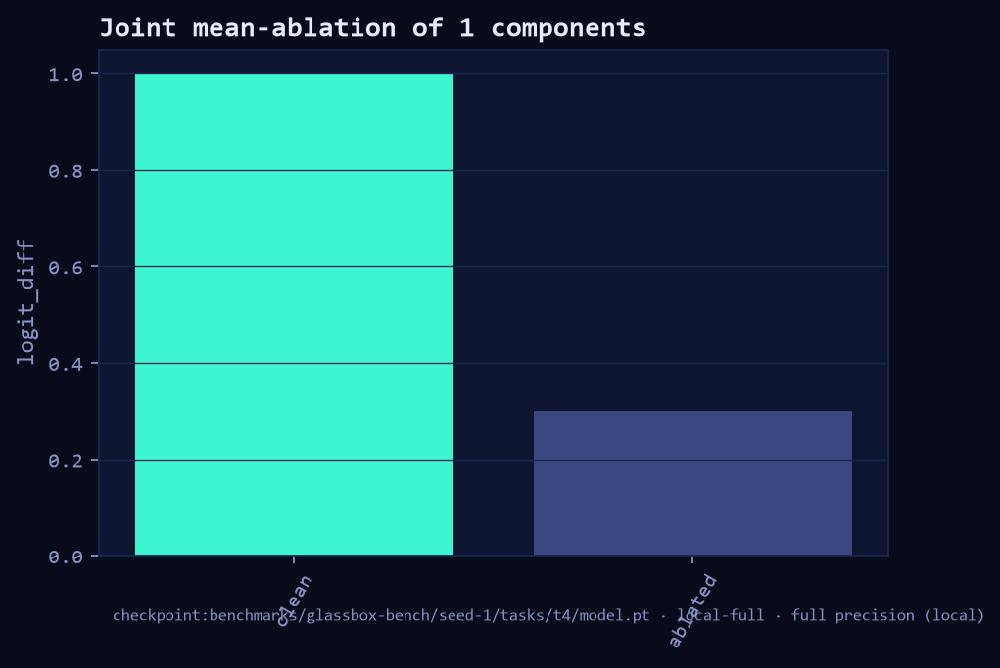

# t4: pointer-then-lookup in a 2-layer benchmark transformer (mlp0 -> head 1.1 -> mlp1)

**Behavior:** Input BOS + 6 tokens from {fu=2, ko=3, ni=4, pa=5, tu=6}; the model outputs one symbol at the last position.  
**Model:** `checkpoint:benchmarks/glassbox-bench/seed-1/tasks/t4/model.pt` on `local-full`  
**Status:** verified · verified  
**Experiments run:** 15 · **Backends used:** full precision (local)  
**Written:** 2026-11-13 13:01

## Summary

The output depends on only two input tokens: the last token t6 and one token x from positions 1-3, chosen by t6 (ko -> position 1, ni -> position 3, fu/pa/tu -> position 2). The output is a fixed 5x5 lookup TABLE[t6][x]. Positions 4 and 5 are never used. Circuit: mlp0 supplies the pointer derived from the last token, head 1.1 attends one-hot from the last position to the pointed position, mlp1 produces the output. Heads 0.0, 0.1, 0.2, 1.0, 1.2 play no part. All numbers are from local-full (full precision). Held-out verification V0002 (n=400, unused seed): predict() agrees with the model on 100% of inputs; ablating the circuit drops the metric to 0.002 of clean (accuracy 0.21, chance 0.2); ablating everything else leaves 1.0.

## The recovered algorithm

```python
def predict(tokens, prompt):
    last = tokens[6]                      # fu=2 ko=3 ni=4 pa=5 tu=6
    ptr = {3: 1, 4: 3}.get(last, 2)       # mlp0 + head 1.1: ko->pos1, ni->pos3, fu/pa/tu->pos2
    x = tokens[ptr]                       # head 1.1 copies the pointed token
    TABLE = {                             # mlp1
        2: {2: 3, 3: 3, 4: 3, 5: 4, 6: 6},
        3: {2: 3, 3: 4, 4: 4, 5: 2, 6: 5},
        4: {2: 5, 3: 2, 4: 4, 5: 3, 6: 6},
        5: {2: 5, 3: 5, 4: 2, 5: 2, 6: 2},
        6: {2: 2, 3: 6, 4: 3, 5: 4, 6: 3},
    }
    return TABLE[last][x]
```

## Circuit


## Claims and evidence

| # | Claim | Evidence | Produced by |
|---|---|---|---|
| 1 | The model performs a deterministic behaviour: accuracy 1.0 against its own outputs on 64 inputs. | E0003 | full precision (local) |
| 2 | The function is output = TABLE[t6][x], x = token at position 1 (t6=ko), 3 (t6=ni) or 2 (t6=fu/pa/tu). On 400 held-out inputs this code matches the model 100% (task-shuffled null: mean 0.22, max 0.27). A first version with one mis-transcribed table entry ([pa][tu]) matched 98%, with all 4 misses on exactly that entry. | V0002, V0001 | full precision (local) |
| 3 | Head 1.1 implements the pointer: from the last position its attention is 1.0 on position 1 for ko-ending inputs, 1.0 on position 3 for ni-ending inputs and 1.0 on position 2 for fu/pa/tu-ending inputs. | E0005, E0006, E0007 | full precision (local) |
| 4 | Head 1.1 and mlp1 are necessary: joint mean ablation leaves 0.015 of the clean metric. | E0008, V0002 | full precision (local) |
| 5 | mlp0 is part of the circuit and its role is consistent with supplying the pointer: mean-ablating it is harmless when all inputs share the same pointer (fu/pa/tu-ending, 1.0 of clean) and destructive when the pointers differ (ko/ni-ending, 0.30 of clean). The original prediction that everything outside {1.1, mlp1} is inert was refuted (0.66 of clean, predicted >= 0.9). | E0013, E0014, E0009 | full precision (local) |
| 6 | Heads 0.0, 0.1, 0.2, 1.0 and 1.2 play no part: jointly mean-ablating them leaves 1.0 of the clean metric, and with everything outside {mlp0, 1.1, mlp1} ablated the model keeps accuracy 1.0. | E0015, V0002 | full precision (local) |
| 7 | The circuit {mlp0, 1.1, mlp1} is necessary and sufficient on held-out data: circuit ablated -> 0.002 of clean (accuracy 0.2125); everything else ablated -> 1.0 of clean (accuracy 1.0); both beyond every null control. | V0002, V0001 | full precision (local) |

## Verification

### V0001: t4 pointer-then-lookup: mlp0 -> 1.1 -> mlp1  (full precision (local))

| check | value |
|---|---|
| status | verified |
| held-out inputs | 200 |
| model accuracy | 1.000 |
| algorithm agrees with model | 0.980 |
| algorithm accuracy vs ground truth | 0.980 |
| circuit size | 3 of 8 components |
| metric kept with ONLY the circuit | 1.000 |
| metric kept with the circuit ABLATED | -0.004 |
| random same-size ablation (control) | 1.000, 1.000, 1.000 |

Passed at full precision, and every effect exceeds its null distribution.



### V0002: t4 pointer-then-lookup (table entry [pa][tu] corrected): mlp0 -> 1.1 -> mlp1  (full precision (local))

| check | value |
|---|---|
| status | verified |
| held-out inputs | 400 |
| model accuracy | 1.000 |
| algorithm agrees with model | 1.000 |
| algorithm accuracy vs ground truth | 1.000 |
| circuit size | 3 of 8 components |
| metric kept with ONLY the circuit | 1.000 |
| metric kept with the circuit ABLATED | 0.002 |
| random same-size ablation (control) | 1.000, 1.000, 1.000 |

Passed at full precision, and every effect exceeds its null distribution.



## Key plots

**E0002: attribution_patching** (full precision (local))



**E0005: attention_patterns** (full precision (local))



**E0006: attention_patterns** (full precision (local))



**E0007: attention_patterns** (full precision (local))



**E0014: ablation** (full precision (local))



## Limitations

- The mlp0 -> head 1.1 query edge was not measured directly: path_patching with sender mlp0 raised a ValueError, so the pointer role of mlp0 rests on conditional mean ablations (E0013, E0014) plus the attention patterns. Those do not exclude that mlp0 writes the pointer at a position other than the last one, nor a role beyond the pointer that happens to be shared by fu/pa/tu.
- How mlp1 receives t6 (directly from the embedding via the residual stream) was not isolated.
- The lookup table was read off input/output pairs (E0001) and confirmed behaviourally; no structure inside mlp1 was analysed. The table looks arbitrary and I found no simpler closed form.
- Attribution patching (E0002) assigned mlp0 zero effect; that first-order estimate was wrong, as the ablations showed.
- E0010-E0012 (per-component sweeps, mlp_out patching) were exploratory and are used only as pointers to the pre-registered runs.

## Open questions

- Does mlp0 encode the pointer as a position index read by 1.1's query at the last position only?
- Is there any simpler rule that generates the 5x5 table?

## Prediction record

9 experiments were pre-registered, 9 were run: **8 confirmed, 1 refuted, 0 inconclusive**. Hit rate (confirmed / decided): **89%**.

Refuted predictions (shown, not hidden):

| prereg | experiment | hypothesis | predicted | observed |
|---|---|---|---|---|
| N0012 | E0009 | Everything except head 1.1 and mlp1 is inert: jointly mean-ablating heads 0.0, 0.1, 0.2, 1.0, 1.2 and mlp0 leaves the behaviour intact. | `summary.fraction_of_clean >= 0.9` | 0.661 |

Exploratory runs (no pre-registration; they cannot be the only support for a claim): E0002, E0004, E0010, E0011, E0012.

## Experiments

| id | primitive | backend / precision | seconds | pre-registration |
|---|---|---|---|---|
| E0001 | dataset | full precision (local) | 0.06 | exploratory |
| E0002 | attribution_patching | full precision (local) | 0.5 | exploratory |
| E0003 | baseline | full precision (local) | 0.19 | N0003: confirmed |
| E0004 | attention_patterns | full precision (local) | 0.2 | exploratory |
| E0005 | attention_patterns | full precision (local) | 0.13 | N0008: confirmed |
| E0006 | attention_patterns | full precision (local) | 0.13 | N0009: confirmed |
| E0007 | attention_patterns | full precision (local) | 0.14 | N0010: confirmed |
| E0008 | ablation | full precision (local) | 1.99 | N0011: confirmed |
| E0009 | ablation | full precision (local) | 0.23 | N0012: refuted |
| E0010 | ablation | full precision (local) | 0.3 | exploratory |
| E0011 | ablation | full precision (local) | 0.26 | exploratory |
| E0012 | activation_patching | full precision (local) | 0.28 | exploratory |
| E0013 | ablation | full precision (local) | 0.09 | N0023: confirmed |
| E0014 | ablation | full precision (local) | 0.09 | N0024: confirmed |
| E0015 | ablation | full precision (local) | 0.2 | N0025: confirmed |
| V0001 | verify | full precision (local) |  | verification |
| V0002 | verify | full precision (local) |  | verification |

## Notebook trail

- `N0001` *decision*: Loaded checkpoint:benchmarks/glassbox-bench/seed-1/tasks/t4/model.pt on local-full (full precision (local)).
- `N0002` *experiment*: dataset (E0001)
- `N0003` *prereg*: The model deterministically outputs one symbol at the last position; since the dataset answers are the model's own outputs, top-1 accuracy against them is ~1.
- `N0004` *experiment*: first screen: heads, layers, positions (E0002)
- `N0005` *experiment*: The model deterministically outputs one symbol at the last position; since the dataset answers are the model's own outpu (E0003)
- `N0006` *experiment*: look at output shape and where 1.1 attends from the last position (E0004)
- `N0007` *hypothesis* **[revised]**: H1 (function + circuit). From E0001 input/output pairs and the E0002 screen: the output depends only on the last token t6 and one of positions 1-3 chosen by t6 (pointer): ko(3)->pos1, ni(4)->pos3, fu/pa/tu(2,5,6)->pos2. Output = lookup TABLE[t6][x] with x the token at the pointed position: t6=2:{2:3,3:3,4:3,5:4,6:6}; t6=3:{2:3,3:4,4:4,5:2,6:5}; t6=4:{2:5,3:2,4:4,5:3,6:6}; t6=5:{2:5,3:5,4:2,5:2,6:5}; t6=6:{2:2,3:6,4:3,5:4,6:3}. Circuit: head 1.1 at the last position attends one-hot to the pointed position and copies x; mlp1 combines x with t6 into the output. Layer 0 (heads 0.0-0.2, mlp0) and heads 1.0, 1.2 are inert. Positions 4 and 5 never matter.
- `N0008` *prereg*: When the last token is ko (id 3), head 1.1 at the last position attends (near) one-hot to position 1.
- `N0009` *prereg*: When the last token is ni (id 4), head 1.1 at the last position attends (near) one-hot to position 3.
- `N0010` *prereg*: When the last token is fu, pa or tu (ids 2, 5, 6), head 1.1 at the last position attends (near) one-hot to position 2.
- `N0011` *prereg*: Head 1.1 and mlp1 are necessary: mean-ablating them jointly destroys the behaviour.
- `N0012` *prereg*: Everything except head 1.1 and mlp1 is inert: jointly mean-ablating heads 0.0, 0.1, 0.2, 1.0, 1.2 and mlp0 leaves the behaviour intact.
- `N0013` *experiment*: When the last token is ko (id 3), head 1.1 at the last position attends (near) one-hot to position 1. (E0005)
- `N0014` *experiment*: When the last token is ni (id 4), head 1.1 at the last position attends (near) one-hot to position 3. (E0006)
- `N0015` *experiment*: When the last token is fu, pa or tu (ids 2, 5, 6), head 1.1 at the last position attends (near) one-hot to position 2. (E0007)
- `N0016` *experiment*: Head 1.1 and mlp1 are necessary: mean-ablating them jointly destroys the behaviour. (E0008)
- `N0017` *experiment*: Everything except head 1.1 and mlp1 is inert: jointly mean-ablating heads 0.0, 0.1, 0.2, 1.0, 1.2 and mlp0 leaves the be (E0009)
- `N0018` *result*: Pointer confirmed: 1.1 from last pos attends 1.0 to pos1 (ko), pos3 (ni), pos2 (fu/pa/tu) (E0005-E0007). 1.1+mlp1 necessary: joint mean ablation -> 0.015 of clean (E0008). REFUTED: ablating all other components (0.0,0.1,0.2,1.0,1.2,mlp0) leaves only 0.66 of clean, predicted >=0.9 (E0009). So at least one component outside {1.1, mlp1} contributes; the 'everything else is inert' part of H1 is wrong as stated. Next: per-component sweeps to find which. (E0005, E0006, E0007, E0008, E0009)
- `N0019` *experiment*: ablation (E0010)
- `N0020` *experiment*: ablation (E0011)
- `N0021` *experiment*: path_patching with sender mlp0 errored (ValueError: unpack) - senders seem to be heads only. Using activation patching of mlp_out by layer/position instead. (E0012)
- `N0022` *hypothesis* **[revised]** -> N0007: Revised after E0009 (refuted) and exploratory E0010-E0012: mlp0 is NOT inert (mean ablation -> 0.66 of clean, E0011; path_patching with sender mlp0 errored so it could not be used). H2: mlp0 at the last position turns the last token into the pointer index that head 1.1's query uses. Mean-ablating mlp0 replaces the pointer with the dataset average, which is dominated by pos2 (64% of inputs), explaining ~0.66 survival. Predictions: (a) on inputs ending only in fu/pa/tu (all point to pos2), mean-ablating mlp0 is harmless; (b) on inputs ending only in ko/ni it breaks the behaviour; (c) the five heads other than 1.1 are jointly inert. Circuit = {mlp0, 1.1, mlp1}.
- `N0023` *prereg*: mlp0 only supplies the pointer index (same for fu/pa/tu): mean-ablating mlp0 over a set of inputs that all end in fu/pa/tu leaves the behaviour intact.
- `N0024` *prereg*: mlp0 supplies the pointer index: on inputs ending in ko (pos1) or ni (pos3), mean-ablating mlp0 mixes the two pointers and breaks the behaviour.
- `N0025` *prereg*: The five heads other than 1.1 (0.0, 0.1, 0.2, 1.0, 1.2) play no part: jointly mean-ablating them leaves the behaviour intact.
- `N0026` *experiment*: mlp0 only supplies the pointer index (same for fu/pa/tu): mean-ablating mlp0 over a set of inputs that all end in fu/pa/ (E0013)
- `N0027` *experiment*: mlp0 supplies the pointer index: on inputs ending in ko (pos1) or ni (pos3), mean-ablating mlp0 mixes the two pointers a (E0014)
- `N0028` *experiment*: The five heads other than 1.1 (0.0, 0.1, 0.2, 1.0, 1.2) play no part: jointly mean-ablating them leaves the behaviour in (E0015)
- `N0029` *verification*: t4 pointer-then-lookup: mlp0 -> 1.1 -> mlp1: verified. Passed at full precision, and every effect exceeds its null distribution. (V0001)
- `N0030` *result*: H2 confirmed: mlp0 ablation harmless on fu/pa/tu-ending inputs (1.0, E0013), destructive on ko/ni-ending inputs (0.30, E0014); five other heads jointly inert (1.0, E0015). V0001 (seed 7, n=200): verified, agreement 0.98, circuit ablated -> -0.004 (acc 0.255), everything else ablated -> 1.0. The 4 disagreements all have last=pa(5) and pointed token tu(6): model says fu(2), my table said pa(5). Cause: I mis-transcribed one example in E0001 (clean index 62, [0,6,6,3,3,6,5], whose answer is 2, not 5). Corrected table entry TABLE[5][6]=2; re-verifying on a fresh seed. (E0013, E0014, E0015, V0001, E0001)
- `N0031` *verification*: t4 pointer-then-lookup (table entry [pa][tu] corrected): mlp0 -> 1.1 -> mlp1: verified. Passed at full precision, and every effect exceeds its null distribution. (V0002)
