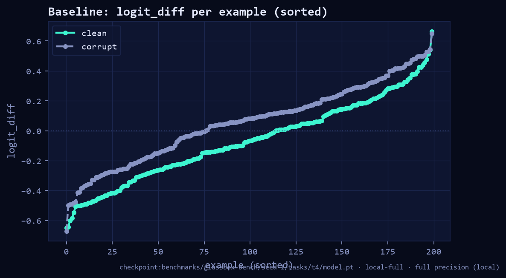
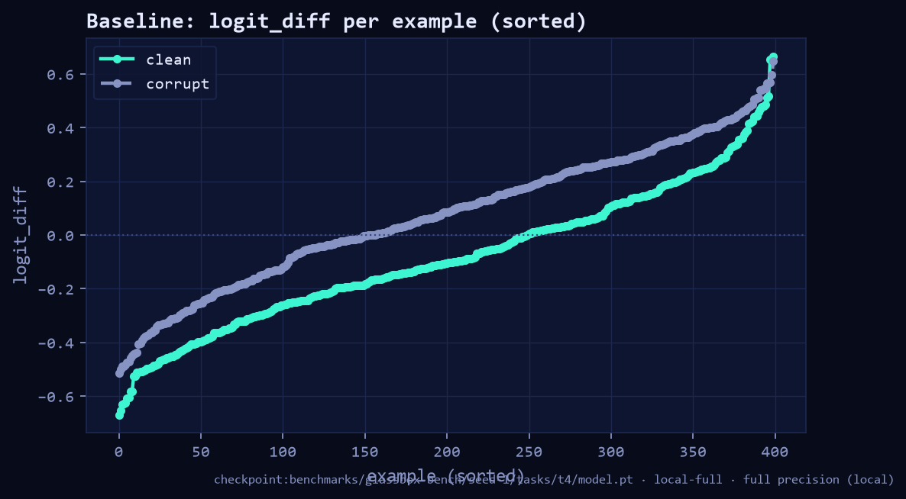

# t4 (glassbox-bench seed-1): no behaviour to explain - null finding

**Behavior:** BOS + 6 tokens from 5 symbols -> one symbol at the last position (dataset task 'bench', benchmarks/glassbox-bench/seed-1/tasks/t4).  
**Model:** `checkpoint:benchmarks/glassbox-bench/seed-1/tasks/t4/model.pt` on `local-full`  
**Status:** unverified (no verification run) · null finding: no mechanism claimed  
**Experiments run:** 3 · **Backends used:** full precision (local)  
**Written:** 2026-11-13 13:35

## Summary

The checkpoint (2 layers, 3 heads, d_model 36, local-full, full precision) does not reproduce the answers of the bench dataset. Argmax accuracy is 0.09 on 200 prompts (seed 0) and 0.1175 on 400 prompts (seed 1), at or below chance (0.14 over the 7-token vocabulary, 0.20 over the 5 symbols). The logit difference between the labelled answer and a wrong symbol averages -0.07 to -0.08 with std about 0.27, so the model has no margin for the labelled answer. Following the protocol, the investigation stopped here: no function was recovered, no circuit is claimed and verify_hypothesis was not run. 3 of 25 experiments used.

## The recovered algorithm

```python
# No algorithm recovered. The model's output is unrelated to the dataset answers (E0002, E0003).
# No predict() is offered: any function fitted to these labels would not describe the model.
```

## Claims and evidence

| # | Claim | Evidence | Produced by |
|---|---|---|---|
| 1 | The model does not compute the dataset's function: argmax accuracy is 0.09 (n=200, seed 0) and 0.1175 (n=400, seed 1), at chance level. Full precision, local-full. | E0002, E0003 | full precision (local) |
| 2 | The model has no margin for the labelled answer: mean logit diff -0.066 (std 0.273) and -0.085 (std 0.260). | E0002, E0003 | full precision (local) |
| 3 | The premise that the dataset answers are the model's own outputs was pre-registered (accuracy >= 0.99) and refuted (observed 0.09). | E0002 | full precision (local) |

## Key plots

**E0002: baseline** (full precision (local))



**E0003: baseline** (full precision (local))



## Limitations

- Only baselines were run; no component-level experiment was done, because there is no behaviour for components to implement.
- The task statement says the dataset answers are the model's own outputs; the lab's baseline contradicts that. I did not determine whether the labels come from a different model or the checkpoint is untrained; both are consistent with the data.
- The model's own input-output map (it mostly emits 'ko' or 'fu' in the examples shown) was not characterised; with logit differences around 0.3 it is a low-margin map, but that was not tested directly.
- verify_hypothesis was not run, so there are no agreement or causal numbers.

## Open questions

- Is this checkpoint a random-initialisation control, or do the dataset labels belong to a different model?
- Does the model's own low-margin output map have any compact description?

## Prediction record

2 experiments were pre-registered, 2 were run: **1 confirmed, 1 refuted, 0 inconclusive**. Hit rate (confirmed / decided): **50%**.

Refuted predictions (shown, not hidden):

| prereg | experiment | hypothesis | predicted | observed |
|---|---|---|---|---|
| N0003 | E0002 | The dataset labels are the model's own argmax outputs, so the model reproduces them on every prompt; whether this reflects a confident computation or a low-marg | `summary.clean_accuracy >= 0.99` | 0.090 |

## Experiments

| id | primitive | backend / precision | seconds | pre-registration |
|---|---|---|---|---|
| E0001 | dataset | full precision (local) | 0.37 | exploratory |
| E0002 | baseline | full precision (local) | 1.47 | N0003: refuted |
| E0003 | baseline | full precision (local) | 1.25 | N0006: confirmed |

## Notebook trail

- `N0001` *decision*: Loaded checkpoint:benchmarks/glassbox-bench/seed-1/tasks/t4/model.pt on local-full (full precision (local)).
- `N0002` *experiment*: dataset (E0001)
- `N0003` *prereg*: The dataset labels are the model's own argmax outputs, so the model reproduces them on every prompt; whether this reflects a confident computation or a low-margin arbitrary map is read from the logit-diff size.
- `N0004` *experiment*: The dataset labels are the model's own argmax outputs, so the model reproduces them on every prompt; whether this reflec (E0002)
- `N0005` *hypothesis* **[rejected]**: H1: The model reproduces the bench dataset answers (they are stated to be its own outputs), so there is a behaviour to explain.
- `N0006` *prereg*: The model does not compute the dataset's answers: E0002's 9% accuracy is not a seed fluke, and on a fresh sample it stays at chance level (1/7 = 0.14 over the vocabulary, 1/5 = 0.2 over symbols).
- `N0007` *experiment*: The model does not compute the dataset's answers: E0002's 9% accuracy is not a seed fluke, and on a fresh sample it stay (E0003)
- `N0008` *hypothesis* **[rejected]** -> N0005: Rejected by E0002 (pre-registered accuracy >= 0.99, observed 0.09, n=200, seed 0) and replicated in E0003 (0.1175, n=400, seed 1). The model does not reproduce the dataset answers; mean logit diff is slightly negative (-0.07 / -0.08) with std ~0.27, i.e. no margin for the labelled answer. local-full, full precision.
- `N0009` *result*: The model is at chance on the bench task: argmax accuracy 0.09 (E0002) and 0.1175 (E0003) against a chance level of 0.14 (7-token vocabulary) to 0.20 (5 symbols); logit diff correct-vs-incorrect averages -0.07 and -0.08, std 0.26-0.27. Example predictions are mostly 'ko' or 'fu' regardless of the expected answer. There is no behaviour to explain, so no circuit is claimed. (E0002, E0003)
- `N0010` *decision*: Stop after 3 of 25 experiments, per protocol step 1: the model does not do the behaviour, so screening, patching and verify_hypothesis would only fit noise. No verify_hypothesis run; report as a null finding.
