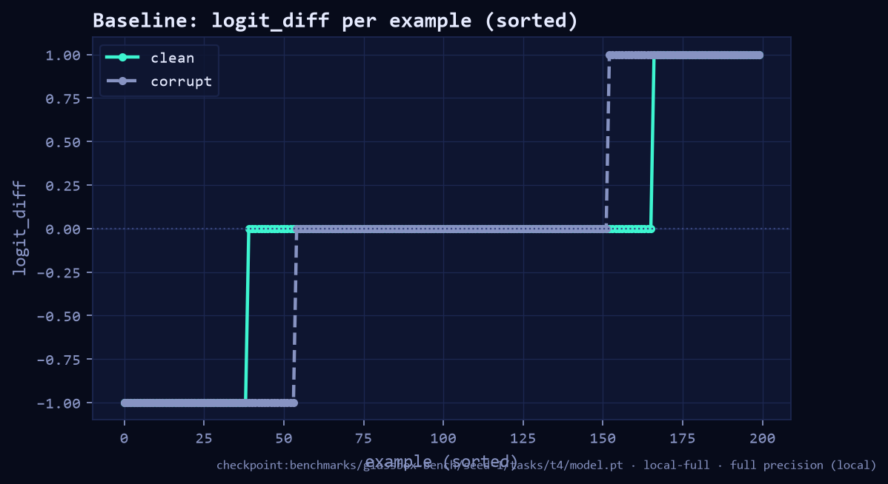

# t4 (seed-1): no behaviour to explain - dataset answers do not match the model's outputs

**Behavior:** BOS + 6 tokens over 5 symbols -> one symbol at the last position, as labelled by dataset task 'bench' (benchmarks/glassbox-bench/seed-1/tasks/t4).  
**Model:** `checkpoint:benchmarks/glassbox-bench/seed-1/tasks/t4/model.pt` on `local-full`  
**Status:** unverified (no verification run) · null result - behaviour absent, nothing verified  
**Experiments run:** 2 · **Backends used:** full precision (local)  
**Written:** 2026-11-13 13:39

## Summary

The investigation stopped at the baseline. On 200 inputs at full precision (local-full) the model's top token equals the dataset's answer only 17% of the time, against 20% chance for five symbols; the mean logit difference is -0.025. The pre-registered prediction (accuracy >= 0.95) was refuted. The model does emit a crisp output (per-prompt logit differences are exactly -1, 0 or +1), but that output is unrelated to the dataset labels, so the labelled behaviour does not exist in this model. No function, circuit or predict() is claimed and no verification was run.

## The recovered algorithm

```python
# No algorithm recovered.
# The dataset labels are at chance relative to the model's outputs (E0002),
# so there is no labelled behaviour to write as code.
```

## Claims and evidence

| # | Claim | Evidence | Produced by |
|---|---|---|---|
| 1 | The model does not produce the dataset's answers: accuracy 0.17 on n=200 (chance 0.20), mean logit diff -0.025, full precision local-full. Pre-registered prediction of >= 0.95 accuracy refuted. | E0002 | full precision (local) |
| 2 | The model's output is nonetheless crisp: every per-prompt logit difference between the labelled answer and the foil is exactly -1, 0 or +1, so the mismatch is in the labels' relation to the model, not in a noisy model. | E0002 | full precision (local) |

## Key plots

**E0002: baseline** (full precision (local))



## Limitations

- No circuit, no function and no verify_hypothesis run: status is neither verified nor screening-pass.
- One baseline on one seed (n=200); 0.17 is far from the 0.95 threshold and within sampling noise of chance (0.20), so it was not replicated.
- What the model actually computes on its own outputs was not investigated; the supplied dataset gives no access to correct labels for it.

## Open questions

- What function does the model compute? Answering this needs a dataset whose answers really are the model's outputs.
- Why does this dataset's answer column disagree with the model, contrary to the task description?

## Prediction record

1 experiments were pre-registered, 1 were run: **0 confirmed, 1 refuted, 0 inconclusive**. Hit rate (confirmed / decided): **0%**.

Refuted predictions (shown, not hidden):

| prereg | experiment | hypothesis | predicted | observed |
|---|---|---|---|---|
| N0003 | E0002 | The model deterministically produces the dataset's answer token at the last position (the answers are stated to be the model's own outputs), so accuracy is ~1. | `summary.clean_accuracy >= 0.95` | 0.170 |

## Experiments

| id | primitive | backend / precision | seconds | pre-registration |
|---|---|---|---|---|
| E0001 | dataset | full precision (local) | 0.15 | exploratory |
| E0002 | baseline | full precision (local) | 0.74 | N0003: refuted |

## Notebook trail

- `N0001` *decision*: Loaded checkpoint:benchmarks/glassbox-bench/seed-1/tasks/t4/model.pt on local-full (full precision (local)).
- `N0002` *experiment*: dataset (E0001)
- `N0003` *prereg*: The model deterministically produces the dataset's answer token at the last position (the answers are stated to be the model's own outputs), so accuracy is ~1.
- `N0004` *experiment*: The model deterministically produces the dataset's answer token at the last position (the answers are stated to be the m (E0002)
- `N0005` *result*: Baseline (local-full, full precision, n=200, seed 1): the model's top token equals the dataset answer on 17% of inputs; chance for 5 symbols is 20%. Mean logit diff -0.025 (corrupt: -0.03). Pre-registered prediction (accuracy >= 0.95) REFUTED. The per-prompt logit diffs are exactly -1, 0 or +1, so the model does emit a crisp one-hot-like output, but that output is unrelated to the dataset's answer labels. The premise 'the answers are the model's own outputs' does not hold for this dataset. E0001 inspection also found no consistent input->label rule (e.g. the same multiset-level features map to different labels). (E0002)
- `N0006` *decision*: Stop per protocol step 1: the model does not do the behaviour defined by the dataset (accuracy 0.17 ~ chance 0.20, E0002). There is no dataset-defined mechanism to explain, so no circuit search, no predict() and no verify_hypothesis: any circuit reported against these labels would be a false discovery. Report as a null result. 2 of 25 experiments used.
