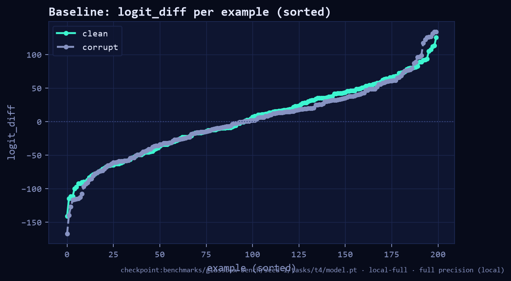
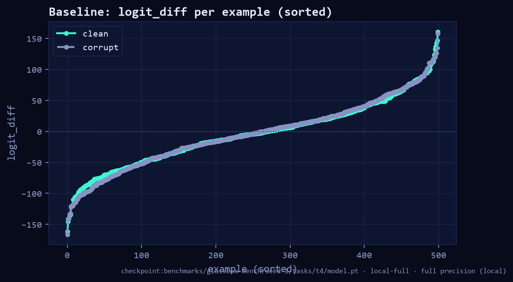

# t4 (null-weight-shuffled): no behaviour to explain

**Behavior:** BOS + 6 tokens from 5 symbols; the model is supposed to output one symbol at the last position, matching the answers recorded in the bench dataset.  
**Model:** `checkpoint:benchmarks/glassbox-bench/seed-1/tasks/t4/model.pt` on `local-full`  
**Status:** unverified (no verification run) · null result: no mechanism claimed  
**Experiments run:** 4 · **Backends used:** full precision (local)  
**Written:** 2026-11-13 13:37

## Summary

The loaded checkpoint does not perform the behaviour. Against the dataset's recorded answers it scores 21.0% on 200 inputs (E0003) and 21.8% on 500 fresh inputs (E0004); chance for 5 symbols is 20%. The correct-vs-incorrect logit difference averages about zero with a spread of ~53 and is the same on clean and corrupt inputs. Following the protocol, the investigation stopped after the baseline: no function, no circuit, no predict() and no verification are claimed. All numbers are from local-full (full precision). 4 of 25 experiments used.

## The recovered algorithm

```python
# No algorithm recovered: the model's output agrees with the recorded answers at chance (E0003, E0004).
# No predict() is offered.
```

## Claims and evidence

| # | Claim | Evidence | Produced by |
|---|---|---|---|
| 1 | The loaded model agrees with the dataset's recorded answers only at chance: 0.21 on n=200 (seed 1), where the pre-registered prediction of >=0.98 was refuted. | E0003 | full precision (local) |
| 2 | The chance-level result replicates on an independent larger sample: 0.218 on n=500 (seed 2), pre-registered as <=0.30 and confirmed. | E0004 | full precision (local) |
| 3 | The logit difference between recorded-correct and incorrect answers carries no signal: mean 2.06 (std 54.1) on clean vs 0.05 on corrupt in E0003, and -4.23 (std 52.9) vs -4.52 in E0004. | E0003, E0004 | full precision (local) |
| 4 | No attention head or MLP layer is claimed as part of a circuit, because there is no behaviour for a circuit to implement. | E0003, E0004 | full precision (local) |

## Key plots

**E0003: baseline** (full precision (local))



**E0004: baseline** (full precision (local))



## Limitations

- The task statement says the dataset answers are the model's own outputs; measured agreement is at chance, so either the checkpoint that was loaded is not the one that produced the labels or its weights have been altered. This investigation cannot tell which.
- The investigation stopped at the baseline; nothing was measured about what the loaded model computes instead (it is deterministic, so it computes some function, but not the labelled one).
- The only screen (E0002, attribution patching, exploratory) gave estimates 10-30x larger than the clean-corrupt gap and was not used for any claim.
- verify_hypothesis was not run: there is no hypothesis to verify.

## Open questions

- Do the recorded labels follow a simple rule? In the 64 examples of E0001 they fit 'the last token selects one of positions 1-3, then a table lookup on (last token, selected token)'. This was fitted by eye, is untested on held-out data, and is a property of the labels, not of this model.
- What function does the loaded checkpoint itself compute, if one cares about it independently of the benchmark labels?

## Prediction record

2 experiments were pre-registered, 2 were run: **1 confirmed, 1 refuted, 0 inconclusive**. Hit rate (confirmed / decided): **50%**.

Refuted predictions (shown, not hidden):

| prereg | experiment | hypothesis | predicted | observed |
|---|---|---|---|---|
| N0003 | E0003 | The model produces its own recorded outputs deterministically on the bench dataset (the behaviour exists and is far from the 20% chance level). | `summary.clean_accuracy >= 0.98` | 0.210 |

Exploratory runs (no pre-registration; they cannot be the only support for a claim): E0002.

## Experiments

| id | primitive | backend / precision | seconds | pre-registration |
|---|---|---|---|---|
| E0001 | dataset | full precision (local) | 0.18 | exploratory |
| E0002 | attribution_patching | full precision (local) | 1.11 | exploratory |
| E0003 | baseline | full precision (local) | 1.0 | N0003: refuted |
| E0004 | baseline | full precision (local) | 3.8 | N0007: confirmed |

## Notebook trail

- `N0001` *decision*: Loaded checkpoint:benchmarks/glassbox-bench/seed-1/tasks/t4/model.pt on local-full (full precision (local)).
- `N0002` *experiment*: dataset (E0001)
- `N0003` *prereg*: The model produces its own recorded outputs deterministically on the bench dataset (the behaviour exists and is far from the 20% chance level).
- `N0004` *experiment*: First screen: which heads / layers / positions matter; also to learn output shape. (E0002)
- `N0005` *experiment*: The model produces its own recorded outputs deterministically on the bench dataset (the behaviour exists and is far from (E0003)
- `N0006` *hypothesis* **[rejected]**: H1: The loaded checkpoint reproduces the bench dataset's recorded answers (accuracy >= 98%), so there is a behaviour to reverse-engineer.
- `N0007` *prereg*: The chance-level baseline in E0003 is not a sampling fluke: on a fresh, larger sample the loaded model still agrees with the recorded answers at about the 20% chance rate for 5 symbols.
- `N0008` *experiment*: The chance-level baseline in E0003 is not a sampling fluke: on a fresh, larger sample the loaded model still agrees with (E0004)
- `N0009` *hypothesis* **[rejected]** -> N0006: Rejected. E0003 (n=200, seed 1): accuracy 0.21 against the recorded answers, prediction >=0.98 refuted. E0004 (n=500, seed 2): 0.218, pre-registered replication confirmed. Chance for 5 symbols is 0.20. Mean logit difference is ~0 relative to its spread (2.06 and -4.23, std ~53) and the same on corrupt inputs (0.05, -4.52). The loaded model does not perform the behaviour.
- `N0010` *result*: Baseline at chance on two independent samples (0.21 on 200, 0.218 on 500; local-full, full precision). The logit difference correct-vs-incorrect is indistinguishable between clean and corrupt inputs. There is no behaviour in this checkpoint to explain. (E0003, E0004)
- `N0011` *note*: Side observation, NOT a claim about this model: in the 64 labelled examples of E0001 the recorded answers fit a lookup rule (the last token selects one of positions 1-3, and the answer is a table lookup on last token and the selected token: last=ko reads pos 1, last=ni reads pos 3, last=fu/pa/tu read pos 2). This describes the dataset labels only; it was fitted by eye on 64 examples, never tested on held-out data, and the loaded model disagrees with those labels ~79% of the time (E0003, E0004), so it is not the model's function. The attribution screen E0002 (exploratory) is uninterpretable: estimates of -28 to -64 against a clean-corrupt gap of 2.0.
- `N0012` *decision*: Stop per protocol step 1: the model does not do the behaviour, so no circuit search, no predict() and no verify_hypothesis. Naming heads or MLPs here would be a false discovery. 4 of 25 experiments used. Write the report as a null result.
