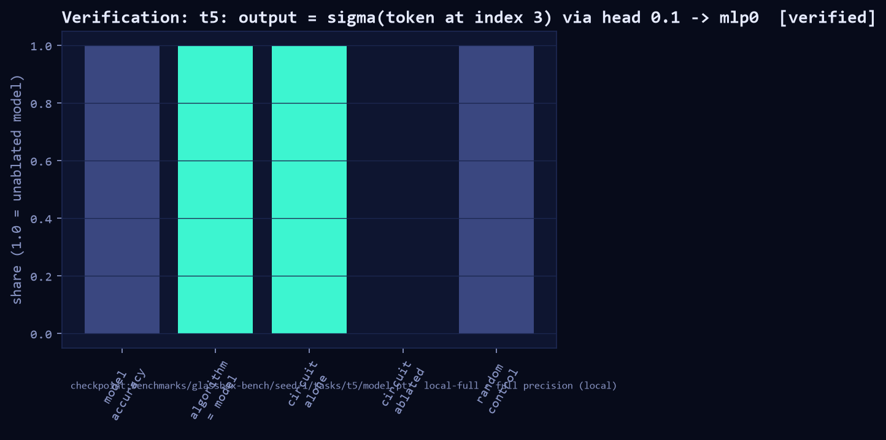
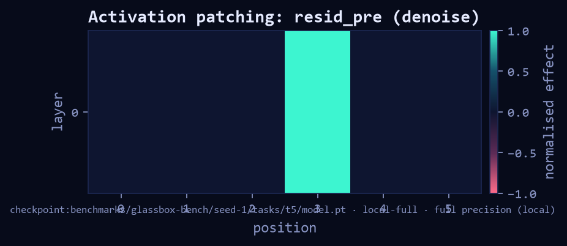
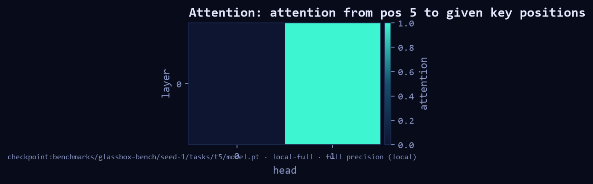
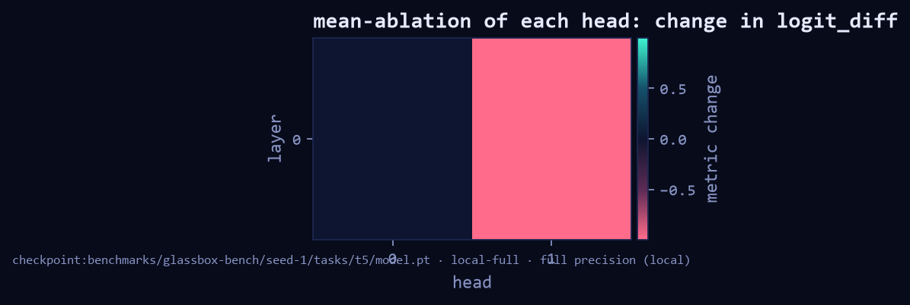
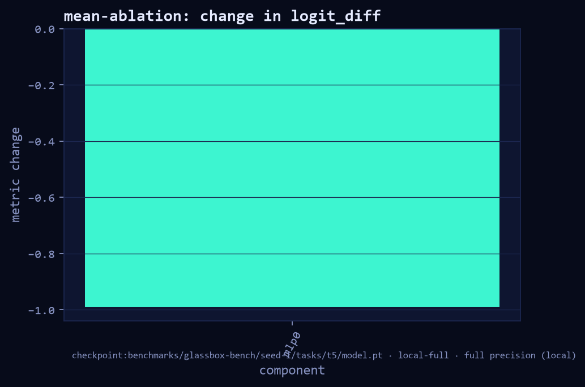

# t5 (glassbox-bench seed-1): output = fixed symbol swap of the third input token, via head 0.1 -> mlp0

**Behavior:** Input is BOS followed by 5 tokens from {bo, lu, fe, ri, ka}; the model outputs one symbol at the last position.  
**Model:** `checkpoint:benchmarks/glassbox-bench/seed-1/tasks/t5/model.pt` on `local-full`  
**Status:** verified · verified  
**Experiments run:** 14 · **Backends used:** full precision (local)  
**Written:** 2026-11-13 13:04

## Summary

All numbers are from the local-full backend (full precision, float64). The model is 1 layer with 2 attention heads and 1 MLP. Its output depends only on the token at index 3 (the third input symbol after BOS): output = sigma(tokens[3]) where sigma swaps bo<->lu and fe<->ka and leaves ri unchanged. Head 0.1 attends from the last position to index 3 with weight 1.0 and moves that token's identity; mlp0 turns it into the output symbol. Head 0.1 has no direct effect on the logits, so the whole path runs through the MLP. Head 0.0 plays no part. On 200 held-out inputs the rule matches the model 200/200; ablating {0.1, mlp0} drops the metric to -0.0005 of clean (accuracy 0.24, chance 0.20) and ablating everything else leaves it at 1.0.

## The recovered algorithm

```python
def predict(tokens, prompt):
    # tokens = [BOS, x1, x2, x3, x4, x5]; only x3 = tokens[3] matters (E0011)
    # head 0.1: last position attends to index 3 with weight 1.0 and copies the token (E0012, E0005)
    # mlp0: maps the copied token to the output symbol (E0010); head has no direct logit path (E0014)
    sigma = {1: 5, 5: 1, 3: 4, 4: 3, 6: 6}   # bo<->lu, fe<->ka, ri->ri
    return sigma[tokens[3]]
```

## Circuit


## Claims and evidence

| # | Claim | Evidence | Produced by |
|---|---|---|---|
| 1 | The model does the behaviour deterministically: clean accuracy 1.0 with a constant logit difference on 200 inputs (local-full). | E0002 | full precision (local) |
| 2 | The function is output = sigma(token at index 3), sigma = {bo<->lu, fe<->ka, ri->ri}; it agrees with the model on 200/200 held-out inputs (seed 100). | V0001, E0011 | full precision (local) |
| 3 | Only index 3 feeds the answer: denoising the residual stream input at index 3 recovers 1.0 of the clean-corrupt difference, every other position (including BOS and the last position) recovers 0.0. | E0011, E0008 | full precision (local) |
| 4 | Head 0.1 reads index 3 from the last position with attention 1.0 and is necessary: mean ablation leaves 0.002 of the clean metric. | E0012, E0005, E0004, E0003 | full precision (local) |
| 5 | mlp0 is necessary (mean ablation leaves 0.010 of clean) and head 0.1's direct path to the logits has effect 0.0, so the symbol swap is written by the MLP after the head has copied the token. | E0010, E0014, E0013 | full precision (local) |
| 6 | Head 0.0 plays no part: mean ablation and resample ablation both leave 1.0 of the clean metric, and the circuit {0.1, mlp0} alone retains 1.0 with head 0.0 ablated. | E0005, E0009, V0001 | full precision (local) |
| 7 | The circuit {0.1, mlp0} is necessary and sufficient on held-out data: ablated -> -0.0005 of clean (accuracy 0.24); everything else ablated -> 1.0 (accuracy 1.0); all three effects are at the 100th percentile of their null distributions. | V0001 | full precision (local) |

## Verification

### V0001: t5: output = sigma(token at index 3) via head 0.1 -> mlp0  (full precision (local))

| check | value |
|---|---|
| status | verified |
| held-out inputs | 200 |
| model accuracy | 1.000 |
| algorithm agrees with model | 1.000 |
| algorithm accuracy vs ground truth | 1.000 |
| circuit size | 2 of 3 components |
| metric kept with ONLY the circuit | 1.000 |
| metric kept with the circuit ABLATED | -0.000 |
| random same-size ablation (control) | 1.000, 1.000, 1.000 |

Passed at full precision, and every effect exceeds its null distribution.



## Key plots

**E0011: activation_patching** (full precision (local))



**E0012: attention_patterns** (full precision (local))



**E0005: ablation** (full precision (local))



**E0010: ablation** (full precision (local))



## Limitations

- sigma itself was read off the model's input/output pairs (E0001) and confirmed by 200/200 held-out agreement; I did not open the MLP to show which neurons implement each of the five mappings.
- Two pre-registrations (E0006, E0007) were scored inconclusive because I gave a metric path that does not exist for that output shape; both were re-registered with the corrected path and unchanged thresholds on fresh seeds (E0009, E0010). The observed values in the inconclusive runs were on the predicted side but are not counted.
- The verifier's random same-size control reports 1.0 for all three draws, although with only 3 components any 2-component set must overlap the claimed circuit. I have not looked into how that control samples, so I would not lean on that particular number; the null-percentile controls are the ones I rely on.
- Held-out agreement covers 200 of the 3125 possible inputs; the patching result (zero effect of every position except index 3) is what supports generalising to the rest.
- PAD (id 2) never appears in the inputs, so behaviour on it is untested.

## Open questions

- What head 0.0 reads and writes (it attends mostly to BOS from the last position) was not characterised beyond showing it has no effect on the output.
- Which mlp0 neurons implement each symbol mapping.

## Prediction record

9 experiments were pre-registered, 9 were run: **7 confirmed, 0 refuted, 2 inconclusive**. Hit rate (confirmed / decided): **100%**.

No prediction was refuted.

Exploratory runs (no pre-registration; they cannot be the only support for a claim): E0003, E0004, E0008, E0013.

## Experiments

| id | primitive | backend / precision | seconds | pre-registration |
|---|---|---|---|---|
| E0001 | dataset | full precision (local) | 0.09 | exploratory |
| E0002 | baseline | full precision (local) | 0.37 | N0004: confirmed |
| E0003 | ablation | full precision (local) | 0.29 | exploratory |
| E0004 | attention_patterns | full precision (local) | 0.17 | exploratory |
| E0005 | ablation | full precision (local) | 0.18 | N0009: confirmed |
| E0006 | ablation | full precision (local) | 0.19 | N0010: inconclusive |
| E0007 | ablation | full precision (local) | 0.23 | N0011: inconclusive |
| E0008 | activation_patching | full precision (local) | 0.13 | exploratory |
| E0009 | ablation | full precision (local) | 0.17 | N0016: confirmed |
| E0010 | ablation | full precision (local) | 0.16 | N0017: confirmed |
| E0011 | activation_patching | full precision (local) | 0.19 | N0021: confirmed |
| E0012 | attention_patterns | full precision (local) | 0.16 | N0022: confirmed |
| E0013 | path_patching | full precision (local) | 0.13 | exploratory |
| E0014 | path_patching | full precision (local) | 0.2 | N0026: confirmed |
| V0001 | verify | full precision (local) |  | verification |

## Notebook trail

- `N0001` *decision*: Loaded checkpoint:benchmarks/glassbox-bench/seed-1/tasks/t5/model.pt on local-full (full precision (local)).
- `N0002` *experiment*: dataset (E0001)
- `N0003` *hypothesis* **[supported]**: H1 (function): from the 200 input/output pairs of E0001 (checked ~50 by hand), output = sigma(token at index 3, i.e. the 3rd input symbol), where sigma swaps bo(1)<->lu(5), fe(3)<->ka(4) and fixes ri(6). All other positions irrelevant. H2 (mechanism, untested): one attention head at the last position attends to index 3 and moves its identity; the MLP and/or the head's OV applies sigma. The other head is a distractor.
- `N0004` *prereg*: The model performs its behaviour reliably on the bench dataset (answers are its own outputs), with a clear logit margin.
- `N0005` *experiment*: The model performs its behaviour reliably on the bench dataset (answers are its own outputs), with a clear logit margin. (E0002)
- `N0006` *experiment*: look at output shape; first screen of the two heads (E0003)
- `N0007` *experiment*: look at output shape; where does the last position attend? (E0004)
- `N0008` *note*: Exploratory screen (seed 0, local-full): mean-ablating head 0.1 drops the metric to 0.003 of clean, head 0.0 leaves it at 1.0 (E0003). From the last position, head 0.1 puts attention 1.0 on index 3; head 0.0 mostly on BOS (0.78) (E0004). Model is 1 layer, 2 heads, 1 MLP. Next: pre-registered confirmation on fresh seeds, plus the MLP. (E0003, E0004)
- `N0009` *prereg*: Head 0.1 is necessary for the behaviour: it carries the identity of the token at index 3 to the last position.
- `N0010` *prereg*: Head 0.0 plays no part in the behaviour (distractor component).
- `N0011` *prereg*: The MLP (mlp0) is necessary: head 0.1 only copies the token at index 3, and the MLP applies the symbol permutation sigma and writes the output logits.
- `N0012` *experiment*: Head 0.1 is necessary for the behaviour: it carries the identity of the token at index 3 to the last position. (E0005)
- `N0013` *experiment*: Head 0.0 plays no part in the behaviour (distractor component). (E0006)
- `N0014` *experiment*: The MLP (mlp0) is necessary: head 0.1 only copies the token at index 3, and the MLP applies the symbol permutation sigma (E0007)
- `N0015` *result*: E0005 (confirmed): mean-ablating head 0.1 leaves 0.002 of clean; head 0.0 leaves 1.0. E0006 and E0007 were scored INCONCLUSIVE because I gave a wrong metric path (summary.fraction_of_clean does not exist for a components-list ablation; it is summary.top[component=X].fraction_of_clean). Observed values were 1.0 for resample-ablating head 0.0 and 0.002 for mean-ablating mlp0, both on the predicted side, but they do not count as scored predictions. I will re-register both with the corrected path, the SAME thresholds, on fresh seeds. (E0005, E0006, E0007)
- `N0016` *prereg*: Head 0.0 plays no part in the behaviour (distractor component). Re-registration of N0010 with corrected metric path, same threshold, fresh seed.
- `N0017` *prereg*: The MLP (mlp0) is necessary: head 0.1 only copies the token at index 3, and the MLP turns it into the output symbol. Re-registration of N0011 with corrected metric path, same threshold, fresh seed.
- `N0018` *experiment*: output shape of residual patching by layer and position (E0008)
- `N0019` *experiment*: Head 0.0 plays no part in the behaviour (distractor component). Re-registration of N0010 with corrected metric path, sam (E0009)
- `N0020` *experiment*: The MLP (mlp0) is necessary: head 0.1 only copies the token at index 3, and the MLP turns it into the output symbol. Re- (E0010)
- `N0021` *prereg*: The output depends only on the token at index 3: patching the clean embedding at index 3 into a corrupt run fully restores the clean answer.
- `N0022` *prereg*: Head 0.1 reads index 3 from the last position with near-total attention, independent of content.
- `N0023` *experiment*: The output depends only on the token at index 3: patching the clean embedding at index 3 into a corrupt run fully restor (E0011)
- `N0024` *experiment*: Head 0.1 reads index 3 from the last position with near-total attention, independent of content. (E0012)
- `N0025` *experiment*: output shape; does head 0.1 write directly to the logits or only via the MLP? (E0013)
- `N0026` *prereg*: Head 0.1 does not write the answer to the logits directly; its effect goes entirely through mlp0.
- `N0027` *experiment*: Head 0.1 does not write the answer to the logits directly; its effect goes entirely through mlp0. (E0014)
- `N0028` *result*: All local-full, full precision. Only index 3 matters: denoising resid_pre at index 3 recovers 1.0, every other position 0.0 (E0011). Head 0.1 attends from the last position to index 3 with weight 1.0 (E0012) and is necessary (0.002 of clean when mean-ablated, E0005). mlp0 is necessary (0.010 of clean, E0010). Head 0.1 has zero direct effect on the logits (E0014), so the path is embed@3 -> head 0.1 -> mlp0 -> logits. Head 0.0 is a distractor: resample ablation leaves 1.0 (E0009), mean ablation leaves 1.0 (E0005). (E0005, E0009, E0010, E0011, E0012, E0014)
- `N0029` *verification*: t5: output = sigma(token at index 3) via head 0.1 -> mlp0: verified. Passed at full precision, and every effect exceeds its null distribution. (V0001)
- `N0030` *hypothesis* **[supported]** -> N0003: H1 and H2 supported. V0001 (held-out seed 100, n=200, local-full): predict() agrees with the model on 200/200; ablating {0.1, mlp0} leaves -0.0005 of clean (accuracy 0.24, chance 0.2); ablating everything else (head 0.0) leaves 1.0. Refinement of H2: sigma is applied by mlp0, not by the head's OV (E0010, E0014).
