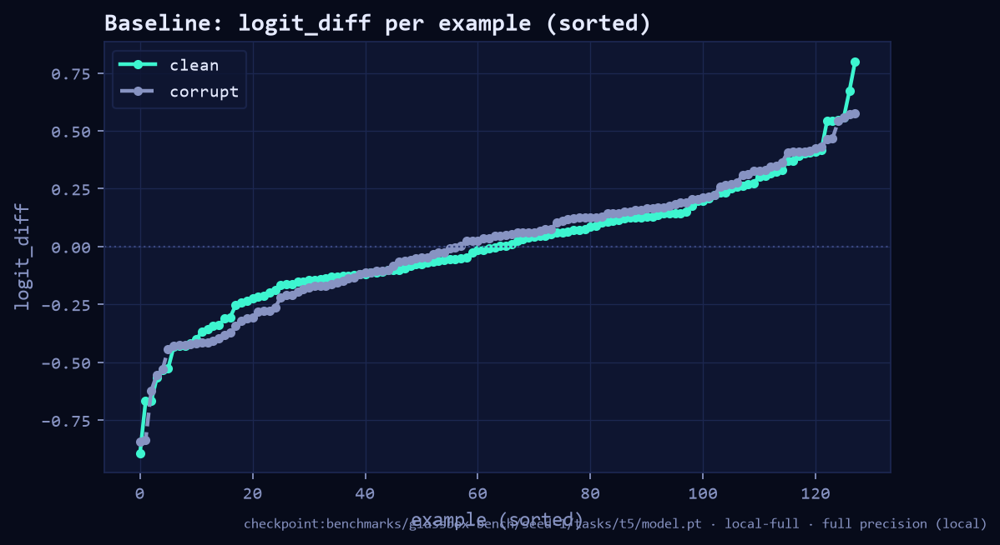
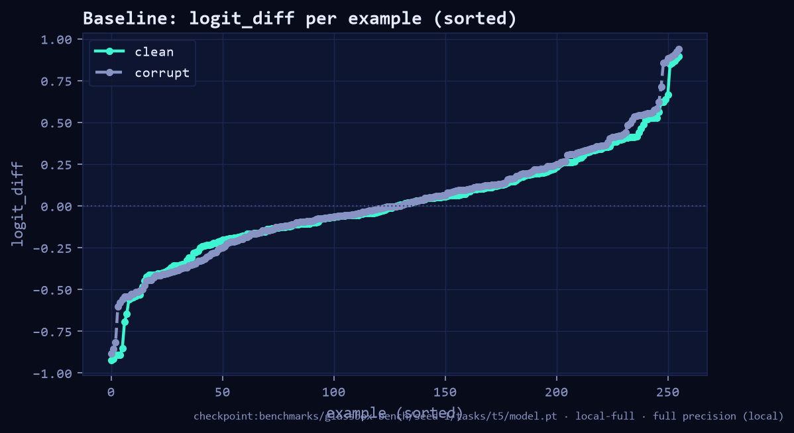

# t5 (null-random-init): no behaviour to explain

**Behavior:** BOS + 5 tokens from 5 symbols; one symbol is read at the last position. The task was to recover the function and the heads/MLPs that implement it.  
**Model:** `checkpoint:benchmarks/glassbox-bench/seed-1/tasks/t5/model.pt` on `local-full`  
**Status:** unverified (no verification run) · null finding: model does not perform the behaviour  
**Experiments run:** 3 · **Backends used:** full precision (local)  
**Written:** 2026-11-13 13:40

## Summary

The loaded model (1 layer, 2 heads, 1 MLP, d_model 29; local-full, full precision) does not reproduce the dataset's answers. Accuracy is 0.148 (n=128) and 0.191 (n=256) against a chance level of 0.20, and the mean logit difference between the correct and a wrong symbol is 0.002 and 0.006 with a standard deviation near 0.3. The dataset labels themselves follow a simple rule (a fixed map of the token at index 3), but that rule is a property of the labels, not of this model. The investigation was stopped after the baseline: no circuit is claimed and no verification was run.

## The recovered algorithm

```python
# No algorithm recovered: the model is at chance on the behaviour (E0002, E0003).
# Rule that fits the dataset LABELS only (E0001, 64/64, not implemented by this model):
#   out = {bo: lu, fe: ka, ka: fe, lu: bo, ri: ri}[tokens[3]]
```

## Claims and evidence

| # | Claim | Evidence | Produced by |
|---|---|---|---|
| 1 | The model does not perform the bench behaviour: clean accuracy 0.148 on 128 inputs, mean logit diff 0.002 +/- 0.279 (local-full, full precision). The pre-registered prediction of >= 0.95 accuracy was refuted. | E0002 | full precision (local) |
| 2 | The null replicates on a fresh, larger sample: accuracy 0.191 on 256 inputs (chance 0.20), mean logit diff 0.006 +/- 0.319; the model also outputs PAD, which is never a valid answer. | E0003 | full precision (local) |
| 3 | Because the model is at chance, no attention head or MLP layer can be said to implement the behaviour; no circuit is claimed. | E0002, E0003 | full precision (local) |

## Key plots

**E0002: baseline** (full precision (local))



**E0003: baseline** (full precision (local))



## Limitations

- No verify_hypothesis run: with no behaviour there is nothing to verify, so the status is a null finding, not 'verified'.
- The label rule (map of token at index 3) was checked by hand on 64 examples from E0001 only, and it describes the dataset labels, not this model.
- No mechanism experiments were run; what this model does compute instead (if anything structured) was not investigated.
- Accuracy 0.148 at n=128 is slightly below chance; consistent with sampling noise (0.191 at n=256), not tested further.

## Open questions

- The task statement says the answers are the model's own outputs, but the loaded checkpoint does not produce them. Is the checkpoint served under this investigation the intended one?

## Prediction record

2 experiments were pre-registered, 2 were run: **1 confirmed, 1 refuted, 0 inconclusive**. Hit rate (confirmed / decided): **50%**.

Refuted predictions (shown, not hidden):

| prereg | experiment | hypothesis | predicted | observed |
|---|---|---|---|---|
| N0003 | E0002 | The model deterministically performs the bench behaviour: its top logit at the last position equals the dataset answer (the answers are its own outputs), so the | `summary.clean_accuracy >= 0.95` | 0.148 |

## Experiments

| id | primitive | backend / precision | seconds | pre-registration |
|---|---|---|---|---|
| E0001 | dataset | full precision (local) | 0.08 | exploratory |
| E0002 | baseline | full precision (local) | 0.64 | N0003: refuted |
| E0003 | baseline | full precision (local) | 0.49 | N0008: confirmed |

## Notebook trail

- `N0001` *decision*: Loaded checkpoint:benchmarks/glassbox-bench/seed-1/tasks/t5/model.pt on local-full (full precision (local)).
- `N0002` *experiment*: dataset (E0001)
- `N0003` *prereg*: The model deterministically performs the bench behaviour: its top logit at the last position equals the dataset answer (the answers are its own outputs), so there is a behaviour to explain.
- `N0004` *hypothesis* **[rejected]**: H1 (function): from the 64 examples in E0001, the output is a fixed map of the token at sequence index 3 (third input symbol), ignoring all other positions: bo(1)->lu(5), fe(3)->ka(4), ka(4)->fe(3), lu(5)->bo(1), ri(6)->ri(6). Holds on all 64/64 examples by hand check. To be tested causally (position patching) and on held-out data.
- `N0005` *experiment*: The model deterministically performs the bench behaviour: its top logit at the last position equals the dataset answer ( (E0002)
- `N0006` *result*: Baseline REFUTED (local-full, full precision, n=128, seed 1): clean accuracy 0.148 against the dataset answers (chance for 5 symbols = 0.20), mean logit diff correct-vs-incorrect 0.002 +/- 0.279 (corrupt inputs: 0.007). The loaded model does not produce the dataset's answers; its logit margins are tiny and centred on zero. There is no behaviour to explain in this model. (E0002)
- `N0007` *hypothesis* **[rejected]** -> N0004: Rejected as a claim about this model. The rule (output = fixed map of the token at index 3) fits the dataset labels 64/64 in E0001, but E0002 shows the loaded model does not reproduce those labels (accuracy 0.148, below 0.20 chance; mean logit diff 0.002). The rule describes the labels, not anything this model computes.
- `N0008` *prereg*: The loaded model does not perform the bench behaviour at all: on a fresh, larger sample its accuracy against the dataset answers stays near chance (0.20) and the mean logit difference stays near zero.
- `N0009` *experiment*: The loaded model does not perform the bench behaviour at all: on a fresh, larger sample its accuracy against the dataset (E0003)
- `N0010` *result*: Replicated on fresh inputs (local-full, n=256, seed 2): accuracy 0.191 (chance 0.20), mean logit diff 0.006 +/- 0.319; the model even predicts PAD, which is never a valid output. Together with E0002 (0.148, n=128): the model is at chance on the bench behaviour. (E0002, E0003)
- `N0011` *decision*: Stop per protocol step 1: the model does not do the behaviour, so there is no mechanism to localise. No circuit search, no verify_hypothesis (any circuit claim would be fitting noise). Report a null finding. 3 of 25 experiments used. (E0002, E0003)
