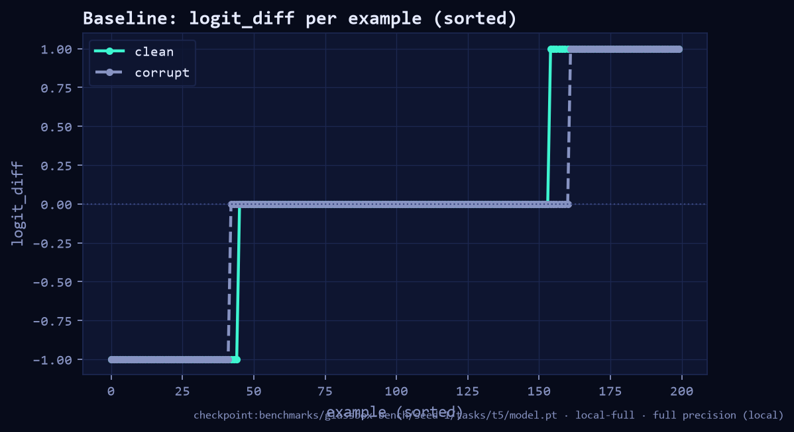
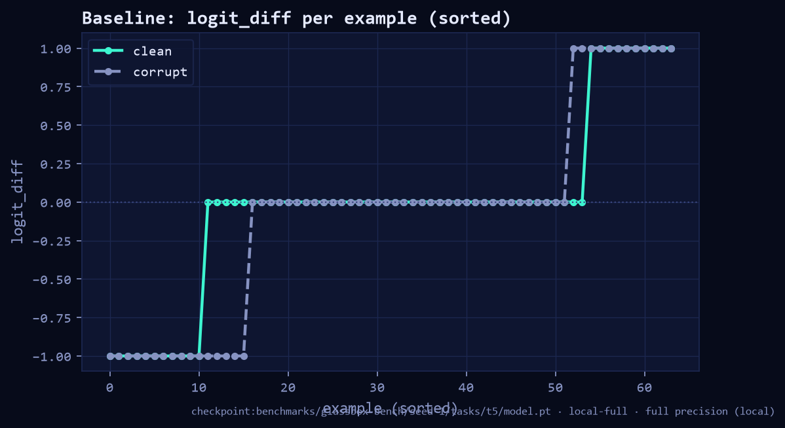

# t5 (null: task-shuffled): no behaviour to explain

**Behavior:** BOS + 5 tokens from 5 symbols; one symbol output at the last position. Bench dataset 'benchmarks/glassbox-bench/seed-1/tasks/t5', whose answers were stated to be the model's own outputs.  
**Model:** `checkpoint:benchmarks/glassbox-bench/seed-1/tasks/t5/model.pt` on `local-full`  
**Status:** unverified (no verification run) · null result: no mechanism claimed  
**Experiments run:** 3 · **Backends used:** full precision (local)  
**Written:** 2026-11-13 13:43

## Summary

The model does not reproduce the bench dataset's answers. On local-full (full precision) its top output matches the dataset answer on 23% of 200 inputs (seed 1, E0002) and 15.6% of 64 inputs (seed 0, E0003); chance is 20%. Mean logit difference between answer and foil is 0.005 and -0.016, the same as on the corrupt inputs. Following the protocol the investigation stopped at step 1: with labels the model does not track, any patching or ablation metric would be noise, so no function, no circuit and no verification are claimed. 3 of 25 experiments used.

## The recovered algorithm

```python
# No algorithm recovered. The labelled behaviour is absent (E0002, E0003), so no predict() is offered.
```

## Claims and evidence

| # | Claim | Evidence | Produced by |
|---|---|---|---|
| 1 | On 200 inputs (seed 1) the model's top output equals the dataset answer on 23% of inputs, at the 20% chance level; mean logit diff 0.005 vs -0.015 on corrupt inputs (local-full). | E0002 | full precision (local) |
| 2 | The mismatch is not a seed fluke: on seed 0 (64 inputs) accuracy is 15.6% and mean logit diff -0.016 (local-full). | E0003 | full precision (local) |
| 3 | The dataset answers are not a relabelling of the model's output: the same model output is paired with different expected labels (lu with ka and lu in E0002; fe with bo and ri in E0003). | E0002, E0003 | full precision (local) |

## Key plots

**E0002: baseline** (full precision (local))



**E0003: baseline** (full precision (local))



## Limitations

- No circuit analysis was run: no head or MLP is claimed to matter or to be inert.
- No verify_hypothesis was run; status is a null result, not verified or screening.
- The pre-registered baseline prediction (accuracy >= 0.95) was refuted; the initial hypothesis H1/H2 is rejected as an explanation of the bench behaviour.
- The model's actual input-output function was not measured. Only the handful of example predictions in the baseline outputs are available.

## Open questions

- The answers shown by the dataset primitive for seed 0 (E0001, exploratory) fit a clean rule: output = P(3rd input symbol) with P = bo->lu, fe->ka, ka->fe, lu->bo, ri->ri, 64 of 64. The labels the baseline scored against for the same inputs are different (E0003), and the model's four example predictions in E0003 agree with the E0001 listing. This suggests the model computes that rule and the scoring labels are shuffled, but it rests on an exploratory listing and four examples and is not claimed.
- Testing that lead would need explicit clean/metric inputs labelled by the rule rather than the bench task labels, which is outside the instructions for this run.

## Prediction record

2 experiments were pre-registered, 2 were run: **1 confirmed, 1 refuted, 0 inconclusive**. Hit rate (confirmed / decided): **50%**.

Refuted predictions (shown, not hidden):

| prereg | experiment | hypothesis | predicted | observed |
|---|---|---|---|---|
| N0004 | E0002 | The model performs the bench behaviour: its top output at the last position matches the dataset answers. | `summary.clean_accuracy >= 0.95` | 0.230 |

## Experiments

| id | primitive | backend / precision | seconds | pre-registration |
|---|---|---|---|---|
| E0001 | dataset | full precision (local) | 0.11 | exploratory |
| E0002 | baseline | full precision (local) | 0.74 | N0004: refuted |
| E0003 | baseline | full precision (local) | 0.31 | N0007: confirmed |

## Notebook trail

- `N0001` *decision*: Loaded checkpoint:benchmarks/glassbox-bench/seed-1/tasks/t5/model.pt on local-full (full precision (local)).
- `N0002` *experiment*: dataset (E0001)
- `N0003` *hypothesis* **[rejected]**: H1 (function): from the 64 examples in E0001, output = P(token at sequence position 3, i.e. the 3rd input symbol), with P = {bo->lu, fe->ka, ka->fe, lu->bo, ri->ri} (ids 1->5, 3->4, 4->3, 5->1, 6->6). All 64 examples fit. Other positions are irrelevant. H2 (mechanism, untested): in this 1-layer model one attention head moves position-3 token identity to the last position; the MLP and/or the head's OV applies the mapping; the other head is inert.
- `N0004` *prereg*: The model performs the bench behaviour: its top output at the last position matches the dataset answers.
- `N0005` *experiment*: The model performs the bench behaviour: its top output at the last position matches the dataset answers. (E0002)
- `N0006` *result*: Baseline prediction REFUTED (E0002, local-full, n=200, seed 1): the model's top output matches the dataset answer on only 23% of inputs (chance = 20% for 5 symbols); mean logit diff answer-vs-foil 0.005 (std 0.68), same as on the corrupt set (-0.015). Example predictions show the same model output paired with different expected labels (lu->ka, lu->lu), so the labels are not even a relabelling of the model's output. The dataset answers are not the model's outputs. (E0002)
- `N0007` *prereg*: The mismatch in E0002 is not a seed-1 fluke: on seed 0 (where the labels fit a clean rule of the 3rd input symbol in E0001) the model also fails to reproduce the dataset answers.
- `N0008` *experiment*: The mismatch in E0002 is not a seed-1 fluke: on seed 0 (where the labels fit a clean rule of the 3rd input symbol in E00 (E0003)
- `N0009` *result*: E0003 (local-full, n=64, seed 0) confirms E0002: accuracy against the dataset answers 15.6% (chance 20%), mean logit diff -0.016, indistinguishable from corrupt (-0.063). The model does not reproduce the bench dataset's answers on either seed. Side observations, NOT tested: (a) the 'expected' labels scored in E0003 (fe, lu, bo, ri for the first four seed-0 inputs) differ from the answers the dataset primitive displayed for the same inputs in E0001 (lu, ka, fe, fe), so the labels used for scoring are not the ones shown by the dataset viewer; (b) the model's four example predictions in E0003 (lu, ka, fe, fe) coincide with the E0001-displayed answers and with rule H1. Four examples plus an exploratory listing is a lead, not evidence. (E0002, E0003, E0001)
- `N0010` *hypothesis* **[rejected]** -> N0003: Rejected as an explanation of the bench behaviour: the model scores at chance against the bench answers (E0002 23%, E0003 15.6%), so there is no labelled behaviour for H1/H2 to explain. H1 as a description of the model's raw outputs is untested (only 4 example predictions in E0003 are consistent with it); H2 (mechanism) was never tested.
- `N0011` *decision*: Stop at step 1 per protocol: the model does not do the behaviour defined by the bench dataset (accuracy at chance on two seeds, 264 inputs). No circuit search, no verify_hypothesis: every patching/ablation metric would be computed against labels the model does not track, and any 'circuit' found would be noise. Report as a null result. 3 of 25 experiments used.
