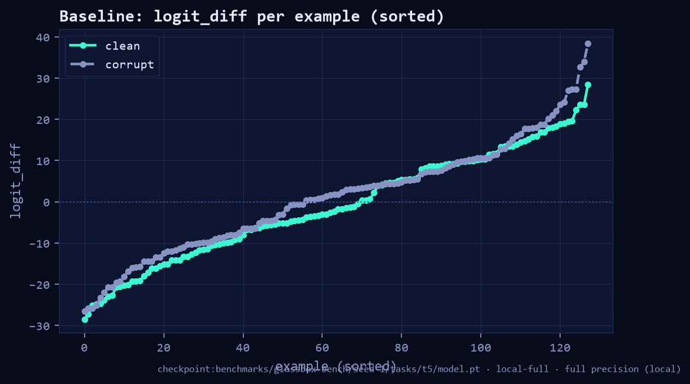
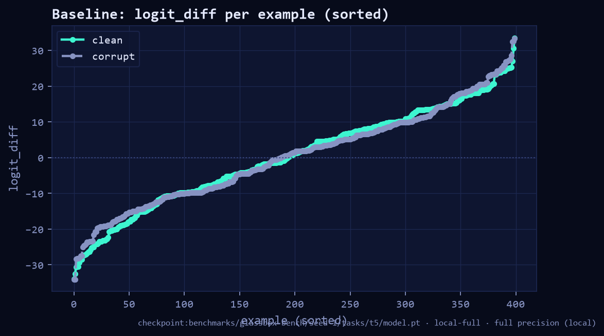

# t5 (null-weight-shuffled): the model does not perform the behaviour; no circuit claimed

**Behavior:** BOS + 5 tokens from 5 symbols (bo, fe, ka, lu, ri); one symbol is output at the last position. Dataset task 'bench', path benchmarks/glassbox-bench/seed-1/tasks/t5.  
**Model:** `checkpoint:benchmarks/glassbox-bench/seed-1/tasks/t5/model.pt` on `local-full`  
**Status:** unverified (no verification run) · null finding: no behaviour, no mechanism  
**Experiments run:** 3 · **Backends used:** full precision (local)  
**Written:** 2026-11-13 13:41

## Summary

On local-full (full precision) the loaded 1-layer, 2-head, d_model=29 checkpoint agrees with the dataset's answers only at chance: 0.203 on 128 prompts (E0002) and 0.200 on 400 independent prompts (E0003), where chance for 5 symbols is 0.20. The mean logit difference between the dataset answer and the foil is about zero (-1.0 and +0.17) with a standard deviation of about 13-14, and the model sometimes predicts PAD, which is never an answer. The investigation was stopped at step 1: there is no behaviour to explain, so no heads or MLP layers are claimed, no predict() was written and verify_hypothesis was not run. Status: no mechanism found (not verified, by design).

## The recovered algorithm

```python
# No algorithm recovered: the loaded model's outputs do not match the dataset answers above chance (E0002, E0003).
# Unverified observation about the dataset LABELS only (64 examples, E0001), not about this model:
#   answer = {bo: lu, lu: bo, fe: ka, ka: fe, ri: ri}[tokens[3]]
```

## Claims and evidence

| # | Claim | Evidence | Produced by |
|---|---|---|---|
| 1 | The loaded model does not perform the behaviour: clean accuracy against the dataset answers is 0.203 on n=128, indistinguishable from chance (0.20). The pre-registered prediction of accuracy >= 0.95 was refuted. Backend: local-full, full precision. | E0002 | full precision (local) |
| 2 | The chance-level result replicates on an independent, larger sample: accuracy 0.200 on n=400 (pre-registered band 0.12-0.30, confirmed); mean logit difference 0.17 with std 14.0, so there is no systematic preference for the dataset answer. | E0003 | full precision (local) |
| 3 | Because there is no behaviour, no attention head or MLP layer is claimed to implement anything; the circuit is empty. | E0002, E0003 | full precision (local) |

## Key plots

**E0002: baseline** (full precision (local))



**E0003: baseline** (full precision (local))



## Limitations

- Only baselines were run (3 of 25 experiments). No patching, ablation or attention analysis was done because there was no behaviour to localise.
- verify_hypothesis was not run: there is no algorithm or circuit to verify.
- The label rule (output = fixed permutation of the 3rd input token) was read off 64 examples in an exploratory dataset inspection (E0001) and was not tested on held-out labels; it is an observation about the labels, not a claim about this model.
- The task text says the dataset answers are the model's own outputs, yet the loaded checkpoint disagrees with them 80% of the time. The investigation name suggests the weights in memory are a shuffled null version; this was not independently checked.

## Open questions

- Does the loaded model compute some other deterministic function of the input (it is deterministic by construction)? Not investigated: it would not be the behaviour defined by the dataset.
- Is the mismatch between dataset answers and the loaded weights intended (null control) or a loading issue?

## Prediction record

2 experiments were pre-registered, 2 were run: **1 confirmed, 1 refuted, 0 inconclusive**. Hit rate (confirmed / decided): **50%**.

Refuted predictions (shown, not hidden):

| prereg | experiment | hypothesis | predicted | observed |
|---|---|---|---|---|
| N0004 | E0002 | The model performs its behaviour reliably on the bench dataset (answers are its own outputs), with a clear logit margin between its answer and the answer for th | `summary.clean_accuracy >= 0.95` | 0.203 |

## Experiments

| id | primitive | backend / precision | seconds | pre-registration |
|---|---|---|---|---|
| E0001 | dataset | full precision (local) | 0.1 | exploratory |
| E0002 | baseline | full precision (local) | 0.72 | N0004: refuted |
| E0003 | baseline | full precision (local) | 0.66 | N0007: confirmed |

## Notebook trail

- `N0001` *decision*: Loaded checkpoint:benchmarks/glassbox-bench/seed-1/tasks/t5/model.pt on local-full (full precision (local)).
- `N0002` *experiment*: dataset (E0001)
- `N0003` *hypothesis* **[rejected]**: H1 (function): from the 64 examples in E0001, the output depends only on the 3rd input token (token index 3 incl. BOS) through a fixed permutation: bo(1)->lu(5), lu(5)->bo(1), fe(3)->ka(4), ka(4)->fe(3), ri(6)->ri(6). All 64 examples fit. To be tested on held-out data and causally (patching position 3).
- `N0004` *prereg*: The model performs its behaviour reliably on the bench dataset (answers are its own outputs), with a clear logit margin between its answer and the answer for the corrupt prompt.
- `N0005` *experiment*: The model performs its behaviour reliably on the bench dataset (answers are its own outputs), with a clear logit margin  (E0002)
- `N0006` *result*: Baseline prediction REFUTED (local-full, full precision). Clean accuracy 0.203 on n=128 (chance for 5 symbols = 0.20); mean logit diff -1.0 +/- 13.2 (corrupt prompts: +1.0), i.e. no systematic preference for the dataset's answer. Example predictions include PAD, which is never a dataset answer. The loaded checkpoint does not reproduce the dataset's labels. Replicating once on an independent seed before stopping. (E0002)
- `N0007` *prereg*: The loaded model does not perform the behaviour: its agreement with the dataset answers is at chance (about 1/5) on an independent, larger sample.
- `N0008` *experiment*: The loaded model does not perform the behaviour: its agreement with the dataset answers is at chance (about 1/5) on an i (E0003)
- `N0009` *hypothesis* **[rejected]** -> N0003: Rejected as a description of THIS model. The permutation-of-token-3 rule fits the 64 dataset labels shown in E0001, but the loaded checkpoint agrees with those labels only at chance (0.203 in E0002, 0.200 in E0003), so it does not compute that rule or any function matching the labels. The rule remains an untested observation about the labels only.
- `N0010` *decision*: STOP per protocol step 1: the model does not do the behaviour (accuracy at chance on two independent samples, n=128 and n=400, mean logit diff ~0 with std ~14). There is no mechanism to explain, so no circuit search, no predict() and no verify_hypothesis were run. 22 of 25 experiments unused. Reporting a null finding. (E0002, E0003)
