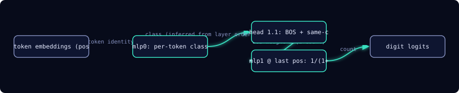
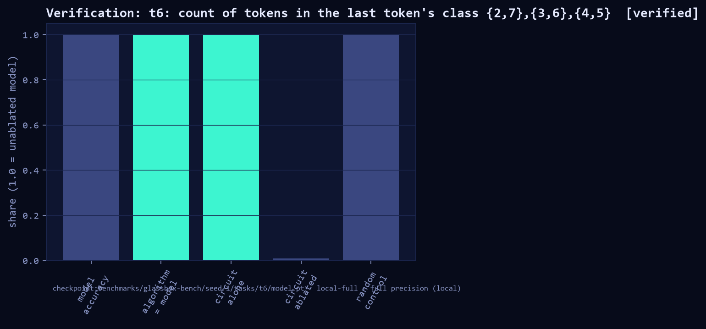
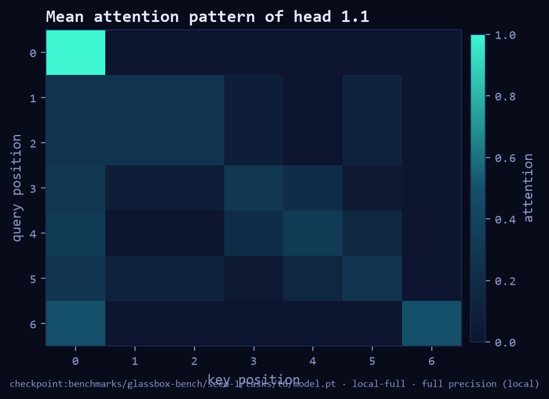
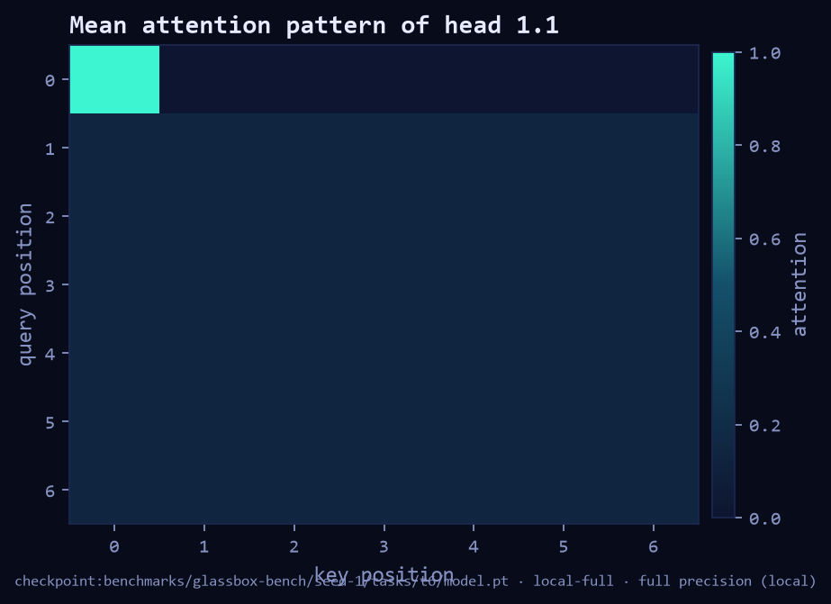
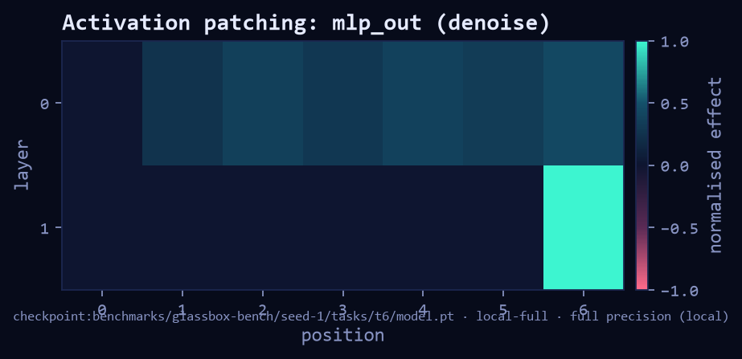
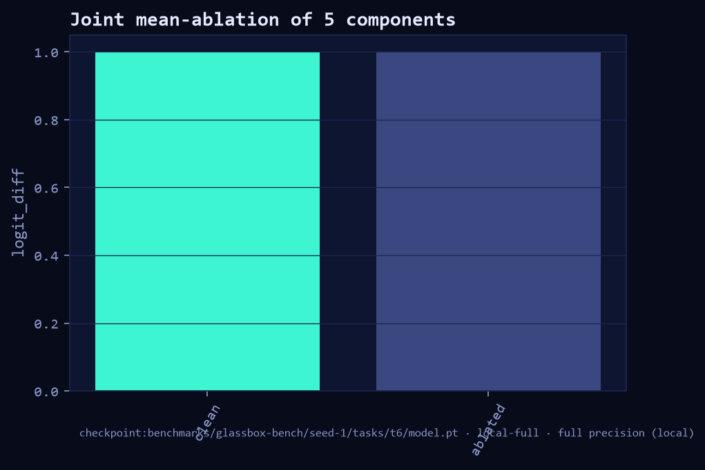

# t6: counting the tokens that share the last token's class (mlp0 -> head 1.1 -> mlp1)

**Behavior:** Input BOS + 6 tokens from {do, ge, go, ko, no, vu}; at the last position the model outputs a digit. Backend: local-full (full precision) for every number in this report.  
**Model:** `checkpoint:benchmarks/glassbox-bench/seed-1/tasks/t6/model.pt` on `local-full`  
**Status:** verified · verified  
**Experiments run:** 17 · **Backends used:** full precision (local)  
**Written:** 2026-11-13 13:09

## Summary

The model outputs how many of the 6 input tokens belong to the same class as the last token (the last token counts itself), with classes {do,vu}, {ge,no}, {go,ko} (token ids {2,7}, {3,6}, {4,5}). The rule was read off the dataset examples and reproduces the model on 200/200 held-out inputs. The circuit is three components: mlp0 (acts per token at every input position), head 1.1 (from the last position attends uniformly over BOS plus all same-class tokens, so BOS weight = 1/(1+count)), and mlp1 (acts only at the last position and turns that into the digit). Heads 0.0, 0.1, 0.2, 1.0 and 1.2 play no part: ablating all five together changes nothing.

## The recovered algorithm

```python
cls = {do:0, vu:0, ge:1, no:1, go:2, ko:2}
# mlp0, at each input position: token -> class feature
# head 1.1, at the last position: attend uniformly to BOS + tokens with cls == cls[last]  -> BOS weight 1/(1+count)
# mlp1, at the last position: 1/(1+count) -> digit
count = sum(cls[t] == cls[tokens[-1]] for t in tokens[1:])
return digit(count)   # id 8 + count
```

## Circuit



## Claims and evidence

| # | Claim | Evidence | Produced by |
|---|---|---|---|
| 1 | The model performs its behaviour deterministically (accuracy 1.0 on 128 inputs). | E0002 | full precision (local) |
| 2 | The function is: number of input tokens in the last token's class, classes {2,7},{3,6},{4,5}; the coded rule agrees with the model on 200/200 held-out inputs (task-shuffled null max 0.315). | V0001 | full precision (local) |
| 3 | Head 1.1 is necessary: mean-ablating it leaves 0.0 of the clean metric. | E0009, V0001 | full precision (local) |
| 4 | mlp0 and mlp1 are both necessary: mean-ablating either leaves 0.0 and 0.012 of the clean metric. | E0010, E0011 | full precision (local) |
| 5 | Heads 0.0, 0.1, 0.2, 1.0, 1.2 play no part: joint mean ablation leaves the metric at 1.0, and the circuit alone (everything else ablated) keeps accuracy 1.0. | E0012, V0001 | full precision (local) |
| 6 | Head 1.1 at the last position attends uniformly over BOS plus same-class tokens (matching on class, not identity): BOS weight is 1/7 when all six tokens are class-mates of mixed identity, and 1/2 (self 1/2, all others 0) when the last token is alone in its class. | E0007, E0013 | full precision (local) |
| 7 | mlp1 does its work only at the last position (patching its output there alone restores the full answer; other positions 0), while mlp0 works at every input position 1-6 (single-position patches give partial effects 0.25-0.43, BOS 0). | E0016, E0017 | full precision (local) |
| 8 | Ablating the circuit {mlp0, 1.1, mlp1} drops the metric to 0.0085 of clean (accuracy 0.35); random same-size sets leave it at 1.0. | V0001 | full precision (local) |

## Verification

### V0001: t6: count of tokens in the last token's class {2,7},{3,6},{4,5}  (full precision (local))

| check | value |
|---|---|
| status | verified |
| held-out inputs | 200 |
| model accuracy | 1.000 |
| algorithm agrees with model | 1.000 |
| algorithm accuracy vs ground truth | 1.000 |
| circuit size | 3 of 8 components |
| metric kept with ONLY the circuit | 1.000 |
| metric kept with the circuit ABLATED | 0.009 |
| random same-size ablation (control) | 1.000, 1.000, 1.000 |

Passed at full precision, and every effect exceeds its null distribution.



## Key plots

**E0013: attention_patterns** (full precision (local))



**E0007: attention_patterns** (full precision (local))



**E0017: activation_patching** (full precision (local))



**E0012: ablation** (full precision (local))



## Limitations

- The mlp0 -> 1.1 edge is inferred from layer order, necessity and per-position patching; path_patching with an MLP sender raised an error, so it was not measured whether mlp0 feeds 1.1's query, key or both.
- That mlp0 writes a 'class' feature is an interpretation consistent with 1.1's class-matching attention; the feature itself was not probed.
- That mlp1 reads 1/(1+count) is inferred from the attention pattern; the value 1.1 moves was not decoded directly.
- E0008 was scored inconclusive because of a wrong metric path (observed 1.0); it was re-run on a fresh seed with the same threshold as E0012.
- Exploratory E0014 shows heads 1.0 and 1.2 have nonzero direct writes along the answer direction (0.21, 0.19) although ablating them does not change the output.

## Open questions

- Does mlp0 feed head 1.1 through the query, the key, or both?
- What do the unused heads 1.0 and 1.2 write, given their nonzero direct logit attribution?

## Prediction record

10 experiments were pre-registered, 10 were run: **9 confirmed, 0 refuted, 1 inconclusive**. Hit rate (confirmed / decided): **100%**.

No prediction was refuted.

Exploratory runs (no pre-registration; they cannot be the only support for a claim): E0003, E0004, E0005, E0006, E0014, E0015.

## Experiments

| id | primitive | backend / precision | seconds | pre-registration |
|---|---|---|---|---|
| E0001 | dataset | full precision (local) | 0.07 | exploratory |
| E0002 | baseline | full precision (local) | 0.37 | N0003: confirmed |
| E0003 | ablation | full precision (local) | 0.27 | exploratory |
| E0004 | ablation | full precision (local) | 0.2 | exploratory |
| E0005 | attention_patterns | full precision (local) | 0.23 | exploratory |
| E0006 | activation_patching | full precision (local) | 0.2 | exploratory |
| E0007 | attention_patterns | full precision (local) | 0.11 | N0010: confirmed |
| E0008 | ablation | full precision (local) | 0.22 | N0011: inconclusive |
| E0009 | ablation | full precision (local) | 0.21 | N0012: confirmed |
| E0010 | ablation | full precision (local) | 0.2 | N0013: confirmed |
| E0011 | ablation | full precision (local) | 0.22 | N0014: confirmed |
| E0012 | ablation | full precision (local) | 0.18 | N0020: confirmed |
| E0013 | attention_patterns | full precision (local) | 0.1 | N0021: confirmed |
| E0014 | direct_logit_attribution | full precision (local) | 0.23 | exploratory |
| E0015 | activation_patching | full precision (local) | 0.25 | exploratory |
| E0016 | activation_patching | full precision (local) | 0.26 | N0026: confirmed |
| E0017 | activation_patching | full precision (local) | 0.22 | N0027: confirmed |
| V0001 | verify | full precision (local) |  | verification |

## Notebook trail

- `N0001` *decision*: Loaded checkpoint:benchmarks/glassbox-bench/seed-1/tasks/t6/model.pt on local-full (full precision (local)).
- `N0002` *experiment*: dataset (E0001)
- `N0003` *prereg*: The model deterministically performs its task: on bench inputs its top output at the last position equals the dataset answer (which is its own output), so accuracy is ~1.
- `N0004` *hypothesis* **[supported]**: H1 (function, from reading the 64 examples in E0001): output = number of the 6 input tokens that are in the same class as the LAST token, where classes are {do,vu}={2,7}, {ge,no}={3,6}, {go,ko}={4,5} (i.e. tok==last or tok+last==9). Output token id = 8 + count. Checked by hand on ~40 of the 64 examples in E0001, all consistent. Simpler candidates (count of tokens equal to last, max frequency, distinct count, count <= last) were inconsistent with E0001 examples.
- `N0005` *experiment*: The model deterministically performs its task: on bench inputs its top output at the last position equals the dataset an (E0002)
- `N0006` *experiment*: Exploratory first screen: mean-ablate each head, to learn output shape and candidate heads (E0003)
- `N0007` *experiment*: Exploratory first screen: mean-ablate each MLP (E0004)
- `N0008` *experiment*: Exploratory: where does 1.1 look from the last position; learn output shape (E0005)
- `N0009` *experiment*: Exploratory: mlp_out patching by layer x position, learn output shape (E0006)
- `N0010` *prereg*: Head 1.1, from the last position, spreads attention uniformly over BOS plus every input token in the same class as the last token (classes {2,7},{3,6},{4,5}). On inputs where all 6 tokens are in the last token's class (mixed identities), attention to BOS is therefore 1/7 = 0.143.
- `N0011` *prereg*: The five heads 0.0, 0.1, 0.2, 1.0, 1.2 play no part in the behaviour: jointly mean-ablating all of them leaves the output intact.
- `N0012` *prereg*: Head 1.1 is necessary: it is the only attention head that carries the count, so mean-ablating it destroys most of the behaviour on fresh inputs.
- `N0013` *prereg*: MLP0 is necessary (it prepares the token-class features that head 1.1 matches on): mean-ablating it destroys the behaviour.
- `N0014` *prereg*: MLP1 is necessary (it converts head 1.1's 1/(1+count) signal into the output count token): mean-ablating it destroys the behaviour.
- `N0015` *experiment*: Head 1.1, from the last position, spreads attention uniformly over BOS plus every input token in the same class as the l (E0007)
- `N0016` *experiment*: The five heads 0.0, 0.1, 0.2, 1.0, 1.2 play no part in the behaviour: jointly mean-ablating all of them leaves the outpu (E0008)
- `N0017` *experiment*: Head 1.1 is necessary: it is the only attention head that carries the count, so mean-ablating it destroys most of the be (E0009)
- `N0018` *experiment*: MLP0 is necessary (it prepares the token-class features that head 1.1 matches on): mean-ablating it destroys the behavio (E0010)
- `N0019` *experiment*: MLP1 is necessary (it converts head 1.1's 1/(1+count) signal into the output count token): mean-ablating it destroys the (E0011)
- `N0020` *prereg*: Same hypothesis as N0011 (E0008 was scored inconclusive only because I gave a metric path that does not exist for joint ablations; its observed fraction was 1.0). Fresh seed, same threshold: the five heads 0.0, 0.1, 0.2, 1.0, 1.2 play no part; joint mean ablation leaves the output intact.
- `N0021` *prereg*: Head 1.1 from the last position attends only to BOS and same-class tokens. On inputs where the last token is the only member of its class (other tokens repeat, from other classes), attention is split 0.5 BOS / 0.5 self.
- `N0022` *experiment*: Same hypothesis as N0011 (E0008 was scored inconclusive only because I gave a metric path that does not exist for joint  (E0012)
- `N0023` *experiment*: Head 1.1 from the last position attends only to BOS and same-class tokens. On inputs where the last token is the only me (E0013)
- `N0024` *experiment*: Exploratory: which components write directly to the answer logits (E0014)
- `N0025` *experiment*: Exploratory: per-position mlp_out patching (E0015)
- `N0026` *prereg*: MLP1 does its work only at the last position (it decodes head 1.1's output there into the count token): patching clean mlp1 output at position 6 alone into a corrupt run fully restores the clean answer.
- `N0027` *prereg*: MLP0 works per token at every input position (it computes each token's class feature, used both as key and as query by 1.1), so patching clean mlp0 output at a single non-final input position (pos 3) restores the answer only partially, on the minority of inputs where that one token decides the count.
- `N0028` *experiment*: MLP1 does its work only at the last position (it decodes head 1.1's output there into the count token): patching clean m (E0016)
- `N0029` *experiment*: MLP0 works per token at every input position (it computes each token's class feature, used both as key and as query by 1 (E0017)
- `N0030` *result*: Circuit = mlp0 -> head 1.1 -> mlp1 (all local-full, full precision). Necessary: 1.1 (E0009, frac 0.0), mlp0 (E0010, 0.0), mlp1 (E0011, 0.012). Not needed: 0.0, 0.1, 0.2, 1.0, 1.2 jointly mean-ablated leave metric at 1.0 (E0012; E0008 same result but scored inconclusive because of my wrong metric path). 1.1 from last pos attends uniformly to BOS + same-class tokens: BOS attention 1/7 when all 6 are class-mates (E0007), 1/2 with self 1/2 when last token is alone in its class (E0013). mlp1 acts only at pos 6 (E0016, effect 1.0; other positions 0), mlp0 acts per token at positions 1-6 with partial single-position effects 0.25-0.43 and 0 at BOS (E0016, E0017). Gap: path_patching with an MLP sender errored, so whether mlp0 feeds 1.1's query/key specifically was not measured directly. Exploratory E0014: 1.0 and 1.2 have nonzero direct logit writes (0.21, 0.19) yet ablating them changes nothing. (E0007, E0008, E0009, E0010, E0011, E0012, E0013, E0016, E0017)
- `N0031` *verification*: t6: count of tokens in the last token's class {2,7},{3,6},{4,5}: verified. Passed at full precision, and every effect exceeds its null distribution. (V0001)
- `N0032` *hypothesis* **[supported]** -> N0004: V0001: predict() agrees with the model on 200/200 held-out inputs (seed 7); class-match attention confirmed in E0007 and E0013.
