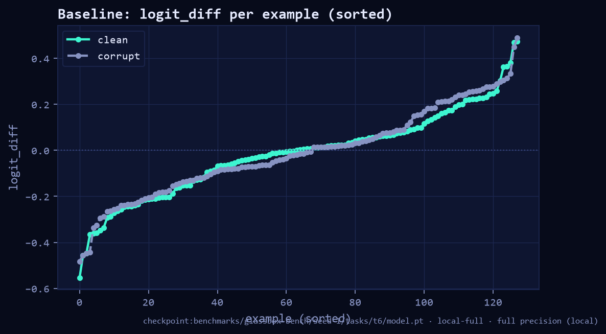
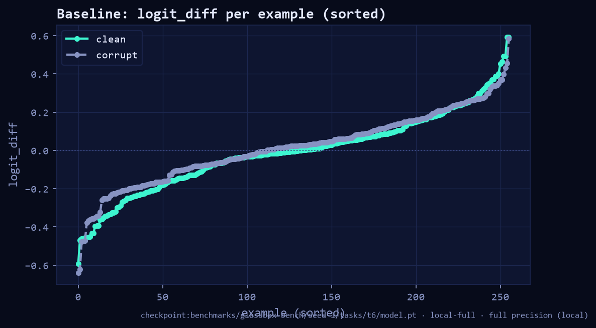

# t6 (null-random-init): the checkpoint does not perform the behaviour - no circuit claimed

**Behavior:** BOS + 6 tokens from 6 symbols (do, ge, go, ko, no, vu); the model is supposed to output one symbol at the last position. Dataset task 'bench', path benchmarks/glassbox-bench/seed-1/tasks/t6.  
**Model:** `checkpoint:benchmarks/glassbox-bench/seed-1/tasks/t6/model.pt` on `local-full`  
**Status:** unverified (no verification run) · null result: no behaviour, nothing verified  
**Experiments run:** 3 · **Backends used:** full precision (local)  
**Written:** 2026-11-13 13:46

## Summary

All numbers are from local-full (full precision). The loaded checkpoint (2 layers, 3 heads per layer, d_model 38) does not produce the dataset's answers: clean accuracy is 0.0078 on two independent samples (1/128 and 2/256), below uniform chance over the 15-token vocabulary, and the logit difference between the dataset answer and the corrupt answer is about 0 +/- 0.2. The model's argmax tokens are a mix of input symbols and wrong digits. Because there is no behaviour, no screening, patching or verification was run and no attention head or MLP is claimed to implement anything. Separately, the dataset labels themselves follow a clean rule (count of tokens in the same pair-class as the last token), but that describes the labels, not this model.

## The recovered algorithm

```python
# No algorithm is attributed to the model: it does not reproduce the dataset answers (E0002, E0003).
# For reference only, the rule that the DATASET LABELS follow (read off E0001 by hand, NOT computed by this checkpoint):
def label_rule(tokens):
    last = tokens[-1]
    partner = 9 - last            # pair-classes by id: {2,7}={do,vu}, {3,6}={ge,no}, {4,5}={go,ko}
    count = sum(1 for t in tokens[1:] if t in (last, partner))
    return 8 + count              # id of the digit token '<count>'
```

## Claims and evidence

| # | Claim | Evidence | Produced by |
|---|---|---|---|
| 1 | The checkpoint does not perform the behaviour: clean accuracy against the dataset answers is 0.0078 on n=128 (seed 1) and 0.0078 on n=256 (seed 2), with mean logit diff -0.015 +/- 0.19 and -0.007 +/- 0.21, the same as on corrupt prompts (local-full, full precision). | E0002, E0003 | full precision (local) |
| 2 | The model's top tokens are not consistently in the expected answer set: shown predictions include input symbols ('vu', 'do', 'ko') and wrong digits ('5' where '4' or '3' was expected). | E0002, E0003 | full precision (local) |
| 3 | No attention head or MLP layer is claimed as part of a circuit: with no behaviour present there is nothing for a circuit to implement, and no component-level experiment was run. | E0002, E0003 | full precision (local) |

## Key plots

**E0002: baseline** (full precision (local))



**E0003: baseline** (full precision (local))



## Limitations

- Only the baseline was measured (3 of 25 experiments used). No component-level experiment was run, by design, because the behaviour is absent.
- The label rule in the pseudocode was checked by hand on roughly 35 of the 64 examples in E0001 (a dataset inspection, exploratory). It was not tested by any scored experiment and is not a claim about the model.
- The task statement says the dataset answers are the model's own outputs; that did not hold for this checkpoint. I did not determine why (the investigation name suggests a randomly initialised null model, but I did not test the weights for that).
- verify_hypothesis was not run, so there are no agreement or causal numbers.

## Open questions

- Is this checkpoint a random-initialisation control, as the investigation name suggests? A weights_svd or logit-scale check could test it.
- Does the model compute any stable non-trivial function of its input at all, different from the dataset labels?

## Prediction record

2 experiments were pre-registered, 2 were run: **1 confirmed, 1 refuted, 0 inconclusive**. Hit rate (confirmed / decided): **50%**.

Refuted predictions (shown, not hidden):

| prereg | experiment | hypothesis | predicted | observed |
|---|---|---|---|---|
| N0004 | E0002 | The model performs its behaviour reliably on the bench dataset: its top output at the last position is the dataset answer (its own output) with a clear logit ma | `summary.clean_accuracy >= 0.95` | 0.008 |

## Experiments

| id | primitive | backend / precision | seconds | pre-registration |
|---|---|---|---|---|
| E0001 | dataset | full precision (local) | 0.18 | exploratory |
| E0002 | baseline | full precision (local) | 0.75 | N0004: refuted |
| E0003 | baseline | full precision (local) | 0.82 | N0007: confirmed |

## Notebook trail

- `N0001` *decision*: Loaded checkpoint:benchmarks/glassbox-bench/seed-1/tasks/t6/model.pt on local-full (full precision (local)).
- `N0002` *experiment*: dataset (E0001)
- `N0003` *hypothesis* **[rejected]**: H1 (function, from reading E0001 input/output pairs): the model outputs the digit equal to the number of the 6 input tokens that fall in the same pair-class as the LAST token, with classes {do,vu} (ids 2,7), {ge,no} (3,6), {go,ko} (4,5), i.e. count of tokens t with t == last or t == 9 - last. Output id = 8 + count (range 1..6). Checked by hand on ~35 of the 64 E0001 examples, no exceptions.
- `N0004` *prereg*: The model performs its behaviour reliably on the bench dataset: its top output at the last position is the dataset answer (its own output) with a clear logit margin over the corrupt-prompt answer.
- `N0005` *experiment*: The model performs its behaviour reliably on the bench dataset: its top output at the last position is the dataset answe (E0002)
- `N0006` *result*: Baseline REFUTED the prediction (local-full, full precision). On n=128 (seed 1) clean accuracy = 0.0078 (1/128), below even uniform chance over 15 tokens. Mean logit diff (dataset answer vs corrupt answer) = -0.015 +/- 0.19, indistinguishable from the corrupt-prompt value (-0.010). The model's top tokens on the shown examples are input symbols ('vu','do','do','ko') where the dataset expects the digit '2'. So this checkpoint does not produce the dataset's answers: the labels follow a clean rule (H1) but the loaded model does not compute it, and its logits are nearly flat. (E0002)
- `N0007` *prereg*: The failure in E0002 is not a sampling accident: on an independent sample the checkpoint again fails to output the dataset answers, i.e. the model does not perform the behaviour at all.
- `N0008` *experiment*: The failure in E0002 is not a sampling accident: on an independent sample the checkpoint again fails to output the datas (E0003)
- `N0009` *hypothesis* **[rejected]** -> N0003: Rejected as a description of THIS checkpoint. The rule (count of tokens in the last token's pair-class) describes the dataset labels in E0001, but the model does not output those labels: accuracy 0.0078 on two independent samples (E0002 n=128, E0003 n=256), logit diff ~0 +/- 0.2, and its argmax tokens are a mix of input symbols and wrong digits. There is no behaviour to explain, so no circuit is claimed.
- `N0010` *decision*: Stop after 3 of 25 experiments. Per protocol step 1: the model does not do the behaviour (accuracy near/below chance, replicated), so no screening, patching or verify_hypothesis is run; a circuit search on a model without the behaviour would only produce false discoveries. Report as a null result.
