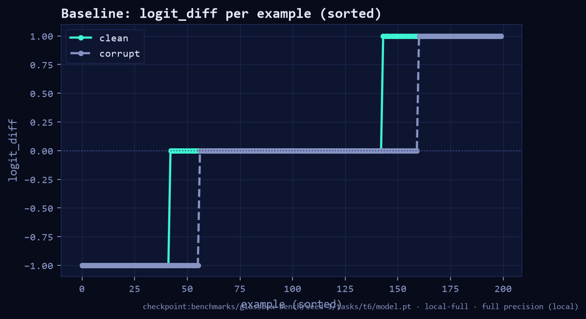
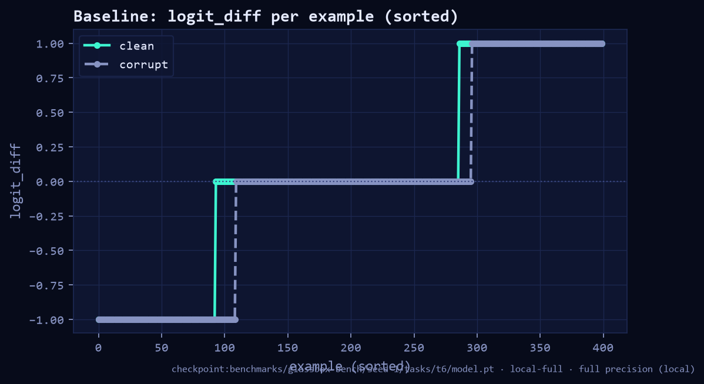

# t6 (task-shuffled): the model does not produce the dataset's answers; no mechanism claimed

**Behavior:** BOS + 6 tokens from 6 symbols; one symbol output at the last position. The dataset 'bench' (seed-1/t6) was supposed to carry the model's own outputs as answers.  
**Model:** `checkpoint:benchmarks/glassbox-bench/seed-1/tasks/t6/model.pt` on `local-full`  
**Status:** unverified (no verification run) · null result: no behaviour to explain  
**Experiments run:** 3 · **Backends used:** full precision (local)  
**Written:** 2026-11-13 13:50

## Summary

At full precision (local-full) the model's last-position output matches the dataset answer on 28.5% of inputs in two independent samples (n=200 and n=400). The label distribution is concentrated on two symbols (about 42% and 38% in the 64 inspected examples), so random pairing would give roughly 0.34 and always guessing the mode roughly 0.42. The mean logit difference between the labelled answer and the foil is 0.05-0.08 with std 0.7, the same on clean and corrupt inputs. The labels therefore do not describe what this model computes. The investigation was stopped after the baseline, as the protocol requires: no circuit, no algorithm and no verification are claimed.

## The recovered algorithm

```python
# No algorithm recovered.
# The dataset labels are not the model's outputs (E0002, E0003), so there is no labelled behaviour to reverse-engineer.
```

## Claims and evidence

| # | Claim | Evidence | Produced by |
|---|---|---|---|
| 1 | The model's output equals the dataset answer on only 28.5% of 200 inputs (seed 1), refuting the pre-registered prediction of >= 95%. | E0002 | full precision (local) |
| 2 | The mismatch replicates on 400 fresh inputs (seed 2): 28.5% again, at or below the label base rate; pre-registered prediction <= 0.45 confirmed. | E0003 | full precision (local) |
| 3 | Mean logit difference between labelled answer and foil is near zero (0.075 and 0.0525, std about 0.7) and not separated from the corrupt inputs (-0.08, -0.0125): the labels carry no signal about the model's output. | E0002, E0003 | full precision (local) |

## Key plots

**E0002: baseline** (full precision (local))



**E0003: baseline** (full precision (local))



## Limitations

- Only the dataset inspection and two baselines were run (3 of 25 experiments). Nothing about heads, MLPs or inert components was measured, so nothing is claimed about them.
- The base-rate comparison uses the label distribution of the 64 seed-0 examples (E0001), a small sample.
- The model does emit crisp outputs (per-example logit diffs are exactly -1, 0 or +1). What function those outputs follow was not investigated, because the supplied dataset gives no valid labels to test it against.
- verify_hypothesis was not run: there is no hypothesis to verify.

## Open questions

- What does the model actually compute? Answering that needs a dataset whose answers really are the model's outputs.
- Are the labels a permutation of the true outputs across examples (same marginal distribution), or something else?

## Prediction record

2 experiments were pre-registered, 2 were run: **1 confirmed, 1 refuted, 0 inconclusive**. Hit rate (confirmed / decided): **50%**.

Refuted predictions (shown, not hidden):

| prereg | experiment | hypothesis | predicted | observed |
|---|---|---|---|---|
| N0003 | E0002 | The model reproduces the dataset's answers at the last position: the dataset labels are the model's own argmax outputs, so accuracy is essentially 1. | `summary.clean_accuracy >= 0.95` | 0.285 |

## Experiments

| id | primitive | backend / precision | seconds | pre-registration |
|---|---|---|---|---|
| E0001 | dataset | full precision (local) | 0.13 | exploratory |
| E0002 | baseline | full precision (local) | 1.58 | N0003: refuted |
| E0003 | baseline | full precision (local) | 1.18 | N0006: confirmed |

## Notebook trail

- `N0001` *decision*: Loaded checkpoint:benchmarks/glassbox-bench/seed-1/tasks/t6/model.pt on local-full (full precision (local)).
- `N0002` *experiment*: dataset (E0001)
- `N0003` *prereg*: The model reproduces the dataset's answers at the last position: the dataset labels are the model's own argmax outputs, so accuracy is essentially 1.
- `N0004` *experiment*: The model reproduces the dataset's answers at the last position: the dataset labels are the model's own argmax outputs,  (E0002)
- `N0005` *result*: Baseline REFUTED (local-full, full precision): on 200 inputs (seed 1) the model's last-position output equals the dataset answer on only 28.5%. Mean logit diff (answer vs foil) 0.075 +/- 0.70 on clean and -0.08 on corrupt, i.e. indistinguishable. Per-example logit diffs are exactly -1, 0 or +1, so the model emits a clean one-hot-like output, it just is not the labelled token. For comparison, in the 64 seed-0 examples (E0001) the answer distribution is roughly 2:42%, 3:38%, 4:14%, 1:6%, 5:2%; matching labels drawn at random from that distribution would give about 0.34, always guessing the mode about 0.42. 28.5% is at or below that. The dataset's answers are not the model's outputs. (E0002)
- `N0006` *prereg*: The mismatch in E0002 is not a seed fluke: the dataset labels are unrelated to this model's outputs, so on a fresh, larger sample accuracy stays at the label base rate.
- `N0007` *experiment*: The mismatch in E0002 is not a seed fluke: the dataset labels are unrelated to this model's outputs, so on a fresh, larg (E0003)
- `N0008` *decision*: STOP: no behaviour to explain. Two independent baselines at full precision (E0002: n=200 seed 1; E0003: n=400 seed 2) both give 28.5% agreement between the model's output and the dataset answer, with mean logit diff 0.05-0.08 (std 0.7), the same as on the corrupt inputs. That is the label base rate, not a computed function. The model does emit crisp outputs, but the labels supplied by this dataset do not describe them, so any circuit found by patching against these labels would be an artefact. No screening, patching, predict() or verify_hypothesis was run; 22 of 25 experiments left unused on purpose. (E0002, E0003)
