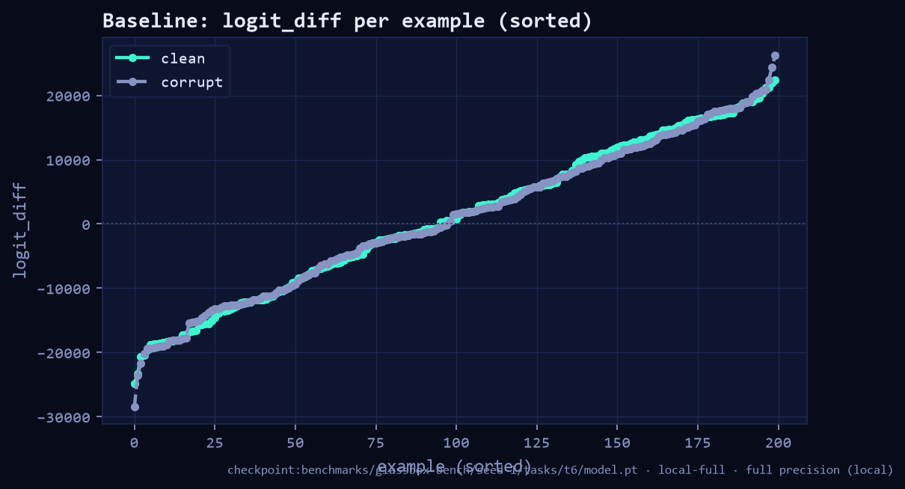
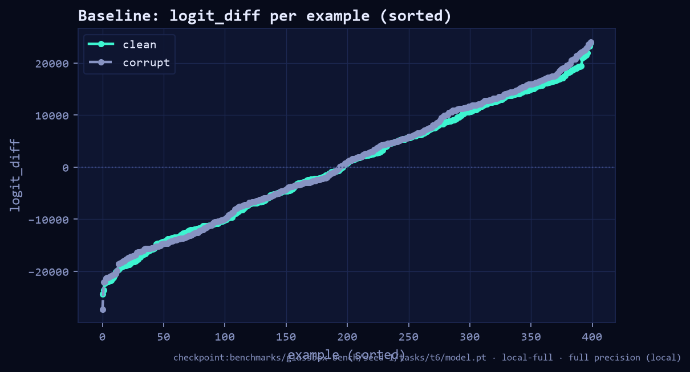

# t6 (null-weight-shuffled): the loaded model does not perform the labelled behaviour

**Behavior:** BOS + 6 tokens from 6 symbols -> one digit token at the last position; the function was to be recovered from the model.  
**Model:** `checkpoint:benchmarks/glassbox-bench/seed-1/tasks/t6/model.pt` on `local-full`  
**Status:** unverified (no verification run) · no mechanism found (stopped at baseline)  
**Experiments run:** 3 · **Backends used:** full precision (local)  
**Written:** 2026-11-13 13:49

## Summary

Negative result. On local-full (full precision) the loaded checkpoint agrees with the dataset's recorded answers on only 34.0% of 200 inputs (E0002) and 34.5% of 400 fresh inputs (E0003). That is the majority-class level: the label '3' covers roughly 37% of the seed-0 sample (E0001), and every example prediction shown in both baselines is '3' whatever the input. Logit differences are degenerate (std about 12000 around a mean of a few hundred). The investigation stopped at step 1, as the protocol prescribes: no function, no circuit and no verification are claimed.

## The recovered algorithm

```python
# No algorithm recovered.
# The loaded model does not reproduce the recorded answers (E0002, E0003),
# so there is no input-dependent behaviour to write down.
```

## Claims and evidence

| # | Claim | Evidence | Produced by |
|---|---|---|---|
| 1 | The loaded model agrees with the dataset's recorded answers on 34.0% of 200 inputs (seed 1), refuting the pre-registered prediction of >= 99%. | E0002 | full precision (local) |
| 2 | The miss replicates on an independent sample: 34.5% agreement on 400 inputs (seed 2), inside the pre-registered majority-class band 0.20-0.50. | E0003 | full precision (local) |
| 3 | The logit-difference metric is degenerate: std about 12000 with mean 882 (seed 1) and 291 (seed 2), and the clean and corrupt means are of the same order (882 vs 801; 291 vs 728) although the inputs differ. | E0002, E0003 | full precision (local) |

## Key plots

**E0002: baseline** (full precision (local))



**E0003: baseline** (full precision (local))



## Limitations

- Only the baseline was measured. No attribution, patching, ablation, attention-pattern or verify_hypothesis run was made, so nothing is known about individual heads or MLPs.
- That the model outputs '3' on every input is suggested by 8 of 8 displayed example predictions and by the 34% agreement matching the share of that label, but the full prediction distribution was not measured, so a constant output is not claimed.
- The function that generated the labels was not identified from the 64 inspected examples (E0001); several simple counting and comparison rules were checked by hand against them and failed.
- The dataset description says its answers are the model's own outputs. That does not hold for the weights that were loaded here; why (for example a weight-shuffled null model behind the same path) was not determined.

## Open questions

- Is the model's output literally constant, or weakly input-dependent?
- Which weights produced the recorded answers?

## Prediction record

2 experiments were pre-registered, 2 were run: **1 confirmed, 1 refuted, 0 inconclusive**. Hit rate (confirmed / decided): **50%**.

Refuted predictions (shown, not hidden):

| prereg | experiment | hypothesis | predicted | observed |
|---|---|---|---|---|
| N0003 | E0002 | The model deterministically outputs a digit token at the last position; since dataset answers are its own outputs, accuracy is 1.0 and the mean logit difference | `summary.clean_accuracy >= 0.99` | 0.340 |

## Experiments

| id | primitive | backend / precision | seconds | pre-registration |
|---|---|---|---|---|
| E0001 | dataset | full precision (local) | 0.19 | exploratory |
| E0002 | baseline | full precision (local) | 0.88 | N0003: refuted |
| E0003 | baseline | full precision (local) | 1.76 | N0006: confirmed |

## Notebook trail

- `N0001` *decision*: Loaded checkpoint:benchmarks/glassbox-bench/seed-1/tasks/t6/model.pt on local-full (full precision (local)).
- `N0002` *experiment*: dataset (E0001)
- `N0003` *prereg*: The model deterministically outputs a digit token at the last position; since dataset answers are its own outputs, accuracy is 1.0 and the mean logit difference is clearly positive.
- `N0004` *experiment*: The model deterministically outputs a digit token at the last position; since dataset answers are its own outputs, accur (E0002)
- `N0005` *result*: Baseline prediction REFUTED (local-full, full precision). The loaded model matches the dataset's recorded answers on only 34% of 200 inputs (seed 1). The four example predictions are all "3" where "2" was expected; in the seed-0 sample (E0001) the label "3" alone covers ~37% of inputs, so 0.34 is what a near-constant output would score. Logit differences are degenerate (mean 882, std 12032, range about -25000..+26000), and per-example clean and corrupt metrics track each other closely although the inputs differ (clean mean 882 vs corrupt 801), i.e. the metric is driven by which label pair is scored, not by the input. The loaded weights do not implement the function that generated the labels. (E0002)
- `N0006` *prereg*: The loaded model does not compute the labelled function: its agreement with the recorded answers stays at the majority-class level (about one third) on an independent sample, so E0002 was not a seed fluke.
- `N0007` *experiment*: The loaded model does not compute the labelled function: its agreement with the recorded answers stays at the majority-c (E0003)
- `N0008` *result*: Replication confirmed (local-full): on 400 fresh inputs (seed 2) agreement with the recorded answers is 0.345, same as seed 1 (0.34). All 8 example predictions across E0002/E0003 are the token "3" regardless of input; logit-diff std ~11800 with mean near 0 relative to that spread. The model does not do the behaviour: accuracy sits at the majority-class level. (E0002, E0003)
- `N0009` *decision*: Stop at step 1. The loaded model does not perform the labelled behaviour (0.34 / 0.345 agreement, two independent samples), so there is no mechanism to localise. No screening, patching, ablation or verify_hypothesis was run: any circuit found by pressing on would be explaining noise. No function is claimed, no circuit is claimed. 22 of 25 experiments left unused. (E0002, E0003)
