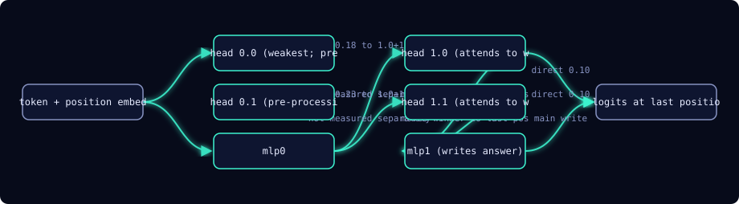
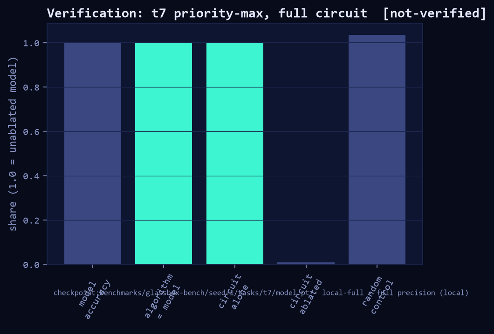
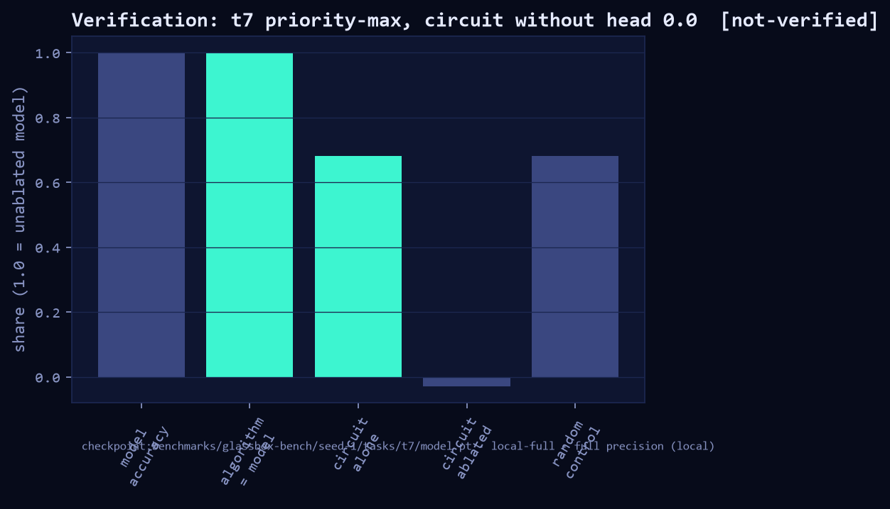
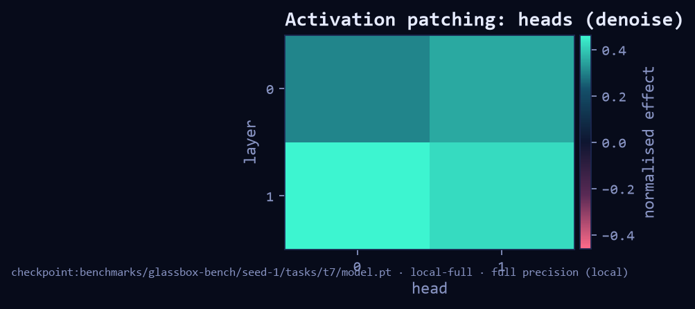
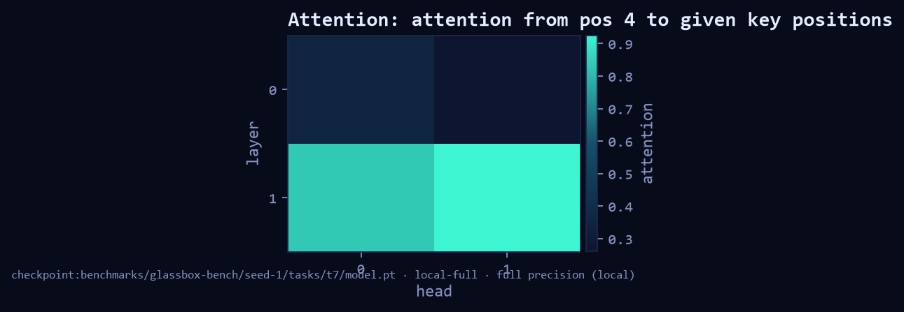
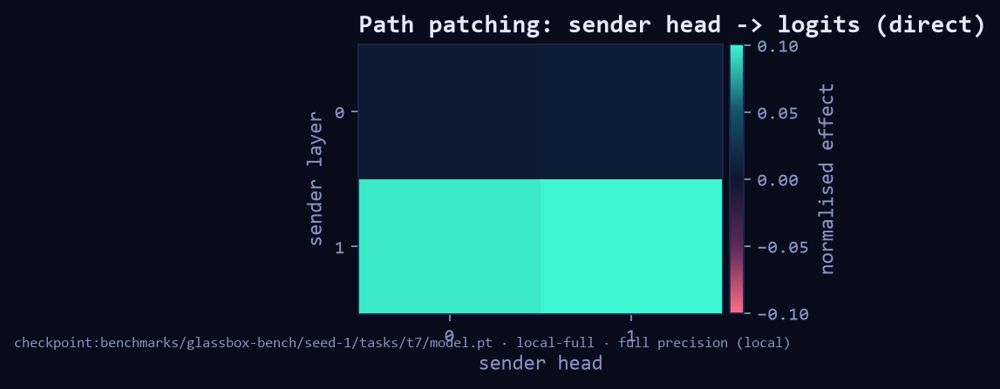
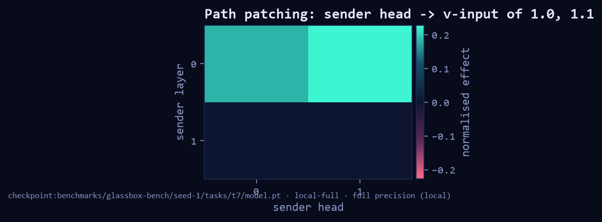

# t7: priority-max over 4 symbols in a 2-layer, 2-head transformer

**Behavior:** BOS + 4 tokens from 6 symbols (ti, ri, pu, bo, so, pa); the model outputs one symbol at the last position.  
**Model:** `checkpoint:benchmarks/glassbox-bench/seed-1/tasks/t7/model.pt` on `local-full`  
**Status:** partial / not verified · partial: function verified by agreement, circuit localisation not verified  
**Experiments run:** 16 · **Backends used:** full precision (local)  
**Written:** 2026-11-13 13:13

## Summary

The model outputs the highest-priority symbol present in the input under the fixed order pa > bo > pu > ri > ti > so, independent of position. A 4-line predict() matches the model on 200/200 held-out inputs twice (V0001 seed 2, V0002 seed 3). Mechanistically, layer-1 heads 1.0 and 1.1 attend from the last position to the winning symbol and mlp1 turns what they move into the answer logits; layer-0 heads pre-process the per-position representations that layer 1 moves (V-composition), and mlp0 is also required. All six components (4 heads, 2 MLPs) showed a causal effect, so I could not identify any component that plays no part. The circuit is therefore the whole model, which the lab cannot distinguish from a null on sufficiency (V0001: not-verified). The one pre-declared smaller circuit (dropping the weakest head, 0.0) kept 96.5% accuracy but only 0.682 of the logit difference, under the 0.7 threshold (V0002: not-verified). All numbers are from local-full (full precision).

## The recovered algorithm

```python
def predict(tokens, prompt):
    rank = {pa(7): 5, bo(5): 4, pu(4): 3, ri(3): 2, ti(2): 1, so(6): 0}
    return max(tokens[1:], key=rank)   # highest-priority symbol present

# mechanism (as far as measured)
# L0: heads 0.0/0.1 (+ mlp0) enrich each position's representation; no direct logit effect
# L1: heads 1.0/1.1 at the last position attend to the position of the highest-priority symbol and copy its (L0-enriched) value
# mlp1: converts the moved value into the output logits
```

## Circuit



## Claims and evidence

| # | Claim | Evidence | Produced by |
|---|---|---|---|
| 1 | The model computes max under the order pa > bo > pu > ri > ti > so: predict() agrees with the model on 200/200 held-out inputs in two separate seeds; the model's own behaviour is confident (accuracy 1.0, mean logit diff 32). | E0001, E0002, V0001, V0002 | full precision (local) |
| 2 | Layer-1 heads 1.0 and 1.1 attend from the last position to the winning symbol wherever it is (0.83 and 0.92 for winner pu at position 3; 0.85 and 0.96 for winner pa at position 2 in the exploratory run), and jointly mean-ablating them leaves 0.17 of the logit difference. | E0008, E0007, E0009 | full precision (local) |
| 3 | Layer-0 heads 0.0 and 0.1 are needed (joint mean ablation leaves 0.27) but write almost nothing directly to the logits (0.004, 0.006); their main route is through the values of the layer-1 heads (0.18, 0.23), not their queries (0.02, 0.04, exploratory) or keys (0.03, 0.03). | E0010, E0012, E0013, E0014, E0011 | full precision (local) |
| 4 | Layer-1 heads have only a small direct effect on the logits (about 0.10 each) while mean-ablating mlp1 leaves 0.29 of the logit difference: the answer is finalised by mlp1. mlp0 is also necessary (0.23 left when ablated). | E0012, E0016, E0015, E0004 | full precision (local) |
| 5 | No single head carries the behaviour (largest single-head denoising effect 0.46; all four between 0.30 and 0.46), and no head or MLP was found to be inert. | E0006, E0003, E0015, E0016 | full precision (local) |
| 6 | Circuit localisation is not verified. Whole model as circuit: thresholds met but sufficiency has no null (V0001). Circuit without head 0.0: ablating it breaks the behaviour (fraction -0.03, accuracy 0.24) and it beats the null controls, but alone it retains 0.682 of the logit difference (accuracy 0.965), below the 0.7 threshold (V0002). | V0001, V0002 | full precision (local) |

## Verification

### V0001: t7 priority-max, full circuit  (full precision (local))

| check | value |
|---|---|
| status | not-verified |
| held-out inputs | 200 |
| model accuracy | 1.000 |
| algorithm agrees with model | 1.000 |
| algorithm accuracy vs ground truth | 1.000 |
| circuit size | 6 of 6 components |
| metric kept with ONLY the circuit | 1.000 |
| metric kept with the circuit ABLATED | 0.010 |
| random same-size ablation (control) | 1.005, 1.051, 1.045 |

The thresholds were met, but these effects do not exceed the 95th percentile of their null distribution: sufficiency. A random control does about as well, so this is not a finding.



### V0002: t7 priority-max, circuit without head 0.0  (full precision (local))

| check | value |
|---|---|
| status | not-verified |
| held-out inputs | 200 |
| model accuracy | 1.000 |
| algorithm agrees with model | 1.000 |
| algorithm accuracy vs ground truth | 1.000 |
| circuit size | 5 of 6 components |
| metric kept with ONLY the circuit | 0.682 |
| metric kept with the circuit ABLATED | -0.028 |
| random same-size ablation (control) | 0.682, 0.682, 0.682 |

At least one check failed; the explanation is partial or wrong. See the numbers.



## Key plots

**E0006: activation_patching** (full precision (local))



**E0008: attention_patterns** (full precision (local))



**E0012: path_patching** (full precision (local))



**E0013: path_patching** (full precision (local))



## Limitations

- Circuit status is not-verified: the only circuit that meets the thresholds is the whole model, which has no sufficiency null.
- The task statement says some components play no part; at head/MLP granularity I found none. Head 0.0 is the weakest (model keeps 96.5% accuracy without it) but it still carries 30% of the patching effect, so I do not call it inert.
- Ablation and patching effects are logit differences against the corrupt prompt's answer; per-component accuracy was only seen in the two verification runs.
- The path-patching primitive rejected mlp0 as a sender, so the mlp0 -> layer-1 and layer-1 -> mlp1 edges are inferred from ablations and direct-effect sizes, not measured as paths.
- How layer-1 attention picks the winner (what is in the keys) and what exactly the layer-0 heads add to the values was not resolved.
- The single-symbol output 'so' (all four inputs so) never appeared in the sampled data; the rule predicts 'so' there but this is untested.
- One prediction was refuted (N0020: I expected no V-composition from layer 0 to layer 1; observed 0.23).

## Open questions

- What do heads 0.0/0.1 write at the source positions that makes the layer-1 values useful: a partial max, or a re-encoding of the token?
- Is the priority order encoded in the layer-1 key/query weights directly on the token embeddings?
- Would a finer-grained decomposition (per position, or neurons within the MLPs) reveal the inert parts the task statement mentions?

## Prediction record

10 experiments were pre-registered, 10 were run: **9 confirmed, 1 refuted, 0 inconclusive**. Hit rate (confirmed / decided): **90%**.

Refuted predictions (shown, not hidden):

| prereg | experiment | hypothesis | predicted | observed |
|---|---|---|---|---|
| N0020 | E0013 | Layer-0 heads influence the layer-1 heads little through their values as well (as with queries, E0011): the layer-1 heads read the winning token mainly from the | `summary.top[0].effect <= 0.1` | 0.228 |

Exploratory runs (no pre-registration; they cannot be the only support for a claim): E0003, E0004, E0005, E0007, E0011.

## Experiments

| id | primitive | backend / precision | seconds | pre-registration |
|---|---|---|---|---|
| E0001 | dataset | full precision (local) | 0.3 | exploratory |
| E0002 | baseline | full precision (local) | 0.54 | N0004: confirmed |
| E0003 | ablation | full precision (local) | 0.4 | exploratory |
| E0004 | ablation | full precision (local) | 0.4 | exploratory |
| E0005 | attention_patterns | full precision (local) | 0.39 | exploratory |
| E0006 | activation_patching | full precision (local) | 0.43 | N0009: confirmed |
| E0007 | attention_patterns | full precision (local) | 0.08 | exploratory |
| E0008 | attention_patterns | full precision (local) | 0.08 | N0012: confirmed |
| E0009 | ablation | full precision (local) | 0.4 | N0014: confirmed |
| E0010 | ablation | full precision (local) | 0.33 | N0015: confirmed |
| E0011 | path_patching | full precision (local) | 0.41 | exploratory |
| E0012 | path_patching | full precision (local) | 0.48 | N0019: confirmed |
| E0013 | path_patching | full precision (local) | 0.4 | N0020: refuted |
| E0014 | path_patching | full precision (local) | 0.39 | N0024: confirmed |
| E0015 | ablation | full precision (local) | 0.32 | N0025: confirmed |
| E0016 | ablation | full precision (local) | 0.33 | N0026: confirmed |
| V0001 | verify | full precision (local) |  | verification |
| V0002 | verify | full precision (local) |  | verification |

## Notebook trail

- `N0001` *decision*: Loaded checkpoint:benchmarks/glassbox-bench/seed-1/tasks/t7/model.pt on local-full (full precision (local)).
- `N0002` *experiment*: dataset (E0001)
- `N0003` *hypothesis* **[supported]**: H1 (function): the output is the highest-priority symbol among the 4 input tokens under the fixed order pa(7) > bo(5) > pu(4) > ri(3) > ti(2) > so(6). Checked by hand against all 200 rows of E0001 (seed 0): no exception found. Position of the tokens appears irrelevant.
- `N0004` *prereg*: The model performs its behaviour confidently: on the bench dataset its top output equals the dataset answer (its own output) almost always.
- `N0005` *experiment*: The model performs its behaviour confidently: on the bench dataset its top output equals the dataset answer (its own out (E0002)
- `N0006` *experiment*: first screen: shape of ablation output, which heads matter (E0003)
- `N0007` *experiment*: first screen: which MLPs matter (E0004)
- `N0008` *experiment*: where do heads look from the last position (E0005)
- `N0009` *prereg*: The computation is distributed: no single attention head, when patched from clean into the corrupt run, restores most of the clean-vs-corrupt logit difference.
- `N0010` *experiment*: The computation is distributed: no single attention head, when patched from clean into the corrupt run, restores most of (E0006)
- `N0011` *experiment*: custom prompts with the top-priority token pa only at position 2: do heads attend from the last position to it? (E0007)
- `N0012` *prereg*: Layer-1 heads implement the selection: from the last position they attend to wherever the highest-priority token sits, for any winner and any position (here winner pu=4 at position 3, the others from ti/ri/so).
- `N0013` *experiment*: Layer-1 heads implement the selection: from the last position they attend to wherever the highest-priority token sits, f (E0008)
- `N0014` *prereg*: Layer-1 heads 1.0 and 1.1 are the main movers of the winning token to the last position: mean-ablating both removes most of the logit difference.
- `N0015` *prereg*: Layer-0 heads 0.0 and 0.1 are part of the mechanism (they supply the last position with context that layer 1 needs): mean-ablating both removes at least half of the logit difference.
- `N0016` *experiment*: Layer-1 heads 1.0 and 1.1 are the main movers of the winning token to the last position: mean-ablating both removes most (E0009)
- `N0017` *experiment*: Layer-0 heads 0.0 and 0.1 are part of the mechanism (they supply the last position with context that layer 1 needs): mea (E0010)
- `N0018` *experiment*: output shape + does layer 0 attention feed the layer-1 query? (mlp0 as sender is not accepted by the primitive) (E0011)
- `N0019` *prereg*: Layer-0 heads do not write the answer directly to the logits; their contribution is routed through later components (mlp0/mlp1/layer-1 heads).
- `N0020` *prereg*: Layer-0 heads influence the layer-1 heads little through their values as well (as with queries, E0011): the layer-1 heads read the winning token mainly from the embedding/mlp0 stream at the source position, not from layer-0 attention output.
- `N0021` *experiment*: Layer-0 heads do not write the answer directly to the logits; their contribution is routed through later components (mlp (E0012)
- `N0022` *experiment*: Layer-0 heads influence the layer-1 heads little through their values as well (as with queries, E0011): the layer-1 head (E0013)
- `N0023` *result*: All four heads carry causal weight (denoising effects 0.30-0.46, E0006; joint mean ablation leaves 0.17 for layer 1, E0009, and 0.27 for layer 0, E0010). Layer-1 heads attend from the last position to the winning token (0.83 / 0.92, E0008). Layer-0 heads have ~0 direct effect on the logits (0.004 / 0.006) and layer-1 heads only ~0.10 each (E0012), so the answer is finalised downstream of attention (mlp1). REFUTED prediction N0020: I expected layer-0 heads not to feed layer-1 values; in fact V-composition is the main route for the layer-0 heads (0.18 / 0.23 of their 0.30 / 0.36 total, E0013). Revised picture: layer-0 heads pre-process the per-position representations that layer-1 heads then move to the last position. (E0006, E0008, E0009, E0010, E0012, E0013)
- `N0024` *prereg*: Layer-0 heads feed the layer-1 heads mainly through values (E0013), not through keys: the layer-1 attention choice of the winner depends little on layer-0 attention output.
- `N0025` *prereg*: mlp0 is a necessary part of the mechanism (seen in exploratory E0004 on seed 0; tested here on fresh inputs).
- `N0026` *prereg*: mlp1 is a necessary part of the mechanism: it converts what the layer-1 heads moved to the last position into the answer logits (heads' direct effects are only ~0.1 each, E0012).
- `N0027` *experiment*: Layer-0 heads feed the layer-1 heads mainly through values (E0013), not through keys: the layer-1 attention choice of th (E0014)
- `N0028` *experiment*: mlp0 is a necessary part of the mechanism (seen in exploratory E0004 on seed 0; tested here on fresh inputs). (E0015)
- `N0029` *experiment*: mlp1 is a necessary part of the mechanism: it converts what the layer-1 heads moved to the last position into the answer (E0016)
- `N0030` *verification*: t7 priority-max, full circuit: not-verified. The thresholds were met, but these effects do not exceed the 95th percentile of their null distribution: sufficiency. A random control does about as well, so this is not a finding. (V0001)
- `N0031` *decision*: V0001: function agreement 1.0 on held-out seed 2; whole-model circuit (6/6 components) meets thresholds but sufficiency has no null (circuit = whole model), so status not-verified. Every component showed a causal effect in my experiments, so I do not believe any is a pure dummy. One follow-up, decided before seeing it: test the 5-component circuit that drops the weakest component, head 0.0 (smallest single-ablation loss in E0003, smallest patching effect in E0006), on unused seed 3. Expectation: circuit-alone fraction near 0.69, i.e. borderline against the 0.7 threshold. I will report the outcome either way and not try further subsets to hunt for a pass.
- `N0032` *verification*: t7 priority-max, circuit without head 0.0: not-verified. At least one check failed; the explanation is partial or wrong. See the numbers. (V0002)
- `N0033` *hypothesis* **[supported]** -> N0003: H1 supported: predict() agrees with the model on 200/200 held-out inputs in V0001 (seed 2) and 200/200 in V0002 (seed 3). Circuit localisation is NOT verified: whole model has no sufficiency null (V0001); dropping head 0.0 leaves 0.682 of the logit difference and 96.5% accuracy, just under the 0.7 threshold (V0002). Conclusion: all six components take part; no dummy component found at head/MLP granularity. Stopping here as decided in N0031.
