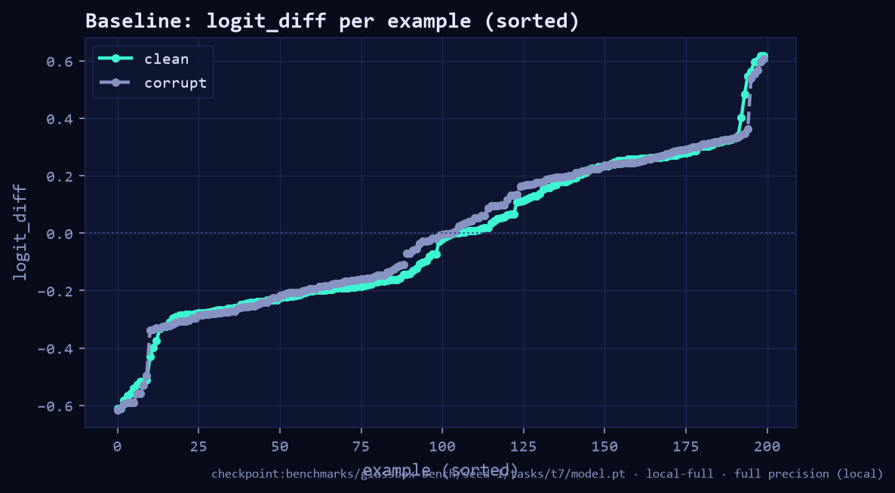
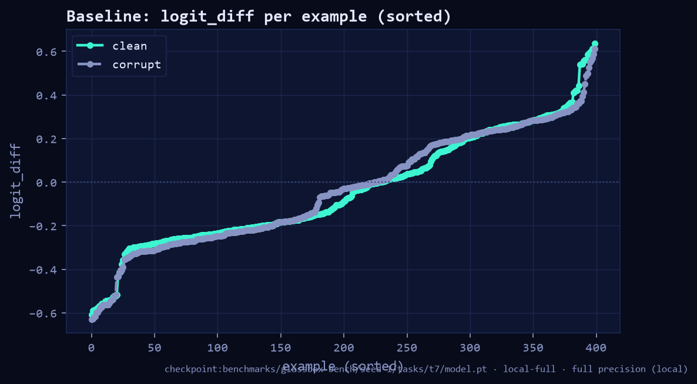

# t7 (null-random-init): no behaviour to explain

**Behavior:** BOS + 4 tokens from 6 symbols; the model is said to output one symbol at the last position, with dataset answers equal to the model's own outputs.  
**Model:** `checkpoint:benchmarks/glassbox-bench/seed-1/tasks/t7/model.pt` on `local-full`  
**Status:** unverified (no verification run) · null finding: model does not perform the behaviour  
**Experiments run:** 4 · **Backends used:** full precision (local)  
**Written:** 2026-11-13 13:52

## Summary

The checkpoint does not do the labelled behaviour. On local-full (full precision) its top token matches the dataset answer on 25.5% of 200 prompts (E0003) and 20.0% of 400 fresh prompts (E0004), near the 1/6 chance level, with a mean answer-vs-foil logit difference of about zero (std 0.27). The dataset labels themselves follow a clean rule (maximum under the ordering pa > bo > pu > ri > ti > so, read off E0001), but the model does not implement it. The pre-registered prediction that the model reproduces its labels was refuted, and the investigation stopped there: no circuit is claimed and nothing was submitted for verification.

## The recovered algorithm

```python
# No algorithm recovered: the model's output does not track the dataset answers (E0003, E0004).
# For reference only, the rule the dataset LABELS follow (from E0001, not implemented by this checkpoint):
#   order = [7, 5, 4, 3, 2, 6]  # pa > bo > pu > ri > ti > so
#   answer = first symbol in order that appears in tokens[1:]
```

## Claims and evidence

| # | Claim | Evidence | Produced by |
|---|---|---|---|
| 1 | The model does not perform the labelled behaviour: accuracy against the dataset answers is 0.255 (n=200, seed 0), against a pre-registered prediction of >= 0.95. | E0003 | full precision (local) |
| 2 | The failure replicates on a fresh, larger sample: accuracy 0.20 (n=400, seed 1), pre-registered <= 0.40; mean logit difference -0.036 with std 0.27, and the model sometimes outputs PAD, which is not one of the 6 symbols. | E0004 | full precision (local) |
| 3 | No attention head or MLP layer can be assigned to the behaviour: there is no logit margin for any component to carry (clean mean logit diff -0.020, corrupt -0.009). | E0003, E0004 | full precision (local) |

## Key plots

**E0003: baseline** (full precision (local))



**E0004: baseline** (full precision (local))



## Limitations

- Only 4 of 25 experiments were used; the protocol says to stop when the baseline is at chance.
- The labelling rule (max under pa > bo > pu > ri > ti > so) was checked by hand on about 40 of the 200 rows of E0001, not exhaustively, and it describes the labels, not the model.
- The exploratory attribution screen E0002 was run before the baseline; its effects are normalised by a clean-corrupt gap of about 0.01 and should be ignored.
- verify_hypothesis was not run: there is no hypothesis or circuit to verify.
- Whether the checkpoint is untrained or merely mismatched with the dataset labels was not tested; only that it does not produce the labelled outputs.

## Open questions

- The task statement says the dataset answers are the model's own outputs; here they are not. Is the checkpoint a deliberate null (the investigation name suggests so) or is the task folder mis-paired?

## Prediction record

2 experiments were pre-registered, 2 were run: **1 confirmed, 1 refuted, 0 inconclusive**. Hit rate (confirmed / decided): **50%**.

Refuted predictions (shown, not hidden):

| prereg | experiment | hypothesis | predicted | observed |
|---|---|---|---|---|
| N0003 | E0003 | The model deterministically outputs the maximum of the 4 input symbols under the ordering pa(7) > bo(5) > pu(4) > ri(3) > ti(2) > so(6); the dataset answers are | `summary.clean_accuracy >= 0.95` | 0.255 |

Exploratory runs (no pre-registration; they cannot be the only support for a claim): E0002.

## Experiments

| id | primitive | backend / precision | seconds | pre-registration |
|---|---|---|---|---|
| E0001 | dataset | full precision (local) | 0.55 | exploratory |
| E0002 | attribution_patching | full precision (local) | 1.06 | exploratory |
| E0003 | baseline | full precision (local) | 0.71 | N0003: refuted |
| E0004 | baseline | full precision (local) | 3.03 | N0007: confirmed |

## Notebook trail

- `N0001` *decision*: Loaded checkpoint:benchmarks/glassbox-bench/seed-1/tasks/t7/model.pt on local-full (full precision (local)).
- `N0002` *experiment*: dataset (E0001)
- `N0003` *prereg*: The model deterministically outputs the maximum of the 4 input symbols under the ordering pa(7) > bo(5) > pu(4) > ri(3) > ti(2) > so(6); the dataset answers are its own argmax, so baseline accuracy is ~1 with a positive logit diff.
- `N0004` *experiment*: attribution_patching (E0002)
- `N0005` *experiment*: The model deterministically outputs the maximum of the 4 input symbols under the ordering pa(7) > bo(5) > pu(4) > ri(3)  (E0003)
- `N0006` *hypothesis* **[rejected]**: H1: the model outputs the maximum of its 4 input symbols under the ordering pa(7) > bo(5) > pu(4) > ri(3) > ti(2) > so(6), and the dataset answers are its own argmax (as the task statement says). The ordering rule was read off the 200 labelled rows of E0001 (it fits every row I checked by hand, about 40).
- `N0007` *prereg*: The checkpoint does not perform the labelled behaviour: on a fresh, larger sample its argmax matches the dataset answer only at the rate a near-constant guess would get, and its mean logit difference for the answer is about zero.
- `N0008` *experiment*: The checkpoint does not perform the labelled behaviour: on a fresh, larger sample its argmax matches the dataset answer  (E0004)
- `N0009` *hypothesis* **[rejected]** -> N0006: Rejected by E0003 (pre-registered accuracy >= 0.95, observed 0.255, n=200 seed 0) and replicated by E0004 (0.20, n=400 seed 1). The model's argmax does not match the dataset answers; mean logit diff for the answer is about 0 (-0.020 and -0.036, std 0.27), and its predictions include PAD, which is not one of the 6 symbols. The ordering rule describes the dataset labels, not this checkpoint.
- `N0010` *result*: The checkpoint does not perform the labelled behaviour (local-full, full precision). Accuracy against the dataset answers is 0.255 (E0003, n=200) and 0.20 (E0004, n=400), near the 1/6 chance level for 6 symbols; logit diff answer-vs-foil has mean about 0 and std 0.27, i.e. no margin. The exploratory attribution screen E0002 has a clean-minus-corrupt metric gap of only 0.01, so its head/MLP 'effects' are ratios over a near-zero denominator and carry no information. (E0003, E0004)
- `N0011` *decision*: Stop after 4 of 25 experiments, per the protocol: with accuracy near chance there is no mechanism to explain. No circuit is claimed, no predict() is submitted, and verify_hypothesis is not run because there is no hypothesis left to verify. Reporting a null finding.
