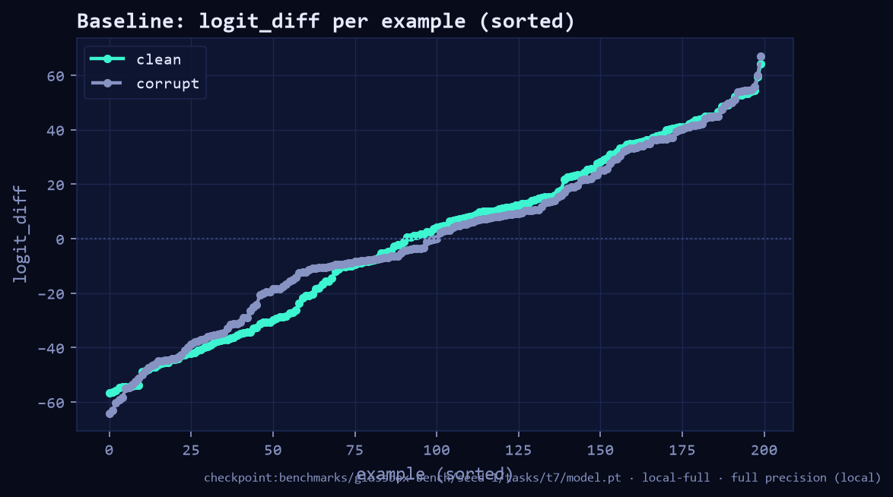
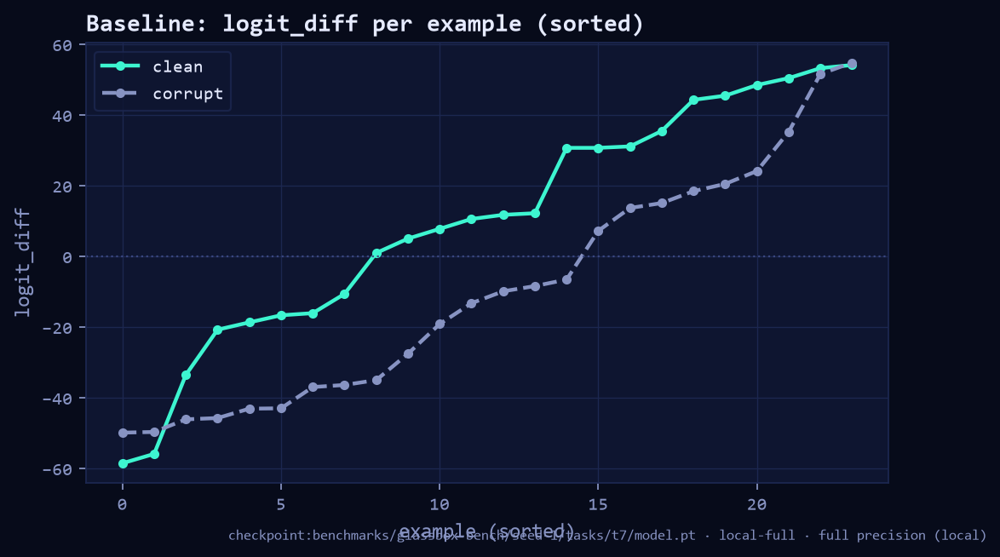

# t7 (null-task-shuffled): no labelled behaviour to explain

**Behavior:** BOS + 4 tokens from 6 symbols -> one symbol at the last position (glassbox-bench seed-1 t7, dataset task 'bench'). Backend: local-full, full precision.  
**Model:** `checkpoint:benchmarks/glassbox-bench/seed-1/tasks/t7/model.pt` on `local-full`  
**Status:** unverified (no verification run) · null result - no mechanism claimed  
**Experiments run:** 5 · **Backends used:** full precision (local)  
**Written:** 2026-11-13 13:56

## Summary

The investigation stopped at step 1. Against the labels the lab scores with, the model is at chance: accuracy 0.375 and mean logit difference 0.38 +/- 32.4 on 200 inputs (E0002), which is what the label marginal alone gives. A follow-up diagnostic with explicit inputs and the answers printed in the dataset view reached only 0.50 on 24 rows (E0005). Both pre-registered predictions were refuted. No function, circuit or predict() is claimed, and verify_hypothesis was not run because there is no validated behaviour to verify.

## The recovered algorithm

```python
# No algorithm recovered. The labels supplied for this task are not the model's outputs (E0002, E0005),
# so no predict(tokens, prompt) can be justified from this investigation.
```

## Claims and evidence

| # | Claim | Evidence | Produced by |
|---|---|---|---|
| 1 | On the task's own metric the model performs at chance: clean accuracy 0.375, mean logit diff 0.38 with std 32.4 (corrupt mean 0.62), n=200, local-full. | E0002 | full precision (local) |
| 2 | The answers shown in the dataset view (which fit 'max under the ordering pa>bo>pu>ri>ti>so' on the rows checked) are not the model's outputs either: with explicit inputs and those labels accuracy is 0.50 on 24 rows. | E0005, E0001 | full precision (local) |
| 3 | No component can be assigned a role: mean-ablating any single head or MLP moves the task metric by less than 1 logit against a per-example std of 32, and every ablation nominally 'improves' it, which is the signature of a metric with no signal. | E0002, E0003, E0004 | full precision (local) |

## Key plots

**E0002: baseline** (full precision (local))



**E0005: baseline** (full precision (local))



## Limitations

- No circuit, no algorithm and no held-out verification: the investigation was stopped as the protocol requires when baseline accuracy is at chance.
- The model's true input-output function was not characterised. The lab exposes model predictions only for 4 example rows per baseline, so the model may well compute something systematic that neither label set captures.
- E0005 used only 24 rows; 0.50 is above the 0.375 marginal-chance figure but that gap is not statistically meaningful at n=24 and was not followed up.
- E0003 and E0004 are exploratory and are cited only alongside the pre-registered E0002.

## Open questions

- Why does the brief say the task answers are the model's own outputs when E0002 shows they are not? In E0002 the 'expected' labels differed from the answers listed for the same rows in E0001, consistent with the labels having been shuffled relative to the inputs.
- What does the model actually output across all 1296 inputs? Answering this needs a primitive that returns raw argmax predictions per input.

## Prediction record

2 experiments were pre-registered, 2 were run: **0 confirmed, 2 refuted, 0 inconclusive**. Hit rate (confirmed / decided): **0%**.

Refuted predictions (shown, not hidden):

| prereg | experiment | hypothesis | predicted | observed |
|---|---|---|---|---|
| N0003 | E0002 | The model deterministically outputs a symbol at the last position; since dataset answers are the model's own outputs, clean accuracy should be ~1. | `summary.clean_accuracy >= 0.95` | 0.375 |
| N0008 | E0005 | Diagnostic: the model's outputs on the first 24 rows of E0001 equal the answers printed in the E0001 dataset view (which fit 'max under the ordering pa>bo>pu>ri | `summary.clean_accuracy >= 0.9` | 0.500 |

Exploratory runs (no pre-registration; they cannot be the only support for a claim): E0003, E0004.

## Experiments

| id | primitive | backend / precision | seconds | pre-registration |
|---|---|---|---|---|
| E0001 | dataset | full precision (local) | 1.98 | exploratory |
| E0002 | baseline | full precision (local) | 1.89 | N0003: refuted |
| E0003 | ablation | full precision (local) | 1.36 | exploratory |
| E0004 | ablation | full precision (local) | 1.05 | exploratory |
| E0005 | baseline | full precision (local) | 0.21 | N0008: refuted |

## Notebook trail

- `N0001` *decision*: Loaded checkpoint:benchmarks/glassbox-bench/seed-1/tasks/t7/model.pt on local-full (full precision (local)).
- `N0002` *experiment*: dataset (E0001)
- `N0003` *prereg*: The model deterministically outputs a symbol at the last position; since dataset answers are the model's own outputs, clean accuracy should be ~1.
- `N0004` *experiment*: The model deterministically outputs a symbol at the last position; since dataset answers are the model's own outputs, cl (E0002)
- `N0005` *experiment*: shape check + first screen of heads (E0003)
- `N0006` *experiment*: first screen of MLPs (E0004)
- `N0007` *result*: Baseline prediction REFUTED (E0002): against the labels the lab scores with, clean accuracy is 0.375 and mean logit diff is 0.38 +/- 32.4 (corrupt 0.62), i.e. zero signal. 0.375 is what you get by chance from the label marginal (~50% pa, ~30% bo, ~13% pu). The brief's statement that the task answers are the model's own outputs does not hold for the labels used by the metric. Exploratory mean-ablation sweeps (E0003 heads, E0004 MLPs) all move the metric by <1 logit against a per-example std of 32: uninterpretable noise. Oddity: E0002 example_predictions (bo, bo, bo, pu) equal the 'answers' printed by the dataset view E0001 for the same rows (5,5,5,4), while the 'expected' labels used by the metric were (bo, pa, pa, pu). So the model may be computing something systematic, but the scored labels are not aligned with the inputs. (E0002, E0003, E0004)
- `N0008` *prereg*: Diagnostic: the model's outputs on the first 24 rows of E0001 equal the answers printed in the E0001 dataset view (which fit 'max under the ordering pa>bo>pu>ri>ti>so'), so the chance-level baseline is a label/input misalignment in the scored task, not a noise model.
- `N0009` *experiment*: Diagnostic: the model's outputs on the first 24 rows of E0001 equal the answers printed in the E0001 dataset view (which (E0005)
- `N0010` *result*: Diagnostic prediction REFUTED (E0005): with explicit inputs (first 24 rows of E0001) and the answers printed in the E0001 view (all 24 fit 'max under pa>bo>pu>ri>ti>so'), accuracy is only 0.50 (mean logit diff 10.1 +/- 33.6). The lab did not re-shuffle these labels (the 4 example 'expected' values are the ones I passed), so the model itself does not reproduce the answers shown in the dataset view. Hypothesis 'the model computes the rule visible in the dataset view and only the scoring labels are misaligned' is REJECTED. Neither label set available to me (task metric E0002: 0.375; dataset-view answers E0005: 0.50 on n=24) is the model's own output. There is no validated behaviour to localise. (E0005, E0002)
- `N0011` *decision*: STOP per protocol step 1: the model does not do the labelled behaviour (E0002 accuracy 0.375 = chance for the label marginal; E0005 0.50 on 24 rows). No circuit search, no predict(), no verify_hypothesis: any patching/ablation effect measured against these labels would be noise (E0003/E0004 exploratory sweeps: all changes <1 logit vs per-example std 32, and every ablation 'improves' the metric). Reporting a null result with 20 of 25 experiments unused. (E0002, E0005)
