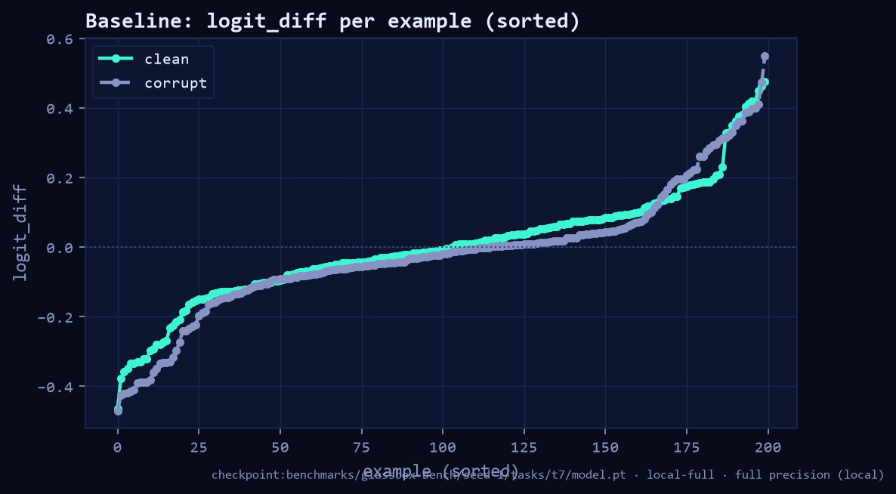
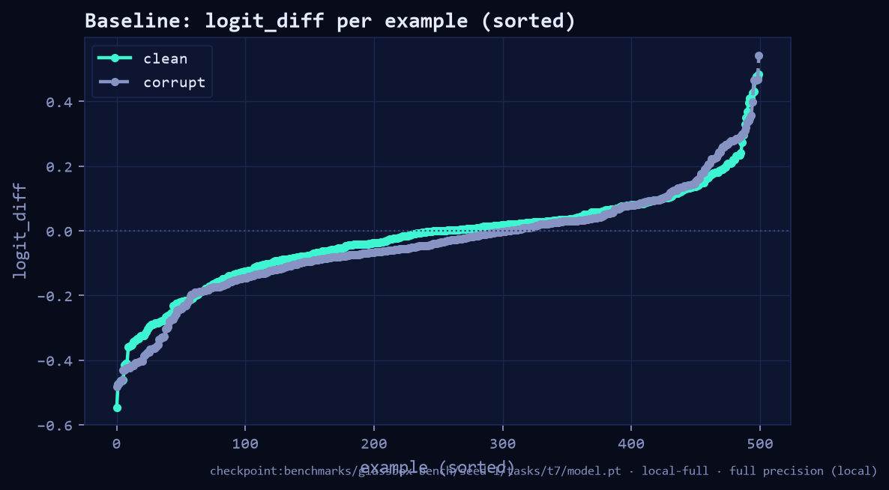

# t7 (null-weight-shuffled): no behaviour found, no circuit claimed

**Behavior:** BOS + 4 tokens from 6 symbols; the model is said to output one symbol at the last position by a deterministic function.  
**Model:** `checkpoint:benchmarks/glassbox-bench/seed-1/tasks/t7/model.pt` on `local-full`  
**Status:** unverified (no verification run) · null result: no mechanism  
**Experiments run:** 4 · **Backends used:** full precision (local)  
**Written:** 2026-11-13 13:54

## Summary

The loaded checkpoint does not do the behaviour. On local-full (full precision) its last-position output matches the dataset's labelled outputs on 2.5% of 200 prompts (E0003) and 2.8% of 500 fresh prompts (E0004), below the 1/6 chance level, with a mean logit difference indistinguishable from zero (0.001 and -0.022, std about 0.16) and frequent top predictions of BOS and PAD, which are never valid outputs. The investigation stopped at the baseline step: there is no mechanism to explain, so no heads or MLP layers are claimed and no verification was run.

## The recovered algorithm

```python
# No algorithm recovered.
# The dataset labels (E0001) are consistent with: return the highest-priority symbol present,
# priority pa > bo > pu > ri > {so, ti}. This describes the LABELS only; the loaded weights do not
# compute it (E0003, E0004), so no predict() is offered for the model.
```

## Claims and evidence

| # | Claim | Evidence | Produced by |
|---|---|---|---|
| 1 | The loaded model does not reproduce the labelled outputs: accuracy 0.025 on n=200 (pre-registered prediction of >= 0.98 was refuted). | E0003 | full precision (local) |
| 2 | The failure replicates on a fresh, larger sample: accuracy 0.028 on n=500, at or below chance as pre-registered (<= 0.2); mean logit diff -0.022, std 0.15. | E0004 | full precision (local) |
| 3 | The model has no confident output on this task: the logit difference between labelled and alternative answer is about zero on both clean and corrupt prompts, and top predictions include BOS and PAD. | E0003, E0004 | full precision (local) |
| 4 | No attention head or MLP layer is claimed as part of a circuit; the attribution screen was computed on a metric that is noise (base -0.018, source 0.001) and is not interpretable. | E0002, E0003 | full precision (local) |

## Key plots

**E0003: baseline** (full precision (local))



**E0004: baseline** (full precision (local))



## Limitations

- The task brief states that the dataset answers are the model's own outputs; that is contradicted by E0003/E0004 for the weights actually loaded. I did not determine why (the investigation name suggests a weight-shuffled null control, but that was not tested).
- The rule read off the labels (priority pa > bo > pu > ri > {so, ti}) comes from inspecting 64 examples in E0001 only; the relative order of so and ti was not determined, and it is not a claim about the model.
- No verify_hypothesis run: there was no hypothesis about a mechanism to verify.
- I did not characterise what the loaded weights do compute (their near-flat logits were not analysed further).

## Open questions

- Do the labels belong to a different (unshuffled) checkpoint of t7?

## Prediction record

2 experiments were pre-registered, 2 were run: **1 confirmed, 1 refuted, 0 inconclusive**. Hit rate (confirmed / decided): **50%**.

Refuted predictions (shown, not hidden):

| prereg | experiment | hypothesis | predicted | observed |
|---|---|---|---|---|
| N0003 | E0003 | The model deterministically outputs a symbol with a clear margin; from E0001 the outputs look like 'the highest-priority symbol present' with priority pa(7) > b | `summary.clean_accuracy >= 0.98` | 0.025 |

Exploratory runs (no pre-registration; they cannot be the only support for a claim): E0002.

## Experiments

| id | primitive | backend / precision | seconds | pre-registration |
|---|---|---|---|---|
| E0001 | dataset | full precision (local) | 0.64 | exploratory |
| E0002 | attribution_patching | full precision (local) | 1.71 | exploratory |
| E0003 | baseline | full precision (local) | 1.17 | N0003: refuted |
| E0004 | baseline | full precision (local) | 4.33 | N0007: confirmed |

## Notebook trail

- `N0001` *decision*: Loaded checkpoint:benchmarks/glassbox-bench/seed-1/tasks/t7/model.pt on local-full (full precision (local)).
- `N0002` *experiment*: dataset (E0001)
- `N0003` *prereg*: The model deterministically outputs a symbol with a clear margin; from E0001 the outputs look like 'the highest-priority symbol present' with priority pa(7) > bo(5) > pu(4) > ri(3) > {so(6), ti(2)}. Since labels are the model's own argmax, accuracy should be 1 and the logit diff vs the corrupt-prompt answer should be clearly positive.
- `N0004` *experiment*: first screen of heads / layers / positions (E0002)
- `N0005` *experiment*: The model deterministically outputs a symbol with a clear margin; from E0001 the outputs look like 'the highest-priority (E0003)
- `N0006` *hypothesis* **[rejected]**: H1: The loaded model computes the function seen in the dataset labels (E0001: labels look like 'highest-priority symbol present', pa > bo > pu > ri > {so, ti}) with a confident margin, so there is a circuit to find.
- `N0007` *prereg*: E0003 was not a fluke of one sample: the loaded checkpoint does not produce the dataset's labelled outputs at all. On a fresh, larger sample its accuracy stays at or below chance over the 6 symbols (1/6 = 0.167) and the logit diff stays near zero.
- `N0008` *experiment*: E0003 was not a fluke of one sample: the loaded checkpoint does not produce the dataset's labelled outputs at all. On a  (E0004)
- `N0009` *hypothesis* **[rejected]** -> N0006: Rejected. The loaded checkpoint does not produce the labelled outputs: accuracy 0.025 (n=200, E0003, prediction >= 0.98 refuted) and 0.028 (n=500, E0004), below 1/6 chance; mean logit diff 0.001 and -0.022 with std ~0.16; top predictions are often BOS/PAD, which are never valid outputs. No behaviour, so no circuit to find.
- `N0010` *result*: Null result (local-full, full precision). The model's last-position output agrees with the dataset labels on 2.5% (E0003, n=200, seed 1) and 2.8% (E0004, n=500, seed 2) of prompts; logit diff correct-vs-incorrect is ~0 (0.001 / -0.022, std 0.17 / 0.15), same as on corrupt prompts (-0.018 / -0.037). Predictions include BOS and PAD. The labels themselves (E0001) follow a clean rule (highest-priority symbol present, pa > bo > pu > ri > {so, ti}), but that rule is a property of the labels, not of these weights. The exploratory attribution screen E0002 was run on a metric that is noise (base -0.018, source 0.001), so its head/MLP scores are not interpretable. (E0003, E0004)
- `N0011` *decision*: Stop at step 1 per protocol: the model does not do the behaviour, so there is no mechanism to explain. No circuit claimed, no verify_hypothesis run (nothing to verify; claiming a circuit here would be a false discovery). 4 of 25 experiments used.
