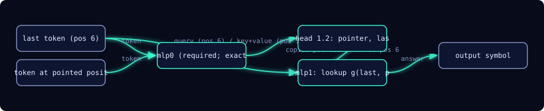
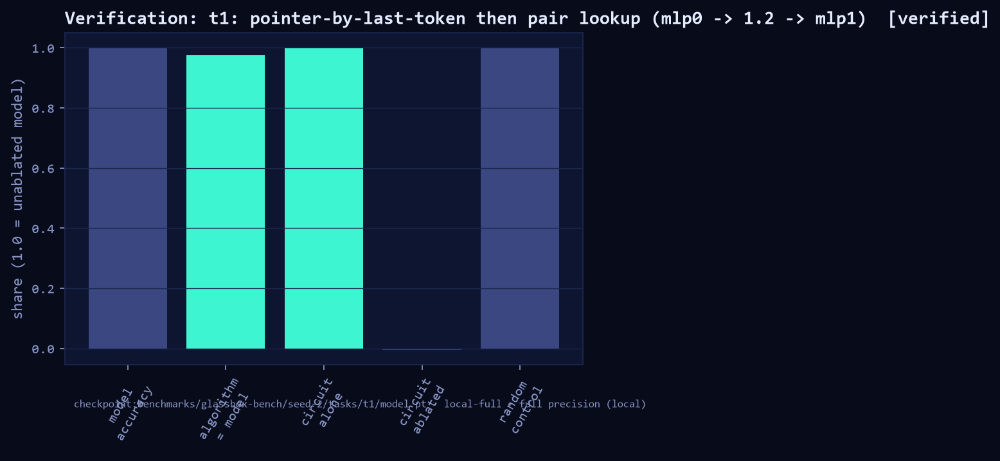
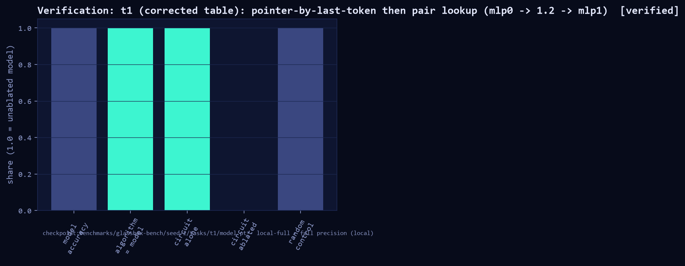
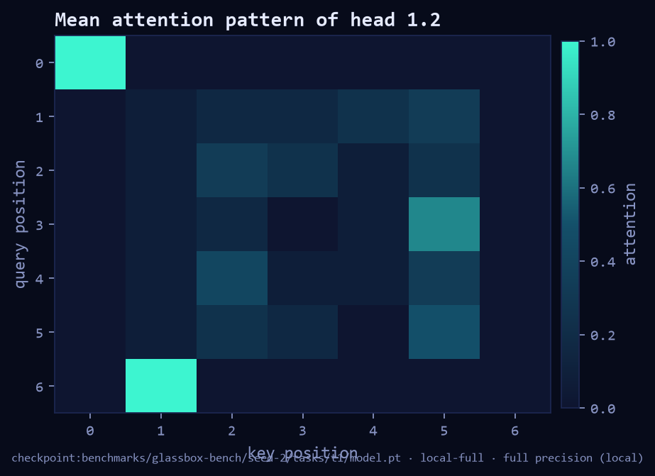
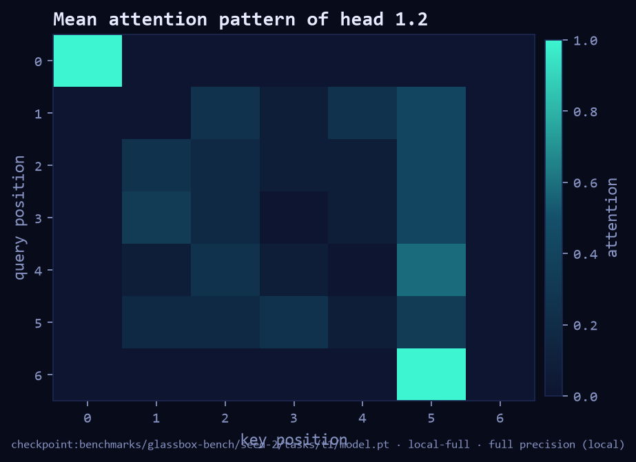
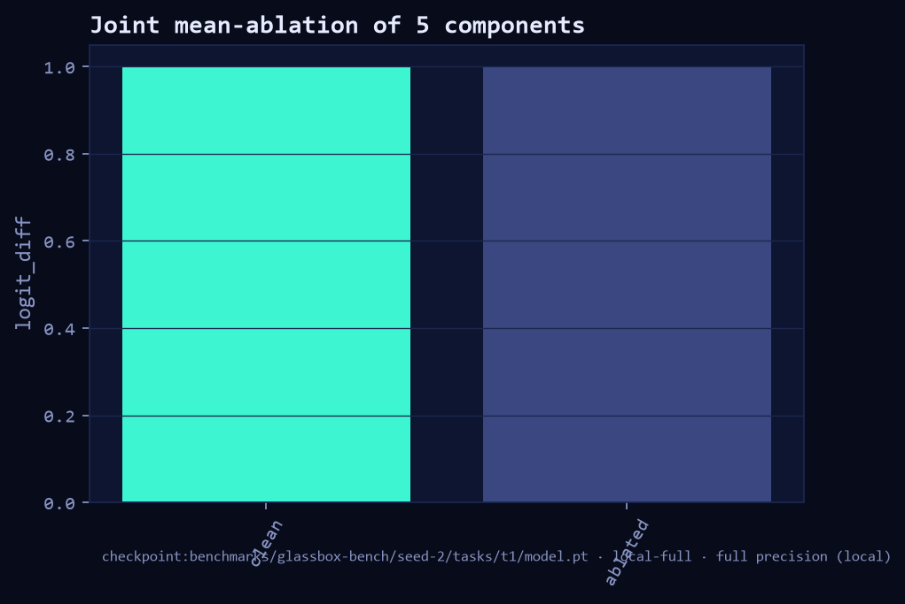

# t1: last token picks a position, MLP looks up (last token, token there)

**Behavior:** BOS + 6 tokens from {ge, gu, lu, sa, vi, zo}; the model outputs one symbol at the last position. local-full checkpoint benchmarks/glassbox-bench/seed-2/tasks/t1/model.pt (2 layers, 3 heads per layer, full precision).  
**Model:** `checkpoint:benchmarks/glassbox-bench/seed-2/tasks/t1/model.pt` on `local-full`  
**Status:** verified · verified  
**Experiments run:** 16 · **Backends used:** full precision (local)  
**Written:** 2026-11-13 12:47

## Summary

The output depends on exactly two input tokens: the last token (position 6) and one earlier token whose position is chosen by the last token alone (ge->5, sa->5, gu->1, vi->2, lu->3, zo->4). The answer is a fixed 6x6 lookup g(last token, pointed token). Head 1.2 is the pointer (one-hot attention from position 6), mlp1 computes the lookup, and mlp0 is also required. Heads 0.0, 0.1, 0.2, 1.0 and 1.1 are inert. All numbers are from the local-full (full precision) backend. On 400 held-out inputs the algorithm agrees with the model 400/400; ablating the circuit drops accuracy to 0.245, ablating everything else leaves it at 1.0.

## The recovered algorithm

```python
ids: 2=ge 3=gu 4=lu 5=sa 6=vi 7=zo; x[1..6] = input tokens
last = x[6]
ptr  = {ge:5, sa:5, gu:1, vi:2, lu:3, zo:4}[last]        # head 1.2
b    = x[ptr]
out  = g[last][b]                                          # mlp1

g (rows = last, cols = b in order ge gu lu sa vi zo):
 ge: ge sa vi sa ge ge
 gu: sa vi gu lu ge zo
 lu: vi gu ge sa gu ge
 sa: lu zo vi sa ge vi
 vi: zo lu gu zo ge gu
 zo: lu vi lu gu sa ge
```

## Circuit



## Claims and evidence

| # | Claim | Evidence | Produced by |
|---|---|---|---|
| 1 | The model performs a deterministic behaviour (clean accuracy 1.0 on 200 inputs). | E0002 | full precision (local) |
| 2 | Head 1.2 attends one-hot from the last position to a position set by the last token alone: gu->1, vi->2, lu->3, zo->4, ge and sa->5 (attention 1.0 in every case, 12 prompts each). | E0008, E0009, E0010, E0011, E0012 | full precision (local) |
| 3 | Head 1.2 is necessary: mean-ablating it leaves 0.109 of the clean metric. | E0014, V0002 | full precision (local) |
| 4 | mlp0 and mlp1 are necessary: mean-ablating either leaves under 0.02 of the clean metric. | E0015, E0016, V0002 | full precision (local) |
| 5 | Heads 0.0, 0.1, 0.2, 1.0 and 1.1 play no part: joint mean ablation leaves the metric at 1.0, and the circuit {mlp0, 1.2, mlp1} alone keeps accuracy 1.0. | E0013, V0002 | full precision (local) |
| 6 | The output is the lookup g(last token, token at the pointed position); this algorithm matches the model on 400/400 held-out inputs (null agreement p95 = 0.213). An earlier version with one misread table entry (gu,ge) scored 195/200 and was corrected. | V0002, V0001 | full precision (local) |

## Verification

### V0001: t1: pointer-by-last-token then pair lookup (mlp0 -> 1.2 -> mlp1)  (full precision (local))

| check | value |
|---|---|
| status | verified |
| held-out inputs | 200 |
| model accuracy | 1.000 |
| algorithm agrees with model | 0.975 |
| algorithm accuracy vs ground truth | 0.975 |
| circuit size | 3 of 8 components |
| metric kept with ONLY the circuit | 1.000 |
| metric kept with the circuit ABLATED | -0.005 |
| random same-size ablation (control) | 1.000, 1.000, 1.000 |

Passed at full precision, and every effect exceeds its null distribution.



### V0002: t1 (corrected table): pointer-by-last-token then pair lookup (mlp0 -> 1.2 -> mlp1)  (full precision (local))

| check | value |
|---|---|
| status | verified |
| held-out inputs | 400 |
| model accuracy | 1.000 |
| algorithm agrees with model | 1.000 |
| algorithm accuracy vs ground truth | 1.000 |
| circuit size | 3 of 8 components |
| metric kept with ONLY the circuit | 1.000 |
| metric kept with the circuit ABLATED | 0.000 |
| random same-size ablation (control) | 1.000, 1.000, 1.000 |

Passed at full precision, and every effect exceeds its null distribution.



## Key plots

**E0008: attention_patterns** (full precision (local))



**E0012: attention_patterns** (full precision (local))



**E0013: ablation** (full precision (local))



## Limitations

- The lookup table g and the pointer map were read off the model's input/output pairs (E0001, E0007) and then tested; I found no simpler closed-form rule for g, so it is reported as a 36-entry table.
- The exact role of mlp0 was not isolated (whether it feeds the query, the key or the value of head 1.2, or mlp1 directly). A path-patching attempt with mlp0 as sender errored (unsupported sender) and was not replaced.
- The first verification (V0001) had one wrong table entry from a transcription error; it is corrected in V0002. The pointer rule and circuit were unchanged.
- Attention tests used 12 prompts per last-token group; the held-out agreement (400/400) is the stronger test of the pointer rule.

## Open questions

- Is g a composition of simpler operations (e.g. a per-token map followed by arithmetic)? The gu row is a permutation but the others are not.
- What does mlp0 compute, and at which positions is it needed?

## Prediction record

10 experiments were pre-registered, 10 were run: **10 confirmed, 0 refuted, 0 inconclusive**. Hit rate (confirmed / decided): **100%**.

No prediction was refuted.

Exploratory runs (no pre-registration; they cannot be the only support for a claim): E0003, E0004, E0005, E0006.

## Experiments

| id | primitive | backend / precision | seconds | pre-registration |
|---|---|---|---|---|
| E0001 | dataset | full precision (local) | 0.07 | exploratory |
| E0002 | baseline | full precision (local) | 0.43 | N0003: confirmed |
| E0003 | activation_patching | full precision (local) | 0.4 | exploratory |
| E0004 | ablation | full precision (local) | 0.35 | exploratory |
| E0005 | ablation | full precision (local) | 0.27 | exploratory |
| E0006 | attention_patterns | full precision (local) | 0.17 | exploratory |
| E0007 | dataset | full precision (local) | 0.12 | exploratory |
| E0008 | attention_patterns | full precision (local) | 0.11 | N0011: confirmed |
| E0009 | attention_patterns | full precision (local) | 0.1 | N0013: confirmed |
| E0010 | attention_patterns | full precision (local) | 0.1 | N0014: confirmed |
| E0011 | attention_patterns | full precision (local) | 0.11 | N0015: confirmed |
| E0012 | attention_patterns | full precision (local) | 0.1 | N0016: confirmed |
| E0013 | ablation | full precision (local) | 0.25 | N0017: confirmed |
| E0014 | ablation | full precision (local) | 0.24 | N0018: confirmed |
| E0015 | ablation | full precision (local) | 0.25 | N0025: confirmed |
| E0016 | ablation | full precision (local) | 0.24 | N0026: confirmed |
| V0001 | verify | full precision (local) |  | verification |
| V0002 | verify | full precision (local) |  | verification |

## Notebook trail

- `N0001` *decision*: Loaded checkpoint:benchmarks/glassbox-bench/seed-2/tasks/t1/model.pt on local-full (full precision (local)).
- `N0002` *experiment*: dataset (E0001)
- `N0003` *prereg*: The model deterministically computes its function: on the bench dataset its top-1 output at the last position equals the dataset answer (its own output) essentially always.
- `N0004` *experiment*: The model deterministically computes its function: on the bench dataset its top-1 output at the last position equals the (E0002)
- `N0005` *experiment*: First look: which layer x position carries the answer (E0003)
- `N0006` *experiment*: Screen: which heads matter (mean ablation sweep) (E0004)
- `N0007` *experiment*: Screen: which MLPs matter (mean ablation sweep) (E0005)
- `N0008` *experiment*: Where does 1.2 look from the last position? (shape check) (E0006)
- `N0009` *hypothesis* **[supported]**: H1 (where): the computation runs through mlp0 -> head 1.2 -> mlp1; heads 0.0,0.1,0.2,1.0,1.1 are inert (exploratory E0004/E0005). H2 (what): head 1.2 at the last position attends one-hot to a single earlier position chosen by the LAST token alone (reading E0006 + E0001 data: ge->pos5, sa->pos5, gu->pos1, vi->pos2, lu->pos3, zo->pos4), and the output is a fixed lookup g(last token, token at the pointed position). All non-pointed positions are irrelevant.
- `N0010` *experiment*: dataset (E0007)
- `N0011` *prereg*: Head 1.2 is a pointer whose target is set by the last token alone: when the last token is gu (id 3), it attends from the last position (6) essentially one-hot to position 1.
- `N0012` *experiment*: Head 1.2 is a pointer whose target is set by the last token alone: when the last token is gu (id 3), it attends from the (E0008)
- `N0013` *prereg*: Head 1.2 pointer: when the last token is vi (id 6), it attends from position 6 one-hot to position 2.
- `N0014` *prereg*: Head 1.2 pointer: when the last token is lu (id 4), it attends from position 6 one-hot to position 3.
- `N0015` *prereg*: Head 1.2 pointer: when the last token is zo (id 7), it attends from position 6 one-hot to position 4.
- `N0016` *prereg*: Head 1.2 pointer: when the last token is ge (id 2) or sa (id 5), it attends from position 6 one-hot to position 5 (two symbols share the same target).
- `N0017` *prereg*: Heads 0.0, 0.1, 0.2, 1.0 and 1.1 play no part in the behaviour: mean-ablating all five jointly leaves the output unchanged.
- `N0018` *prereg*: Head 1.2 is the only attention head needed and is necessary: mean-ablating 1.2 alone destroys the behaviour on a fresh seed.
- `N0019` *experiment*: Head 1.2 pointer: when the last token is vi (id 6), it attends from position 6 one-hot to position 2. (E0009)
- `N0020` *experiment*: Head 1.2 pointer: when the last token is lu (id 4), it attends from position 6 one-hot to position 3. (E0010)
- `N0021` *experiment*: Head 1.2 pointer: when the last token is zo (id 7), it attends from position 6 one-hot to position 4. (E0011)
- `N0022` *experiment*: Head 1.2 pointer: when the last token is ge (id 2) or sa (id 5), it attends from position 6 one-hot to position 5 (two s (E0012)
- `N0023` *experiment*: Heads 0.0, 0.1, 0.2, 1.0 and 1.1 play no part in the behaviour: mean-ablating all five jointly leaves the output unchang (E0013)
- `N0024` *experiment*: Head 1.2 is the only attention head needed and is necessary: mean-ablating 1.2 alone destroys the behaviour on a fresh s (E0014)
- `N0025` *prereg*: mlp0 is a necessary part of the circuit: mean-ablating it destroys the behaviour on a fresh seed.
- `N0026` *prereg*: mlp1 is a necessary part of the circuit (it implements the lookup g(last token, pointed token)): mean-ablating it destroys the behaviour on a fresh seed.
- `N0027` *experiment*: mlp0 is a necessary part of the circuit: mean-ablating it destroys the behaviour on a fresh seed. (E0015)
- `N0028` *experiment*: mlp1 is a necessary part of the circuit (it implements the lookup g(last token, pointed token)): mean-ablating it destro (E0016)
- `N0029` *verification*: t1: pointer-by-last-token then pair lookup (mlp0 -> 1.2 -> mlp1): verified. Passed at full precision, and every effect exceeds its null distribution. (V0001)
- `N0030` *result*: V0001 passed all checks (agreement 0.975, circuit ablated acc 0.245, everything-else ablated acc 1.0) but showed 5 disagreements, all with (last=gu, pointed=ge): model outputs sa, my table said ge. Cause: I misread one row of E0007 (index 117: [2,2,6,6,2,3] -> answer is 5=sa, not 2). The table entry g(gu,ge) is corrected to sa; the pointer rule and circuit are unchanged. Re-verifying on a fresh seed with the corrected table. (V0001, E0007)
- `N0031` *verification*: t1 (corrected table): pointer-by-last-token then pair lookup (mlp0 -> 1.2 -> mlp1): verified. Passed at full precision, and every effect exceeds its null distribution. (V0002)
- `N0032` *hypothesis* **[supported]** -> N0009: Supported: pointer rule confirmed for all six last tokens (E0008-E0012), circuit necessity/inertness confirmed (E0013-E0016), and predict() agrees with the model on 400/400 held-out inputs with the circuit checks passing (V0002). One table entry (gu,ge) was corrected after V0001.
