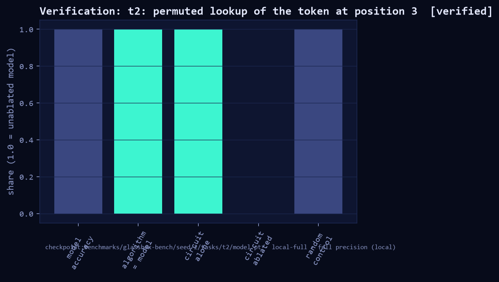
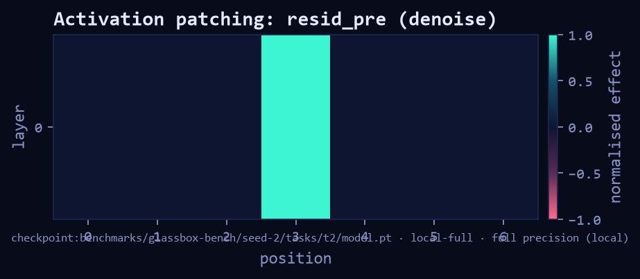
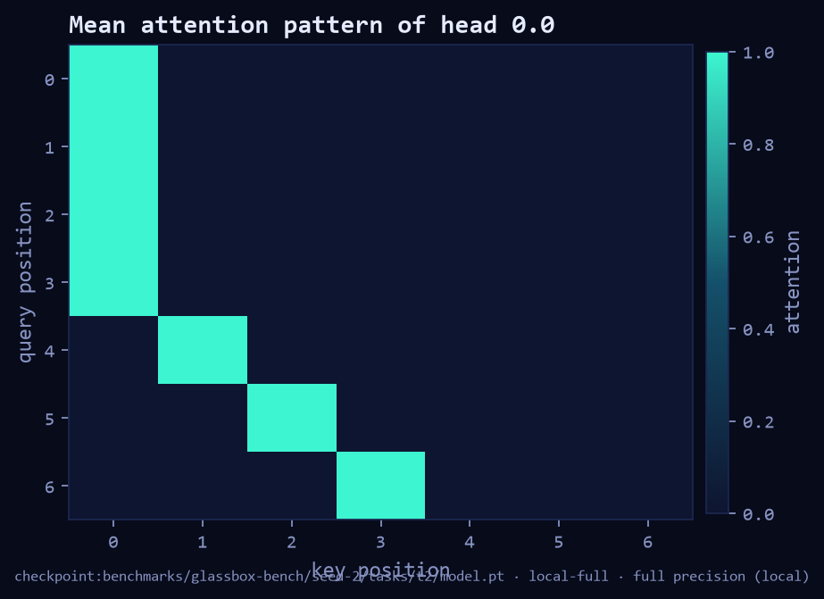
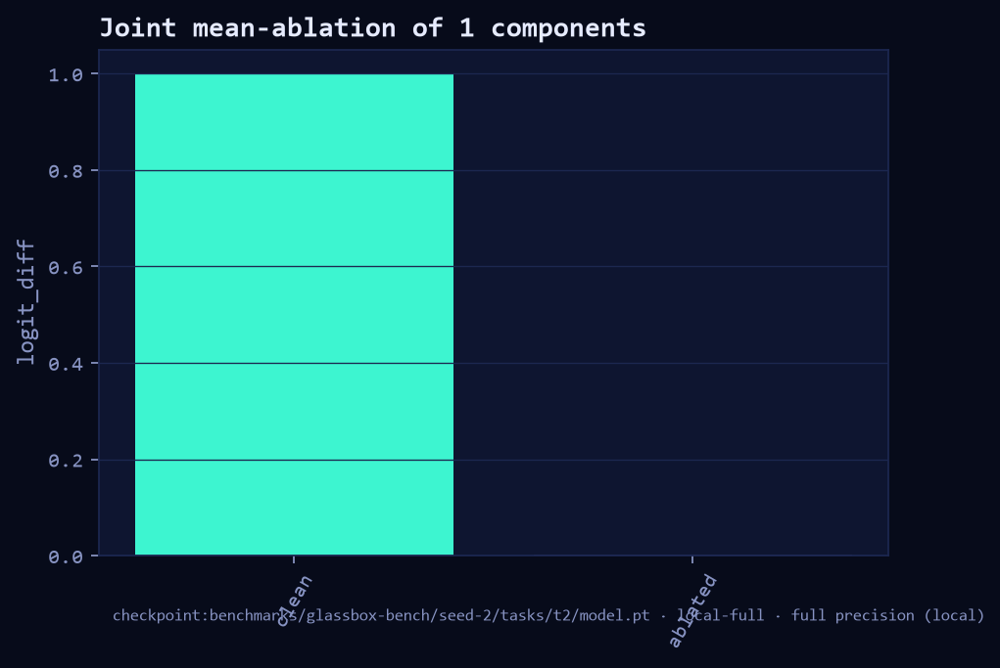

# t2: output = fixed symbol map of the token at position 3 (head 0.0 -> mlp0)

**Behavior:** BOS + 6 tokens from {do, du, go, gu, la, ta}; one symbol is output at the last position.  
**Model:** `checkpoint:benchmarks/glassbox-bench/seed-2/tasks/t2/model.pt` on `local-full`  
**Status:** verified · verified  
**Experiments run:** 11 · **Backends used:** full precision (local)  
**Written:** 2026-11-13 12:50

## Summary

All numbers are from the local-full backend (full precision). The model outputs a fixed re-labelling of the third input token (sequence position 3, BOS = 0): do->do, gu->gu, la->la, du->go, go->ta, ta->du. No other input position influences the output. Head 0.0 attends from the last position to position 3 with weight 1.0 and moves that token; it has no direct effect on the logits. mlp0 reads what head 0.0 wrote and produces the output symbol. Heads 0.1 and 0.2 play no part. On 200 held-out inputs the algorithm matches the model 200/200; ablating {0.0, mlp0} drops accuracy to 0.16 (chance), ablating everything else leaves it at 1.0.

## The recovered algorithm

```python
def predict(tokens, prompt):
    x = tokens[3]                      # head 0.0 copies position 3 to the last position (E0003, E0010)
    table = {do: do, gu: gu, la: la,   # mlp0 turns it into the output symbol (E0008, E0011)
             du: go, go: ta, ta: du}
    return table[x]
```

## Circuit


## Claims and evidence

| # | Claim | Evidence | Produced by |
|---|---|---|---|
| 1 | The model performs the behaviour perfectly on its own labels (accuracy 1.0, n=200). | E0002 | full precision (local) |
| 2 | The output depends only on the token at position 3: patching the layer-0 residual input at position 3 restores 100% of the metric, every other position 0%. | E0003 | full precision (local) |
| 3 | The function is a fixed map of that token: do->do, gu->gu, la->la, du->go, go->ta, ta->du. It agrees with the model on 200/200 held-out inputs. | V0001, E0001 | full precision (local) |
| 4 | Head 0.0 is necessary: mean-ablating it leaves 0.002 of the clean metric. It attends from position 6 to position 3 with weight 1.0. | E0006, E0010, E0004 | full precision (local) |
| 5 | mlp0 is necessary (mean ablation leaves 0.002 of clean), and head 0.0 has zero direct effect on the logits, so the head's output reaches the answer only through mlp0. | E0008, E0011, E0005 | full precision (local) |
| 6 | Heads 0.1 and 0.2 play no part: jointly mean-ablating them leaves 100% of the clean metric. | E0007, V0001 | full precision (local) |
| 7 | The circuit {0.0, mlp0} is necessary and sufficient on held-out data: circuit ablated -> accuracy 0.16; everything else ablated -> accuracy 1.0; all effects beat their null controls. | V0001 | full precision (local) |

## Verification

### V0001: t2: permuted lookup of the token at position 3  (full precision (local))

| check | value |
|---|---|
| status | verified |
| held-out inputs | 200 |
| model accuracy | 1.000 |
| algorithm agrees with model | 1.000 |
| algorithm accuracy vs ground truth | 1.000 |
| circuit size | 2 of 4 components |
| metric kept with ONLY the circuit | 1.000 |
| metric kept with the circuit ABLATED | -0.002 |
| random same-size ablation (control) | 1.000, 1.000, 1.000 |

Passed at full precision, and every effect exceeds its null distribution.



## Key plots

**E0003: activation_patching** (full precision (local))



**E0010: attention_patterns** (full precision (local))



**E0006: ablation** (full precision (local))



**E0008: ablation** (full precision (local))


## Limitations

- The symbol map was read off the dataset examples (E0001) and confirmed by held-out agreement (V0001); I did not separately measure whether the three-symbol rotation is done inside mlp0 or split between head 0.0's OV write, mlp0 and the unembedding. Only the combined path is established.
- The attention pattern in E0009 suggests head 0.0 looks a fixed three positions back from every query position, but only the last position (6 -> 3) was tested with a pre-registered run, so 'position 3' and 'three back from the end' are not distinguished; they are the same thing at fixed length 7.
- V0001 lists random_same_size_ablated_fraction as 1.0 for three random sets, which is odd for a 4-component model where most 2-component sets include a circuit component; the null-control tables in the same result pass, but I did not investigate this field.
- What heads 0.1 and 0.2 compute (they attend mostly to positions 4 and 5) was not studied, only that removing them changes nothing.

## Open questions

- Which neurons of mlp0 (12 available) implement the map, and how is the token encoded in head 0.0's output?

## Prediction record

7 experiments were pre-registered, 7 were run: **7 confirmed, 0 refuted, 0 inconclusive**. Hit rate (confirmed / decided): **100%**.

No prediction was refuted.

Exploratory runs (no pre-registration; they cannot be the only support for a claim): E0004, E0005, E0009.

## Experiments

| id | primitive | backend / precision | seconds | pre-registration |
|---|---|---|---|---|
| E0001 | dataset | full precision (local) | 0.04 | exploratory |
| E0002 | baseline | full precision (local) | 0.35 | N0004: confirmed |
| E0003 | activation_patching | full precision (local) | 0.16 | N0006: confirmed |
| E0004 | activation_patching | full precision (local) | 0.12 | exploratory |
| E0005 | activation_patching | full precision (local) | 0.12 | exploratory |
| E0006 | ablation | full precision (local) | 0.18 | N0010: confirmed |
| E0007 | ablation | full precision (local) | 0.17 | N0011: confirmed |
| E0008 | ablation | full precision (local) | 0.17 | N0012: confirmed |
| E0009 | attention_patterns | full precision (local) | 0.17 | exploratory |
| E0010 | attention_patterns | full precision (local) | 0.19 | N0017: confirmed |
| E0011 | path_patching | full precision (local) | 0.14 | N0018: confirmed |
| V0001 | verify | full precision (local) |  | verification |

## Notebook trail

- `N0001` *decision*: Loaded checkpoint:benchmarks/glassbox-bench/seed-2/tasks/t2/model.pt on local-full (full precision (local)).
- `N0002` *experiment*: dataset (E0001)
- `N0003` *hypothesis* **[supported]**: H1 (function): from the 64 examples in E0001, the output depends only on the token at sequence position 3 (BOS=0), through a fixed map: do->do, gu->gu, la->la, du->go, go->ta, ta->du (ids 2->2, 5->5, 6->6, 3->4, 4->7, 7->3). All 64 examples fit. H2 (mechanism): one attention head moves the pos-3 token to the last position; the MLP (or unembed) applies the 3-cycle.
- `N0004` *prereg*: The model performs its own function reliably: on bench data the labelled answer (the model's own output) is top-1 with a positive logit difference.
- `N0005` *experiment*: The model performs its own function reliably: on bench data the labelled answer (the model's own output) is top-1 with a (E0002)
- `N0006` *prereg*: H1: the output depends only on the token at position 3. Patching the clean residual stream into the corrupt run at layer 0 input, position 3, restores the clean answer fully; other positions do nothing.
- `N0007` *experiment*: H1: the output depends only on the token at position 3. Patching the clean residual stream into the corrupt run at layer (E0003)
- `N0008` *experiment*: screen: which head carries the pos-3 token (E0004)
- `N0009` *experiment*: screen: does the MLP matter, and at which position (E0005)
- `N0010` *prereg*: Head 0.0 is necessary: it is the only route by which the pos-3 token reaches the last position. Mean-ablating it destroys the behaviour.
- `N0011` *prereg*: Heads 0.1 and 0.2 play no part in the behaviour: mean-ablating both together leaves the behaviour intact.
- `N0012` *prereg*: The MLP layer is necessary: it converts the moved pos-3 token into the output symbol. Mean-ablating mlp0 destroys the behaviour.
- `N0013` *experiment*: Head 0.0 is necessary: it is the only route by which the pos-3 token reaches the last position. Mean-ablating it destroy (E0006)
- `N0014` *experiment*: Heads 0.1 and 0.2 play no part in the behaviour: mean-ablating both together leaves the behaviour intact. (E0007)
- `N0015` *experiment*: The MLP layer is necessary: it converts the moved pos-3 token into the output symbol. Mean-ablating mlp0 destroys the be (E0008)
- `N0016` *experiment*: shape check: where does 0.0 look from the last position (E0009)
- `N0017` *prereg*: Head 0.0 at the last position (6) attends essentially entirely to position 3, on fresh inputs.
- `N0018` *prereg*: Head 0.0 does not write the answer to the logits directly; its effect is entirely mediated by mlp0. Path-patching 0.0 -> logits (direct path only) restores almost nothing.
- `N0019` *experiment*: Head 0.0 at the last position (6) attends essentially entirely to position 3, on fresh inputs. (E0010)
- `N0020` *experiment*: Head 0.0 does not write the answer to the logits directly; its effect is entirely mediated by mlp0. Path-patching 0.0 -> (E0011)
- `N0021` *result*: local-full. Baseline accuracy 1.0 (E0002). Only position 3 matters: resid_pre patch effect 1.0 at pos 3, 0.0 at every other position (E0003). Head 0.0 necessary (mean ablation -> 0.002 of clean, E0006); heads 0.1+0.2 jointly ablated -> 1.0 of clean (E0007); mlp0 necessary (0.002, E0008). Head 0.0 attends 6->3 with weight 1.0 (E0010) and has zero direct effect on logits (E0011), so its output is read by mlp0, which writes the answer. Circuit: 0.0 -> mlp0. Decoys: 0.1, 0.2. (E0002, E0003, E0006, E0007, E0008, E0010, E0011)
- `N0022` *verification*: t2: permuted lookup of the token at position 3: verified. Passed at full precision, and every effect exceeds its null distribution. (V0001)
- `N0023` *hypothesis* **[supported]** -> N0003: H1 and H2 supported: predict() agrees with the model on 200/200 held-out inputs (V0001); circuit {0.0, mlp0} is necessary and sufficient (V0001, E0006, E0007, E0008); 0.0 reads pos 3 (E0003, E0010) and acts only through mlp0 (E0011).
