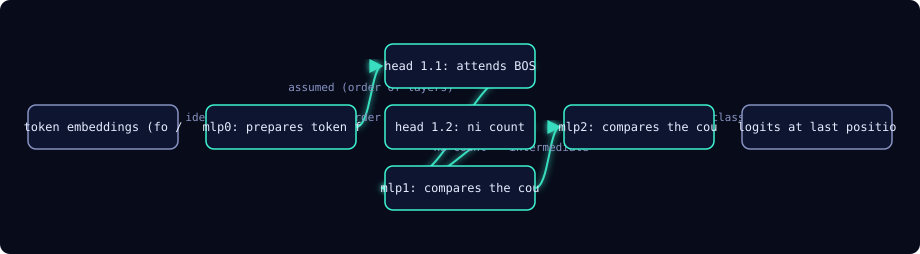
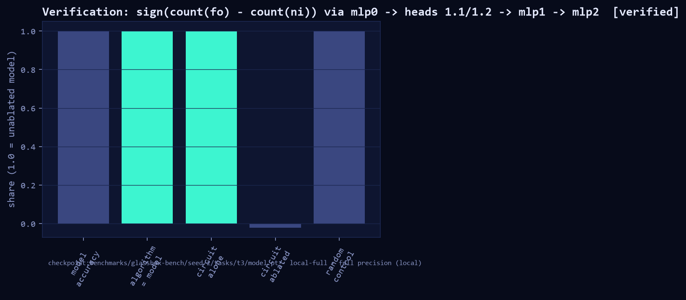
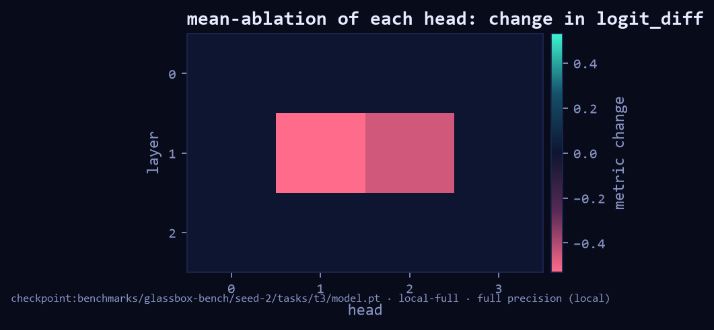
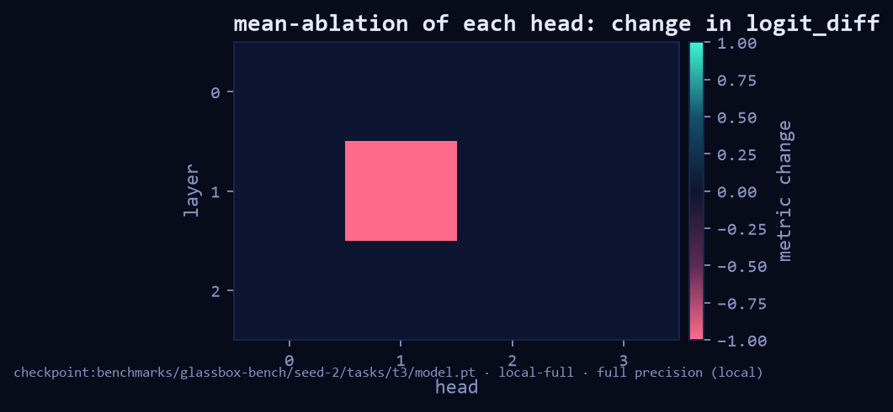
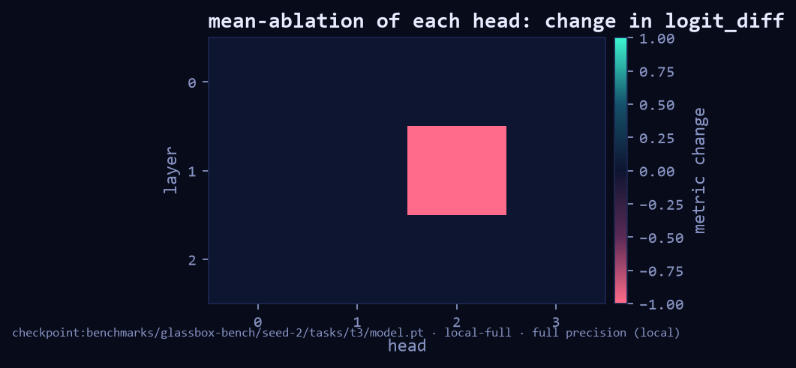
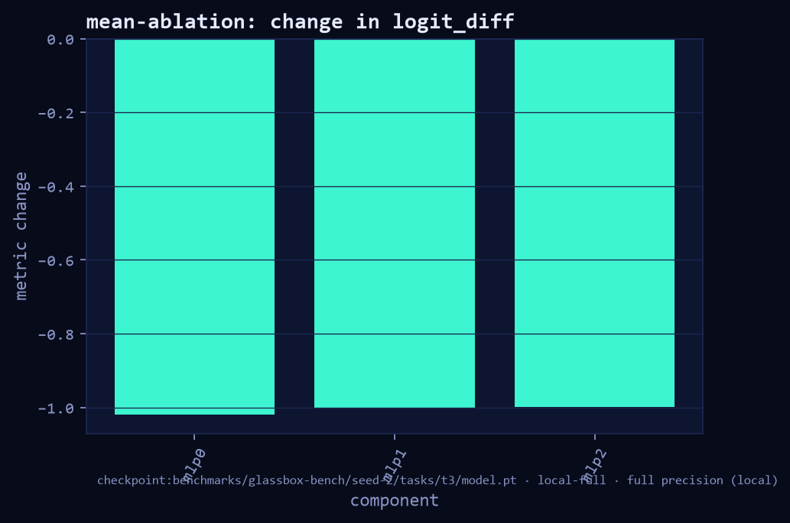

# t3: a three-way comparison of two token counts (fo vs ni)

**Behavior:** BOS + 5 tokens from {fo, le, ni, pe, ti}; at the last position the model outputs one of J / V / Y.  
**Model:** `checkpoint:benchmarks/glassbox-bench/seed-2/tasks/t3/model.pt` on `local-full`  
**Status:** verified · verified  
**Experiments run:** 12 · **Backends used:** full precision (local)  
**Written:** 2026-11-13 12:52

## Summary

The model outputs the sign of (number of 'fo' tokens minus number of 'ni' tokens): more fo -> J, more ni -> V, tie -> Y. The tokens le, pe, ti and all token positions are irrelevant. Five of the 15 components implement it: mlp0, heads 1.1 and 1.2, mlp1, mlp2. Head 1.1 carries the fo count and head 1.2 the ni count (double dissociation); all three MLPs are individually necessary. The other 10 heads (all of layer 0, 1.0, 1.3, all of layer 2) can be mean-ablated together with no change. All numbers are from the local-full backend (full precision). Verified on held-out data: 200/200 agreement, circuit ablated -> accuracy 0.29 (chance), everything else ablated -> accuracy 1.0.

## The recovered algorithm

```python
def predict(tokens, prompt):
    seq = tokens[1:]                      # drop BOS
    n_fo = seq.count(2)                   # head 1.1 (E0009)
    n_ni = seq.count(4)                   # head 1.2 (E0010)
    if n_fo > n_ni: return 7              # J   (mlp1 -> mlp2, E0011)
    if n_fo < n_ni: return 8              # V
    return 9                              # Y   (V0001: 200/200)
```

## Circuit



## Claims and evidence

| # | Claim | Evidence | Produced by |
|---|---|---|---|
| 1 | The model does the task deterministically: clean accuracy 1.0 on 200 prompts (local-full). | E0002 | full precision (local) |
| 2 | The function is sign(count(fo) - count(ni)) -> J / V / Y; a predict() implementing exactly this matches the model on 200/200 held-out inputs (null agreement p95 = 0.39). | V0001, E0001 | full precision (local) |
| 3 | Among attention heads only 1.1 and 1.2 take part: jointly mean-ablating the other 10 heads leaves the metric at 1.0, while jointly ablating 1.1 and 1.2 leaves 0.08. | E0005, E0006, E0003 | full precision (local) |
| 4 | Head 1.1 carries the fo count and head 1.2 the ni count: on ni-free prompts ablating 1.1 gives 0.0 and 1.2 gives 1.0; on fo-free prompts ablating 1.2 gives 0.0 and 1.1 gives 1.0. Consistent with this, 1.1 splits its attention equally over BOS and the fo positions (1/3 each with two fo), so the BOS weight encodes 1/(1+#fo). | E0009, E0010, E0008 | full precision (local) |
| 5 | All three MLP layers are individually necessary: mean-ablating mlp0, mlp1 or mlp2 leaves -0.02, 0.0 and 0.002 of the clean metric. | E0011, E0004, E0012 | full precision (local) |
| 6 | The circuit {mlp0, 1.1, 1.2, mlp1, mlp2} is necessary and sufficient under mean ablation: circuit ablated -> metric -0.02, accuracy 0.29; the other 10 components ablated -> metric 1.0, accuracy 1.0; all effects beat their null controls. | V0001 | full precision (local) |

## Verification

### V0001: sign(count(fo) - count(ni)) via mlp0 -> heads 1.1/1.2 -> mlp1 -> mlp2  (full precision (local))

| check | value |
|---|---|
| status | verified |
| held-out inputs | 200 |
| model accuracy | 1.000 |
| algorithm agrees with model | 1.000 |
| algorithm accuracy vs ground truth | 1.000 |
| circuit size | 5 of 15 components |
| metric kept with ONLY the circuit | 1.000 |
| metric kept with the circuit ABLATED | -0.021 |
| random same-size ablation (control) | 1.000, 1.000, 1.000 |

Passed at full precision, and every effect exceeds its null distribution.



## Key plots

**E0003: ablation** (full precision (local))



**E0009: ablation** (full precision (local))



**E0010: ablation** (full precision (local))



**E0011: ablation** (full precision (local))



## Limitations

- Which components are in the circuit is causally established; the internal division of labour between mlp0, mlp1 and mlp2 is not. The edges mlp0 -> heads and mlp1 -> mlp2 follow from layer order and necessity, not from path patching.
- The attention pattern of 1.2 was not inspected directly; its ni-counter role rests on the ablation dissociation (E0010).
- The count encoding 1/(1+#fo) on BOS rests on one exploratory prompt (E0008).
- The function was checked on 200 held-out random inputs plus part of seed 0 by hand, not on all 3125 possible inputs.
- The lab's metric saturates at +-1 per prompt, so partial effects are fractions of prompts flipped rather than graded logit changes.

## Open questions

- What exactly does mlp0 write that the layer-1 heads need (a fo/ni indicator, or something the later MLPs read)?
- Why are two MLP layers needed for the comparison; what intermediate does mlp1 hand to mlp2?

## Prediction record

6 experiments were pre-registered, 6 were run: **6 confirmed, 0 refuted, 0 inconclusive**. Hit rate (confirmed / decided): **100%**.

No prediction was refuted.

Exploratory runs (no pre-registration; they cannot be the only support for a claim): E0003, E0004, E0007, E0008, E0012.

## Experiments

| id | primitive | backend / precision | seconds | pre-registration |
|---|---|---|---|---|
| E0001 | dataset | full precision (local) | 0.25 | exploratory |
| E0002 | baseline | full precision (local) | 0.57 | N0003: confirmed |
| E0003 | ablation | full precision (local) | 0.61 | exploratory |
| E0004 | ablation | full precision (local) | 0.37 | exploratory |
| E0005 | ablation | full precision (local) | 0.37 | N0008: confirmed |
| E0006 | ablation | full precision (local) | 0.37 | N0009: confirmed |
| E0007 | attention_patterns | full precision (local) | 0.39 | exploratory |
| E0008 | attention_patterns | full precision (local) | 0.1 | exploratory |
| E0009 | ablation | full precision (local) | 0.16 | N0014: confirmed |
| E0010 | ablation | full precision (local) | 0.15 | N0015: confirmed |
| E0011 | ablation | full precision (local) | 0.39 | N0018: confirmed |
| E0012 | activation_patching | full precision (local) | 0.39 | exploratory |
| V0001 | verify | full precision (local) |  | verification |

## Notebook trail

- `N0001` *decision*: Loaded checkpoint:benchmarks/glassbox-bench/seed-2/tasks/t3/model.pt on local-full (full precision (local)).
- `N0002` *experiment*: dataset (E0001)
- `N0003` *prereg*: The model performs its behaviour reliably on the bench dataset (answers are its own outputs), so the correct-vs-incorrect logit diff is positive on essentially all prompts.
- `N0004` *hypothesis* **[supported]**: H1 (function, from reading E0001 inputs/outputs): output = sign(count(fo, id 2) - count(ni, id 4)) over the 5 input tokens: more fo -> J (7), more ni -> V (8), tie -> Y (9). Checked by hand on the first 30 rows plus a few later ones of E0001; to be tested on held-out data via verify_hypothesis.
- `N0005` *experiment*: The model performs its behaviour reliably on the bench dataset (answers are its own outputs), so the correct-vs-incorrec (E0002)
- `N0006` *experiment*: First screen: mean-ablate each head individually. (E0003)
- `N0007` *experiment*: First screen: mean-ablate each MLP individually. (E0004)
- `N0008` *prereg*: Only heads 1.1 and 1.2 among the attention heads take part; the other 10 heads (all of layer 0, 1.0, 1.3, all of layer 2) are inert, even when ablated jointly (no hidden redundancy).
- `N0009` *prereg*: Heads 1.1 and 1.2 together carry all the sequence information to the last position: ablating both leaves the model at chance-level metric.
- `N0010` *experiment*: Only heads 1.1 and 1.2 among the attention heads take part; the other 10 heads (all of layer 0, 1.0, 1.3, all of layer 2 (E0005)
- `N0011` *experiment*: Heads 1.1 and 1.2 together carry all the sequence information to the last position: ablating both leaves the model at ch (E0006)
- `N0012` *experiment*: Look at output shape and where 1.1 attends. (E0007)
- `N0013` *experiment*: Custom prompt BOS fo ni fo pe ni: which positions do 1.1 / 1.2 attend from the last position? (E0008)
- `N0014` *prereg*: Head 1.1 is the fo-counter (attends BOS + every fo; BOS weight = 1/(1+#fo)), and head 1.2 does not carry fo information. On ni-free prompts where only the fo count varies (0 vs >=1; answer Y vs J), mean-ablating 1.1 destroys the behaviour while 1.2 is a no-op.
- `N0015` *prereg*: Head 1.2 is the ni-counter (attends BOS + every ni), and head 1.1 carries no ni information. On fo-free prompts where only the ni count varies (0 vs >=1; answer Y vs V), mean-ablating 1.2 destroys the behaviour while 1.1 is a no-op.
- `N0016` *experiment*: Head 1.1 is the fo-counter (attends BOS + every fo; BOS weight = 1/(1+#fo)), and head 1.2 does not carry fo information. (E0009)
- `N0017` *experiment*: Head 1.2 is the ni-counter (attends BOS + every ni), and head 1.1 carries no ni information. On fo-free prompts where on (E0010)
- `N0018` *prereg*: All three MLP layers are necessary: mlp0 (before the counting heads), mlp1 and mlp2 (after them) each individually break the behaviour when mean-ablated.
- `N0019` *experiment*: All three MLP layers are necessary: mlp0 (before the counting heads), mlp1 and mlp2 (after them) each individually break (E0011)
- `N0020` *experiment*: Shape check + where (layer x position) each MLP matters. (E0012)
- `N0021` *result*: local-full. Baseline accuracy 1.0 (E0002). Heads: only 1.1 and 1.2 matter singly (E0003, exploratory: 0.47 / 0.545); the other 10 heads ablated jointly leave metric 1.0 (E0005); 1.1+1.2 jointly -> 0.08 (E0006). Double dissociation: on ni-free prompts ablating 1.1 -> 0.0 while 1.2 -> 1.0 (E0009); on fo-free prompts ablating 1.2 -> 0.0 while 1.1 -> 1.0 (E0010). Attention of 1.1 on BOS fo ni fo pe ni from every query: 1/3 each on BOS and the two fo positions, 0 elsewhere (E0008, exploratory). MLPs: each of mlp0/mlp1/mlp2 mean-ablated -> ~0 (E0004 exploratory, E0011 preregistered: -0.02 / 0.0 / 0.002); denoising any single MLP's output at all positions restores fully (E0012 exploratory). Circuit: mlp0 -> {1.1 (fo count), 1.2 (ni count)} -> mlp1 -> mlp2 -> unembed. (E0002, E0003, E0004, E0005, E0006, E0008, E0009, E0010, E0011, E0012)
- `N0022` *verification*: sign(count(fo) - count(ni)) via mlp0 -> heads 1.1/1.2 -> mlp1 -> mlp2: verified. Passed at full precision, and every effect exceeds its null distribution. (V0001)
- `N0023` *hypothesis* **[supported]** -> N0004: V0001 (held-out seed 777, n=200, local-full): predict() = sign(#fo - #ni) agrees with the model on 200/200.
