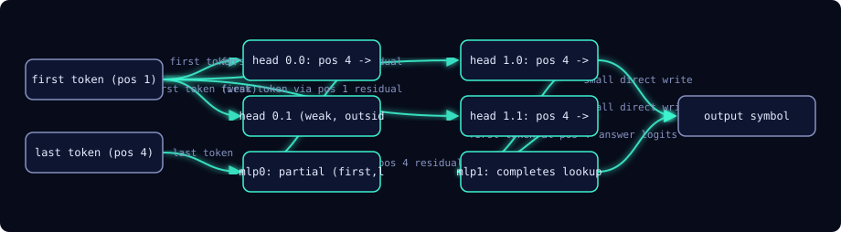
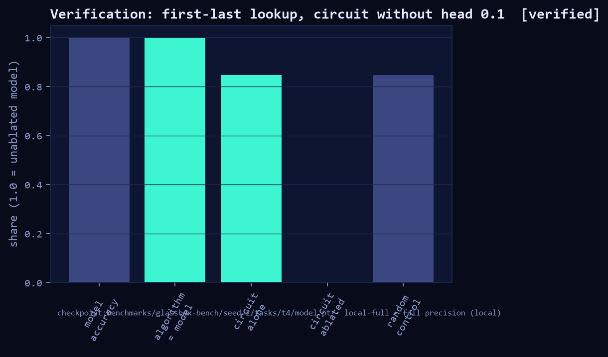
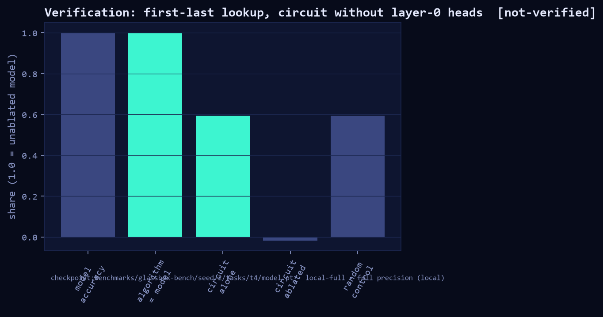
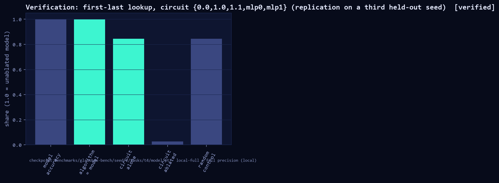
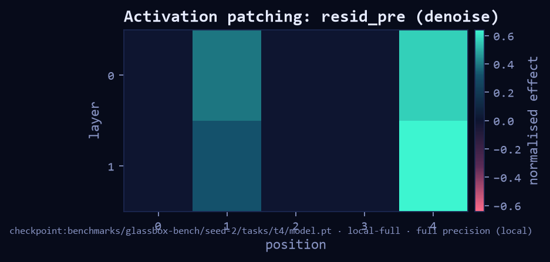
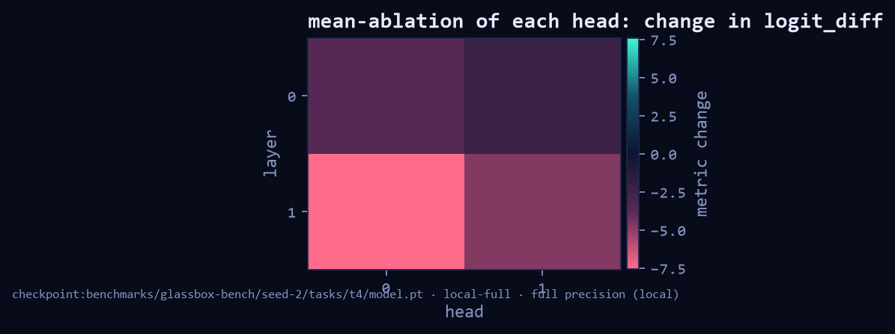
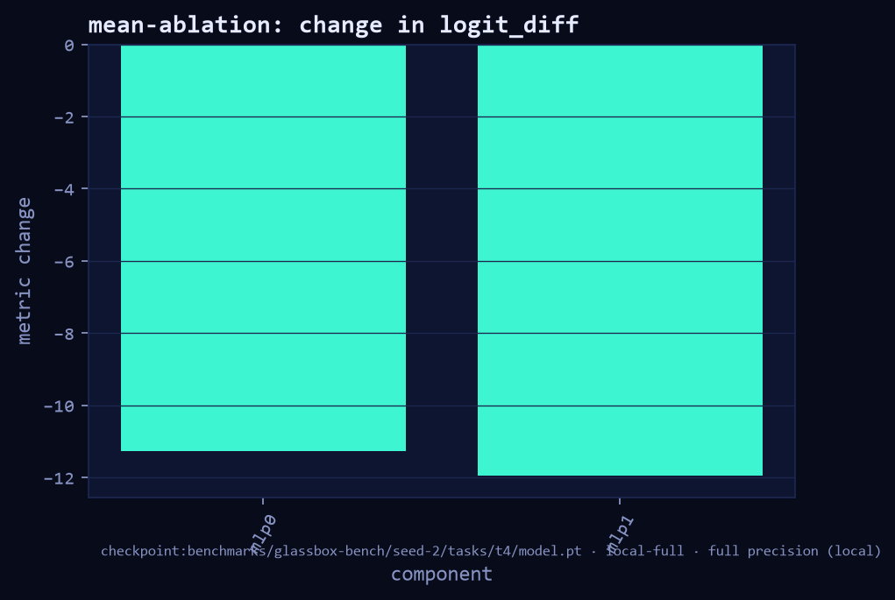
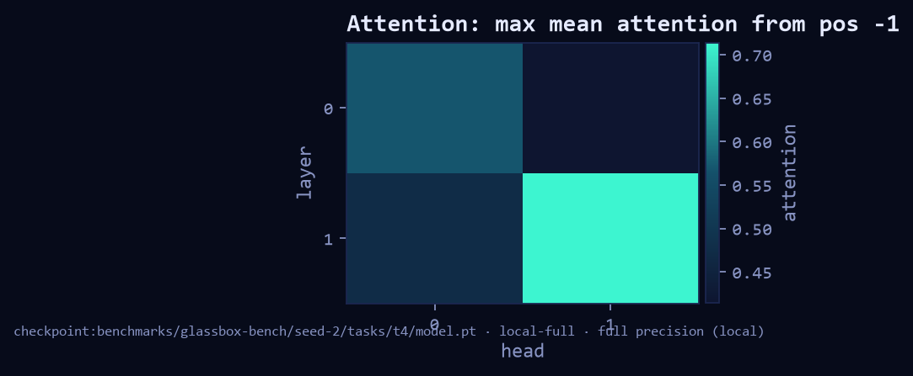

# t4: a 6x6 lookup on (first token, last token) in a 2-layer, 2-head transformer

**Behavior:** Input BOS + 4 tokens from {fa,ku,fu,la,ma,vi} (ids 2..7); the model outputs one symbol at the last position.  
**Model:** `checkpoint:benchmarks/glassbox-bench/seed-2/tasks/t4/model.pt` on `local-full`  
**Status:** partial / not verified · verified (local-full, full precision)  
**Experiments run:** 17 · **Backends used:** full precision (local)  
**Written:** 2026-11-13 13:00

## Summary

The output is a fixed lookup table on the first and the last input token; the two middle tokens are ignored. The table matched the model on 72/72 designed prompts covering every cell (E0005) and on 900/900 held-out prompts (V0001, V0002, V0003). No arithmetic structure was found in the table, so it is reported as a table. Mechanism: first-token information is moved from position 1 to the last position by attention in both layers (0.0 and weakly 0.1 in layer 0; 1.0 and 1.1 in layer 1), and mlp0 and mlp1 at the last position turn the (first,last) pair into the answer, which only becomes decodable after layer 1. Verified circuit: heads 0.0, 1.0, 1.1 and mlp0, mlp1 (V0001, replicated in V0003). Head 0.1 is the only component outside it; it is a weak contributor rather than strictly inert (ablating it keeps about 96.5% accuracy and 85% of the logit difference). A smaller circuit without head 0.0 was tried and failed (V0002). All numbers are from the local-full backend at full precision.

## The recovered algorithm

```python
T = {fa:{fa:fa,ku:ma,fu:ku,la:ku,ma:fu,vi:la},
     ku:{fa:vi,ku:ku,fu:vi,la:la,ma:fa,vi:vi},
     fu:{fa:la,ku:fu,fu:vi,la:ma,ma:fa,vi:fa},
     la:{fa:ma,ku:ma,fu:fu,la:ku,ma:la,vi:la},
     ma:{fa:la,ku:ma,fu:vi,la:ku,ma:fu,vi:ma},
     vi:{fa:vi,ku:ku,fu:ma,la:fa,ma:ku,vi:vi}}

def predict(tokens, prompt):   # ids: fa=2 ku=3 fu=4 la=5 ma=6 vi=7
    first, last = tokens[1], tokens[4]      # positions 2,3 have no causal effect (E0009)
    # layer 0: heads 0.0 (+0.1 weakly) copy 'first' to the last position (E0010, E0013, V0002)
    # layer 1: heads 1.0, 1.1 copy 'first' (as processed by layer 0) again (E0009, E0010, E0014)
    # mlp0 + mlp1 at the last position do the lookup (E0012)
    return T[first][last]                   # E0005, V0001, V0003
```

## Circuit



## Claims and evidence

| # | Claim | Evidence | Produced by |
|---|---|---|---|
| 1 | The model computes output = T[first token][last token], a fixed 6x6 table; confirmed on all 36 cells with two middle fillers (72/72) and on 300/300 held-out prompts in each of three verifications. | E0005, V0001, V0002, V0003 | full precision (local) |
| 2 | The middle tokens (positions 2 and 3) have no causal effect: patching the residual stream there restores less than 0.5% of the logit difference at either layer, and all 36 middles give the same output in two probed cells. | E0009, E0003 | full precision (local) |
| 3 | First-token information reaches the output position through attention in both layers: all four heads attend from the last position mostly to position 1, and after layer 0 about a third of the patching effect (0.32) still sits at position 1, where only layer-1 attention can read it. | E0010, E0009 | full precision (local) |
| 4 | Layer-1 heads are necessary (joint mean ablation leaves 26% of the logit difference); layer-0 heads are a partial route (joint ablation leaves 63%). Single ablations: 1.0 0.52, 1.1 0.70, 0.0 0.77, 0.1 0.86. | E0011, E0013, E0014 | full precision (local) |
| 5 | Both MLPs are necessary: mean-ablating mlp0 leaves 29% and mlp1 leaves 24% of the logit difference. | E0012 | full precision (local) |
| 6 | The circuit {0.0, 1.0, 1.1, mlp0, mlp1} is necessary and sufficient by the lab's criteria on two held-out seeds: ablating it drops accuracy to 0.157 / 0.187 (about chance), ablating only the remaining head 0.1 keeps accuracy 0.967 / 0.963 and 85% / 84% of the logit difference; all null controls passed. | V0001, V0003 | full precision (local) |
| 7 | Head 0.0 cannot be dropped from the circuit: with both layer-0 heads ablated accuracy falls to 0.577 and the sufficiency check fails. | V0002, E0013 | full precision (local) |
| 8 | The answer is not yet decodable after layer 0 (logit-lens logit difference 1.0 of 16.6, answer probability 0.28) and the heads' direct writes total only 2.7 of 16.6, so most of the answer is written by the MLPs, consistent with mlp1 ablation removing 76%. | E0015, E0016, E0012 | full precision (local) |

## Verification

### V0001: first-last lookup, circuit without head 0.1  (full precision (local))

| check | value |
|---|---|
| status | verified |
| held-out inputs | 300 |
| model accuracy | 1.000 |
| algorithm agrees with model | 1.000 |
| algorithm accuracy vs ground truth | 1.000 |
| circuit size | 5 of 6 components |
| metric kept with ONLY the circuit | 0.846 |
| metric kept with the circuit ABLATED | 0.001 |
| random same-size ablation (control) | 0.846, 0.846, 0.846 |

Passed at full precision, and every effect exceeds its null distribution.



### V0002: first-last lookup, circuit without layer-0 heads  (full precision (local))

| check | value |
|---|---|
| status | not-verified |
| held-out inputs | 300 |
| model accuracy | 1.000 |
| algorithm agrees with model | 1.000 |
| algorithm accuracy vs ground truth | 1.000 |
| circuit size | 4 of 6 components |
| metric kept with ONLY the circuit | 0.595 |
| metric kept with the circuit ABLATED | -0.017 |
| random same-size ablation (control) | 0.595, 0.595, 0.595 |

At least one check failed; the explanation is partial or wrong. See the numbers.



### V0003: first-last lookup, circuit {0.0,1.0,1.1,mlp0,mlp1} (replication on a third held-out seed)  (full precision (local))

| check | value |
|---|---|
| status | verified |
| held-out inputs | 300 |
| model accuracy | 1.000 |
| algorithm agrees with model | 1.000 |
| algorithm accuracy vs ground truth | 1.000 |
| circuit size | 5 of 6 components |
| metric kept with ONLY the circuit | 0.844 |
| metric kept with the circuit ABLATED | 0.028 |
| random same-size ablation (control) | 0.844, 0.844, 0.844 |

Passed at full precision, and every effect exceeds its null distribution.



## Key plots

**E0009: activation_patching** (full precision (local))



**E0011: ablation** (full precision (local))



**E0012: ablation** (full precision (local))



**E0010: attention_patterns** (full precision (local))



## Limitations

- The function is reported as an unexplained 36-entry table; I found no simpler rule behind it and did not test for one experimentally.
- The pre-registered test of 'mlp1 writes the answer' (E0017) was scored inconclusive because I registered a metric path that does not exist; the observed all-position effects (mlp1 0.78, mlp0 0.76) do not separate the two MLPs. What each MLP computes individually is not resolved.
- No component is exactly inert: head 0.1, the only one outside the circuit, still costs about 15% of the logit difference and flips about 3-4% of outputs when ablated. The task statement says some components play no part; the closest match I measured is 0.1.
- The edges between specific heads and MLPs in the diagram are inferred from position-level patching and ablations, not from path patching.
- The table was first read by hand from E0001 samples and two transcription errors were caught by E0003; the final table rests on E0005 and the held-out verifications, not on the hand reading.
- V0002 (a 4-component circuit without head 0.0) is a failed verification and is kept in the record; V0003 re-ran the V0001 circuit on a third unseen seed.

## Open questions

- Is there a compact rule that generates the table (for example a composition of two smaller maps)?
- What intermediate features does mlp0 write at the last position, and do the layer-1 heads read the raw first token or a layer-0 transformed version of it?
- Is head 0.1 a partial duplicate of 0.0, or does it serve specific table cells?

## Prediction record

8 experiments were pre-registered, 8 were run: **7 confirmed, 0 refuted, 1 inconclusive**. Hit rate (confirmed / decided): **100%**.

No prediction was refuted.

Exploratory runs (no pre-registration; they cannot be the only support for a claim): E0002, E0003, E0004, E0006, E0007, E0008, E0015, E0016.

## Experiments

| id | primitive | backend / precision | seconds | pre-registration |
|---|---|---|---|---|
| E0001 | dataset | full precision (local) | 0.17 | exploratory |
| E0002 | baseline | full precision (local) | 0.35 | exploratory |
| E0003 | baseline | full precision (local) | 0.11 | exploratory |
| E0004 | attention_patterns | full precision (local) | 0.26 | exploratory |
| E0005 | baseline | full precision (local) | 0.12 | N0006: confirmed |
| E0006 | attribution_patching | full precision (local) | 0.43 | exploratory |
| E0007 | ablation | full precision (local) | 0.32 | exploratory |
| E0008 | ablation | full precision (local) | 0.31 | exploratory |
| E0009 | activation_patching | full precision (local) | 0.34 | N0013: confirmed |
| E0010 | attention_patterns | full precision (local) | 0.28 | N0014: confirmed |
| E0011 | ablation | full precision (local) | 0.35 | N0017: confirmed |
| E0012 | ablation | full precision (local) | 0.31 | N0018: confirmed |
| E0013 | ablation | full precision (local) | 0.29 | N0019: confirmed |
| E0014 | ablation | full precision (local) | 0.3 | N0020: confirmed |
| E0015 | logit_lens | full precision (local) | 0.36 | exploratory |
| E0016 | direct_logit_attribution | full precision (local) | 0.3 | exploratory |
| E0017 | activation_patching | full precision (local) | 0.32 | N0029: inconclusive |
| V0001 | verify | full precision (local) |  | verification |
| V0002 | verify | full precision (local) |  | verification |
| V0003 | verify | full precision (local) |  | verification |

## Notebook trail

- `N0001` *decision*: Loaded checkpoint:benchmarks/glassbox-bench/seed-2/tasks/t4/model.pt on local-full (full precision (local)).
- `N0002` *experiment*: dataset (E0001)
- `N0003` *experiment*: Look at the shape of the baseline output (E0002)
- `N0004` *experiment*: Probe: for first=4,last=7 (36 middles) is the output 5 or 2; for first=7,last=4 (36 middles) is it 6 or 3. Seed-0 data showed out is a function of (first,last) except 4557->2 and 7764->3. (E0003)
- `N0005` *hypothesis* **[supported]**: H1 (function): the output is a fixed 6x6 lookup on (first input token, last input token); the two middle tokens are irrelevant. Table in token ids T[first][last]: 2:{2:2,3:6,4:3,5:3,6:4,7:5} 3:{2:7,3:3,4:7,5:5,6:2,7:7} 4:{2:5,3:4,4:7,5:6,6:2,7:2} 5:{2:6,3:6,4:4,5:3,6:5,7:5} 6:{2:5,3:6,4:7,5:3,6:4,7:6} 7:{2:7,3:3,4:6,5:2,6:3,7:7}. Derived by hand from the E0001 samples; E0003 (exploratory) showed the two apparent middle-dependent exceptions were my transcription errors: (4,*,*,7)->2 and (7,*,*,4)->6 for all 36 middles.
- `N0006` *prereg*: H1: output = T[first][last] (fixed 6x6 table), independent of the middle tokens.
- `N0007` *experiment*: First look: where does each head attend from the last position? (E0004)
- `N0008` *experiment*: H1: output = T[first][last] (fixed 6x6 table), independent of the middle tokens. (E0005)
- `N0009` *experiment*: Cheap screen of heads/MLPs/positions (E0006)
- `N0010` *experiment*: Shape + first exact look: mean-ablate each head separately (E0007)
- `N0011` *experiment*: Shape + first exact look: mean-ablate each MLP separately (E0008)
- `N0012` *hypothesis* **[revised]**: H2 (where): only positions 1 (first token) and 4 (last token) carry causal information; positions 2,3 do not. First-token information reaches position 4 by attention to position 1 in both layers (L0 heads 0.0/0.1 and L1 head 1.1), and the MLPs (mlp0, mlp1) at position 4 do the table lookup. Screen: E0004 (attention from last pos: 0.0, 0.1, 1.1 -> pos 1; 1.0 -> BOS), E0006 (attribution: resid at pos 2,3 ~0), E0007/E0008 (single mean ablations: 1.0 0.55, 1.1 0.72, 0.0 0.76, 0.1 0.86, mlp0 0.31, mlp1 0.23 of clean logit diff) - all exploratory, to be confirmed.
- `N0013` *prereg*: H2a: the middle tokens (positions 2,3) carry no causal information: patching the clean residual stream at position 2 into the corrupt run restores essentially nothing, at any layer.
- `N0014` *prereg*: H2b: head 1.1 at the last position attends mainly to position 1 (the first input token), i.e. it moves first-token information to the output position in layer 1.
- `N0015` *experiment*: H2a: the middle tokens (positions 2,3) carry no causal information: patching the clean residual stream at position 2 int (E0009)
- `N0016` *experiment*: H2b: head 1.1 at the last position attends mainly to position 1 (the first input token), i.e. it moves first-token infor (E0010)
- `N0017` *prereg*: H3a: every head contributes, 1.0 most and 0.1 least: mean-ablating 0.1 alone leaves at least 80% of the clean logit difference (replication of exploratory E0007 on fresh data).
- `N0018` *prereg*: H3b: both MLPs are necessary for the lookup: mean-ablating mlp1 alone removes more than 60% of the clean logit difference (replication of exploratory E0008 on fresh data).
- `N0019` *prereg*: H3c: the layer-0 heads are a real route for first-token information (not fully backed up by layer 1): jointly mean-ablating 0.0 and 0.1 leaves at most 65% of the clean logit difference.
- `N0020` *prereg*: H3d: the layer-1 heads are necessary: jointly mean-ablating 1.0 and 1.1 leaves at most 40% of the clean logit difference.
- `N0021` *experiment*: H3a: every head contributes, 1.0 most and 0.1 least: mean-ablating 0.1 alone leaves at least 80% of the clean logit diff (E0011)
- `N0022` *experiment*: H3b: both MLPs are necessary for the lookup: mean-ablating mlp1 alone removes more than 60% of the clean logit differenc (E0012)
- `N0023` *experiment*: H3c: the layer-0 heads are a real route for first-token information (not fully backed up by layer 1): jointly mean-ablat (E0013)
- `N0024` *experiment*: H3d: the layer-1 heads are necessary: jointly mean-ablating 1.0 and 1.1 leaves at most 40% of the clean logit difference (E0014)
- `N0025` *verification*: first-last lookup, circuit without head 0.1: verified. Passed at full precision, and every effect exceeds its null distribution. (V0001)
- `N0026` *verification*: first-last lookup, circuit without layer-0 heads: not-verified. At least one check failed; the explanation is partial or wrong. See the numbers. (V0002)
- `N0027` *experiment*: Where does the answer become decodable? (E0015)
- `N0028` *experiment*: Which components write the answer direction directly? (E0016)
- `N0029` *prereg*: H4: the answer is written mainly by mlp1 at the last position (the final lookup step): patching clean mlp1 output at position 4 into the corrupt run restores at least half the logit difference, and more than mlp0 output at position 4 does.
- `N0030` *experiment*: H4: the answer is written mainly by mlp1 at the last position (the final lookup step): patching clean mlp1 output at pos (E0017)
- `N0031` *result*: H1 supported. E0005 (pre-registered, local-full): model argmax = T[first][last] on 72/72 prompts covering all 36 cells with two different middle fillers. E0003 (exploratory): for (4,*,*,7) and (7,*,*,4) all 36 middles give the same output. Held-out: predict() agrees with the model on 300/300 (V0001, seed 11) and 300/300 (V0002, seed 12). No arithmetic or ordering structure was found in the table (rows are not permutations, e.g. first=ku gives vi for three different last tokens), so it is reported as a lookup table. (E0005, E0003, V0001, V0002)
- `N0032` *result*: H2 supported with detail (all local-full). Positions 2,3 carry nothing: resid patching effects |x| < 0.005 (E0009); positions 1 and 4 carry everything (0.40/0.57 at layer 0, 0.32/0.64 entering layer 1), so about a third of the effect still sits at position 1 after layer 0 and can only reach the output through layer-1 attention. All four heads attend from the last position mostly to position 1 (E0010: 1.1 0.71, 0.0 0.57, 1.0 0.47, 0.1 0.41). Mean ablation, fraction of clean logit diff: 1.0 0.52, 1.1 0.70, 0.0 0.77, 0.1 0.86 (E0011); mlp0 0.29, mlp1 0.24 (E0012); 0.0+0.1 jointly 0.63 (E0013); 1.0+1.1 jointly 0.26 (E0014). Circuit {0.0,1.0,1.1,mlp0,mlp1}: ablating it gives accuracy 0.157 (chance ~1/6), ablating only 0.1 keeps accuracy 0.967 and 85% of the logit diff (V0001, verified). Dropping 0.0 as well fails: accuracy 0.577 (V0002, not-verified). So 0.1 is a weak contributor to margin rather than strictly inert; no component has exactly zero effect. E0017 (H4, mlp1 writes the answer) was scored INCONCLUSIVE because I pre-registered a metric path that does not exist (mlp_out patching is all-positions, not per-position); the observed all-position effects were mlp1 0.78, mlp0 0.76, so the sub-claim 'mlp1 more than mlp0' is at best marginal. Not re-registered. (E0009, E0010, E0011, E0012, E0013, E0014, E0017, V0001, V0002)
- `N0033` *hypothesis* **[supported]** -> N0005: Supported: E0005 72/72, V0001 and V0002 agreement 300/300 each on held-out seeds.
- `N0034` *hypothesis* **[revised]** -> N0012: Revised: positions and routes confirmed (E0009, E0010, E0011-E0014, V0001), but head 1.0 also attends mostly to position 1 on fresh data (E0010; in E0004 its top key was BOS), and head 0.1 is only a weak contributor (V0001: accuracy 0.967 with it ablated). The division of labour between mlp0 and mlp1 is not resolved (E0017 inconclusive).
- `N0035` *report*: Report written: report/report.md (E0003, E0005, E0009, E0010, E0011, E0012, E0013, E0014, E0015, E0016, V0001, V0002)
- `N0036` *verification*: first-last lookup, circuit {0.0,1.0,1.1,mlp0,mlp1} (replication on a third held-out seed): verified. Passed at full precision, and every effect exceeds its null distribution. (V0003)
