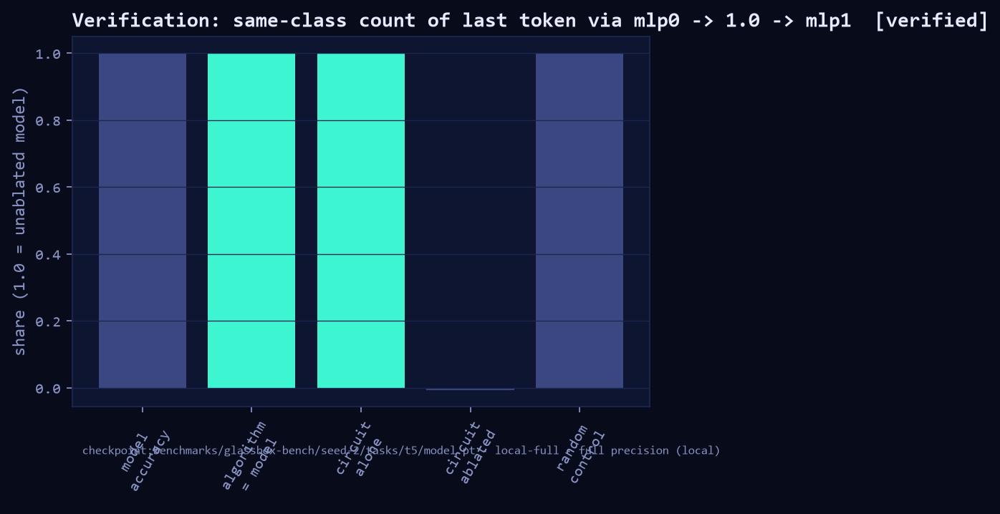
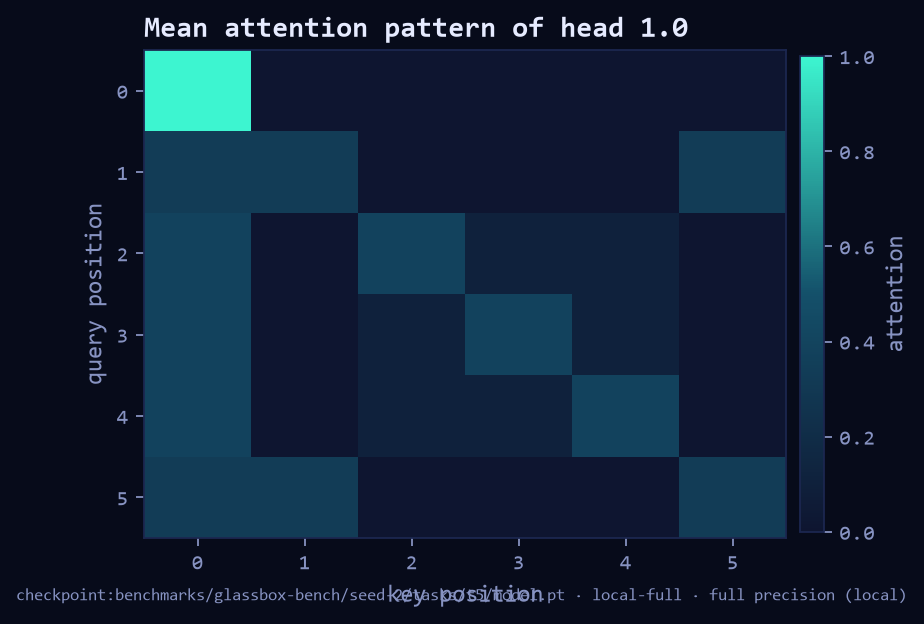
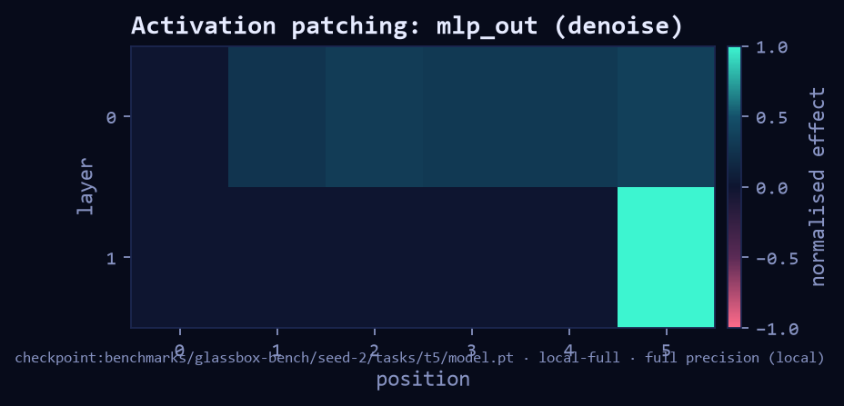
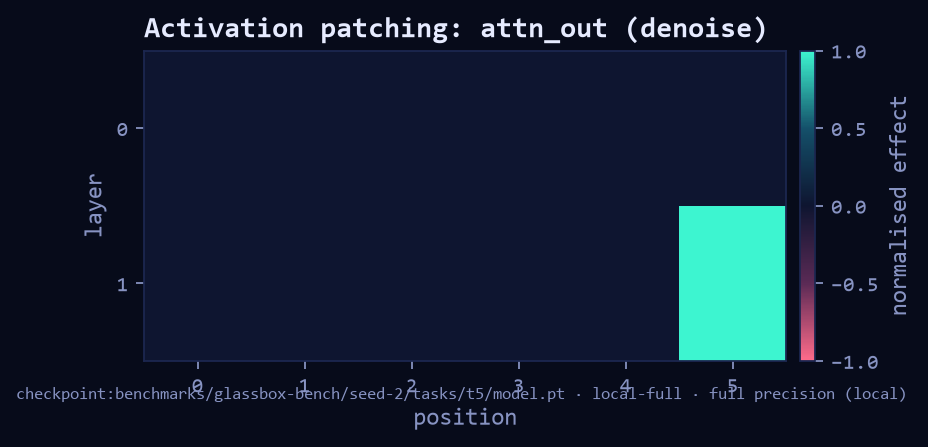
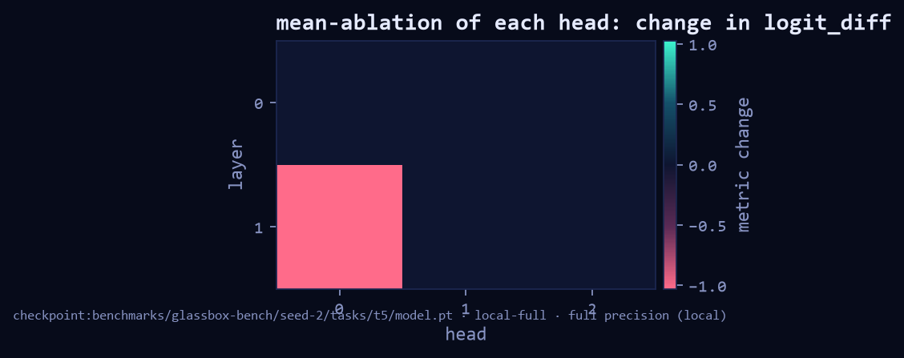

# t5: count of tokens in the same class as the last token (mlp0 -> head 1.0 -> mlp1)

**Behavior:** Input BOS + 5 tokens from {gi, ke, ki, me, su}; at the last position the model outputs one digit token '0'..'5'.  
**Model:** `checkpoint:benchmarks/glassbox-bench/seed-2/tasks/t5/model.pt` on `local-full`  
**Status:** verified · verified  
**Experiments run:** 15 · **Backends used:** full precision (local)  
**Written:** 2026-11-13 13:03

## Summary

All numbers are from the local-full backend (full precision). The model outputs how many of the 5 input tokens (the last one included) belong to the same class as the last token, where the classes are {ke, ki}, {gi, me} and {su}. Three components implement it: mlp0 prepares a per-token feature at every token position, head 1.0 at the last position attends evenly to BOS and to every same-class position (so the BOS share is 1/(count+1)), and mlp1 at the last position turns that into the digit. Heads 0.0, 0.1, 0.2, 1.1 and 1.2 play no part. The algorithm matches the model on 300/300 held-out inputs and the circuit passes necessity, sufficiency and null controls.

## The recovered algorithm

```python
cls = {ke:'k', ki:'k', gi:'g', me:'g', su:'s'}
# mlp0 (positions 1-5): per-token class feature
# head 1.0 (query = last pos): uniform attention over BOS + positions with cls == cls[last]  -> BOS share = 1/(count+1)
# mlp1 (last pos): decode share -> digit
count = sum(cls[x] == cls[x5] for x in x1..x5)
output = digit(count)   # token id 7 + count
```

## Circuit


## Claims and evidence

| # | Claim | Evidence | Produced by |
|---|---|---|---|
| 1 | The model reproduces its recorded outputs exactly (accuracy 1.0, n=200). | E0002 | full precision (local) |
| 2 | Function: output = number of input tokens in the same class as the last token, classes {ke,ki},{gi,me},{su}; predict() agrees with the model on 300/300 held-out inputs. | V0001, E0008 | full precision (local) |
| 3 | The circuit is mlp0, head 1.0 and mlp1: jointly mean-ablated the metric falls to 0.023 of clean; individually 1.0 -> -0.03, mlp0 -> 0.0, mlp1 -> -0.0004. On held-out data ablating the circuit gives -0.006 of clean (accuracy 0.30) while ablating everything else leaves 1.0. | E0005, E0014, E0015, V0001 | full precision (local) |
| 4 | Heads 0.0, 0.1, 0.2, 1.1 and 1.2 play no part: jointly mean-ablating all five leaves 1.0 of clean, and patching layer-0 attention output has zero effect at every position. | E0006, E0013, E0014 | full precision (local) |
| 5 | Head 1.0 at the last position splits attention exactly evenly between BOS and same-class positions, including a different symbol of the same class (1/3, 1/3, 0, 0, 0, 1/3 on count-2 prompts), so the BOS share encodes 1/(count+1). | E0008 | full precision (local) |
| 6 | mlp0 acts at every token position 1-5 (denoising effect 0.27-0.36 per position, 0 at BOS); mlp1 acts only at the last position (effect 1.0 there, 0 elsewhere). | E0012 | full precision (local) |
| 7 | Layer-1 attention output at the last position is all mlp1 needs: patching it alone restores the full metric. | E0013 | full precision (local) |

## Verification

### V0001: same-class count of last token via mlp0 -> 1.0 -> mlp1  (full precision (local))

| check | value |
|---|---|
| status | verified |
| held-out inputs | 300 |
| model accuracy | 1.000 |
| algorithm agrees with model | 1.000 |
| algorithm accuracy vs ground truth | 1.000 |
| circuit size | 3 of 8 components |
| metric kept with ONLY the circuit | 1.000 |
| metric kept with the circuit ABLATED | -0.006 |
| random same-size ablation (control) | 1.000, 1.000, 1.000 |

Passed at full precision, and every effect exceeds its null distribution.



## Key plots

**E0008: attention_patterns** (full precision (local))



**E0012: activation_patching** (full precision (local))



**E0013: activation_patching** (full precision (local))



**E0014: ablation** (full precision (local))



## Limitations

- The mlp0 -> head 1.0 edge is inferred from mlp0's necessity at positions 1-5 plus the class-matched attention pattern; it was not path-patched (path_patching only takes heads as senders), so whether mlp0 feeds the query, the key or both is not measured.
- What mlp0 writes was not decoded (no probe run); 'class feature' is the simplest reading consistent with E0008 and E0012.
- The class table was inferred from examples and confirmed by 300/300 agreement and the E0008 prompts, not by exhaustive enumeration of all 3125 inputs.
- The metric saturates at +/-1, so effect sizes are close to accuracy-like and do not resolve small partial contributions.

## Open questions

- Does mlp0 feed head 1.0 through the query, the key, or both?
- How do mlp1's neurons map the fractions 1/2..1/6 to the five digits?

## Prediction record

8 experiments were pre-registered, 8 were run: **8 confirmed, 0 refuted, 0 inconclusive**. Hit rate (confirmed / decided): **100%**.

No prediction was refuted.

Exploratory runs (no pre-registration; they cannot be the only support for a claim): E0003, E0004, E0007, E0009, E0010, E0011.

## Experiments

| id | primitive | backend / precision | seconds | pre-registration |
|---|---|---|---|---|
| E0001 | dataset | full precision (local) | 0.14 | exploratory |
| E0002 | baseline | full precision (local) | 0.51 | N0004: confirmed |
| E0003 | ablation | full precision (local) | 0.42 | exploratory |
| E0004 | ablation | full precision (local) | 0.31 | exploratory |
| E0005 | ablation | full precision (local) | 0.28 | N0008: confirmed |
| E0006 | ablation | full precision (local) | 0.3 | N0009: confirmed |
| E0007 | attention_patterns | full precision (local) | 0.32 | exploratory |
| E0008 | attention_patterns | full precision (local) | 0.1 | N0013: confirmed |
| E0009 | path_patching | full precision (local) | 0.31 | exploratory |
| E0010 | activation_patching | full precision (local) | 0.28 | exploratory |
| E0011 | activation_patching | full precision (local) | 0.42 | exploratory |
| E0012 | activation_patching | full precision (local) | 0.32 | N0018: confirmed |
| E0013 | activation_patching | full precision (local) | 0.39 | N0019: confirmed |
| E0014 | ablation | full precision (local) | 0.31 | N0020: confirmed |
| E0015 | ablation | full precision (local) | 0.26 | N0021: confirmed |
| V0001 | verify | full precision (local) |  | verification |

## Notebook trail

- `N0001` *decision*: Loaded checkpoint:benchmarks/glassbox-bench/seed-2/tasks/t5/model.pt on local-full (full precision (local)).
- `N0002` *experiment*: dataset (E0001)
- `N0003` *hypothesis* **[supported]**: H1 (function, from reading E0001 examples): output = number of input tokens (among the 5, including the last itself) that fall in the same class as the last token, where classes are {ke(3),ki(4)}, {gi(2),me(5)}, {su(6)}. Output token id = 7 + count. Checked by hand on ~30 rows of E0001; to be tested by predict() agreement on held-out seed.
- `N0004` *prereg*: The model computes its own function reliably: the dataset answers are the model's outputs, so baseline accuracy is ~1 and logit diff is clearly positive.
- `N0005` *experiment*: The model computes its own function reliably: the dataset answers are the model's outputs, so baseline accuracy is ~1 an (E0002)
- `N0006` *experiment*: first screen: mean-ablate each head separately; also learn result shape (E0003)
- `N0007` *experiment*: first screen: mean-ablate each MLP separately (E0004)
- `N0008` *prereg*: The behaviour is implemented by mlp0, head 1.0 and mlp1; jointly mean-ablating them destroys it.
- `N0009` *prereg*: Heads 0.0, 0.1, 0.2, 1.1 and 1.2 play no part in the behaviour: jointly mean-ablating all five leaves it intact.
- `N0010` *experiment*: The behaviour is implemented by mlp0, head 1.0 and mlp1; jointly mean-ablating them destroys it. (E0005)
- `N0011` *experiment*: Heads 0.0, 0.1, 0.2, 1.1 and 1.2 play no part in the behaviour: jointly mean-ablating all five leaves it intact. (E0006)
- `N0012` *experiment*: look at where head 1.0 attends from the last position; learn output shape (E0007)
- `N0013` *prereg*: Head 1.0, from the last position, attends uniformly to BOS and to every position whose token is in the same class as the last token (classes {ke,ki},{gi,me},{su}), so BOS attention = 1/(count+1). On prompts where the only same-class partner is the OTHER symbol of the class at position 1, attention from pos 5 to pos 1 is 1/3.
- `N0014` *experiment*: Head 1.0, from the last position, attends uniformly to BOS and to every position whose token is in the same class as the (E0008)
- `N0015` *experiment*: shape check + does head 1.0 write directly to logits or via mlp1? (E0009)
- `N0016` *experiment*: shape check; where (layer x position) does MLP output matter (E0010)
- `N0017` *experiment*: per-position MLP output patching (trying the positions parameter) (E0011)
- `N0018` *prereg*: mlp1 acts only at the last position (it decodes the count there), while mlp0 acts at every token position (it prepares per-token class features); patching clean mlp1 output at pos 5 alone fully restores the behaviour.
- `N0019` *prereg*: The only thing mlp1 needs is what layer-1 attention (head 1.0) writes at the last position (the same-class fraction): patching clean layer-1 attn_out at pos 5 into a corrupt run restores most of the behaviour, and layer-0 attention carries nothing.
- `N0020` *prereg*: Head 1.0 is individually necessary (confirming exploratory E0003 on a fresh seed): mean-ablating it alone destroys the behaviour while every other head is harmless.
- `N0021` *prereg*: Both MLPs are individually necessary (confirming exploratory E0004 on a fresh seed); the weaker of the two, mlp1, still loses >=85% under mean ablation.
- `N0022` *experiment*: mlp1 acts only at the last position (it decodes the count there), while mlp0 acts at every token position (it prepares p (E0012)
- `N0023` *experiment*: The only thing mlp1 needs is what layer-1 attention (head 1.0) writes at the last position (the same-class fraction): pa (E0013)
- `N0024` *experiment*: Head 1.0 is individually necessary (confirming exploratory E0003 on a fresh seed): mean-ablating it alone destroys the b (E0014)
- `N0025` *experiment*: Both MLPs are individually necessary (confirming exploratory E0004 on a fresh seed); the weaker of the two, mlp1, still  (E0015)
- `N0026` *result*: Circuit = mlp0 -> head 1.0 -> mlp1 (local-full). Joint mean ablation of the three: 0.023 of clean (E0005); each alone necessary: 1.0 -> -0.03 (E0014), mlp0 -> 0.0, mlp1 -> 0.0 (E0015). The other five heads (0.0,0.1,0.2,1.1,1.2) jointly mean-ablated: 1.0 of clean (E0006); layer-0 attention output patching has zero effect at every position (E0013). mlp0 matters at every token position 1-5 (0.27-0.36 each) and not at BOS; mlp1 only at pos 5 (1.0) (E0012). Layer-1 attn_out at pos 5 alone is sufficient (1.0) (E0013). Head 1.0 from the last position splits attention exactly evenly between BOS and same-class positions, including a different symbol of the same class (1/3,1/3,0,0,0,1/3 on count-2 prompts) (E0008), so the BOS share is 1/(count+1), which mlp1 decodes into the count token. (E0005, E0006, E0008, E0012, E0013, E0014, E0015)
- `N0027` *verification*: same-class count of last token via mlp0 -> 1.0 -> mlp1: verified. Passed at full precision, and every effect exceeds its null distribution. (V0001)
- `N0028` *hypothesis* **[supported]** -> N0003: predict() agrees with the model on 300/300 held-out inputs (V0001, seed 11); class merging {ke,ki},{gi,me} seen directly in head 1.0's attention (E0008). (V0001, E0008)
