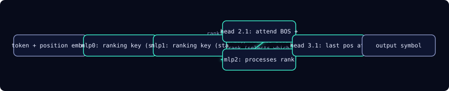
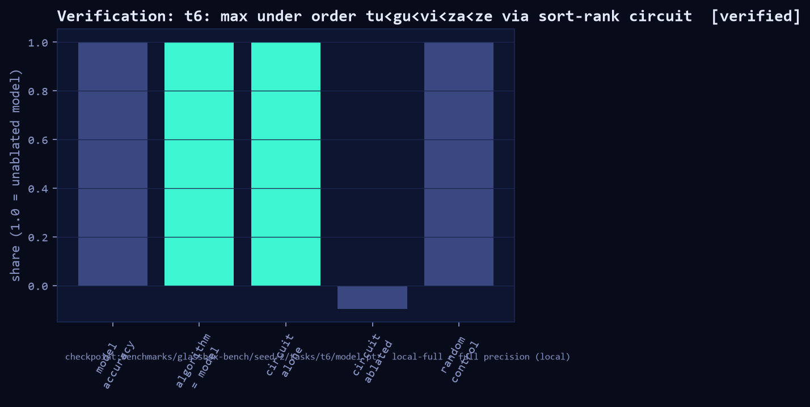
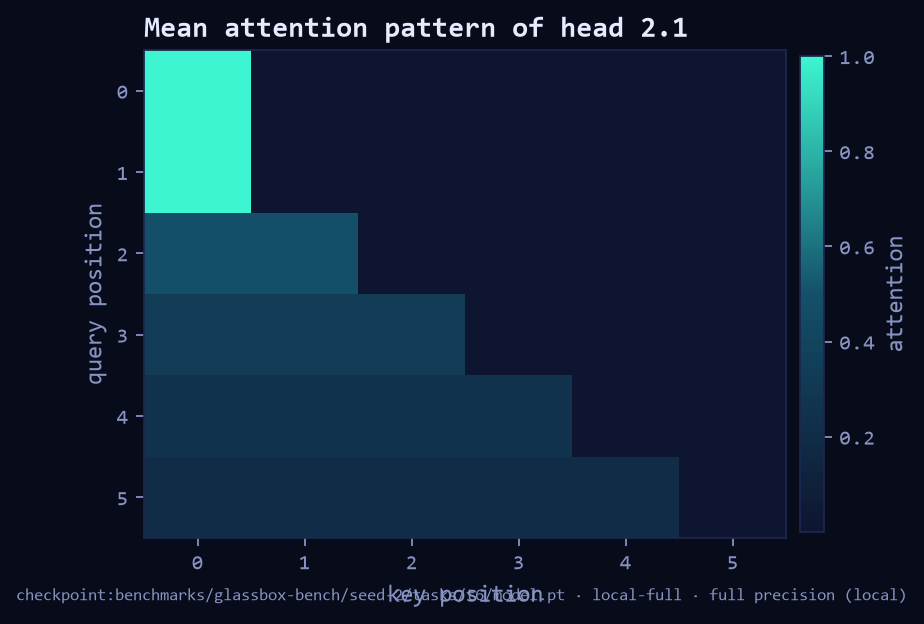
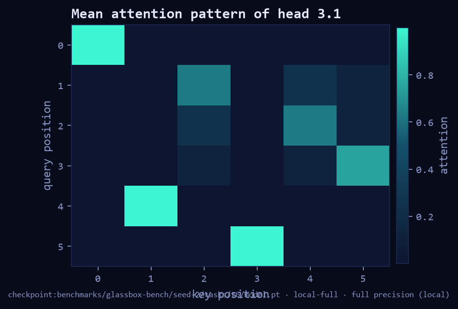
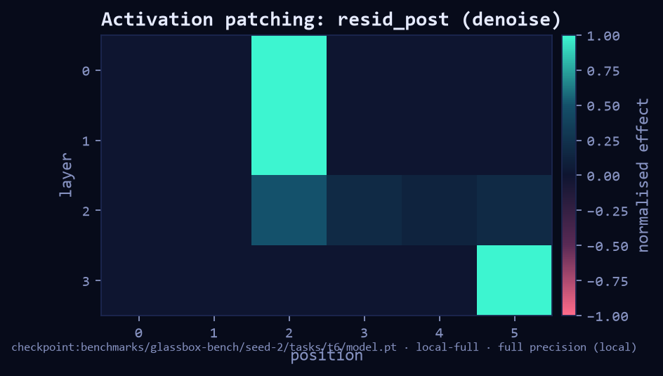
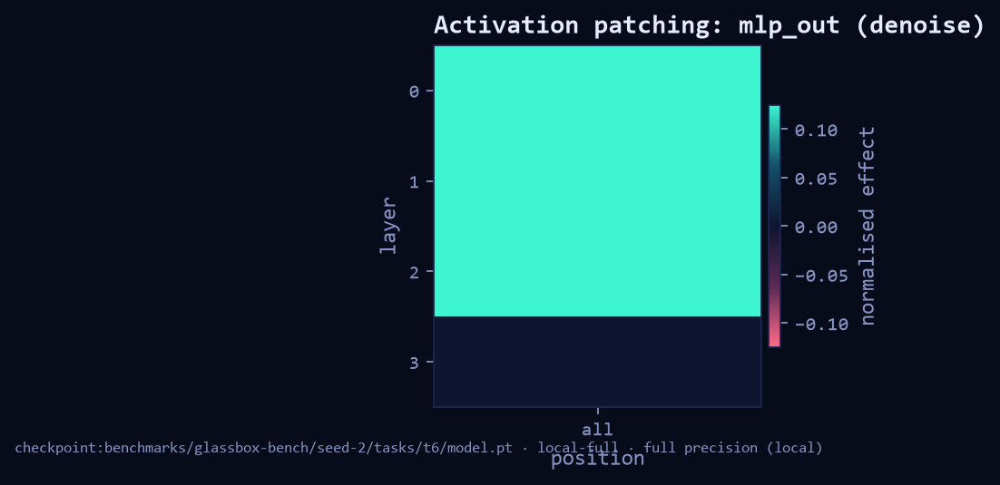

# t6: the model outputs the maximum symbol under tu < gu < vi < za < ze, via a sort-rank circuit

**Behavior:** Input BOS + 5 symbols from {gu, tu, vi, za, ze}; at the last position the model outputs one symbol.  
**Model:** `checkpoint:benchmarks/glassbox-bench/seed-2/tasks/t6/model.pt` on `local-full`  
**Status:** verified · verified (local-full, full precision)  
**Experiments run:** 16 · **Backends used:** full precision (local)  
**Written:** 2026-11-13 13:09

## Summary

The model outputs the highest-ranked symbol present in the input under the order tu < gu < vi < za < ze (token ids 3 < 2 < 4 < 5 < 6, i.e. id order except that gu outranks tu). It does this with five components: mlp0 and mlp1 build a per-position ranking key; head 2.1 at each position attends uniformly to BOS plus every position holding a lower symbol or an equal symbol earlier in the sequence, which encodes that position's stable ascending sort rank; mlp2 processes that; head 3.1 at the last position attends to the position of rank 4 (the last occurrence of the max symbol) and copies its symbol to the output. Heads 0.0, 0.1, 1.0, 1.1, 2.0, 3.0 and mlp3 play no part. All numbers are from the local-full backend (full precision). Held-out verification V0001: verified.

## The recovered algorithm

```python
order = {tu:0, gu:1, vi:2, za:3, ze:4}
xs = tokens[1:6]
# mlp0, mlp1: ranking key per position
# head 2.1 (+ mlp2): rank_i = #(j : order[x_j] < order[x_i], or x_j == x_i and j < i)
# head 3.1 at last position: attend to the position with rank 4, copy its symbol
return xs[rank.index(4)]   # == max(xs, key=order)
```

## Circuit



## Claims and evidence

| # | Claim | Evidence | Produced by |
|---|---|---|---|
| 1 | The model does the behaviour deterministically: 200/200 clean prompts match the dataset answers (local-full). | E0002 | full precision (local) |
| 2 | The function is max under the order tu < gu < vi < za < ze: all 12 gu/tu-only prompts containing a gu output gu regardless of position or count, and the max-under-order predict() agrees with the model on 200/200 held-out prompts. | E0003, V0001 | full precision (local) |
| 3 | Heads 0.0, 0.1, 1.0, 1.1, 2.0, 3.0 and mlp3 play no part: mean-ablating all seven jointly leaves fraction_of_clean = 1.0, and in verification ablating everything outside the circuit leaves accuracy 1.0. | E0006, V0001 | full precision (local) |
| 4 | mlp0, mlp1, head 2.1, mlp2 and head 3.1 are the circuit: ablating them drops held-out accuracy to 0.24 and fraction_of_clean to -0.095 (corrupt-reference mean ablation). With clean-reference mean ablation the residual was 0.191, missing my pre-registered <= 0.1 threshold. | V0001, E0007 | full precision (local) |
| 5 | Head 2.1 attends uniformly to BOS plus positions holding a lower symbol or an equal earlier symbol: on five identical symbols position i attends 1/i to BOS and each earlier position (5->BOS = 0.2); a unique-max position attends 0.2 to BOS and each of the 4 others and receives no attention. This refuted my first guess that it attends to higher-ranked symbols. | E0010, E0011 | full precision (local) |
| 6 | Head 3.1 at the last position attends (0.9999) to the last occurrence of the max symbol, and position 4 attends to the earlier occurrence: a stable ascending sort in which position i reads the element of rank i-1. My first guess (first occurrence) was refuted. | E0012, E0009 | full precision (local) |
| 7 | Routing: a symbol's information stays at its own position through layers 0-1 (single-position patch restores 1.0), is spread over positions after layer 2 (0.5 at source, 0.12-0.19 elsewhere), and is at the last position only after layer 3 (1.0). | E0014 | full precision (local) |
| 8 | mlp0, mlp1 and mlp2 carry ranking information, not the copied symbol: patching their clean outputs makes the model output the corrupt symbol at the top-ranked position, giving exactly the predicted effect 0.125 (mlp3: 0.0). | E0016 | full precision (local) |

## Verification

### V0001: t6: max under order tu<gu<vi<za<ze via sort-rank circuit  (full precision (local))

| check | value |
|---|---|
| status | verified |
| held-out inputs | 200 |
| model accuracy | 1.000 |
| algorithm agrees with model | 1.000 |
| algorithm accuracy vs ground truth | 1.000 |
| circuit size | 5 of 12 components |
| metric kept with ONLY the circuit | 1.000 |
| metric kept with the circuit ABLATED | -0.095 |
| random same-size ablation (control) | 1.000, 1.000, 1.000 |

Passed at full precision, and every effect exceeds its null distribution.



## Key plots

**E0010: attention_patterns** (full precision (local))



**E0012: attention_patterns** (full precision (local))



**E0014: activation_patching** (full precision (local))



**E0016: activation_patching** (full precision (local))



## Limitations

- The individual roles of mlp0 versus mlp1 are not separated; E0016 only shows both carry ranking (not symbol) information. What exactly mlp2 computes from head 2.1's output was not measured.
- Edges between components are inferred from layer order, attention patterns and patching; path patching could not test them (MLP senders unsupported; exploratory E0013 returned 0 direct effect for every head, including 3.1, which I do not understand).
- The single-component ablation screens E0004/E0005 are exploratory.
- E0015 was scored inconclusive because of a wrong metric path (mlp_out is patched at all positions at once); it was replaced by E0016 on new prompt pairs.
- E0007 missed its threshold (0.191 vs <= 0.1). An untested possible reason is that a mean-ablated model emits a constant, frequently correct symbol.
- V0001 reports random same-size ablation fractions of 1.0, 1.0, 1.0; I did not check how those random sets are drawn.
- Attention-pattern tests used small hand-built prompt sets (5-8 prompts each).

## Open questions

- Does head 3.1 at positions 1-4 really output the full sorted sequence (attention patterns suggest it; outputs at those positions were not read)?
- How is the gu > tu ordering encoded in mlp0/mlp1?

## Prediction record

11 experiments were pre-registered, 11 were run: **7 confirmed, 3 refuted, 1 inconclusive**. Hit rate (confirmed / decided): **70%**.

Refuted predictions (shown, not hidden):

| prereg | experiment | hypothesis | predicted | observed |
|---|---|---|---|---|
| N0012 | E0007 | H2: mlp0, mlp1, 2.1, mlp2 and 3.1 are jointly necessary; mean-ablating them together destroys the behaviour. | `summary.fraction_of_clean <= 0.1` | 0.191 |
| N0018 | E0009 | H3: head 3.1 at the last position attends (nearly) exclusively to the first occurrence of the max symbol. In 8 hand-built prompts whose first max occurrence is  | `data.pattern[5][2] >= 0.9` | 0.125 |
| N0020 | E0011 | H3 ordering: head 2.1 compares symbols in the order ze>za>vi>gu>tu. When position 3 holds the unique maximum under that order (including gu among tu), position  | `data.pattern[3][0] >= 0.97` | 0.200 |

Exploratory runs (no pre-registration; they cannot be the only support for a claim): E0004, E0005, E0008, E0013.

## Experiments

| id | primitive | backend / precision | seconds | pre-registration |
|---|---|---|---|---|
| E0001 | dataset | full precision (local) | 0.46 | exploratory |
| E0002 | baseline | full precision (local) | 0.84 | N0003: confirmed |
| E0003 | baseline | full precision (local) | 0.11 | N0005: confirmed |
| E0004 | ablation | full precision (local) | 1.0 | exploratory |
| E0005 | ablation | full precision (local) | 0.78 | exploratory |
| E0006 | ablation | full precision (local) | 0.64 | N0011: confirmed |
| E0007 | ablation | full precision (local) | 0.69 | N0012: refuted |
| E0008 | attention_patterns | full precision (local) | 0.7 | exploratory |
| E0009 | attention_patterns | full precision (local) | 0.1 | N0018: refuted |
| E0010 | attention_patterns | full precision (local) | 0.1 | N0019: confirmed |
| E0011 | attention_patterns | full precision (local) | 0.1 | N0020: refuted |
| E0012 | attention_patterns | full precision (local) | 0.1 | N0025: confirmed |
| E0013 | path_patching | full precision (local) | 0.79 | exploratory |
| E0014 | activation_patching | full precision (local) | 0.15 | N0029: confirmed |
| E0015 | activation_patching | full precision (local) | 0.11 | N0031: inconclusive |
| E0016 | activation_patching | full precision (local) | 0.09 | N0034: confirmed |
| V0001 | verify | full precision (local) |  | verification |

## Notebook trail

- `N0001` *decision*: Loaded checkpoint:benchmarks/glassbox-bench/seed-2/tasks/t6/model.pt on local-full (full precision (local)).
- `N0002` *experiment*: dataset (E0001)
- `N0003` *prereg*: The model does the benchmark behaviour reliably (the dataset answers are its own outputs), so the clean accuracy of the labelled answer vs the corrupt-run answer is near 1.
- `N0004` *experiment*: The model does the benchmark behaviour reliably (the dataset answers are its own outputs), so the clean accuracy of the  (E0002)
- `N0005` *prereg*: The function is a max over the 5 input symbols under the order ze(6) > za(5) > vi(4) > gu(2) > tu(3): the output is the highest-ranked symbol present. In particular any sequence of only gu/tu containing at least one gu outputs gu, regardless of position or count.
- `N0006` *experiment*: The function is a max over the 5 input symbols under the order ze(6) > za(5) > vi(4) > gu(2) > tu(3): the output is the  (E0003)
- `N0007` *hypothesis* **[supported]**: H1 (function): output = max of the 5 input symbols under the order ze(6) > za(5) > vi(4) > gu(2) > tu(3). Consistent with all 120 examples in E0001 (incl. [gu,tu,tu,tu,gu] -> gu), and with the 12 targeted gu/tu prompts in E0003.
- `N0008` *experiment*: First screen: mean-ablate each head individually (E0004)
- `N0009` *experiment*: First screen: mean-ablate each MLP individually (E0005)
- `N0010` *hypothesis* **[supported]**: H2 (where): the circuit is mlp0, mlp1, head 2.1, mlp2, head 3.1. Heads 0.0, 0.1, 1.0, 1.1, 2.0, 3.0 and mlp3 play no part. Based on exploratory single-component mean-ablation screens E0004/E0005 (seed 2); to be confirmed with pre-registered joint ablations.
- `N0011` *prereg*: H2: heads 0.0, 0.1, 1.0, 1.1, 2.0, 3.0 and mlp3 play no part; mean-ablating all of them jointly leaves the behaviour intact.
- `N0012` *prereg*: H2: mlp0, mlp1, 2.1, mlp2 and 3.1 are jointly necessary; mean-ablating them together destroys the behaviour.
- `N0013` *experiment*: H2: heads 0.0, 0.1, 1.0, 1.1, 2.0, 3.0 and mlp3 play no part; mean-ablating all of them jointly leaves the behaviour int (E0006)
- `N0014` *experiment*: H2: mlp0, mlp1, 2.1, mlp2 and 3.1 are jointly necessary; mean-ablating them together destroys the behaviour. (E0007)
- `N0015` *result*: E0006 confirmed: jointly mean-ablating 0.0, 0.1, 1.0, 1.1, 2.0, 3.0, mlp3 leaves fraction_of_clean = 1.0. E0007 REFUTED my threshold: jointly mean-ablating mlp0, mlp1, 2.1, mlp2, 3.1 leaves 0.191 of the clean logit diff (predicted <= 0.1). The behaviour is largely destroyed (81% lost) but not to the level I predicted. Untested possible reason: a mean-ablated model emits a constant answer, and since 'ze' is the correct answer in the majority of random prompts, a constant output scores a positive mean logit diff. I have not measured that, so the residual 0.19 stands as an unexplained miss of the prediction. (E0006, E0007)
- `N0016` *experiment*: attention_patterns (E0008)
- `N0017` *hypothesis* **[revised]**: H3 (mechanism, from exploratory E0008 pattern of head 2.1: zero self-attention, BOS always attended, later queries attend more to earlier keys): head 2.1 at every position i attends uniformly to BOS plus every position j whose symbol outranks symbol i (order ze>za>vi>gu>tu), or equals it and sits earlier (j<i). So attention-to-BOS = 1/(1+count), and count = 0 only at the FIRST occurrence of the max symbol. mlp2 turns this into a 'I am the winner' flag; head 3.1 at the last position attends to the flagged position and copies its symbol to the output. mlp0/mlp1 prepare the per-position comparison key.
- `N0018` *prereg*: H3: head 3.1 at the last position attends (nearly) exclusively to the first occurrence of the max symbol. In 8 hand-built prompts whose first max occurrence is at position 2 (several with later ties, and the last position is not the first max), mean attention 5->2 is near 1.
- `N0019` *prereg*: H3 tie-break: head 2.1 counts earlier equal symbols as 'outranking'. On prompts with five identical symbols, position 5 attends uniformly to BOS and positions 1-4, so attention 5->BOS = 0.2.
- `N0020` *prereg*: H3 ordering: head 2.1 compares symbols in the order ze>za>vi>gu>tu. When position 3 holds the unique maximum under that order (including gu among tu), position 3 attends only to BOS.
- `N0021` *experiment*: H3: head 3.1 at the last position attends (nearly) exclusively to the first occurrence of the max symbol. In 8 hand-buil (E0009)
- `N0022` *experiment*: H3 tie-break: head 2.1 counts earlier equal symbols as 'outranking'. On prompts with five identical symbols, position 5  (E0010)
- `N0023` *experiment*: H3 ordering: head 2.1 compares symbols in the order ze>za>vi>gu>tu. When position 3 holds the unique maximum under that  (E0011)
- `N0024` *hypothesis* **[revised]** -> N0017: H3 had the direction wrong. E0011 (refuted, 3->BOS = 0.2 not 1): the unique-max position attends uniformly to BOS + all 4 other positions, and nobody attends to it; so head 2.1 attends to keys that are LOWER-ranked (or equal and earlier), not higher. E0010 (confirmed) fits: on all-identical prompts position i attends to BOS + the i-1 earlier positions. E0009 (refuted, 5->2 = 0.125 not >=0.9): head 3.1 from the last position attends to the LAST occurrence of the max (row 5 = [0,0,.125,.125,.375,.375] equals exactly the distribution of last-max positions in my 8 prompts), not the first. Row 1 of the same pattern matches the first occurrence of the MIN symbol (5/8 at pos 1). REVISED H3': 2.1 computes at each position its ascending stable sort rank r = #(lower symbols, or equal and earlier) via attention-to-BOS = 1/(1+r); mlp2 decodes r; head 3.1 at position i attends to the position with rank i-1 and copies its symbol (the model sorts the sequence). At the last position that is rank 4 = the max symbol under tu<gu<vi<za<ze.
- `N0025` *prereg*: H3': head 3.1 at the last position attends to the position of stable-sort rank 4, i.e. the LAST occurrence of the max symbol. In 8 new prompts where the max symbol occurs at positions 1 and 3 only, attention 5->3 is ~1.
- `N0026` *experiment*: H3': head 3.1 at the last position attends to the position of stable-sort rank 4, i.e. the LAST occurrence of the max sy (E0012)
- `N0027` *experiment*: Shape check for path_patching (MLP senders raised ValueError: unsupported). Does 2.1 write directly to the logits? (E0013)
- `N0028` *note*: E0012 confirmed H3' for head 3.1: last position attends 0.9999 to the last occurrence of the max (pos 3), and position 4 attends 0.9999 to the earlier occurrence (pos 1) = stable ascending sort. path_patching: MLP senders raise ValueError (unsupported, no experiment id). Exploratory E0013 (heads -> logits, denoise) returned effect 0.0 for every head including 3.1, which sits oddly with 3.1 being necessary in the E0004 screen; I do not understand this output and will not build claims on path_patching direct-to-logits. (E0012, E0013)
- `N0029` *prereg*: H3' routing: through layers 0-1 the identity of a symbol stays at its own position (no relevant attention before layer 2). With clean/corrupt pairs differing only at position 2 (clean has the unique max there, corrupt has tu), patching the clean residual stream after layer 1 at position 2 alone fully restores the clean answer.
- `N0030` *experiment*: H3' routing: through layers 0-1 the identity of a symbol stays at its own position (no relevant attention before layer 2 (E0014)
- `N0031` *prereg*: Key/value dissociation: mlp1 writes the per-position comparison key that head 2.1 uses to rank, while the symbol that head 3.1 copies comes from elsewhere (token embedding). So patching only mlp1's clean output at position 2 into the corrupt run gives position 2 the top rank but 3.1 then copies the corrupt symbol tu: output is tu, which is neither the clean nor the corrupt answer in 7 of 8 pairs (metric 0) and is the corrupt answer in 1 pair (metric -1). Expected normalised effect = (−0.125+1)/2 ≈ 0.44.
- `N0032` *experiment*: Key/value dissociation: mlp1 writes the per-position comparison key that head 2.1 uses to rank, while the symbol that he (E0015)
- `N0033` *result*: E0014 confirmed: with pairs differing only at position 2, patching clean resid_post at pos 2 restores 1.0 after layers 0 and 1; after layer 2 the effect is spread (0.5 at pos 2, 0.12-0.19 at pos 3-5); after layer 3 it is 1.0 at the last position only. E0015 scored INCONCLUSIVE: my metric path data.effect[1][2] does not exist, because mlp_out is patched at all positions at once (one column 'all'). Observed mlp_out effects: mlp0 0.4375, mlp1 0.4375, mlp2 0.4375, mlp3 0.0. 0.4375 equals the number my key/value-dissociation hypothesis predicted, but the prediction was not scored, so I do not count it. I will test the same hypothesis on NEW pairs with a different expected value and the correct path, rather than re-register this run. (E0014, E0015)
- `N0034` *prereg*: Key/value dissociation (new pairs, change at position 4): mlp1 supplies the ranking key, not the copied symbol. Patching clean mlp1 output makes the changed position rank top, and head 3.1 then copies the CORRUPT symbol x at that position. In 6 pairs x is also the corrupt answer (metric stays -1, effect 0); in 2 pairs x is neither answer (metric 0, effect 0.5). Expected mean effect = 0.125.
- `N0035` *experiment*: Key/value dissociation (new pairs, change at position 4): mlp1 supplies the ranking key, not the copied symbol. Patching (E0016)
- `N0036` *verification*: t6: max under order tu<gu<vi<za<ze via sort-rank circuit: verified. Passed at full precision, and every effect exceeds its null distribution. (V0001)
- `N0037` *hypothesis* **[supported]** -> N0007: H1 supported: E0003 (12/12 targeted gu/tu prompts) and V0001 (predict() agrees with the model on 200/200 held-out prompts, seed 7).
- `N0038` *hypothesis* **[supported]** -> N0010: H2 supported: E0006 (other 7 components jointly mean-ablated: fraction 1.0), V0001 (circuit ablated: fraction -0.095, accuracy 0.24; everything else ablated: fraction 1.0, accuracy 1.0). Caveat: E0007's pre-registered threshold (<=0.1) was missed at 0.191 with clean-reference mean ablation.
