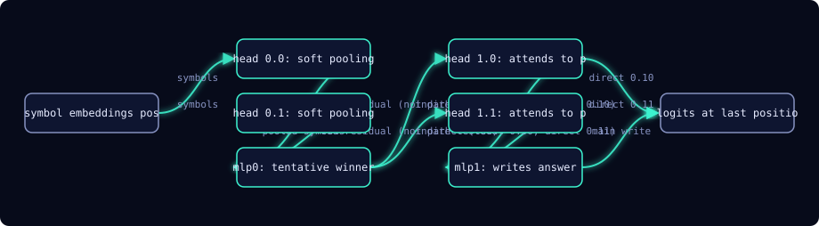
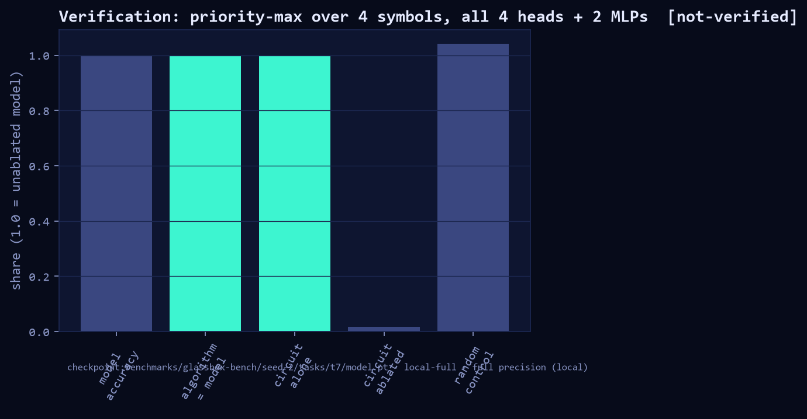
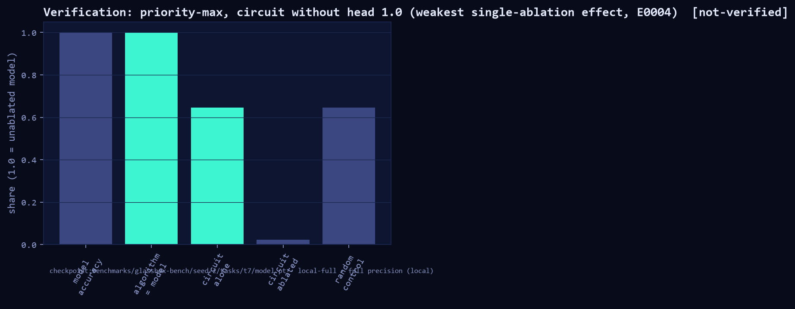
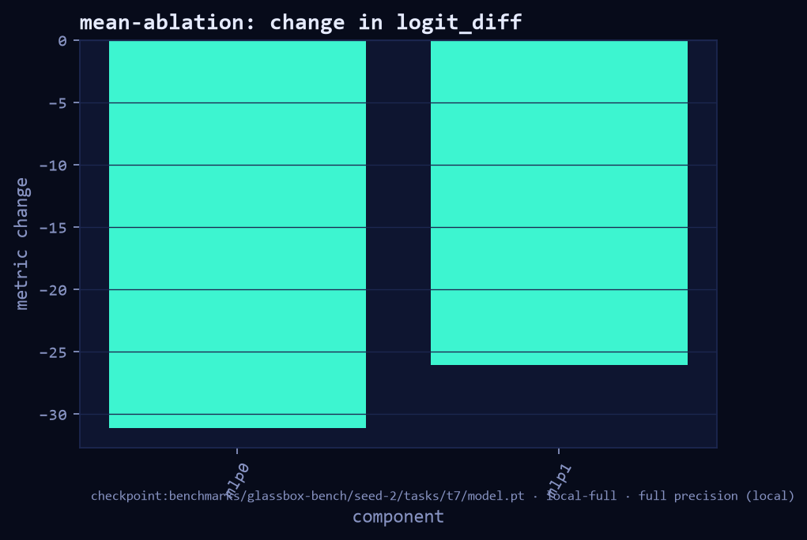
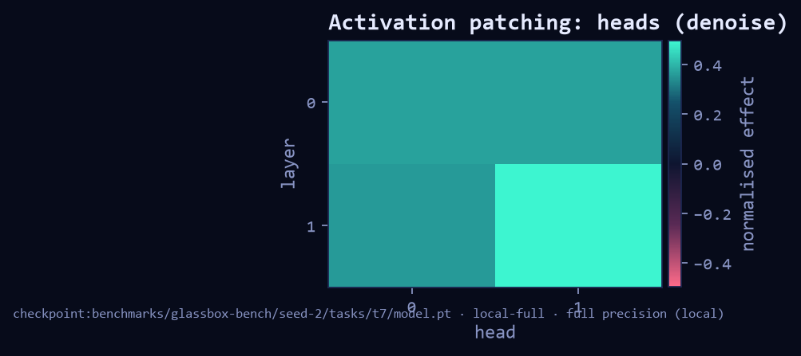
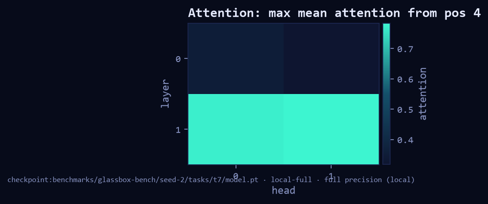
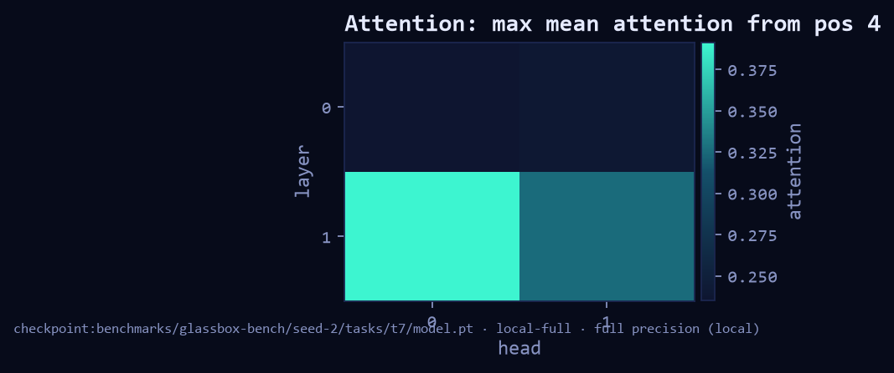
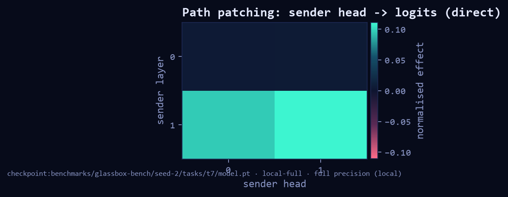

# t7: priority-max over four symbols (2-layer, 2-head transformer)

**Behavior:** Input BOS + 4 tokens from {pa, li, po, pu, pi, re}; the model outputs one symbol at the last position.  
**Model:** `checkpoint:benchmarks/glassbox-bench/seed-2/tasks/t7/model.pt` on `local-full`  
**Status:** partial / not verified · partial: function verified on held-out inputs; circuit localisation not verified (whole model involved)  
**Experiments run:** 15 · **Backends used:** full precision (local)  
**Written:** 2026-11-13 13:13

## Summary

All numbers are from the local-full backend (full precision). The model outputs the highest-priority symbol present in the input, with the fixed order pi > po > pu > pa > re > li. A six-line predict() agrees with the model on 400/400 and 400/400 held-out inputs (two unused seeds). At head/MLP granularity no component is inert: each of the four heads and both MLPs loses 33-81% of the logit difference when mean-ablated alone. Layer 0 produces only a weak tentative answer at the last position (logit-diff 2.0 of 38.7); layer 1 does most of the work, with the layer-1 heads acting mainly through mlp1 rather than writing logits directly. Layer-1 heads attend strongly (0.78) to pi when it is present, but do not select a low-priority winner such as pa, so the mechanism is a mixture of selective attention and pooled-symbol MLP computation. Circuit verification did not reach 'verified': the whole-model circuit has no sufficiency null, and dropping the weakest head (1.0) keeps 99.25% accuracy but only 64.6% of the logit difference, below the 70% threshold.

## The recovered algorithm

```python
def predict(tokens, prompt):
    # highest-priority symbol present (E0001/E0002, E0006, V0001, V0002)
    order = [6, 4, 5, 2, 7, 3]   # pi > po > pu > pa > re > li
    present = set(tokens[1:])
    for t in order:
        if t in present:
            return t

# Mechanism sketch (evidence-backed parts only):
# L0: heads 0.0/0.1 pool symbols into the last position with weak preference for pi (E0013);
#     mlp0 is the most important single component (E0005); L0 heads have ~0 direct logit effect (E0015).
# L1: heads 1.0/1.1 attend to pi when present (0.78, E0013) but not to low-priority winners (E0014);
#     they act mostly via mlp1 (direct 0.10-0.11 vs total 0.36-0.50; E0015, E0009); mlp1 ablation leaves 0.33 (E0005).
```

## Circuit



## Claims and evidence

| # | Claim | Evidence | Produced by |
|---|---|---|---|
| 1 | The model computes a priority max: output = highest-ranked symbol present, order pi > po > pu > pa > re > li. predict() matches the model on 400/400 held-out inputs in each of two verifications (null agreement ~0.35). | E0002, V0001, V0002 | full precision (local) |
| 2 | re outranks li: on all 14 inputs containing only li and re (both present), logit(re) > logit(li) by 2.1-9.0. My pre-registered guess of the opposite order was refuted. Margins here are far smaller than the typical 38.7. | E0006 | full precision (local) |
| 3 | Both MLPs are needed: mean-ablating mlp0 leaves 19% and mlp1 33% of the clean logit difference. | E0005 | full precision (local) |
| 4 | All four heads are causally involved: exact denoising patch effects are 0.37 (0.0), 0.37 (0.1), 0.36 (1.0), 0.50 (1.1); joint mean ablation of the layer-1 heads leaves 22%, of the layer-0 heads 25%. | E0009, E0011, E0012, E0004 | full precision (local) |
| 5 | Heads contribute little directly to the logits: layer-0 heads ~0.005 each, layer-1 heads 0.10-0.11 each of the clean-corrupt gap, versus total effects of 0.36-0.50. The answer is written mainly through the MLPs. | E0015, E0009 | full precision (local) |
| 6 | Layer-1 heads select pi by content (0.78 attention on the pi position from the last position; layer-0 heads 0.32-0.35), but this does not generalise to a low-priority winner: with pa as winner among li/re attention is diffuse (max 0.39/0.33, not on the winner). The 'attend to the max' story holds only for high-priority symbols; this prediction was refuted. | E0013, E0014 | full precision (local) |
| 7 | No head or MLP could be shown inert. Treating the whole model as the circuit passes the threshold checks but cannot be null-controlled for sufficiency; removing head 1.0 from the circuit keeps accuracy 0.9925 but only 0.646 of the logit difference (fails the 0.7 threshold). Ablating the 5-component circuit drops accuracy to 0.49. | V0001, V0002, E0005, E0009 | full precision (local) |

## Verification

### V0001: priority-max over 4 symbols, all 4 heads + 2 MLPs  (full precision (local))

| check | value |
|---|---|
| status | not-verified |
| held-out inputs | 400 |
| model accuracy | 1.000 |
| algorithm agrees with model | 1.000 |
| algorithm accuracy vs ground truth | 1.000 |
| circuit size | 6 of 6 components |
| metric kept with ONLY the circuit | 1.000 |
| metric kept with the circuit ABLATED | 0.017 |
| random same-size ablation (control) | 1.013, 1.118, 0.990 |

The thresholds were met, but these effects do not exceed the 95th percentile of their null distribution: sufficiency. A random control does about as well, so this is not a finding.



### V0002: priority-max, circuit without head 1.0 (weakest single-ablation effect, E0004)  (full precision (local))

| check | value |
|---|---|
| status | not-verified |
| held-out inputs | 400 |
| model accuracy | 1.000 |
| algorithm agrees with model | 1.000 |
| algorithm accuracy vs ground truth | 1.000 |
| circuit size | 5 of 6 components |
| metric kept with ONLY the circuit | 0.646 |
| metric kept with the circuit ABLATED | 0.024 |
| random same-size ablation (control) | 0.646, 0.646, 0.646 |

At least one check failed; the explanation is partial or wrong. See the numbers.



## Key plots

**E0005: ablation** (full precision (local))



**E0009: activation_patching** (full precision (local))



**E0013: attention_patterns** (full precision (local))



**E0014: attention_patterns** (full precision (local))



**E0015: path_patching** (full precision (local))



## Limitations

- Circuit status is not-verified: the task says some components are inert, but at head/MLP granularity every component carries 33-81% of the logit difference; any inert parts may be at neuron or subspace level, which was not examined.
- The priority order was read off input/output pairs and tested behaviourally; ties and the all-identical inputs are covered only by the held-out agreement checks.
- The edges mlp0 -> layer-1 heads and heads -> mlp1 are inferred from total-vs-direct effects; no q/k/v path patching into specific receivers was run (one path_patching attempt with an MLP sender errored).
- Ablation effects are on logit difference; accuracy is much more robust (0.9925 with head 1.0 ablated), so 'needed for the margin' is not the same as 'needed for the answer'.
- How low-priority winners (pa, re, li) are resolved inside the MLPs is not explained.
- Attention tests used small hand-built prompt sets (16 and 8 prompts).

## Open questions

- Which components are dispensable for accuracy rather than margin? Head 1.0 nearly is.
- What do mlp0 neurons encode: presence of each symbol, or a partial ranking?
- Do layer-1 heads select po and pu the way they select pi, and where does selection give way to pooling?

## Prediction record

10 experiments were pre-registered, 9 were run: **7 confirmed, 2 refuted, 0 inconclusive**. Hit rate (confirmed / decided): **78%**.

Refuted predictions (shown, not hidden):

| prereg | experiment | hypothesis | predicted | observed |
|---|---|---|---|---|
| N0010 | E0006 | The function is a max under a fixed priority order of symbols. For the two lowest symbols I guess li(3) outranks re(7): on all 14 inputs made only of li and re  | `summary.clean_accuracy >= 0.9` | 0.000 |
| N0025 | E0014 | Layer-1 attention follows the priority order, not just a 'look at pi' rule: when the top-priority symbol present is the low-ranked pa (at position 1, the rest l | `data.score[1][0] >= 0.4` | 0.391 |

Exploratory runs (no pre-registration; they cannot be the only support for a claim): E0003, E0004, E0007, E0008, E0010.

## Experiments

| id | primitive | backend / precision | seconds | pre-registration |
|---|---|---|---|---|
| E0001 | dataset | full precision (local) | 0.26 | exploratory |
| E0002 | baseline | full precision (local) | 0.62 | N0003: confirmed |
| E0003 | attribution_patching | full precision (local) | 0.5 | exploratory |
| E0004 | ablation | full precision (local) | 0.36 | exploratory |
| E0005 | ablation | full precision (local) | 0.36 | N0008: confirmed |
| E0006 | baseline | full precision (local) | 0.1 | N0010: refuted |
| E0007 | attention_patterns | full precision (local) | 0.36 | exploratory |
| E0008 | direct_logit_attribution | full precision (local) | 0.38 | exploratory |
| E0009 | activation_patching | full precision (local) | 0.41 | N0015: confirmed |
| E0010 | logit_lens | full precision (local) | 0.41 | exploratory |
| E0011 | ablation | full precision (local) | 0.31 | N0018: confirmed |
| E0012 | ablation | full precision (local) | 0.34 | N0019: confirmed |
| E0013 | attention_patterns | full precision (local) | 0.08 | N0023: confirmed |
| E0014 | attention_patterns | full precision (local) | 0.07 | N0025: refuted |
| E0015 | path_patching | full precision (local) | 0.38 | N0029: confirmed |
| V0001 | verify | full precision (local) |  | verification |
| V0002 | verify | full precision (local) |  | verification |

## Notebook trail

- `N0001` *decision*: Loaded checkpoint:benchmarks/glassbox-bench/seed-2/tasks/t7/model.pt on local-full (full precision (local)).
- `N0002` *experiment*: dataset (E0001)
- `N0003` *prereg*: The model performs the bench behaviour confidently: the dataset answers are its own argmax outputs, so accuracy is ~1 with a positive logit difference.
- `N0004` *experiment*: The model performs the bench behaviour confidently: the dataset answers are its own argmax outputs, so accuracy is ~1 wi (E0002)
- `N0005` *experiment*: attribution_patching (E0003)
- `N0006` *hypothesis* **[revised]**: H1 (function): from the 200 input/output pairs in E0001 the output is the highest-priority symbol present in the 4 inputs, with priority pi(6) > po(4) > pu(5) > pa(2) > {li(3), re(7)}; order of li vs re not yet determined (no all-li/re example seen). H2 (location): attribution (E0003, exploratory) spreads over all 4 heads and both MLPs; needs exact ablation to tell which are really needed.
- `N0007` *experiment*: ablation (E0004)
- `N0008` *prereg*: Both MLP layers take part in the behaviour (attribution E0003 gave each ~0.7): mean-ablating mlp1 alone removes at least 30% of the clean logit difference.
- `N0009` *experiment*: Both MLP layers take part in the behaviour (attribution E0003 gave each ~0.7): mean-ablating mlp1 alone removes at least (E0005)
- `N0010` *prereg*: The function is a max under a fixed priority order of symbols. For the two lowest symbols I guess li(3) outranks re(7): on all 14 inputs made only of li and re (both present) the model outputs li.
- `N0011` *experiment*: The function is a max under a fixed priority order of symbols. For the two lowest symbols I guess li(3) outranks re(7):  (E0006)
- `N0012` *result*: E0006 refuted my guess li>re: on all 14 mixed li/re inputs logit(re) > logit(li) (diffs -2.1 to -9.0, example predictions all 're'). Revised H1: output = highest-priority symbol present, priority pi(6) > po(4) > pu(5) > pa(2) > re(7) > li(3). Margins on li/re inputs are small (2-9 logits vs ~39 typical). Also E0004/E0005: every head and both MLPs lose 33-80% of logit diff under single mean ablation, so no component is obviously inert on logit diff. (E0006)
- `N0013` *experiment*: attention_patterns (E0007)
- `N0014` *experiment*: direct_logit_attribution (E0008)
- `N0015` *prereg*: All four heads take part (near-uniform pooling of the input symbols into the last position, E0007 exploratory), including head 1.0 which had the smallest mean-ablation effect: patching clean head 1.0 output into the corrupt run restores at least 15% of the logit difference.
- `N0016` *experiment*: All four heads take part (near-uniform pooling of the input symbols into the last position, E0007 exploratory), includin (E0009)
- `N0017` *experiment*: logit_lens (E0010)
- `N0018` *prereg*: Layer 1 does not merely amplify the tentative answer present at the last position after layer 0 (logit lens E0010: margin 2.0 after L0 vs 38.7 final); mlp1 depends on symbol information freshly pooled by heads 1.0 and 1.1. Jointly mean-ablating both layer-1 heads removes at least 65% of the logit difference.
- `N0019` *prereg*: Layer-0 pooling by heads 0.0 and 0.1 is necessary: layer-1 heads cannot substitute by reading raw embeddings from positions 1-3. Jointly mean-ablating heads 0.0+0.1 leaves at most 40% of the logit difference.
- `N0020` *experiment*: Layer 1 does not merely amplify the tentative answer present at the last position after layer 0 (logit lens E0010: margi (E0011)
- `N0021` *experiment*: Layer-0 pooling by heads 0.0 and 0.1 is necessary: layer-1 heads cannot substitute by reading raw embeddings from positi (E0012)
- `N0022` *verification*: priority-max over 4 symbols, all 4 heads + 2 MLPs: not-verified. The thresholds were met, but these effects do not exceed the 95th percentile of their null distribution: sufficiency. A random control does about as well, so this is not a finding. (V0001)
- `N0023` *prereg*: The near-uniform mean attention in E0007 hides content-based selection: heads attend to the highest-priority symbol wherever it sits. On prompts where pi (top priority) is always at position 2 and never elsewhere, head 1.1 puts at least 40% of its last-position attention on position 2.
- `N0024` *experiment*: The near-uniform mean attention in E0007 hides content-based selection: heads attend to the highest-priority symbol wher (E0013)
- `N0025` *prereg*: Layer-1 attention follows the priority order, not just a 'look at pi' rule: when the top-priority symbol present is the low-ranked pa (at position 1, the rest li/re), heads 1.0 and 1.1 still put most last-position attention on that position.
- `N0026` *experiment*: Layer-1 attention follows the priority order, not just a 'look at pi' rule: when the top-priority symbol present is the  (E0014)
- `N0027` *result*: Attention is content-selective only for high-priority symbols. E0013 (confirmed): with pi fixed at position 2, heads 1.1/1.0 put 0.78/0.78 of last-position attention on it; layer-0 heads only 0.35/0.32. E0014 (refuted): with pa at position 1 as the winner among li/re, head 1.0 max mean attention is 0.39 and on position 3, head 1.1 0.33 on BOS: no selection of the winner. So 'layer-1 heads attend to the max-priority symbol' holds for pi, not as a general rule; low-priority winners must be resolved by pooled information + MLPs. (E0013, E0014)
- `N0028` *prereg*: Layer 0 (heads 0.0, 0.1 and mlp0) acts mainly through layer 1 rather than writing the answer directly: the direct path from layer-0 components to the logits carries at most 20% of the clean-corrupt logit-diff gap (logit lens E0010 showed only 2.0 of 38.7 after layer 0).
- `N0029` *prereg*: Layer-0 heads act through later components rather than writing the answer directly (replaces N0028, which errored because path_patching senders must be heads): the direct-to-logits path of head 0.0 carries at most 10% of the clean-corrupt gap, although its total patching effect is 0.37 (E0009).
- `N0030` *experiment*: Layer-0 heads act through later components rather than writing the answer directly (replaces N0028, which errored becaus (E0015)
- `N0031` *verification*: priority-max, circuit without head 1.0 (weakest single-ablation effect, E0004): not-verified. At least one check failed; the explanation is partial or wrong. See the numbers. (V0002)
- `N0032` *hypothesis* **[revised]** -> N0006: H1 revised and supported: priority max with order pi > po > pu > pa > re > li (li>re guess refuted by E0006); predict() agrees with the model on 400/400 (V0001) and 400/400 (V0002) held-out inputs. H2 resolved: all four heads and both MLPs are causally involved (E0004 expl., E0005, E0009, E0011, E0012); no head/MLP is inert on logit difference. V0001 (whole model as circuit) passes thresholds but sufficiency has no null, so not-verified; V0002 (drop head 1.0) fails circuit-alone: 0.646 of logit diff < 0.7, though accuracy stays 0.9925.
