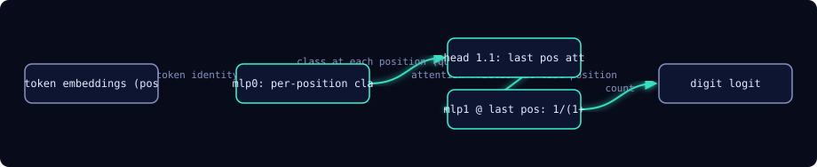
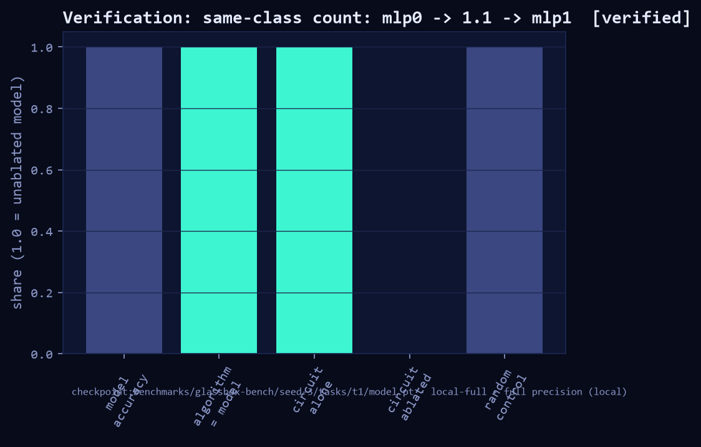
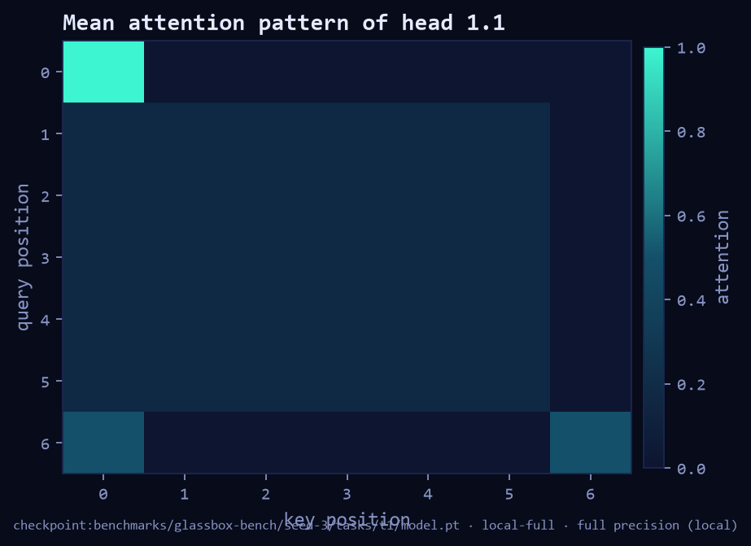
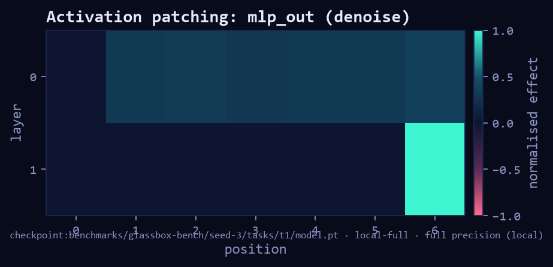
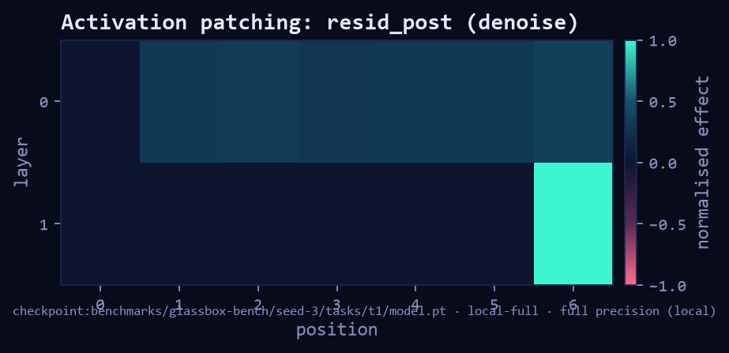

# t1: count of tokens in the same class as the last token (mlp0 -> head 1.1 -> mlp1)

**Behavior:** Input BOS + 6 tokens from {do, lo, po, to, vo}; the model outputs one digit at the last position.  
**Model:** `checkpoint:benchmarks/glassbox-bench/seed-3/tasks/t1/model.pt` on `local-full`  
**Status:** verified · verified (local-full, full precision)  
**Experiments run:** 13 · **Backends used:** full precision (local)  
**Written:** 2026-11-13 12:44

## Summary

The model splits the five symbols into two classes, A = {lo, vo} and B = {do, po, to}, and outputs how many of the 6 input tokens (the last one included) belong to the same class as the last token. The circuit is mlp0 (per-position work at each token position), head 1.1 (from the last position attends equally to BOS and to every same-class token, so the BOS weight is 1/(1+count)), and mlp1 (at the last position turns that into the digit). Heads 0.0, 0.1 and 1.0 play no part. All numbers are from local-full at full precision.

## The recovered algorithm

```python
A = {lo, vo}; B = {do, po, to}
class(t) = A if t in A else B          # mlp0, at every token position
count = #{ i in 1..6 : class(x_i) == class(x_6) }   # head 1.1 from the last position: equal attention on BOS and same-class tokens -> BOS weight 1/(1+count)
output digit = count                   # mlp1 at the last position
```

## Circuit



## Claims and evidence

| # | Claim | Evidence | Produced by |
|---|---|---|---|
| 1 | The model does the behaviour deterministically (clean accuracy 1.0 on 128 inputs). | E0002 | full precision (local) |
| 2 | The function is: number of input tokens in the same class as the last token, with classes {lo, vo} and {do, po, to}. The Python version agrees with the model on 200/200 held-out inputs. | V0001 | full precision (local) |
| 3 | Head 1.1 is necessary: resample-ablating it leaves 0.0 of the clean metric; the other three heads each leave 1.0. | E0007 | full precision (local) |
| 4 | mlp0 and mlp1 are both necessary: resample-ablating either leaves 0.0 of the clean metric. | E0008 | full precision (local) |
| 5 | Heads 0.0, 0.1 and 1.0 play no part: jointly mean-ablating all three leaves 1.0 of the clean metric; with everything outside {mlp0, 1.1, mlp1} ablated the model keeps accuracy 1.0. | E0006, V0001 | full precision (local) |
| 6 | Head 1.1 at the last position attends only to BOS and same-class tokens with equal weight: when the last token is the only member of its class, 0.5 goes to BOS, 0.5 to itself and 0 to the five other-class tokens. | E0009 | full precision (local) |
| 7 | mlp1 does its work only at the last position (patching it there alone restores 1.0); mlp0 works at each of the six token positions (0.29-0.36 each) and not at BOS (0.0). | E0012 | full precision (local) |
| 8 | After layer 0 the answer is not yet at the last position (patching resid_post.0 at pos 6 alone restores 0.36); after layer 1 it is (1.0). So the count is moved to the last position in layer 1. | E0013 | full precision (local) |
| 9 | Ablating the circuit {mlp0, 1.1, mlp1} drops the metric to 0.0015 of clean (accuracy 0.25); all three checks beat their null distributions. | V0001 | full precision (local) |

## Verification

### V0001: same-class count: mlp0 -> 1.1 -> mlp1  (full precision (local))

| check | value |
|---|---|
| status | verified |
| held-out inputs | 200 |
| model accuracy | 1.000 |
| algorithm agrees with model | 1.000 |
| algorithm accuracy vs ground truth | 1.000 |
| circuit size | 3 of 6 components |
| metric kept with ONLY the circuit | 1.000 |
| metric kept with the circuit ABLATED | 0.002 |
| random same-size ablation (control) | 1.000, 1.000, 1.000 |

Passed at full precision, and every effect exceeds its null distribution.



## Key plots

**E0009: attention_patterns** (full precision (local))



**E0012: activation_patching** (full precision (local))



**E0013: activation_patching** (full precision (local))



## Limitations

- What mlp0 writes was not read out directly. That it is a class mark is inferred from the attention rule of 1.1 (E0009) plus mlp0 being needed at every token position (E0012, E0013). Path patching from mlp0 into 1.1's query/key was attempted and the primitive errored for an MLP sender, so the mlp0 -> 1.1 edge is not separately measured.
- The split of mlp1's role (decode 1/(1+count) to a digit) is inferred from the attention weights and position patching; the numeric encoding in 1.1's output was not measured.
- E0009 used inputs where the last token is alone in its class; the general 1/(1+count) weighting is consistent with the exploratory mean pattern in E0005 but only the count = 1 case was pre-registered.
- V0001's three random same-size ablation sets all returned 1.0; with only 6 components the random control is coarse.

## Open questions

- Do heads 0.0, 0.1 and 1.0 compute anything coherent, or are they pure distractors?
- Which side(s) of head 1.1 (query, key, value) read mlp0's output?

## Prediction record

7 experiments were pre-registered, 7 were run: **7 confirmed, 0 refuted, 0 inconclusive**. Hit rate (confirmed / decided): **100%**.

No prediction was refuted.

Exploratory runs (no pre-registration; they cannot be the only support for a claim): E0003, E0004, E0005, E0010, E0011.

## Experiments

| id | primitive | backend / precision | seconds | pre-registration |
|---|---|---|---|---|
| E0001 | dataset | full precision (local) | 0.08 | exploratory |
| E0002 | baseline | full precision (local) | 0.35 | N0004: confirmed |
| E0003 | ablation | full precision (local) | 0.23 | exploratory |
| E0004 | ablation | full precision (local) | 0.18 | exploratory |
| E0005 | attention_patterns | full precision (local) | 0.13 | exploratory |
| E0006 | ablation | full precision (local) | 0.17 | N0009: confirmed |
| E0007 | ablation | full precision (local) | 0.21 | N0010: confirmed |
| E0008 | ablation | full precision (local) | 0.18 | N0011: confirmed |
| E0009 | attention_patterns | full precision (local) | 0.1 | N0016: confirmed |
| E0010 | activation_patching | full precision (local) | 0.17 | exploratory |
| E0011 | activation_patching | full precision (local) | 0.22 | exploratory |
| E0012 | activation_patching | full precision (local) | 0.23 | N0020: confirmed |
| E0013 | activation_patching | full precision (local) | 0.24 | N0021: confirmed |
| V0001 | verify | full precision (local) |  | verification |

## Notebook trail

- `N0001` *decision*: Loaded checkpoint:benchmarks/glassbox-bench/seed-3/tasks/t1/model.pt on local-full (full precision (local)).
- `N0002` *experiment*: dataset (E0001)
- `N0003` *hypothesis* **[supported]**: H1 (function, from reading 32 rows of E0001): symbols split into two classes A={lo(3),vo(6)} and B={do(2),po(4),to(5)}. Output = number of the 6 input tokens that are in the same class as the LAST token (digit token id = 7 + count). Checked by hand on the first 32 dataset rows, all consistent. To be tested on held-out seeds via verify_hypothesis.
- `N0004` *prereg*: The model deterministically performs the bench behaviour: its top output at the last position is the dataset answer nearly always.
- `N0005` *experiment*: The model deterministically performs the bench behaviour: its top output at the last position is the dataset answer near (E0002)
- `N0006` *experiment*: first screen: which heads matter (E0003)
- `N0007` *experiment*: first screen: which MLPs matter (E0004)
- `N0008` *hypothesis* **[supported]**: H2 (where, from exploratory screens E0003/E0004): the circuit is mlp0 -> head 1.1 -> mlp1. Heads 0.0, 0.1 and 1.0 play no part. Guess at roles: mlp0 marks each token's class per position, 1.1 at the last position attends to same-class tokens (count as an attention fraction), mlp1 turns the fraction into the digit.
- `N0009` *prereg*: Heads 0.0, 0.1 and 1.0 play no part: mean-ablating all three jointly leaves the behaviour intact.
- `N0010` *prereg*: Head 1.1 is necessary: resample-ablating it destroys the behaviour, while no other head matters.
- `N0011` *prereg*: Both MLPs are necessary: resample-ablating mlp0 (and mlp1) destroys the behaviour.
- `N0012` *experiment*: look at output shape and where 1.1 attends from the last position (E0005)
- `N0013` *experiment*: Heads 0.0, 0.1 and 1.0 play no part: mean-ablating all three jointly leaves the behaviour intact. (E0006)
- `N0014` *experiment*: Head 1.1 is necessary: resample-ablating it destroys the behaviour, while no other head matters. (E0007)
- `N0015` *experiment*: Both MLPs are necessary: resample-ablating mlp0 (and mlp1) destroys the behaviour. (E0008)
- `N0016` *prereg*: Head 1.1 at the last position attends only to BOS and to tokens of the same class as the last token, with equal weight (so BOS weight = 1/(1+count)). On inputs where the last token is the only one of its class, the weight on BOS is 0.5 and on self 0.5.
- `N0017` *experiment*: Head 1.1 at the last position attends only to BOS and to tokens of the same class as the last token, with equal weight ( (E0009)
- `N0018` *experiment*: shape check + where (layer x position) the MLP outputs matter (E0010)
- `N0019` *experiment*: shape check: per-position MLP output patching (E0011)
- `N0020` *prereg*: mlp1 does its work only at the last position (it converts head 1.1's output there into the digit); mlp0 works at the token positions, not at one single place.
- `N0021` *prereg*: After layer 0 the information needed for the answer is still spread over the token positions (per-position class marks); it only arrives at the last position in layer 1 via head 1.1. So patching the layer-0 residual stream at the last position alone does not restore the answer.
- `N0022` *experiment*: mlp1 does its work only at the last position (it converts head 1.1's output there into the digit); mlp0 works at the tok (E0012)
- `N0023` *experiment*: After layer 0 the information needed for the answer is still spread over the token positions (per-position class marks); (E0013)
- `N0024` *verification*: same-class count: mlp0 -> 1.1 -> mlp1: verified. Passed at full precision, and every effect exceeds its null distribution. (V0001)
- `N0025` *result*: All on local-full (full precision). Model is deterministic (E0002, acc 1.0). Head 1.1 necessary (resample ablation -> 0.0 of clean, E0007); mlp0 and mlp1 necessary (each -> 0.0, E0008); heads 0.0/0.1/1.0 jointly mean-ablated -> 1.0 of clean (E0006). Head 1.1 from the last position puts 0.5 on BOS and 0.5 on itself when the last token is the only one of its class, 0 on other-class tokens (E0009). mlp1 matters only at pos 6 (effect 1.0); mlp0 matters at each token position 1-6 (0.29-0.36 each), 0 at BOS (E0012); after layer 0 the last position alone restores only 0.36 (E0013), and resid_post.0 effects are identical to mlp_out.0 effects. Held-out V0001 (seed 7, n=200): predict() agreement 1.0; circuit ablated 0.0015 of clean; everything else ablated 1.0; verified, beats null controls. (E0002, E0006, E0007, E0008, E0009, E0012, E0013, V0001)
- `N0026` *hypothesis* **[supported]** -> N0003: V0001: predict() agrees with the model on 200/200 held-out inputs (seed 7).
- `N0027` *hypothesis* **[supported]** -> N0008: Component set supported by E0006, E0007, E0008, V0001; 1.1's attention rule by E0009; position roles by E0012, E0013. The exact content mlp0 writes (a class mark) is inferred from E0009 + E0012/E0013, not read out directly.
