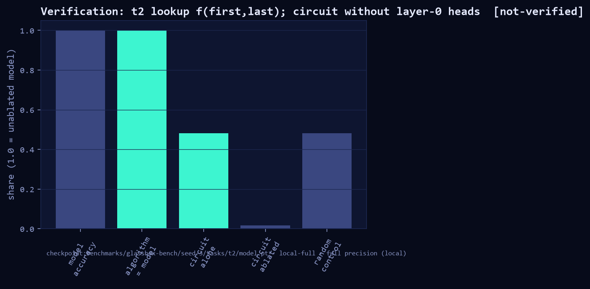
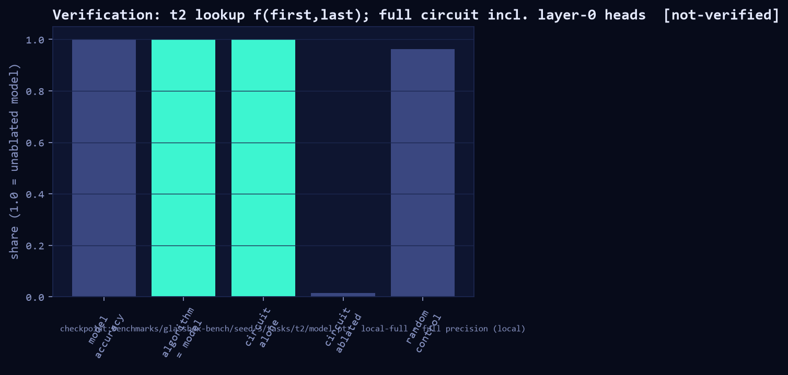
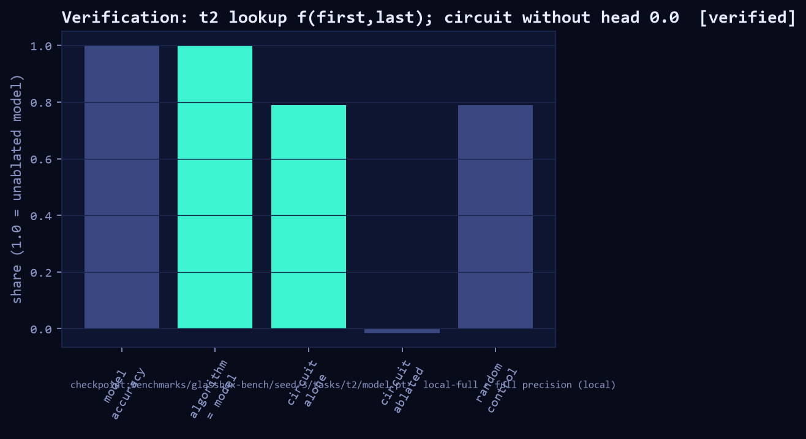
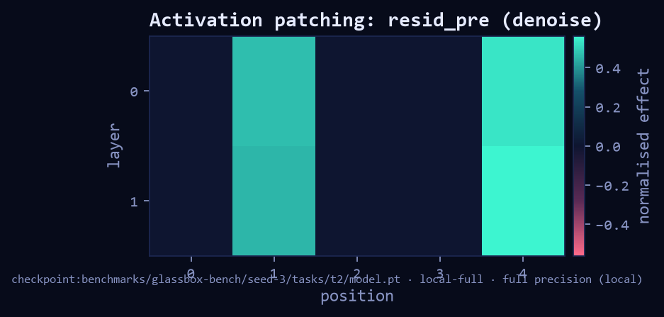
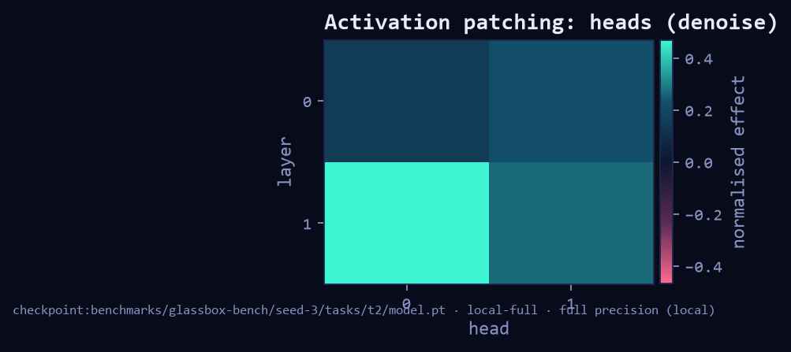
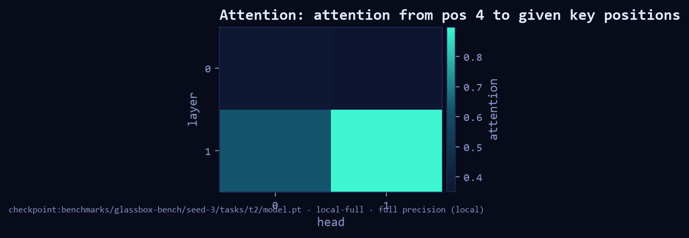
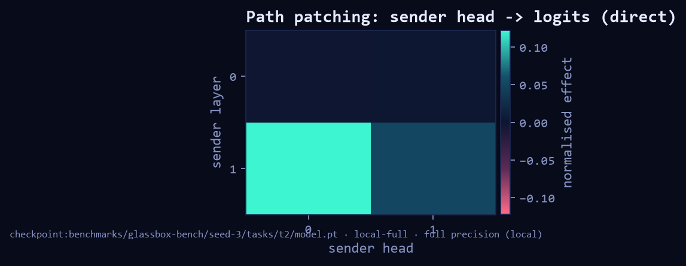

# t2: a two-token lookup f(first, last) in a 2-layer, 2-head transformer

**Behavior:** Input BOS + 4 tokens from 6 symbols (ids 2..7: bo, ge, mu, fi, te, ra); the model outputs one symbol at the last position. All numbers are from the local-full backend (full precision).  
**Model:** `checkpoint:benchmarks/glassbox-bench/seed-3/tasks/t2/model.pt` on `local-full`  
**Status:** partial / not verified · verified (5-component circuit; with caveats on head 0.0 and on the random control)  
**Experiments run:** 18 · **Backends used:** full precision (local)  
**Written:** 2026-11-13 12:51

## Summary

The model computes a fixed 6x6 lookup table of the FIRST input token (pos 1) and the LAST input token (pos 4); the two middle tokens are ignored. The table, read off the model's own outputs, reproduces the model on 200/200 held-out inputs in each of three held-out sets. No closed-form rule for the table was found (rows are not permutations, so it is not a group operation or modular sum). Mechanism: layer 0 processes the first and last tokens in place (MLP0 is essential; heads 0.0 and 0.1 attend mostly to the token itself at pos 1 and enrich it); layer-1 heads 1.0 and 1.1 attend from the last position to pos 1 and move the first token's representation there; MLP1 at the last position combines both tokens and writes most of the answer. No head or MLP is fully inert: the unused parts of the model are positions 2 and 3. Head 0.0 is the weakest component and the circuit without it passes verification, but it still carries a minority share of the logit margin.

## The recovered algorithm

```python
T = {2:[4,4,6,5,2,5], 3:[2,5,2,3,5,5], 4:[7,5,6,4,4,3], 5:[4,5,3,3,6,7], 6:[5,3,7,5,5,3], 7:[2,6,2,4,7,2]}  # T[first][last-2], token ids

def predict(tokens, prompt):
    a = tokens[1]   # first input token; held at pos 1 through layer 0 (E0004), enriched by MLP0 and heads 0.0/0.1 (E0015, E0018)
    d = tokens[4]   # last input token; processed in place at pos 4 (E0004)
    # tokens[2], tokens[3] are ignored (E0004: effects < 0.004)
    # layer 1: heads 1.0/1.1 move a from pos 1 to pos 4 (E0009, E0010); MLP1 combines a and d (E0013, E0017)
    return T[a][d - 2]
```

## Circuit


## Claims and evidence

| # | Claim | Evidence | Produced by |
|---|---|---|---|
| 1 | The model does the behaviour deterministically: 200/200 top-1 agreement with its dataset answers, mean logit diff 14.3. | E0002 | full precision (local) |
| 2 | The output is a lookup table of the first and last input tokens only; the table in the pseudocode matches the model on 200/200 held-out inputs in each of three held-out seeds (null agreement from task-shuffled labels: p95 about 0.24). | V0001, V0002, V0003, E0004 | full precision (local) |
| 3 | Positions 2 and 3 are unused: patching the residual stream there at either layer recovers less than 0.004 of the gap, while pos 1 recovers 0.45-0.47 and pos 4 recovers 0.53-0.56. The first token is still at pos 1 at the input to layer 1. | E0004 | full precision (local) |
| 4 | Heads 1.0 and 1.1 move the first token to the last position: from pos 4 they put 0.63 and 0.90 of their attention on pos 1, and jointly mean-ablating them leaves 0.17 of the clean logit diff. Single-head patching effects: 1.0 = 0.47, 1.1 = 0.27. | E0009, E0010, E0005 | full precision (local) |
| 5 | The movers do not write the answer directly: direct paths to the logits are 0.12 (1.0) and 0.05 (1.1) of the gap, far below their total effects, so MLP1 mediates most of it. Patching MLP1's output alone recovers 0.77 of the gap and MLP0's 0.76. | E0017, E0013, E0005 | full precision (local) |
| 6 | Layer-0 heads are part of the circuit, not inert: jointly mean-ablating 0.0 and 0.1 leaves 0.49 of the logit diff (my prediction of >= 0.5 was refuted), and the circuit without them fails sufficiency (0.48 of the logit diff, accuracy 0.855). | E0011, V0001 | full precision (local) |
| 7 | Layer-0 heads work mainly by enriching the first token in place for the movers: from pos 1 they attend to the token itself (0.70 / 0.77), their path into the movers' value input recovers 0.10 (0.0) and 0.15 (0.1) of the gap, and their direct path to the logits is about 0.002. Head 0.1 also contributes 0.07 through the movers' query input (my prediction of <= 0.05 was refuted). | E0018, E0015, E0016, E0017 | full precision (local) |
| 8 | The circuit {0.1, 1.0, 1.1, mlp0, mlp1} passes verification at full precision: ablating it leaves -0.016 of the logit diff (accuracy 0.27, near chance); ablating only the excluded head 0.0 keeps 0.79 of the logit diff and accuracy 0.985. | V0003, E0005 | full precision (local) |
| 9 | Ablating all six components leaves 0.014 of the logit diff; a whole-model circuit cannot be given a sufficiency null, so that run is reported as not-verified. | V0002, E0010 | full precision (local) |

## Verification

### V0001: t2 lookup f(first,last); circuit without layer-0 heads  (full precision (local))

| check | value |
|---|---|
| status | not-verified |
| held-out inputs | 200 |
| model accuracy | 1.000 |
| algorithm agrees with model | 1.000 |
| algorithm accuracy vs ground truth | 1.000 |
| circuit size | 4 of 6 components |
| metric kept with ONLY the circuit | 0.482 |
| metric kept with the circuit ABLATED | 0.017 |
| random same-size ablation (control) | 0.482, 0.482, 0.482 |

At least one check failed; the explanation is partial or wrong. See the numbers.



### V0002: t2 lookup f(first,last); full circuit incl. layer-0 heads  (full precision (local))

| check | value |
|---|---|
| status | not-verified |
| held-out inputs | 200 |
| model accuracy | 1.000 |
| algorithm agrees with model | 1.000 |
| algorithm accuracy vs ground truth | 1.000 |
| circuit size | 6 of 6 components |
| metric kept with ONLY the circuit | 1.000 |
| metric kept with the circuit ABLATED | 0.014 |
| random same-size ablation (control) | 0.945, 1.016, 0.928 |

The thresholds were met, but these effects do not exceed the 95th percentile of their null distribution: sufficiency. A random control does about as well, so this is not a finding.



### V0003: t2 lookup f(first,last); circuit without head 0.0  (full precision (local))

| check | value |
|---|---|
| status | verified |
| held-out inputs | 200 |
| model accuracy | 1.000 |
| algorithm agrees with model | 1.000 |
| algorithm accuracy vs ground truth | 1.000 |
| circuit size | 5 of 6 components |
| metric kept with ONLY the circuit | 0.788 |
| metric kept with the circuit ABLATED | -0.016 |
| random same-size ablation (control) | 0.788, 0.788, 0.788 |

Passed at full precision, and every effect exceeds its null distribution.



## Key plots

**E0004: activation_patching** (full precision (local))



**E0005: activation_patching** (full precision (local))



**E0009: attention_patterns** (full precision (local))



**E0017: path_patching** (full precision (local))



## Limitations

- The function is given as a 36-cell lookup table read off the model's outputs (dataset E0001); no simpler rule was found, so I cannot say whether the model deviates from an intended target function.
- Head 0.0 is excluded from the verified circuit but is not inert: ablating it alone costs about 18-21% of the logit margin (E0006 exploratory, V0003) and 1.5% accuracy. Excluding 0.1 instead was deliberately not tested; its single-ablation effect is similar (0.74, exploratory E0006), so the choice of which layer-0 head to drop is weakly determined.
- The verification's random same-size control returned identical values for every draw (V0001, V0003), so it looks degenerate for a 6-component model and adds little beyond the threshold checks.
- E0012 and E0013 were scored inconclusive because I pre-registered per-position metric paths that the primitive does not return; their all-position numbers are used only as measurements.
- MLP edges (mlp0 -> movers, mlp0 -> mlp1) are inferred from position-level patching and ablation; path patching only accepted heads as senders, so they were not tested directly.
- The per-position split of layer-0 attention (pos 1 vs pos 4) rests on the exploratory attribution screen E0003 only.
- The metric is logit diff against the corrupt prompt's answer, which under-weights cases where clean and corrupt answers are close.

## Open questions

- Is there a compact rule behind the 6x6 table (for example a composition of simpler per-token maps)?
- How does MLP1 implement the 36-cell lookup: which neurons encode which (first, last) pairs?
- Do heads 0.0 and 0.1 carry the same or complementary first-token features (their joint ablation effect is roughly additive)?

## Prediction record

12 experiments were pre-registered, 12 were run: **8 confirmed, 2 refuted, 2 inconclusive**. Hit rate (confirmed / decided): **80%**.

Refuted predictions (shown, not hidden):

| prereg | experiment | hypothesis | predicted | observed |
|---|---|---|---|---|
| N0017 | E0011 | Layer-0 heads 0.0 and 0.1 are not essential to the computation: jointly mean-ablating them keeps at least half the clean logit difference. | `summary.fraction_of_clean >= 0.5` | 0.491 |
| N0032 | E0016 | Layer-0 heads do not control where the layer-1 movers look: the path from 0.0/0.1 into the query input of 1.0/1.1 carries little of the effect (the pos 4 -> pos | `summary.top[component=0.1].effect <= 0.05` | 0.071 |

Exploratory runs (no pre-registration; they cannot be the only support for a claim): E0003, E0006, E0007, E0008, E0014.

## Experiments

| id | primitive | backend / precision | seconds | pre-registration |
|---|---|---|---|---|
| E0001 | dataset | full precision (local) | 0.17 | exploratory |
| E0002 | baseline | full precision (local) | 0.44 | N0003: confirmed |
| E0003 | attribution_patching | full precision (local) | 0.34 | exploratory |
| E0004 | activation_patching | full precision (local) | 0.29 | N0007: confirmed |
| E0005 | activation_patching | full precision (local) | 0.35 | N0009: confirmed |
| E0006 | ablation | full precision (local) | 0.27 | exploratory |
| E0007 | ablation | full precision (local) | 0.25 | exploratory |
| E0008 | attention_patterns | full precision (local) | 0.28 | exploratory |
| E0009 | attention_patterns | full precision (local) | 0.28 | N0015: confirmed |
| E0010 | ablation | full precision (local) | 0.29 | N0016: confirmed |
| E0011 | ablation | full precision (local) | 0.28 | N0017: refuted |
| E0012 | activation_patching | full precision (local) | 0.25 | N0023: inconclusive |
| E0013 | activation_patching | full precision (local) | 0.28 | N0024: inconclusive |
| E0014 | path_patching | full precision (local) | 0.31 | exploratory |
| E0015 | path_patching | full precision (local) | 0.33 | N0031: confirmed |
| E0016 | path_patching | full precision (local) | 0.31 | N0032: refuted |
| E0017 | path_patching | full precision (local) | 0.29 | N0033: confirmed |
| E0018 | attention_patterns | full precision (local) | 0.26 | N0038: confirmed |
| V0001 | verify | full precision (local) |  | verification |
| V0002 | verify | full precision (local) |  | verification |
| V0003 | verify | full precision (local) |  | verification |

## Notebook trail

- `N0001` *decision*: Loaded checkpoint:benchmarks/glassbox-bench/seed-3/tasks/t2/model.pt on local-full (full precision (local)).
- `N0002` *experiment*: dataset (E0001)
- `N0003` *prereg*: The model reliably produces its own deterministic output on the bench dataset: the correct symbol beats the corrupt-prompt answer by a clear logit margin.
- `N0004` *hypothesis* **[open]**: H1 (function): From tabulating the 200 rows of E0001, the output depends only on the first input token a (pos 1) and the last input token d (pos 4); the middle tokens (pos 2, 3) are irrelevant. Every (a,d) pair seen in E0001 maps to a single answer (all 36 cells covered, no conflicts found). The table T[a][d] (raw ids 2..7) is: a=2:[4,4,6,5,2,5]; a=3:[2,5,2,3,5,5]; a=4:[7,5,6,4,4,3]; a=5:[4,5,3,5,6,7]; a=6:[5,3,7,5,6,3]; a=7:[2,6,2,4,7,2]. No closed form found yet; treated as a lookup table.
- `N0005` *experiment*: The model reliably produces its own deterministic output on the bench dataset: the correct symbol beats the corrupt-prom (E0002)
- `N0006` *experiment*: first screen; learn output shape (E0003)
- `N0007` *prereg*: The first input token (pos 1) is still held at pos 1 at the input to layer 1 and is moved to the last position by layer-1 attention; middle positions 2 and 3 carry nothing. So patching clean resid_pre of layer 1 at pos 1 restores a substantial fraction of the logit diff.
- `N0008` *experiment*: The first input token (pos 1) is still held at pos 1 at the input to layer 1 and is moved to the last position by layer- (E0004)
- `N0009` *prereg*: Layer-1 attention moves the first-token information to the last position; head 1.0 is the main mover (largest head effect), with 1.1 secondary.
- `N0010` *experiment*: Layer-1 attention moves the first-token information to the last position; head 1.0 is the main mover (largest head effec (E0005)
- `N0011` *experiment*: learn ablation output shape; single-head mean ablation sweep (E0006)
- `N0012` *experiment*: single-MLP mean ablation sweep (E0007)
- `N0013` *experiment*: learn output shape: where does each head look from the last position (E0008)
- `N0014` *hypothesis* **[revised]**: H2 (mechanism): Layer 0 processes tokens in place at pos 1 (a) and pos 4 (d) (mainly MLP0); layer-1 heads 1.0 and 1.1 attend from pos 4 to pos 1 and move the first token's representation to the last position; MLP1 at pos 4 combines a and d into the lookup answer. Positions 2 and 3 are unused (E0004: effects < 0.004). Layer-0 heads 0.0/0.1 have smaller single-ablation effects (E0006 exploratory: 0.82 / 0.74 of clean) and are candidates for being dispensable; both MLPs are essential (E0007 exploratory: 0.15 / 0.24 of clean).
- `N0015` *prereg*: Both layer-1 heads attend from the last position (pos 4) mainly to the first input token (pos 1), on a fresh seed.
- `N0016` *prereg*: Heads 1.0 and 1.1 together are the only route by which the first token reaches the last position, so jointly mean-ablating them removes most of the logit difference.
- `N0017` *prereg*: Layer-0 heads 0.0 and 0.1 are not essential to the computation: jointly mean-ablating them keeps at least half the clean logit difference.
- `N0018` *experiment*: Both layer-1 heads attend from the last position (pos 4) mainly to the first input token (pos 1), on a fresh seed. (E0009)
- `N0019` *experiment*: Heads 1.0 and 1.1 together are the only route by which the first token reaches the last position, so jointly mean-ablati (E0010)
- `N0020` *experiment*: Layer-0 heads 0.0 and 0.1 are not essential to the computation: jointly mean-ablating them keeps at least half the clean (E0011)
- `N0021` *result*: Layer-1 heads attend pos 4 -> pos 1 (1.0: 0.63, 1.1: 0.90; E0009) and jointly ablating them leaves 0.17 of the clean logit diff (E0010): they are the main mover of the first token. REFUTED: the prediction that layer-0 heads are dispensable (>= 0.5 kept) failed, observed 0.49 (E0011). Layer-0 heads also put ~0.35-0.37 of their pos-4 attention on pos 1 (E0009), so they look like a weaker, earlier first-token route and/or in-place enrichment. They are contributors, not inert, on the logit-diff metric. (E0009, E0010, E0011)
- `N0022` *hypothesis* **[revised]** -> N0014: Revised after E0011 (refuted prediction, 0.49 < 0.5): layer-0 heads 0.0/0.1 are not dispensable on the logit-diff metric; they carry roughly half the margin jointly. The rest of H2 stands (E0004, E0005, E0009, E0010). Next: locate at which position layer-0 attention and MLP outputs matter.
- `N0023` *prereg*: Layer-0 attention matters mainly through its output at pos 1 (in-place processing of the first token, later moved by layer 1), more than through its output at pos 4.
- `N0024` *prereg*: MLP0 processes both relevant tokens in place (pos 1 and pos 4), while MLP1 acts only at the last position where it combines first and last token into the answer.
- `N0025` *experiment*: Layer-0 attention matters mainly through its output at pos 1 (in-place processing of the first token, later moved by lay (E0012)
- `N0026` *experiment*: MLP0 processes both relevant tokens in place (pos 1 and pos 4), while MLP1 acts only at the last position where it combi (E0013)
- `N0027` *note*: Corrections. (1) E0012 and E0013 scored inconclusive because my metric paths assumed per-position output; attn_out/mlp_out patching returns one all-positions value per layer. Observed: attn_out.0 = 0.42, attn_out.1 = 0.76, mlp_out.0 = 0.76, mlp_out.1 = 0.77 of the gap. These are reported as measurements, not as confirmed predictions. (2) Re-tabulating all 200 rows of E0001 with careful index alignment fixes two diagonal cells of the H1 table: (a=5,d=5)->3 and (a=6,d=6)->5. Final table T[a][d] for d=2..7: a=2:[4,4,6,5,2,5]; a=3:[2,5,2,3,5,5]; a=4:[7,5,6,4,4,3]; a=5:[4,5,3,3,6,7]; a=6:[5,3,7,5,5,3]; a=7:[2,6,2,4,7,2]. All 200 rows agree with it; all 36 cells are covered.
- `N0028` *verification*: t2 lookup f(first,last); circuit without layer-0 heads: not-verified. At least one check failed; the explanation is partial or wrong. See the numbers. (V0001)
- `N0029` *result*: V0001 (held-out seed 11, n=200, local-full): predict() = lookup T[first][last] agrees with the model on 200/200. Circuit {1.0, 1.1, mlp0, mlp1}: ablating it leaves 0.017 of clean logit diff (accuracy 0.25) -> necessary. But ablating everything else (= heads 0.0 + 0.1) leaves only 0.48 of the logit diff (accuracy 0.855), below the 0.7 sufficiency threshold -> NOT verified. Consistent with E0011: layer-0 heads belong to the circuit. Status of the 4-component circuit: rejected as incomplete. (V0001)
- `N0030` *experiment*: learn path_patching output shape (previous call with an MLP sender errored: senders must be heads); do layer-0 heads feed the value input of the layer-1 movers (E0014)
- `N0031` *prereg*: A substantial part of the layer-0 heads' effect is mediated by the value input of the layer-1 mover heads (they enrich the first-token representation at pos 1, which 1.0/1.1 then move). Replication of exploratory E0014 on a fresh seed.
- `N0032` *prereg*: Layer-0 heads do not control where the layer-1 movers look: the path from 0.0/0.1 into the query input of 1.0/1.1 carries little of the effect (the pos 4 -> pos 1 attention is mostly positional).
- `N0033` *prereg*: The mover head 1.0 does not write the answer directly: most of its effect is mediated by MLP1, so its direct path to the logits is at most about half of its total effect (0.47 in E0005).
- `N0034` *experiment*: A substantial part of the layer-0 heads' effect is mediated by the value input of the layer-1 mover heads (they enrich t (E0015)
- `N0035` *experiment*: Layer-0 heads do not control where the layer-1 movers look: the path from 0.0/0.1 into the query input of 1.0/1.1 carrie (E0016)
- `N0036` *experiment*: The mover head 1.0 does not write the answer directly: most of its effect is mediated by MLP1, so its direct path to the (E0017)
- `N0037` *result*: Path patching (seed 3, local-full). Layer-0 heads -> value input of movers 1.0/1.1: 0.0 = 0.099, 0.1 = 0.146 of the gap (E0015, confirmed; replicates exploratory E0014). Layer-0 heads -> query input of the movers: 0.0 = 0.025, 0.1 = 0.071 (E0016); my prediction of <= 0.05 for 0.1 was REFUTED, so 0.1 also contributes modestly to steering the movers' attention. Direct paths to logits: 0.0 = 0.002, 0.1 = 0.003, 1.0 = 0.122, 1.1 = 0.051 (E0017, confirmed <= 0.25): layer-0 heads have no direct effect and the movers' effect (totals 0.47 / 0.27 in E0005) is mostly mediated by MLP1. (E0015, E0016, E0017)
- `N0038` *prereg*: At pos 1 the layer-0 heads attend substantially to the first token itself (not only BOS), so their output at pos 1 carries first-token information that the layer-1 movers then read.
- `N0039` *experiment*: At pos 1 the layer-0 heads attend substantially to the first token itself (not only BOS), so their output at pos 1 carri (E0018)
- `N0040` *verification*: t2 lookup f(first,last); full circuit incl. layer-0 heads: not-verified. The thresholds were met, but these effects do not exceed the 95th percentile of their null distribution: sufficiency. A random control does about as well, so this is not a finding. (V0002)
- `N0041` *decision*: V0002 (seed 12): predict() agrees 200/200; ablating all six components leaves 0.014 of the logit diff (accuracy 0.265). But a circuit equal to the whole model has no sufficiency null, so status = not-verified (untestable, not wrong). E0018: layer-0 heads attend to the token itself from pos 1 (0.70 / 0.77), consistent with in-place enrichment of the first token. Decision, made before seeing any 5-component result: every measurement ranks 0.0 as the weakest component (patching 0.156 E0005, v-path 0.099 E0015, q-path 0.025 E0016). Final verification will test the 5-component circuit {0.1, 1.0, 1.1, mlp0, mlp1} with 0.0 as the only excluded component. This is NOT a claim that 0.0 is inert: it carries a measurable minority share. I will run this once and report whatever it returns; I will not also try dropping 0.1 to shop for a pass. (V0001, V0002, E0005, E0011, E0015, E0016, E0018)
- `N0042` *verification*: t2 lookup f(first,last); circuit without head 0.0: verified. Passed at full precision, and every effect exceeds its null distribution. (V0003)
