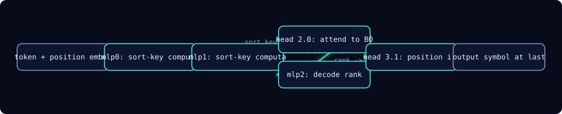
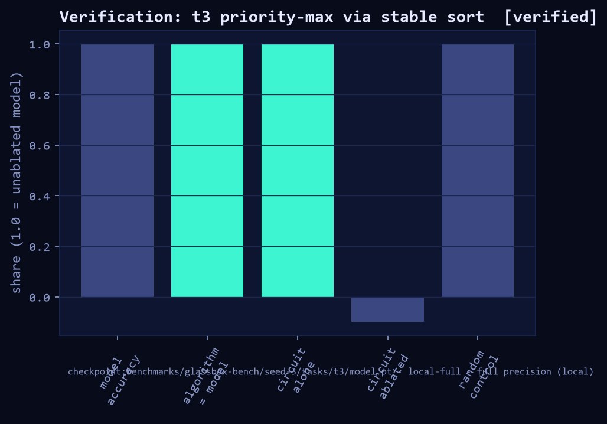
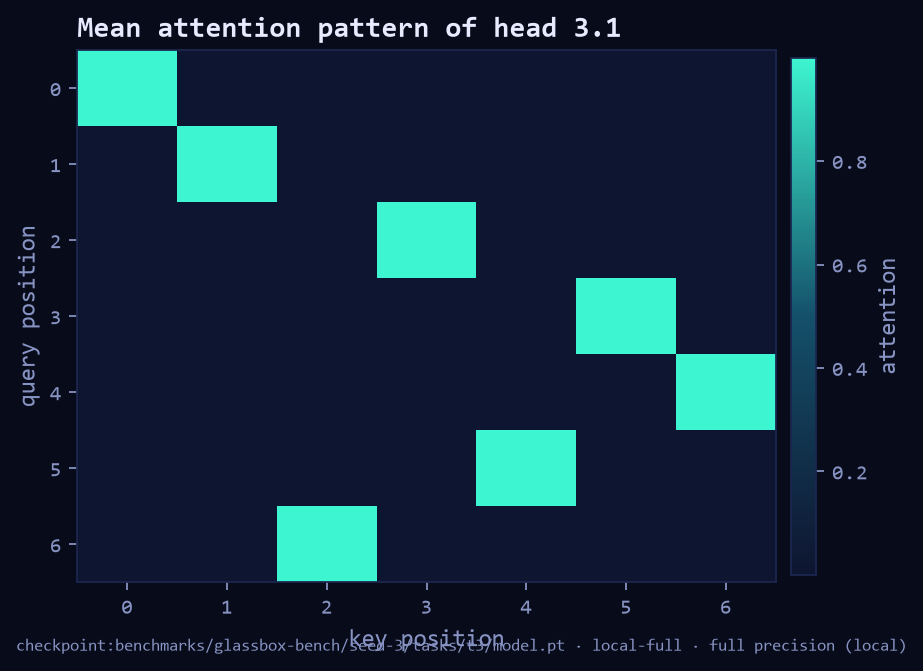
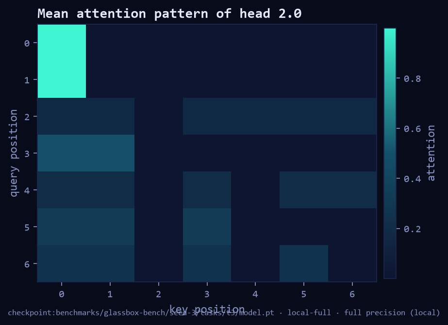
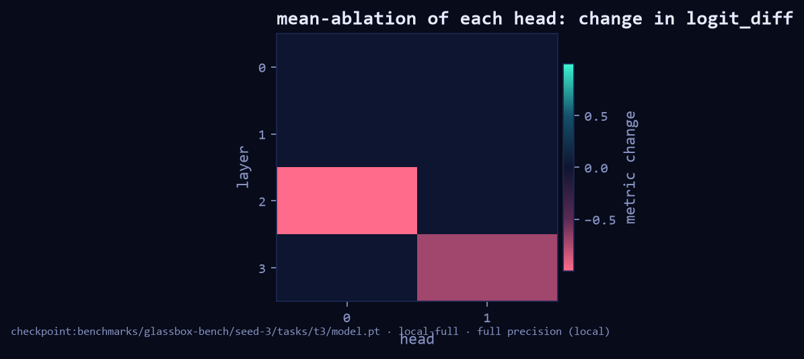
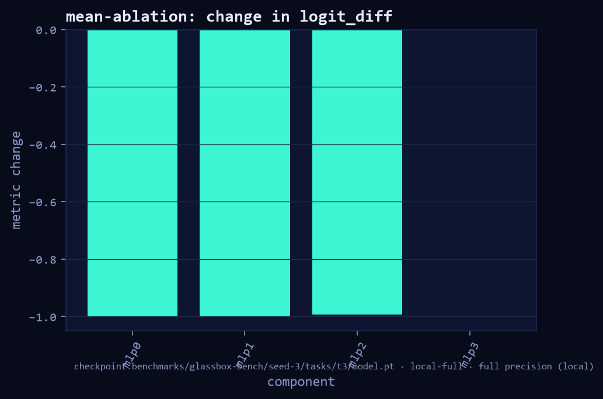

# t3: priority-max over 6 symbols, implemented as a stable sort

**Behavior:** BOS + 6 tokens from {ba, gu, ku, po, se}; the model outputs one symbol at the last position.  
**Model:** `checkpoint:benchmarks/glassbox-bench/seed-3/tasks/t3/model.pt` on `local-full`  
**Status:** verified · verified (local-full, full precision)  
**Experiments run:** 16 · **Backends used:** full precision (local)  
**Written:** 2026-11-13 12:55

## Summary

The model outputs the highest-priority symbol present in the input, with fixed priority po > gu > se > ba > ku, regardless of counts or positions. Internally it performs a full stable sort by that priority: mlp0 and mlp1 are both required before head 2.0; head 2.0 makes each position attend to BOS plus every position with a strictly lower sort key (ties broken by position), so its attention to BOS encodes 1/(1+rank); mlp2 is required between 2.0 and 3.1; head 3.1 at query position i attends with weight ~1 to the element of rank i-1 and copies its token, so the last position emits the largest element. Heads 0.0, 0.1, 1.0, 1.1, 2.1, 3.0 and mlp3 play no part. All numbers are from the local-full backend at full precision.

## The recovered algorithm

```python
prio = {ku:0, ba:1, se:2, gu:3, po:4}
# mlp0, mlp1: per-position sort key (priority, position as tiebreak)  [necessary; exact division of labour not resolved]
# head 2.0: rank[i] = #{j : key[j] < key[i]}   (attention to BOS = 1/(1+rank))
# mlp2: decode rank from the BOS-attention fraction
# head 3.1: out[i] = token at position with rank == i-1   (sorted sequence)
return max(tokens[1:], key=prio)   # value at the last position
```

## Circuit



## Claims and evidence

| # | Claim | Evidence | Produced by |
|---|---|---|---|
| 1 | The model's output equals the highest-priority symbol present, priority po > gu > se > ba > ku, independent of counts and positions: 20/20 on hand-built prompts covering low-priority-only and single-minority cases, and 200/200 agreement on held-out prompts. | E0003, V0001 | full precision (local) |
| 2 | The model computes a deterministic function with logit difference ~1.0 on every prompt (accuracy 1.0 against its own labels). | E0002 | full precision (local) |
| 3 | Head 2.0 is necessary (mean ablation leaves 0.01% of the logit difference). It attends from each position to BOS and to every position with a strictly lower sort key, ties broken by earlier position; the opposite direction (attending to higher-priority symbols) was predicted and refuted. | E0011, E0009 | full precision (local) |
| 4 | mlp0, mlp1 and mlp2 are each necessary (mean ablation leaves <1% of the logit difference); mlp3 is not (100% remains). | E0012 | full precision (local) |
| 5 | Head 3.1 is the output head: zero-ablating it removes the logit difference entirely; at query position i it attends ~0.9999 to the single position holding the element of ascending rank i-1, so the last position reads the top-priority symbol. | E0013, E0008 | full precision (local) |
| 6 | Head 2.0 feeds head 3.1 through 3.1's key input (effect 0.34 with values still corrupt) and not through its query input (effect 0.0). | E0015, E0016 | full precision (local) |
| 7 | Heads 0.0, 0.1, 1.0, 1.1, 2.1, 3.0 and mlp3 play no part: jointly mean-ablating all seven leaves 100% of the logit difference. | E0010, V0001 | full precision (local) |
| 8 | The circuit {mlp0, mlp1, 2.0, mlp2, 3.1} is necessary and sufficient on held-out data: ablating it gives fraction -0.10 (accuracy 0.245); ablating everything else gives fraction 1.0 (accuracy 1.0); all null controls passed. | V0001 | full precision (local) |

## Verification

### V0001: t3 priority-max via stable sort  (full precision (local))

| check | value |
|---|---|
| status | verified |
| held-out inputs | 200 |
| model accuracy | 1.000 |
| algorithm agrees with model | 1.000 |
| algorithm accuracy vs ground truth | 1.000 |
| circuit size | 5 of 12 components |
| metric kept with ONLY the circuit | 1.000 |
| metric kept with the circuit ABLATED | -0.098 |
| random same-size ablation (control) | 1.000, 1.000, 1.000 |

Passed at full precision, and every effect exceeds its null distribution.



## Key plots

**E0008: attention_patterns** (full precision (local))



**E0009: attention_patterns** (full precision (local))



**E0011: ablation** (full precision (local))



**E0012: ablation** (full precision (local))



## Limitations

- The attention-pattern readings of 2.0 and 3.1 (E0008, E0009) rest on a single hand-built prompt; the full-sort description at non-final positions is not tested on outputs, since only the last position is read.
- The benchmark dataset is dominated by po/gu answers; the order se > ba > ku rests on the 20 hand-built prompts in E0003.
- The individual roles of mlp0 versus mlp1 and the mlp1->2.0 and 2.0->mlp2->3.1 edges through the MLPs were not path-patched (MLP senders failed in path_patching); they are inferred from necessity plus layer order.
- The 2.0 -> 3.1 key path restores only 0.34 in a denoising patch, as expected when values stay corrupt, but the remainder was not separately attributed.

## Open questions

- What exactly do mlp0 and mlp1 each compute (priority lookup vs. position tiebreak)?
- What do the inert heads (e.g. 1.1, 2.1, 3.0, which have sharp attention patterns) compute, given that they do not affect the output?

## Prediction record

10 experiments were pre-registered, 10 were run: **9 confirmed, 1 refuted, 0 inconclusive**. Hit rate (confirmed / decided): **90%**.

Refuted predictions (shown, not hidden):

| prereg | experiment | hypothesis | predicted | observed |
|---|---|---|---|---|
| N0013 | E0009 | Head 2.0 is a comparison/counting head: each position attends to BOS plus every position holding a strictly higher-priority symbol, so the top symbol (po at pos | `data.pattern[2][0] >= 0.9` | 0.167 |

Exploratory runs (no pre-registration; they cannot be the only support for a claim): E0004, E0005, E0006, E0007, E0014.

## Experiments

| id | primitive | backend / precision | seconds | pre-registration |
|---|---|---|---|---|
| E0001 | dataset | full precision (local) | 0.25 | exploratory |
| E0002 | baseline | full precision (local) | 0.97 | N0003: confirmed |
| E0003 | baseline | full precision (local) | 0.12 | N0005: confirmed |
| E0004 | ablation | full precision (local) | 1.29 | exploratory |
| E0005 | ablation | full precision (local) | 1.09 | exploratory |
| E0006 | attention_patterns | full precision (local) | 0.15 | exploratory |
| E0007 | attention_patterns | full precision (local) | 0.14 | exploratory |
| E0008 | attention_patterns | full precision (local) | 0.12 | N0012: confirmed |
| E0009 | attention_patterns | full precision (local) | 0.11 | N0013: refuted |
| E0010 | ablation | full precision (local) | 0.93 | N0017: confirmed |
| E0011 | ablation | full precision (local) | 1.09 | N0018: confirmed |
| E0012 | ablation | full precision (local) | 0.89 | N0019: confirmed |
| E0013 | ablation | full precision (local) | 0.85 | N0020: confirmed |
| E0014 | path_patching | full precision (local) | 0.53 | exploratory |
| E0015 | path_patching | full precision (local) | 1.07 | N0026: confirmed |
| E0016 | path_patching | full precision (local) | 0.86 | N0027: confirmed |
| V0001 | verify | full precision (local) |  | verification |

## Notebook trail

- `N0001` *decision*: Loaded checkpoint:benchmarks/glassbox-bench/seed-3/tasks/t3/model.pt on local-full (full precision (local)).
- `N0002` *experiment*: dataset (E0001)
- `N0003` *prereg*: The model reproduces the benchmark's labelled outputs (its own outputs) at the last position, so there is a behaviour to explain.
- `N0004` *experiment*: The model reproduces the benchmark's labelled outputs (its own outputs) at the last position, so there is a behaviour to (E0002)
- `N0005` *prereg*: The output is the highest-priority symbol present anywhere in the 6 inputs, with fixed priority po(5) > gu(3) > se(6) > ba(1) > ku(4), independent of counts and positions.
- `N0006` *experiment*: The output is the highest-priority symbol present anywhere in the 6 inputs, with fixed priority po(5) > gu(3) > se(6) >  (E0003)
- `N0007` *hypothesis* **[supported]**: H1 (function): output = highest-priority symbol present among the 6 inputs, priority po(5) > gu(3) > se(6) > ba(1) > ku(4); independent of counts and positions. Order read off E0001 examples, tested on hand-built prompts in E0003 (20/20).
- `N0008` *experiment*: ablation (E0004)
- `N0009` *experiment*: ablation (E0005)
- `N0010` *experiment*: attention_patterns (E0006)
- `N0011` *experiment*: attention_patterns (E0007)
- `N0012` *prereg*: Head 3.1 at the last position attends to the position holding the highest-priority symbol (and copies it to the output). On BOS,ku,po,ba,gu,ba,se the top symbol po sits at position 2.
- `N0013` *prereg*: Head 2.0 is a comparison/counting head: each position attends to BOS plus every position holding a strictly higher-priority symbol, so the top symbol (po at position 2) attends only to BOS.
- `N0014` *experiment*: Head 3.1 at the last position attends to the position holding the highest-priority symbol (and copies it to the output). (E0008)
- `N0015` *experiment*: Head 2.0 is a comparison/counting head: each position attends to BOS plus every position holding a strictly higher-prior (E0009)
- `N0016` *result*: E0009 REFUTED my direction guess for 2.0: on BOS,ku,po,ba,gu,ba,se the top symbol po attends 1/6 to BOS and 1/6 to each of the 5 other symbols; the lowest (ku) attends only to BOS. So 2.0 attends to BOS + every position with a strictly LOWER sort key (ties broken by position: the second ba attends to the first ba, not vice versa). Attention to BOS = 1/(1+rank). E0008 confirmed 3.1: last position attends 0.9999 to po; moreover every query position i attends to exactly one position: the element of ascending rank i-1 (pos1->ku, pos2->ba#1, pos3->ba#2, pos4->se, pos5->gu, pos6->po). Revised picture: the model performs a full stable sort by priority (ku<ba<se<gu<po); the last position emits the largest element. (E0008, E0009)
- `N0017` *prereg*: Heads 0.0, 0.1, 1.0, 1.1, 2.1, 3.0 and mlp3 play no part in the behaviour: mean-ablating all of them jointly leaves the output intact.
- `N0018` *prereg*: Head 2.0 (rank counting) is necessary: mean-ablating it alone destroys the behaviour, while other heads except 3.1 do nothing.
- `N0019` *prereg*: MLPs 0, 1 and 2 are each necessary (key computation and rank decoding), mlp3 is not. Tested on the weakest of the three in the exploratory screen (mlp2).
- `N0020` *prereg*: Head 3.1 is the only component that writes the answer to the logits; zero-ablating it removes the logit difference entirely (mean ablation left 30% in E0004 only because the mean output is mostly 'po').
- `N0021` *experiment*: Heads 0.0, 0.1, 1.0, 1.1, 2.1, 3.0 and mlp3 play no part in the behaviour: mean-ablating all of them jointly leaves the  (E0010)
- `N0022` *experiment*: Head 2.0 (rank counting) is necessary: mean-ablating it alone destroys the behaviour, while other heads except 3.1 do no (E0011)
- `N0023` *experiment*: MLPs 0, 1 and 2 are each necessary (key computation and rank decoding), mlp3 is not. Tested on the weakest of the three  (E0012)
- `N0024` *experiment*: Head 3.1 is the only component that writes the answer to the logits; zero-ablating it removes the logit difference entir (E0013)
- `N0025` *experiment*: path_patching (E0014)
- `N0026` *prereg*: Head 2.0's rank information reaches head 3.1 through its key input (which position holds rank i), restoring a substantial part of the behaviour even when values stay corrupt.
- `N0027` *prereg*: Head 3.1's query does not use head 2.0's output (the query is the position index only); the path 2.0 -> 3.1 query has no effect.
- `N0028` *experiment*: Head 2.0's rank information reaches head 3.1 through its key input (which position holds rank i), restoring a substantia (E0015)
- `N0029` *experiment*: Head 3.1's query does not use head 2.0's output (the query is the position index only); the path 2.0 -> 3.1 query has no (E0016)
- `N0030` *verification*: t3 priority-max via stable sort: verified. Passed at full precision, and every effect exceeds its null distribution. (V0001)
- `N0031` *hypothesis* **[supported]** -> N0007: Supported: E0003 (20/20 hand-built prompts incl. low-priority-only cases) and V0001 (agreement 1.0 on 200 held-out prompts). Circuit mlp0, mlp1, 2.0, mlp2, 3.1 verified necessary and sufficient in V0001; the other 7 components are inert (E0010).
