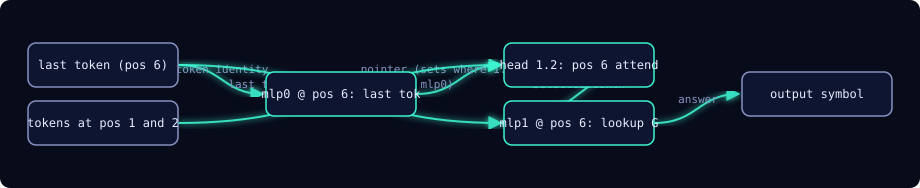
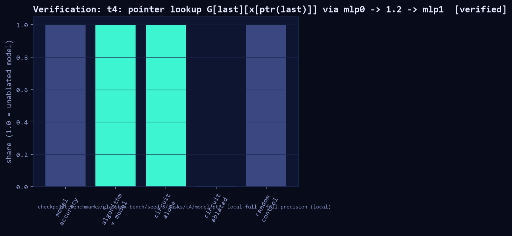
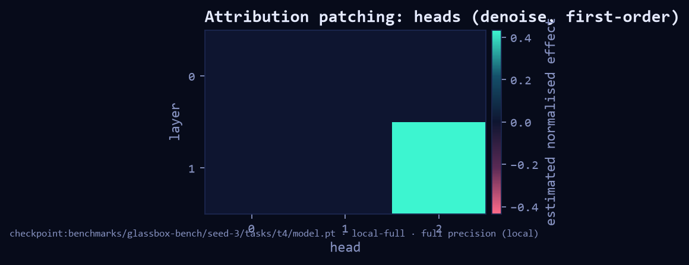
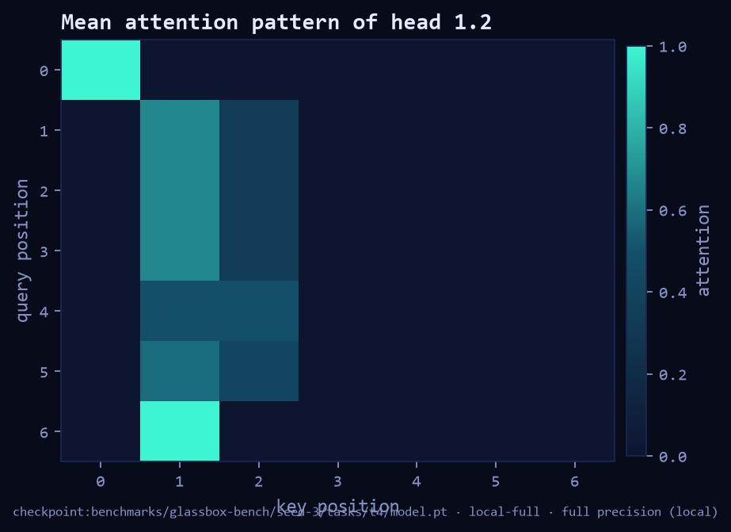
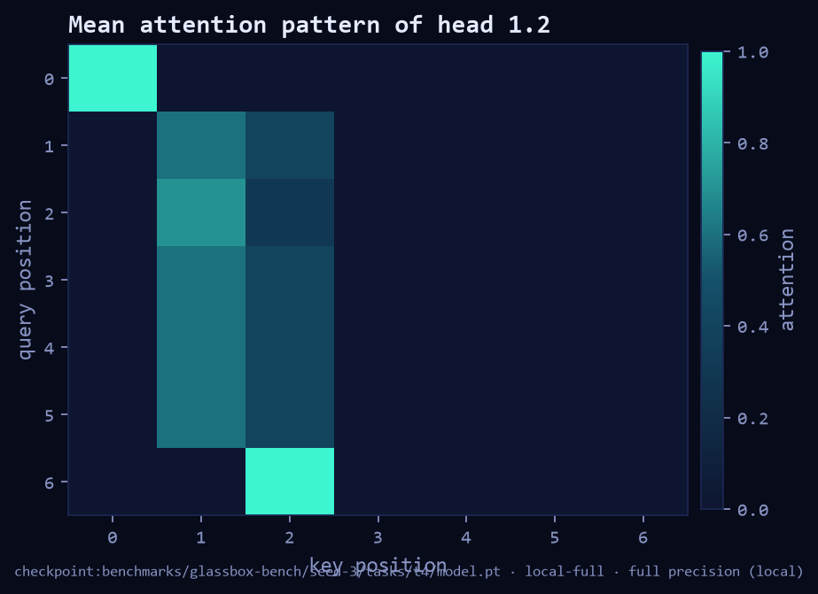
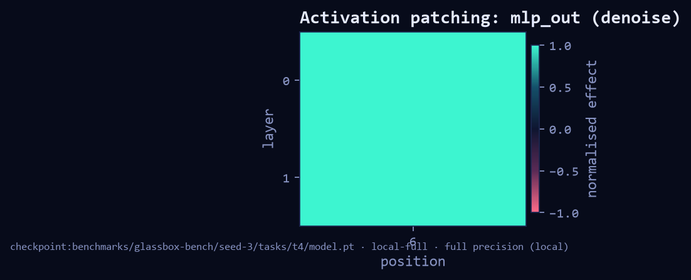

# t4: last-token-directed pointer lookup (mlp0 -> head 1.2 -> mlp1)

**Behavior:** Input BOS + 6 tokens over {fu, ko, la, nu, vo}; the model outputs one symbol at the last position.  
**Model:** `checkpoint:benchmarks/glassbox-bench/seed-3/tasks/t4/model.pt` on `local-full`  
**Status:** verified · verified  
**Experiments run:** 17 · **Backends used:** full precision (local)  
**Written:** 2026-11-13 13:03

## Summary

The model computes out = G[last][x[j]], where j = 2 if the last token is fu or ko and j = 1 if it is la, nu or vo, and G is a fixed 5x5 table. Tokens at positions 3, 4 and 5 are never used. Three components implement it: mlp0 at the last position turns the last token into a pointer, head 1.2 attends from the last position to position 1 or 2 accordingly and moves that token, and mlp1 at the last position maps (last token, moved token) to the output. Heads 0.0, 0.1, 0.2, 1.0 and 1.1 play no part. All numbers are from local-full (full precision). Held-out verification V0001 (n=400, seed 7): predict() agrees with the model on 100% of inputs; ablating the circuit leaves 0.4% of the metric; ablating everything else leaves 100%.

## The recovered algorithm

```python
ids: 0 BOS, 2 fu, 3 ko, 4 la, 5 nu, 6 vo
last = tokens[6]
j = 2 if last in (fu, ko) else 1            # mlp0 @ last position
b = tokens[j]                                # head 1.2, last position -> position j
G = {fu: {fu:ko, ko:nu, la:vo, nu:vo, vo:ko},
     ko: {fu:nu, ko:ko, la:la, nu:la, vo:nu},
     la: {fu:nu, ko:vo, la:vo, nu:vo, vo:nu},
     nu: {fu:nu, ko:la, la:fu, nu:la, vo:ko},
     vo: {fu:nu, ko:vo, la:la, nu:vo, vo:nu}}
return G[last][b]                            # mlp1 @ last position
```

## Circuit



## Claims and evidence

| # | Claim | Evidence | Produced by |
|---|---|---|---|
| 1 | The model reproduces its recorded outputs on 100% of 200 inputs (local-full). | E0003 | full precision (local) |
| 2 | The function is out = G[last][x[j]] with j = 2 for last in {fu, ko} and j = 1 for last in {la, nu, vo}; the rule was read off 100 examples (E0001) and agrees with the model on 400/400 held-out inputs. | E0001, V0001 | full precision (local) |
| 3 | Head 1.2 attends from the last position entirely (1.00) to position 1 when the last token is la/nu/vo and entirely (1.00) to position 2 when it is fu/ko. | E0007, E0008, E0006 | full precision (local) |
| 4 | mlp1 is necessary: mean-ablating it alone leaves -0.7% of the clean metric; ablating 1.2 together with mlp1 gives the same. | E0011, E0009 | full precision (local) |
| 5 | mlp0 is part of the circuit: mean-ablating it alone leaves 64% of the metric, which accounts for the whole loss seen when all six non-{1.2, mlp1} components were ablated (a refuted prediction). | E0012, E0010 | full precision (local) |
| 6 | mlp0 at the last position carries the pointer and nothing else that matters: patching it restores 100% on pairs whose last tokens are in different pointer classes and 0% on pairs whose last tokens differ within a class. | E0016, E0017, E0015 | full precision (local) |
| 7 | Heads 0.0, 0.1, 0.2, 1.0 and 1.1 play no part: mean-ablating all five jointly leaves 100% of the metric; with everything outside {mlp0, 1.2, mlp1} ablated the model is still 100% accurate. | E0013, V0001, E0004 | full precision (local) |

## Verification

### V0001: t4: pointer lookup G[last][x[ptr(last)]] via mlp0 -> 1.2 -> mlp1  (full precision (local))

| check | value |
|---|---|
| status | verified |
| held-out inputs | 400 |
| model accuracy | 1.000 |
| algorithm agrees with model | 1.000 |
| algorithm accuracy vs ground truth | 1.000 |
| circuit size | 3 of 8 components |
| metric kept with ONLY the circuit | 1.000 |
| metric kept with the circuit ABLATED | 0.004 |
| random same-size ablation (control) | 1.000, 1.000, 1.000 |

Passed at full precision, and every effect exceeds its null distribution.



## Key plots

**E0002: attribution_patching** (full precision (local))



**E0007: attention_patterns** (full precision (local))



**E0008: attention_patterns** (full precision (local))



**E0016: activation_patching** (full precision (local))



## Limitations

- The table G was read off 100 examples and checked on 400 held-out random inputs, not on all 15625 inputs; exhaustive enumeration was not run.
- That the pointer enters head 1.2 through its query (rather than key) is inferred from mlp0 mattering only at position 6 (exploratory E0015) plus the attention switch; a direct path-patching test from mlp0 to 1.2's query failed with a tool error (mlp senders not accepted) and was not measured.
- That mlp1 gets the last token's identity straight from the embedding is by elimination (E0017 rules out mlp0, E0013 rules out the other heads); it was not measured directly.
- No structure was found in G beyond a lookup table; whether it factors into simpler maps was not tested.
- In V0001 the three random same-size ablation sets all left 100% of the metric, so that control was uninformative about partial overlaps with the circuit.

## Open questions

- Does G decompose (e.g. through coarser token classes such as {fu, vo}, which share a column value in four of five rows)?
- What do the inert heads 0.0-0.2, 1.0, 1.1 compute, if anything coherent?

## Prediction record

10 experiments were pre-registered, 10 were run: **9 confirmed, 1 refuted, 0 inconclusive**. Hit rate (confirmed / decided): **90%**.

Refuted predictions (shown, not hidden):

| prereg | experiment | hypothesis | predicted | observed |
|---|---|---|---|---|
| N0013 | E0010 | Everything outside {1.2, mlp1} is irrelevant: jointly mean-ablating heads 0.0, 0.1, 0.2, 1.0, 1.1 and mlp0 leaves the behaviour intact. | `summary.fraction_of_clean >= 0.95` | 0.644 |

Exploratory runs (no pre-registration; they cannot be the only support for a claim): E0002, E0004, E0005, E0006, E0014, E0015.

## Experiments

| id | primitive | backend / precision | seconds | pre-registration |
|---|---|---|---|---|
| E0001 | dataset | full precision (local) | 1.12 | exploratory |
| E0002 | attribution_patching | full precision (local) | 0.6 | exploratory |
| E0003 | baseline | full precision (local) | 0.33 | N0003: confirmed |
| E0004 | ablation | full precision (local) | 0.39 | exploratory |
| E0005 | attention_patterns | full precision (local) | 0.33 | exploratory |
| E0006 | attention_patterns | full precision (local) | 0.14 | exploratory |
| E0007 | attention_patterns | full precision (local) | 0.13 | N0010: confirmed |
| E0008 | attention_patterns | full precision (local) | 0.14 | N0011: confirmed |
| E0009 | ablation | full precision (local) | 0.32 | N0012: confirmed |
| E0010 | ablation | full precision (local) | 0.29 | N0013: refuted |
| E0011 | ablation | full precision (local) | 0.31 | N0014: confirmed |
| E0012 | ablation | full precision (local) | 0.31 | N0021: confirmed |
| E0013 | ablation | full precision (local) | 0.29 | N0022: confirmed |
| E0014 | activation_patching | full precision (local) | 0.2 | exploratory |
| E0015 | activation_patching | full precision (local) | 0.22 | exploratory |
| E0016 | activation_patching | full precision (local) | 0.09 | N0027: confirmed |
| E0017 | activation_patching | full precision (local) | 0.08 | N0028: confirmed |
| V0001 | verify | full precision (local) |  | verification |

## Notebook trail

- `N0001` *decision*: Loaded checkpoint:benchmarks/glassbox-bench/seed-3/tasks/t4/model.pt on local-full (full precision (local)).
- `N0002` *experiment*: dataset (E0001)
- `N0003` *prereg*: The model deterministically produces its own recorded outputs on the bench dataset (the behaviour exists and is sharp).
- `N0004` *experiment*: First screen: heads / layers / positions. (E0002)
- `N0005` *experiment*: The model deterministically produces its own recorded outputs on the bench dataset (the behaviour exists and is sharp). (E0003)
- `N0006` *hypothesis* **[revised]**: H1 (function, from reading E0001's 100 examples): output = G[last][x[j]], where j = position 2 if last token in {fu(2), ko(3)} else position 1, and G is a 5x5 lookup table (rows last id 2..6, cols selected id 2..6): G[2]={2:3,3:5,4:6,5:6,6:3}; G[3]={2:5,3:3,4:4,5:4,6:5}; G[4]={2:5,3:6,4:6,5:6,6:5}; G[5]={2:5,3:4,4:2,5:4,6:3}; G[6]={2:5,3:6,4:4,5:6,6:5}. Positions 3,4,5 are irrelevant. H2 (mechanism, from exploratory screen E0002): head 1.2 at the last position attends to position 1 or 2 depending on the last token and moves that token; mlp1 at the last position does the table lookup. Layer 0 (heads 0.0-0.2, mlp0) and heads 1.0, 1.1 play no part.
- `N0007` *experiment*: Look at the ablation output shape; per-head mean ablation. (E0004)
- `N0008` *experiment*: Shape of attention_patterns output for head 1.2 from the last position. (E0005)
- `N0009` *experiment*: Custom inputs whose last token is fu or ko: where does 1.2 look from the last position? Also checks custom-token input format and output shape. (E0006)
- `N0010` *prereg*: Head 1.2, from the last position, puts essentially all its attention on position 1 when the last token is la, nu or vo.
- `N0011` *prereg*: Head 1.2, from the last position, puts essentially all its attention on position 2 when the last token is fu or ko (fresh inputs, not those of E0006).
- `N0012` *prereg*: Head 1.2 and mlp1 together are necessary: mean-ablating both destroys the behaviour.
- `N0013` *prereg*: Everything outside {1.2, mlp1} is irrelevant: jointly mean-ablating heads 0.0, 0.1, 0.2, 1.0, 1.1 and mlp0 leaves the behaviour intact.
- `N0014` *prereg*: mlp1 alone is necessary: it computes the lookup from (last token, token moved by 1.2) to the output symbol.
- `N0015` *experiment*: Head 1.2, from the last position, puts essentially all its attention on position 1 when the last token is la, nu or vo. (E0007)
- `N0016` *experiment*: Head 1.2, from the last position, puts essentially all its attention on position 2 when the last token is fu or ko (fres (E0008)
- `N0017` *experiment*: Head 1.2 and mlp1 together are necessary: mean-ablating both destroys the behaviour. (E0009)
- `N0018` *experiment*: Everything outside {1.2, mlp1} is irrelevant: jointly mean-ablating heads 0.0, 0.1, 0.2, 1.0, 1.1 and mlp0 leaves the be (E0010)
- `N0019` *experiment*: mlp1 alone is necessary: it computes the lookup from (last token, token moved by 1.2) to the output symbol. (E0011)
- `N0020` *result*: local-full. 1.2 attention from pos 6: 1.00 on pos 1 when last is la/nu/vo (E0007), 1.00 on pos 2 when last is fu/ko (E0008). Mean-ablating {1.2, mlp1} -> fraction_of_clean -0.007 (E0009); mlp1 alone -> -0.007 (E0011). REFUTED: jointly mean-ablating 0.0, 0.1, 0.2, 1.0, 1.1, mlp0 leaves only 0.644 (E0010), not >= 0.95. So H2's claim that everything outside {1.2, mlp1} is irrelevant is wrong as stated; heads were individually harmless in the exploratory sweep E0004, so the suspect is mlp0 (not covered by that sweep) or a joint effect of the heads. (E0007, E0008, E0009, E0010, E0011)
- `N0021` *prereg*: The loss in E0010 comes from mlp0: mean-ablating mlp0 alone reduces the metric noticeably, i.e. mlp0 is part of the circuit.
- `N0022` *prereg*: The five heads other than 1.2 are jointly irrelevant: mean-ablating 0.0, 0.1, 0.2, 1.0, 1.1 together leaves the behaviour intact.
- `N0023` *experiment*: The loss in E0010 comes from mlp0: mean-ablating mlp0 alone reduces the metric noticeably, i.e. mlp0 is part of the circ (E0012)
- `N0024` *experiment*: The five heads other than 1.2 are jointly irrelevant: mean-ablating 0.0, 0.1, 0.2, 1.0, 1.1 together leaves the behaviou (E0013)
- `N0025` *experiment*: At which position does mlp0 matter? Also output shape. (E0014)
- `N0026` *experiment*: Per-position mlp_out patching. (E0015)
- `N0027` *prereg*: mlp0 at the last position computes the pointer (which of positions 1/2 head 1.2 should read) from the last token. Patching clean mlp0 output at pos 6 into a run whose last token belongs to the other pointer class redirects 1.2 and restores the clean answer, on pairs built so that G[corrupt_last][x2] equals the clean answer.
- `N0028` *prereg*: mlp0 at the last position carries ONLY the pointer class, not the last token's identity: when clean and corrupt differ only in the last token and both last tokens are in the same pointer class (la/nu/vo -> pos 1, or fu/ko -> pos 2), patching clean mlp0 output at pos 6 does nothing. mlp1 gets the last token's identity from elsewhere (the embedding).
- `N0029` *experiment*: mlp0 at the last position computes the pointer (which of positions 1/2 head 1.2 should read) from the last token. Patchi (E0016)
- `N0030` *experiment*: mlp0 at the last position carries ONLY the pointer class, not the last token's identity: when clean and corrupt differ o (E0017)
- `N0031` *result*: local-full. mlp0 alone mean-ablated -> 0.644 (E0012), accounting for all of E0010's loss; the five other heads jointly -> 1.000 (E0013). mlp0 matters only at pos 6 (exploratory E0015). Cross-pointer-class pairs: patching clean mlp0@6 restores 1.00 (E0016); same-class pairs: 0.00 (E0017). So mlp0 at the last position turns the last token into a 2-way pointer (fu/ko -> pos 2, la/nu/vo -> pos 1) and carries nothing else that matters. H2 revised: circuit = mlp0 -> (query of) 1.2 -> mlp1. (E0012, E0013, E0016, E0017)
- `N0032` *hypothesis* **[revised]** -> N0006: E0010 refuted "everything outside {1.2, mlp1} is irrelevant": mlp0 is needed (E0012) as the pointer computation at the last position (E0016, E0017). Revised circuit: mlp0 (last token -> pointer), head 1.2 (reads position 1 or 2 per pointer, E0007/E0008), mlp1 (lookup G[last][selected], E0011). Heads 0.0, 0.1, 0.2, 1.0, 1.1 are inert (E0013). The function H1 is unchanged.
- `N0033` *verification*: t4: pointer lookup G[last][x[ptr(last)]] via mlp0 -> 1.2 -> mlp1: verified. Passed at full precision, and every effect exceeds its null distribution. (V0001)
