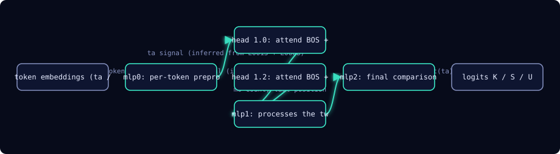
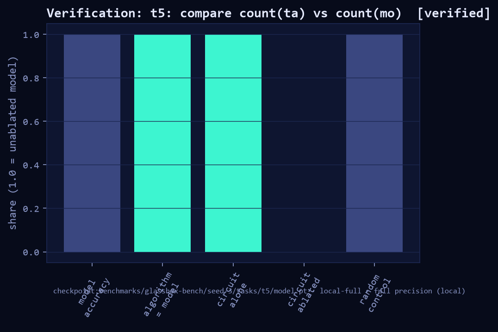
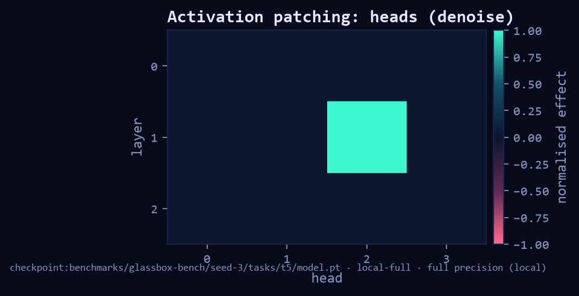
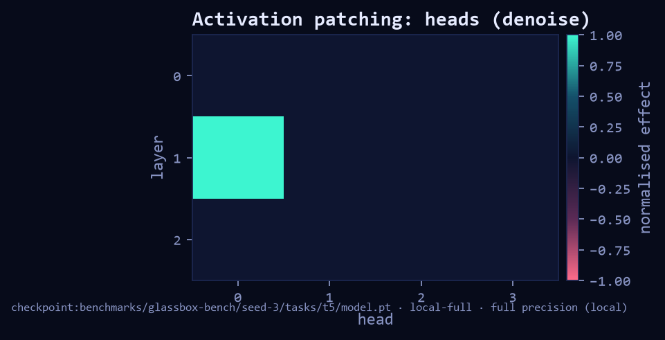
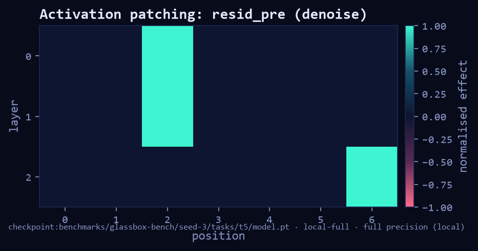
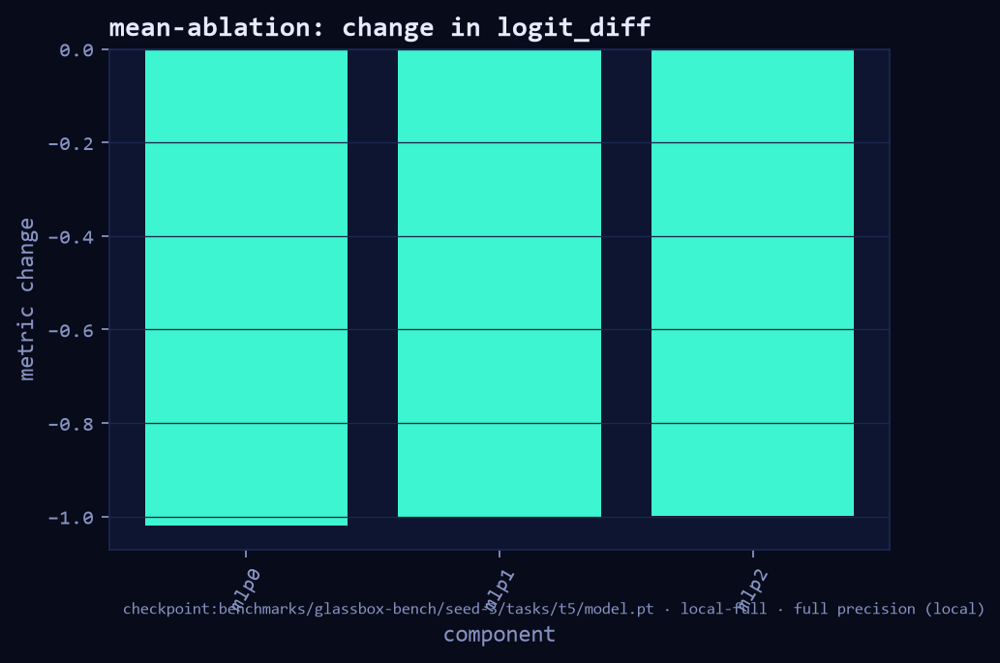

# t5 (glassbox-bench seed-3): three-way comparison of count(ta) vs count(mo)

**Behavior:** Input BOS + 6 tokens from {ta, mo, la, me, ba, le}; at the last position the model outputs one of K / S / U.  
**Model:** `checkpoint:benchmarks/glassbox-bench/seed-3/tasks/t5/model.pt` on `local-full`  
**Status:** verified  
**Experiments run:** 15 · **Backends used:** full precision (local)  
**Written:** 2026-11-13 13:07

## Summary

The model outputs U if 'ta' occurs more often than 'mo' in the 6 input tokens, S if it occurs less often, and K if the counts are equal; the other four symbols are ignored. The rule agrees with the model on 200/200 held-out inputs (V0001, local-full, full precision). The circuit is head 1.0 (collects ta), head 1.2 (collects mo), and all three MLP layers; the other ten heads are inert. Circuit ablated: metric -0.0004, accuracy 0.35 (chance for 3 classes); everything else ablated: metric 1.0, accuracy 1.0. All numbers are from the local-full backend.

## The recovered algorithm

```python
def predict(tokens, prompt):
    seq = tokens[1:]                 # drop BOS
    n_ta = seq.count(7)              # head 1.0: attends BOS + every 'ta' (E0008, E0011)
    n_mo = seq.count(6)              # head 1.2: attends BOS + every 'mo' (E0007, E0012)
    # mlp0 (before the heads) and mlp1, mlp2 (after) are all required (E0014)
    if n_ta > n_mo: return 10        # 'U'
    if n_ta < n_mo: return 9         # 'S'
    return 8                         # 'K'
```

## Circuit



## Claims and evidence

| # | Claim | Evidence | Produced by |
|---|---|---|---|
| 1 | The model performs a deterministic 3-class behaviour (clean accuracy 1.0 on 200 prompts). | E0002 | full precision (local) |
| 2 | The function is: U if count(ta) > count(mo), S if count(ta) < count(mo), K if equal. This rule matches the model on 200/200 held-out inputs (null agreement 0.33). | V0001, E0001 | full precision (local) |
| 3 | Head 1.0 is the sole carrier of the ta count: in a ta-only contrast, patching head 1.0 alone restores the clean output completely (effect 1.0; every other head 0.0). | E0008, E0006 | full precision (local) |
| 4 | Head 1.2 is the sole carrier of the mo count: in a mo-only contrast, patching head 1.2 alone restores the clean output completely (effect 1.0; every other head 0.0). | E0007 | full precision (local) |
| 5 | Each of the two heads splits attention between BOS and its matching tokens: with one ta (resp. mo) at position 3, attention from the last position is 0.5 on BOS and 0.5 on that token, 0 elsewhere. The BOS share thus encodes 1/(1+count). | E0011, E0012 | full precision (local) |
| 6 | Heads 1.0 and 1.2 are necessary: joint mean ablation takes the metric to -0.02 of clean. | E0009, E0003 | full precision (local) |
| 7 | The other ten heads (0.0-0.3, 1.1, 1.3, 2.0-2.3) play no part: joint mean ablation of all ten leaves the metric at 1.0. | E0010, V0001 | full precision (local) |
| 8 | All three MLP layers are necessary: mean-ablating mlp0, mlp1 or mlp2 alone takes the metric to -0.02, 0.0 and 0.002. | E0014, E0004 | full precision (local) |
| 9 | The token's information stays at its own position through layer 0 and is at the last position before layer 2: resid_pre patching has effect 1.0 at (layer 0, pos 2), (layer 1, pos 2), (layer 2, pos 6) and 0 everywhere else. So the move to the last position happens in layer 1. | E0015 | full precision (local) |
| 10 | The circuit {1.0, 1.2, mlp0, mlp1, mlp2} is necessary and sufficient on held-out data: ablating it gives metric -0.0004 / accuracy 0.35; ablating the other 10 components gives metric 1.0 / accuracy 1.0; both beat their null distributions. | V0001 | full precision (local) |

## Verification

### V0001: t5: compare count(ta) vs count(mo)  (full precision (local))

| check | value |
|---|---|
| status | verified |
| held-out inputs | 200 |
| model accuracy | 1.000 |
| algorithm agrees with model | 1.000 |
| algorithm accuracy vs ground truth | 1.000 |
| circuit size | 5 of 15 components |
| metric kept with ONLY the circuit | 1.000 |
| metric kept with the circuit ABLATED | -0.000 |
| random same-size ablation (control) | 1.000, 1.000, 1.000 |

Passed at full precision, and every effect exceeds its null distribution.



## Key plots

**E0007: activation_patching** (full precision (local))



**E0008: activation_patching** (full precision (local))



**E0015: activation_patching** (full precision (local))



**E0014: ablation** (full precision (local))



## Limitations

- The individual computations of mlp0, mlp1 and mlp2 are not resolved: they are shown to be necessary (E0014), but which one converts attention shares to counts and which one compares is not measured.
- One pre-registered prediction (E0013) was inconclusive: I assumed mlp_out patching was position-resolved; it patches all positions. Its by-product (each MLP's output alone restores the ta contrast) is suggestive of a serial chain mlp0 -> 1.0 -> mlp1 -> mlp2 but was not a pre-registered claim.
- The edges mlp0 -> heads (key vs value) are inferred, not path-patched: path_patching with an MLP sender raised an error and was not run.
- Contrast and attention experiments used small hand-written prompt sets (6-12 prompts); the dataset-level claims use 200 prompts.
- The function was verified on 200 sampled inputs out of 46656 possible; not exhaustive.

## Open questions

- What exactly does mlp0 write at each token position, and does head 1.0/1.2 read it through keys or values?
- How do mlp1 and mlp2 divide the work of turning two 1/(1+n) attention shares into a 3-way comparison?

## Prediction record

10 experiments were pre-registered, 10 were run: **9 confirmed, 0 refuted, 1 inconclusive**. Hit rate (confirmed / decided): **100%**.

No prediction was refuted.

Exploratory runs (no pre-registration; they cannot be the only support for a claim): E0003, E0004, E0005, E0006.

## Experiments

| id | primitive | backend / precision | seconds | pre-registration |
|---|---|---|---|---|
| E0001 | dataset | full precision (local) | 0.15 | exploratory |
| E0002 | baseline | full precision (local) | 0.56 | N0004: confirmed |
| E0003 | ablation | full precision (local) | 0.57 | exploratory |
| E0004 | ablation | full precision (local) | 0.38 | exploratory |
| E0005 | attention_patterns | full precision (local) | 0.42 | exploratory |
| E0006 | activation_patching | full precision (local) | 0.1 | exploratory |
| E0007 | activation_patching | full precision (local) | 0.12 | N0011: confirmed |
| E0008 | activation_patching | full precision (local) | 0.11 | N0012: confirmed |
| E0009 | ablation | full precision (local) | 0.36 | N0013: confirmed |
| E0010 | ablation | full precision (local) | 0.38 | N0014: confirmed |
| E0011 | attention_patterns | full precision (local) | 0.11 | N0019: confirmed |
| E0012 | attention_patterns | full precision (local) | 0.11 | N0020: confirmed |
| E0013 | activation_patching | full precision (local) | 0.09 | N0021: inconclusive |
| E0014 | ablation | full precision (local) | 0.41 | N0022: confirmed |
| E0015 | activation_patching | full precision (local) | 0.13 | N0028: confirmed |
| V0001 | verify | full precision (local) |  | verification |

## Notebook trail

- `N0001` *decision*: Loaded checkpoint:benchmarks/glassbox-bench/seed-3/tasks/t5/model.pt on local-full (full precision (local)).
- `N0002` *experiment*: dataset (E0001)
- `N0003` *hypothesis* **[supported]**: H1 (function): the output compares count of 'ta' (id 7) with count of 'mo' (id 6) among the 6 input tokens: U (10) if #ta > #mo, S (9) if #ta < #mo, K (8) if equal. Derived by reading the first 40 rows of E0001; all consistent. Other symbols (ba, la, le, me) are irrelevant.
- `N0004` *prereg*: The model performs its behaviour reliably: on the bench dataset its top output is its own recorded answer, with positive logit diff vs. the corrupt-prompt answer.
- `N0005` *experiment*: The model performs its behaviour reliably: on the bench dataset its top output is its own recorded answer, with positive (E0002)
- `N0006` *experiment*: First screen: which heads matter (mean ablation sweep), also to learn the output shape. (E0003)
- `N0007` *experiment*: First screen: which MLPs matter (mean ablation sweep). (E0004)
- `N0008` *experiment*: Look at output shape and where 1.0 attends from the last position. (E0005)
- `N0009` *experiment*: Shape check + first look: ta-only contrast (clean has ta, corrupt has ta replaced by ba). Which heads carry the ta count? (E0006)
- `N0010` *hypothesis* **[supported]**: H2 (where): exploratory screens E0003/E0004/E0006 suggest head 1.0 carries the 'ta' count and head 1.2 the 'mo' count to the last position (each attends to BOS + its matching tokens, so the BOS share = 1/(1+count)), and all three MLPs are needed (mlp0 before the heads, mlp1/mlp2 after, turning the two counts into a comparison). Other 10 heads are inert.
- `N0011` *prereg*: Head 1.2 is the sole carrier of the 'mo' count: in a mo-only contrast (clean has mo, corrupt has each mo replaced by la), patching head 1.2 alone from clean into corrupt restores the clean output.
- `N0012` *prereg*: Head 1.0 is the sole carrier of the 'ta' count: in a ta-only contrast on fresh prompts (corrupt has each ta replaced by le), patching head 1.0 alone restores the clean output.
- `N0013` *prereg*: Heads 1.0 and 1.2 together are necessary: mean-ablating both destroys the behaviour.
- `N0014` *prereg*: The other ten heads (all of layer 0, 1.1, 1.3, all of layer 2) play no part: mean-ablating all ten jointly leaves the behaviour intact.
- `N0015` *experiment*: Head 1.2 is the sole carrier of the 'mo' count: in a mo-only contrast (clean has mo, corrupt has each mo replaced by la) (E0007)
- `N0016` *experiment*: Head 1.0 is the sole carrier of the 'ta' count: in a ta-only contrast on fresh prompts (corrupt has each ta replaced by  (E0008)
- `N0017` *experiment*: Heads 1.0 and 1.2 together are necessary: mean-ablating both destroys the behaviour. (E0009)
- `N0018` *experiment*: The other ten heads (all of layer 0, 1.1, 1.3, all of layer 2) play no part: mean-ablating all ten jointly leaves the be (E0010)
- `N0019` *prereg*: Head 1.0 at the last position attends only to BOS and to 'ta' tokens, equally: with exactly one ta (at position 3) its attention from position 6 to position 3 is 1/2.
- `N0020` *prereg*: Head 1.2 at the last position attends only to BOS and to 'mo' tokens, equally: with exactly one mo (at position 3) its attention from position 6 to position 3 is 1/2.
- `N0021` *prereg*: After head 1.0 moves the ta signal to the last position, mlp1 at the last position processes it and is a sufficient carrier: in a contrast that differs only by ta vs ba at position 2, patching mlp1's output at position 6 restores the clean output.
- `N0022` *prereg*: All three MLP layers are necessary: mean-ablating any one, including the least critical in the exploratory sweep (mlp0), removes most of the behaviour on a fresh seed.
- `N0023` *experiment*: Head 1.0 at the last position attends only to BOS and to 'ta' tokens, equally: with exactly one ta (at position 3) its a (E0011)
- `N0024` *experiment*: Head 1.2 at the last position attends only to BOS and to 'mo' tokens, equally: with exactly one mo (at position 3) its a (E0012)
- `N0025` *experiment*: After head 1.0 moves the ta signal to the last position, mlp1 at the last position processes it and is a sufficient carr (E0013)
- `N0026` *experiment*: All three MLP layers are necessary: mean-ablating any one, including the least critical in the exploratory sweep (mlp0), (E0014)
- `N0027` *result*: E0013 prediction scored INCONCLUSIVE: I assumed mlp_out patching returns layer x position, but it patches all positions at once (columns=['all']), so data.effect[1][6] does not exist. Not re-registered with a moved target. What the run does show (not the pre-registered claim): in the ta-vs-ba contrast, patching the output of mlp0, mlp1 or mlp2 (all positions) each restores the clean answer completely (effect 1.0 each). Together with E0008 (head 1.0 alone restores it) this suggests a serial chain mlp0 -> head 1.0 -> mlp1 -> mlp2. Position-resolved evidence still needed. (E0013)
- `N0028` *prereg*: The ta signal stays at its own token position through layer 0 and is moved to the last position only in layer 1: in a contrast differing only at position 2 (ta vs ba), patching resid_pre of layer 1 at position 2 restores the clean output (and position 6 at that layer does nothing).
- `N0029` *experiment*: The ta signal stays at its own token position through layer 0 and is moved to the last position only in layer 1: in a co (E0015)
- `N0030` *verification*: t5: compare count(ta) vs count(mo): verified. Passed at full precision, and every effect exceeds its null distribution. (V0001)
- `N0031` *hypothesis* **[supported]** -> N0003: H1 supported: predict() = compare count(ta) vs count(mo) agrees with the model on 200/200 held-out inputs (V0001, seed 11); model itself is deterministic at accuracy 1.0 (E0002).
- `N0032` *hypothesis* **[supported]** -> N0010: H2 supported: 1.0 alone carries ta (E0008), 1.2 alone carries mo (E0007); each attends 0.5 BOS / 0.5 to a single matching token (E0011, E0012); joint ablation of both kills behaviour (E0009), the other 10 heads are inert jointly (E0010); every MLP is necessary (E0014); signal stays at token position until layer 1 and is at the last position before layer 2 (E0015); circuit {1.0, 1.2, mlp0, mlp1, mlp2} is necessary and sufficient on held-out data (V0001). Not resolved: the individual computations of mlp0/mlp1/mlp2 (E0013 inconclusive on the position-resolved claim; path_patching from an MLP sender raised an error and was not run).
