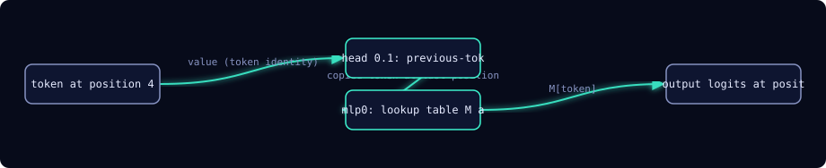
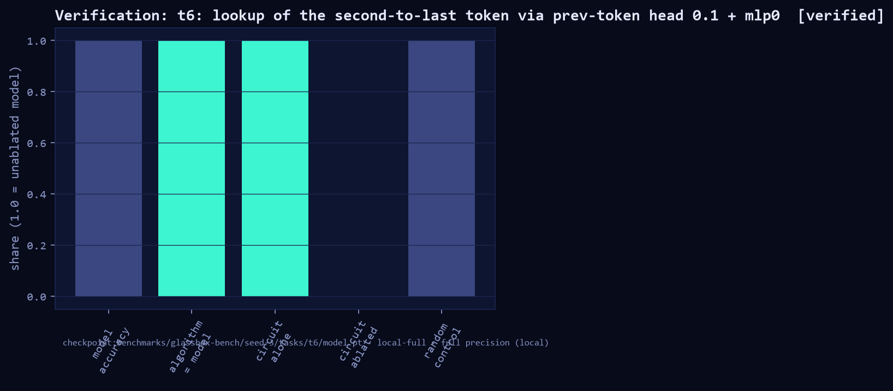
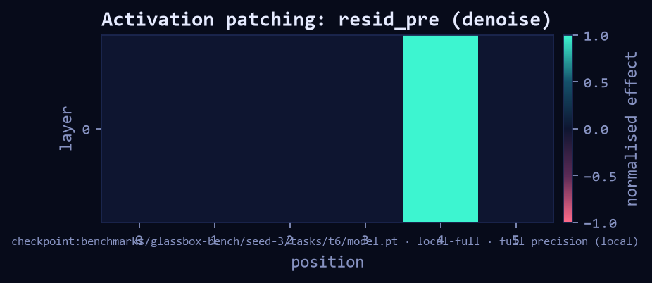
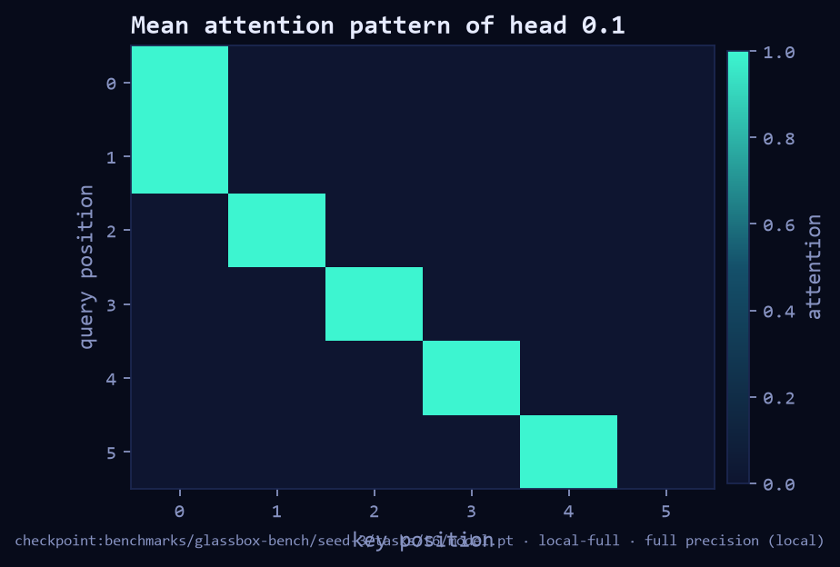
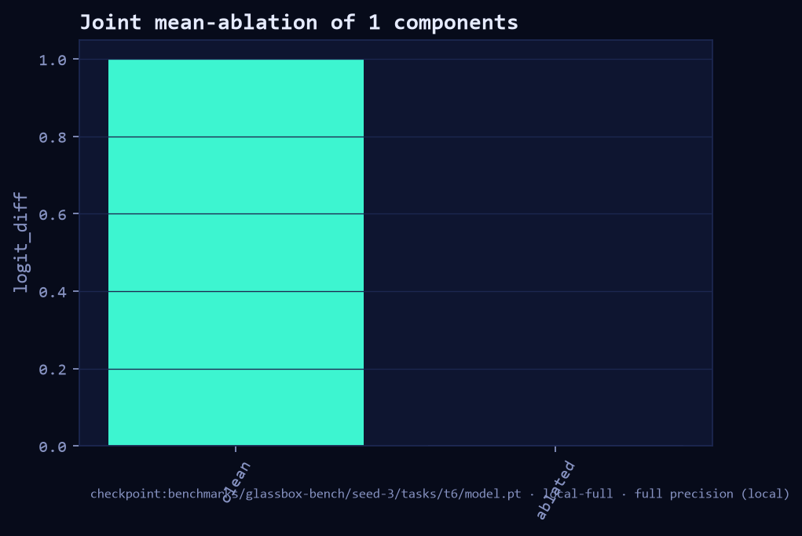

# t6: fixed symbol lookup on the second-to-last token (head 0.1 -> mlp0)

**Behavior:** BOS + 5 tokens from {ge, pe, ro, sa, zu}; the model outputs one symbol at the last position.  
**Model:** `checkpoint:benchmarks/glassbox-bench/seed-3/tasks/t6/model.pt` on `local-full`  
**Status:** verified · verified  
**Experiments run:** 13 · **Backends used:** full precision (local)  
**Written:** 2026-11-13 13:10

## Summary

The model outputs M[x4], where x4 is the fourth input symbol (token position 4, the one just before the last) and M is the fixed table ge->pe, pe->zu, ro->ge, sa->sa, zu->ro. All other inputs, including the last token itself, are ignored. Head 0.1 is a pure previous-token head that copies the position-4 token to the last position; mlp0 then applies the lookup and writes the answer. Heads 0.0 and 0.2 play no part. All numbers are from the local-full backend (full precision). Held-out verification: 300/300 agreement, circuit ablated -> metric -0.002 (accuracy 20%, chance), everything else ablated -> metric 1.0 (accuracy 100%).

## The recovered algorithm

```python
def predict(tokens, prompt):
    # tokens = [BOS, x1, x2, x3, x4, x5]
    moved = tokens[4]                      # head 0.1: last position attends to position 4 (E0012, E0010)
    M = {2: 3, 3: 6, 4: 2, 5: 5, 6: 4}     # mlp0 lookup (E0006): ge->pe, pe->zu, ro->ge, sa->sa, zu->ro
    return M[moved]
```

## Circuit



## Claims and evidence

| # | Claim | Evidence | Produced by |
|---|---|---|---|
| 1 | The model reproduces the dataset answers on 100% of prompts (the behaviour is deterministic and clean). | E0002 | full precision (local) |
| 2 | The output is a fixed lookup of the token at position 4: ge->pe, pe->zu, ro->ge, sa->sa, zu->ro. The rule agrees with the model on 300/300 held-out inputs (null agreement with shuffled labels: mean 0.20, max 0.25). | V0001, E0001 | full precision (local) |
| 3 | Before layer 0 only position 4 matters: patching the clean residual at position 4 into a corrupt run recovers 100% of the metric gap, every other position 0%. | E0010, E0008 | full precision (local) |
| 4 | After layer 0 the answer is entirely at the last position (resid_post at position 5 recovers 100%, position 4 recovers 0%). | E0011 | full precision (local) |
| 5 | Head 0.1 is necessary and is a previous-token head: mean-ablating it leaves 0.3% of the metric, and its attention from position 5 to position 4 is 1.0. | E0009, E0012, E0004, E0007 | full precision (local) |
| 6 | mlp0 is necessary: mean-ablating it leaves 0.8% of the metric; patching clean mlp_out (all positions) into a corrupt run recovers 100%. | E0006, E0013 | full precision (local) |
| 7 | Heads 0.0 and 0.2 play no part: ablating both together leaves 100% of the metric, and with everything except {0.1, mlp0} ablated the model keeps 100% accuracy. | E0005, V0001 | full precision (local) |
| 8 | The circuit {0.1, mlp0} is necessary and sufficient on held-out data: ablated -> fraction of clean -0.002 and accuracy 0.203; alone -> fraction 1.0 and accuracy 1.0; all effects beat their null distributions. | V0001 | full precision (local) |

## Verification

### V0001: t6: lookup of the second-to-last token via prev-token head 0.1 + mlp0  (full precision (local))

| check | value |
|---|---|
| status | verified |
| held-out inputs | 300 |
| model accuracy | 1.000 |
| algorithm agrees with model | 1.000 |
| algorithm accuracy vs ground truth | 1.000 |
| circuit size | 2 of 4 components |
| metric kept with ONLY the circuit | 1.000 |
| metric kept with the circuit ABLATED | -0.002 |
| random same-size ablation (control) | 1.000, 1.000, 1.000 |

Passed at full precision, and every effect exceeds its null distribution.



## Key plots

**E0010: activation_patching** (full precision (local))



**E0012: attention_patterns** (full precision (local))



**E0009: ablation** (full precision (local))



**E0006: ablation** (full precision (local))


## Limitations

- Two pre-registered predictions were scored inconclusive because the metric path I registered does not exist in the result (E0004, E0013). The observed values (0.0075 and 1.0) match the hypothesis; E0004 was re-tested on a new sample as E0009 with the same threshold.
- The lookup table was read from the model's input/output pairs, not decoded from mlp0's weights or neurons; how the 15 MLP neurons implement the table was not studied.
- mlp_out patching covers all positions at once, so 'mlp0 acts at position 5' is inferred from E0011 (only position 5 matters after the layer), not measured per position.
- No path patching was run to show directly that 0.1's output is what mlp0 reads; this follows from both being individually necessary and jointly sufficient in a one-layer model.

## Open questions

- What do the distractor heads 0.0 and 0.2 write, and into which subspace, given that it never reaches the output?
- How is the table distributed over mlp0's neurons?

## Prediction record

9 experiments were pre-registered, 9 were run: **7 confirmed, 0 refuted, 2 inconclusive**. Hit rate (confirmed / decided): **100%**.

No prediction was refuted.

Exploratory runs (no pre-registration; they cannot be the only support for a claim): E0003, E0007, E0008.

## Experiments

| id | primitive | backend / precision | seconds | pre-registration |
|---|---|---|---|---|
| E0001 | dataset | full precision (local) | 0.06 | exploratory |
| E0002 | baseline | full precision (local) | 0.31 | N0003: confirmed |
| E0003 | ablation | full precision (local) | 0.17 | exploratory |
| E0004 | ablation | full precision (local) | 0.15 | N0007: inconclusive |
| E0005 | ablation | full precision (local) | 0.14 | N0008: confirmed |
| E0006 | ablation | full precision (local) | 0.16 | N0009: confirmed |
| E0007 | attention_patterns | full precision (local) | 0.17 | exploratory |
| E0008 | activation_patching | full precision (local) | 0.16 | exploratory |
| E0009 | ablation | full precision (local) | 0.16 | N0015: confirmed |
| E0010 | activation_patching | full precision (local) | 0.25 | N0016: confirmed |
| E0011 | activation_patching | full precision (local) | 0.18 | N0017: confirmed |
| E0012 | attention_patterns | full precision (local) | 0.18 | N0018: confirmed |
| E0013 | activation_patching | full precision (local) | 0.21 | N0019: inconclusive |
| V0001 | verify | full precision (local) |  | verification |

## Notebook trail

- `N0001` *decision*: Loaded checkpoint:benchmarks/glassbox-bench/seed-3/tasks/t6/model.pt on local-full (full precision (local)).
- `N0002` *experiment*: dataset (E0001)
- `N0003` *prereg*: The model deterministically computes its output on bench inputs; since dataset answers are the model's own outputs, baseline accuracy should be ~1 with a clear logit margin.
- `N0004` *experiment*: The model deterministically computes its output on bench inputs; since dataset answers are the model's own outputs, base (E0002)
- `N0005` *experiment*: First screen: which heads matter, and the output shape of ablation. (E0003)
- `N0006` *hypothesis* **[supported]**: H1 (function): output = M[token at position 4] (the 4th of the 5 input symbols, i.e. the one just before the last), with M = {ge->pe, pe->zu, ro->ge, sa->sa, zu->ro} (ids 2->3, 3->6, 4->2, 5->5, 6->4). Read off the first 30 rows of E0001; all other positions appear irrelevant. H2 (circuit): head 0.1 attends from the last position to position 4 and moves that token's identity; mlp0 at the last position applies the lookup M. Heads 0.0 and 0.2 play no part (exploratory screen E0003: mean-ablating 0.1 leaves 0.4% of the metric, 0.0 and 0.2 leave 100%).
- `N0007` *prereg*: Head 0.1 is necessary: it is the only route by which the position-4 token reaches the last position.
- `N0008` *prereg*: Heads 0.0 and 0.2 are distractors that play no part in the behaviour, even when removed together.
- `N0009` *prereg*: mlp0 applies the lookup table M to the token moved by head 0.1, so it is necessary.
- `N0010` *experiment*: Head 0.1 is necessary: it is the only route by which the position-4 token reaches the last position. (E0004)
- `N0011` *experiment*: Heads 0.0 and 0.2 are distractors that play no part in the behaviour, even when removed together. (E0005)
- `N0012` *experiment*: mlp0 applies the lookup table M to the token moved by head 0.1, so it is necessary. (E0006)
- `N0013` *experiment*: Output shape check for attention_patterns. (E0007)
- `N0014` *experiment*: Output shape check for activation_patching by layer x position. (E0008)
- `N0015` *prereg*: Head 0.1 is necessary (re-test of N0007 on a new sample with a metric path that exists; threshold unchanged at 0.2).
- `N0016` *prereg*: Before layer 0 the output depends only on the token at position 4: patching the clean residual at position 4 into the corrupt run restores the clean answer completely.
- `N0017` *prereg*: After layer 0 the answer lives entirely at the last position (5): the layer moved the position-4 information there.
- `N0018` *prereg*: Head 0.1 is a previous-token head: from the last position (5) it puts essentially all attention on position 4.
- `N0019` *prereg*: mlp0 writes the answer at the last position: patching clean mlp_out at position 5 into the corrupt run restores the clean answer.
- `N0020` *experiment*: Head 0.1 is necessary (re-test of N0007 on a new sample with a metric path that exists; threshold unchanged at 0.2). (E0009)
- `N0021` *experiment*: Before layer 0 the output depends only on the token at position 4: patching the clean residual at position 4 into the co (E0010)
- `N0022` *experiment*: After layer 0 the answer lives entirely at the last position (5): the layer moved the position-4 information there. (E0011)
- `N0023` *experiment*: Head 0.1 is a previous-token head: from the last position (5) it puts essentially all attention on position 4. (E0012)
- `N0024` *experiment*: mlp0 writes the answer at the last position: patching clean mlp_out at position 5 into the corrupt run restores the clea (E0013)
- `N0025` *verification*: t6: lookup of the second-to-last token via prev-token head 0.1 + mlp0: verified. Passed at full precision, and every effect exceeds its null distribution. (V0001)
- `N0026` *hypothesis* **[supported]** -> N0006: H1 and H2 supported. Function: predict() agrees with the model on 300/300 held-out inputs (V0001). Circuit: head 0.1 necessary (E0009, 0.3% of metric left), attends 5->4 with weight 1.0 (E0012); only position 4 matters before the layer (E0010) and only position 5 after it (E0011); mlp0 necessary (E0006, 0.8% left); 0.0+0.2 jointly ablated leave 100% (E0005). Two predictions scored inconclusive because I gave a metric path that does not exist in the result (E0004: observed fraction 0.0075, re-tested on a new seed as E0009 with the same threshold; E0013: mlp_out is patched over all positions at once, effect 1.0, no per-position column).
