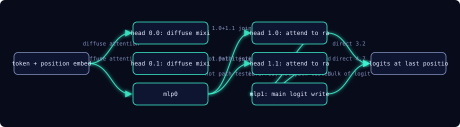
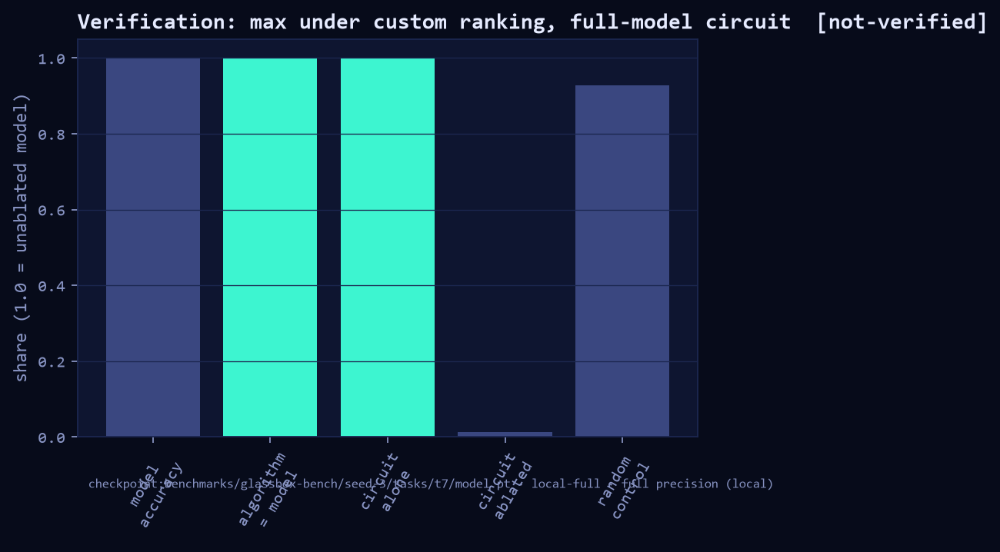
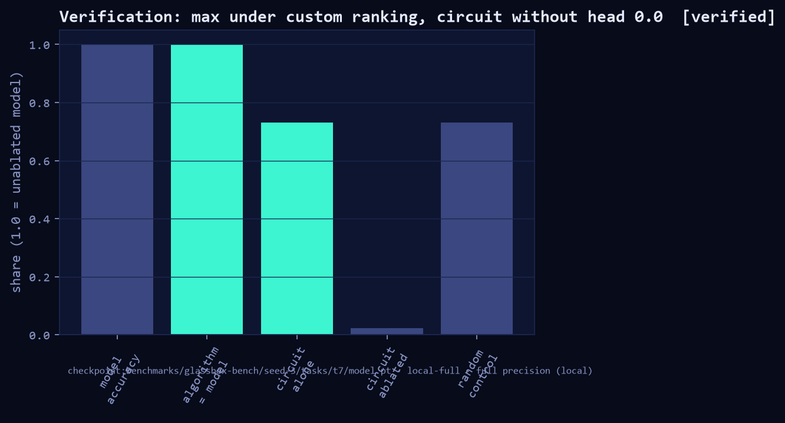
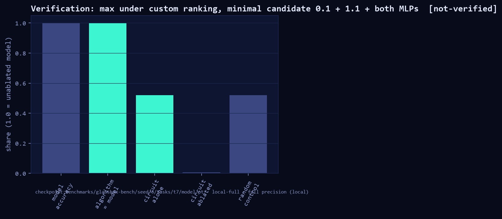
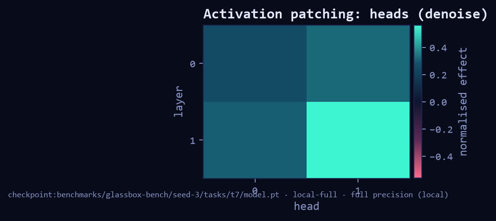
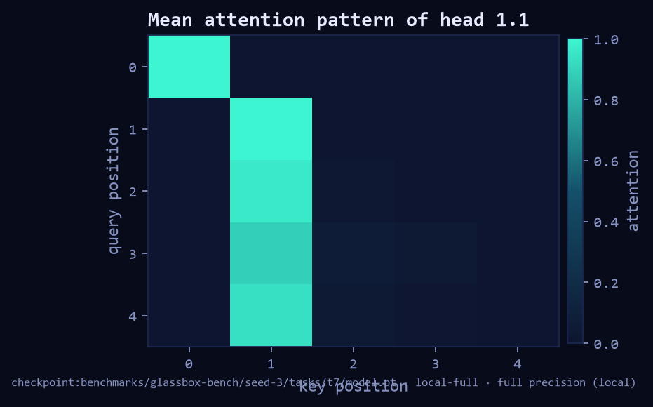
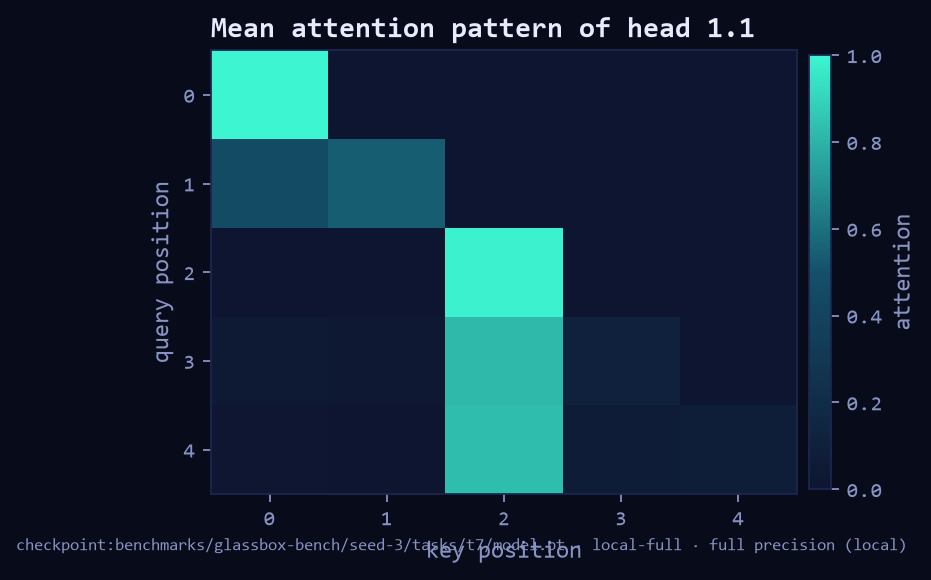
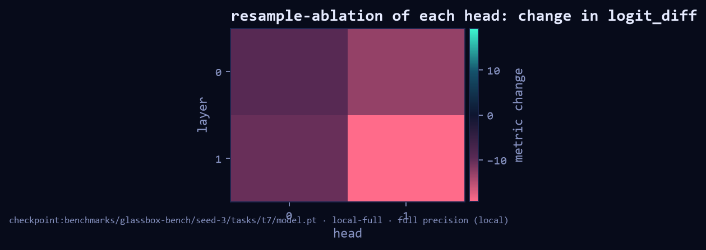
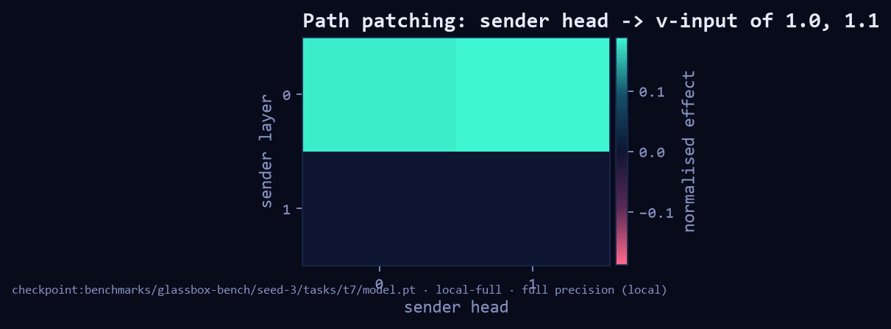

# t7: maximum under a custom symbol ranking, computed by the whole 2-layer model

**Behavior:** BOS + 4 tokens from {ve, mu, ri, vu, va, nu}; the model outputs one symbol at the last position.  
**Model:** `checkpoint:benchmarks/glassbox-bench/seed-3/tasks/t7/model.pt` on `local-full`  
**Status:** partial / not verified · function verified; circuit partial (whole model, no inert component found)  
**Experiments run:** 18 · **Backends used:** full precision (local)  
**Written:** 2026-11-13 13:14

## Summary

All numbers are from the local-full backend (full precision). The model outputs the highest-ranked of its four input symbols under the ordering nu > mu > va > vu > ri > ve, independent of position. A six-line predict() reproduces the model on 800/800 held-out inputs across four unused seeds (V0001-V0004). Mechanistically: both layer-1 heads attend from the last position to wherever the rank-maximum sits and copy it; the layer-0 heads attend diffusely and feed the layer-1 heads through their value inputs; the two MLPs carry most of the final logit. Contrary to the task brief's expectation, no head or MLP was found to be inert: every head carries 27-57% of the logit margin on its own. The heads are partially redundant (removing 0.0 or 1.0 alone keeps accuracy at 1.0 / 0.98) but removing both drops accuracy to 0.855. The claimed circuit is therefore all six components; that claim cannot be null-tested for sufficiency by the lab because it is the whole model, so its formal status is not-verified (V0001), while the five-component subsets pass as verified (V0002, V0003).

## The recovered algorithm

```python
def predict(tokens, prompt):
    # ranking read from E0001, agreement 1.0 on held-out seeds 11-14 (V0001-V0004)
    rank = {7: 5, 3: 4, 6: 3, 5: 2, 4: 1, 2: 0}   # nu > mu > va > vu > ri > ve
    xs = tokens[1:]                                # drop BOS
    # layer-1 heads attend from the last position to the rank-maximum (E0008, E0011)
    return max(xs, key=lambda t: rank[t])
```

## Circuit



## Claims and evidence

| # | Claim | Evidence | Produced by |
|---|---|---|---|
| 1 | The model does the task perfectly on its own labels (accuracy 1.0, mean logit diff 31.9). | E0002 | full precision (local) |
| 2 | The function is max over the four inputs under nu > mu > va > vu > ri > ve: predict() matches the model on 200/200 held-out inputs for each of four unused seeds (task-shuffled null agreement <= 0.45). | V0001, V0002, V0003, V0004 | full precision (local) |
| 3 | All four heads are causally involved. Exact denoising patching: 1.1 0.56, 0.1 0.32, 1.0 0.30, 0.0 0.25. Single resample ablation leaves 0.43 / 0.62 / 0.69 / 0.73 of the logit diff. No head is inert. | E0006, E0010, E0003 | full precision (local) |
| 4 | The layer-0 heads are not dispensable: jointly mean-ablating them leaves 0.34 of the logit diff (this refuted my prediction of >= 0.5). | E0009 | full precision (local) |
| 5 | Both layer-1 heads select by content: from the last position they attend to the rank-maximum wherever it is (nu at pos 1: 1.1 0.94, 1.0 0.89; vu at pos 2 among ve/ri: 1.0 0.96, 1.1 0.83). Layer-0 heads stay near-uniform (0.25-0.29) in the same conditions. | E0008, E0011, E0007 | full precision (local) |
| 6 | Layer-0 heads reach the output mainly through the value input of the layer-1 heads (0.18 and 0.19 of the gap), not through queries (0.01-0.02) or keys (0.02-0.06). The V-path result refuted my prediction of <= 0.1. | E0018, E0017, E0016 | full precision (local) |
| 7 | Both MLPs are heavily involved: patching the whole-layer output restores 0.78 (mlp0) and 0.75 (mlp1) of the gap; single mean ablation leaves 0.24 and 0.30. Heads write only 8.3 of 36.3 logit-diff units directly, so most of the final logit goes through the MLPs. (The pre-registered per-position predictions for E0014/E0015 scored inconclusive because the metric path did not exist; the whole-layer numbers are what was measured.) | E0014, E0004, E0012, E0015 | full precision (local) |
| 8 | The answer is already weakly present after layer 0 (median rank 0, logit diff 1.5, prob 0.42) and layer 1 amplifies it to 36.3. | E0013, E0014 | full precision (local) |
| 9 | Circuit size. All six components: ablating them leaves 0.01 of the metric (accuracy 0.5); sufficiency is trivially 1.0 and has no null, so status not-verified. Without 0.0: remaining five keep 0.73 of the metric and accuracy 1.0 (verified). Without 1.0: 0.71, accuracy 0.98 (verified). Without both 0.0 and 1.0: 0.52, accuracy 0.855, fails. Heads are redundant one at a time but not two at a time. | V0001, V0002, V0003, V0004 | full precision (local) |

## Verification

### V0001: max under custom ranking, full-model circuit  (full precision (local))

| check | value |
|---|---|
| status | not-verified |
| held-out inputs | 200 |
| model accuracy | 1.000 |
| algorithm agrees with model | 1.000 |
| algorithm accuracy vs ground truth | 1.000 |
| circuit size | 6 of 6 components |
| metric kept with ONLY the circuit | 1.000 |
| metric kept with the circuit ABLATED | 0.012 |
| random same-size ablation (control) | 0.838, 1.075, 0.873 |

The thresholds were met, but these effects do not exceed the 95th percentile of their null distribution: sufficiency. A random control does about as well, so this is not a finding.



### V0002: max under custom ranking, circuit without head 0.0  (full precision (local))

| check | value |
|---|---|
| status | verified |
| held-out inputs | 200 |
| model accuracy | 1.000 |
| algorithm agrees with model | 1.000 |
| algorithm accuracy vs ground truth | 1.000 |
| circuit size | 5 of 6 components |
| metric kept with ONLY the circuit | 0.731 |
| metric kept with the circuit ABLATED | 0.022 |
| random same-size ablation (control) | 0.731, 0.731, 0.731 |

Passed at full precision, and every effect exceeds its null distribution.



### V0003: max under custom ranking, circuit without head 1.0  (full precision (local))

| check | value |
|---|---|
| status | verified |
| held-out inputs | 200 |
| model accuracy | 1.000 |
| algorithm agrees with model | 1.000 |
| algorithm accuracy vs ground truth | 1.000 |
| circuit size | 5 of 6 components |
| metric kept with ONLY the circuit | 0.708 |
| metric kept with the circuit ABLATED | 0.007 |
| random same-size ablation (control) | 0.708, 0.708, 0.708 |

Passed at full precision, and every effect exceeds its null distribution.


### V0004: max under custom ranking, minimal candidate 0.1 + 1.1 + both MLPs  (full precision (local))

| check | value |
|---|---|
| status | not-verified |
| held-out inputs | 200 |
| model accuracy | 1.000 |
| algorithm agrees with model | 1.000 |
| algorithm accuracy vs ground truth | 1.000 |
| circuit size | 4 of 6 components |
| metric kept with ONLY the circuit | 0.521 |
| metric kept with the circuit ABLATED | 0.006 |
| random same-size ablation (control) | 0.521, 0.521, 0.521 |

At least one check failed; the explanation is partial or wrong. See the numbers.



## Key plots

**E0006: activation_patching** (full precision (local))



**E0008: attention_patterns** (full precision (local))



**E0011: attention_patterns** (full precision (local))



**E0010: ablation** (full precision (local))



**E0018: path_patching** (full precision (local))



## Limitations

- The brief says the model contains components that play no part. I did not find any: every head and MLP has a sizeable causal effect. If the benchmark defines 'no part' by accuracy rather than margin, heads 0.0 (accuracy 1.0 without it) and 1.0 (0.98) are the candidates, but they cannot both be dropped (0.855).
- The full six-component circuit is formally not-verified: the lab cannot draw a sufficiency null when the circuit is the whole model. Four verification runs with different circuits were made and all are reported; the 5-component 'verified' runs were not chosen as the headline because the dropped head still carries ~27-29% of the margin.
- Two pre-registered predictions (E0014, E0015) scored inconclusive because I guessed a per-position metric path that the primitive does not return. Where in the sequence layer 0 does its work is therefore unmeasured.
- The ranking of ri above ve rests on few examples in the 200-sample datasets (inputs containing only ve and ri are rare); agreement was 800/800 but that pair is thinly tested.
- MLP mechanisms are black boxes here: I showed they are necessary and carry most of the logit, not what features they compute. Edges into and out of the MLPs are inferred, not path-patched (the path-patching primitive only accepts heads as senders).
- Screening runs E0003, E0004, E0005, E0007, E0012, E0013, E0016 were exploratory.

## Open questions

- What do the two layer-1 heads key on: raw token embeddings or mlp0 output? Keys from layer-0 heads are small (E0016), so it is one of those two.
- What does the V-path from layer 0 carry: a bag-of-tokens summary that lets mlp1 confirm the maximum?
- Is there a split of labour by rank between 1.0 and 1.1 (1.0 was stronger for vu, 1.1 for nu)?

## Prediction record

10 experiments were pre-registered, 10 were run: **6 confirmed, 2 refuted, 2 inconclusive**. Hit rate (confirmed / decided): **75%**.

Refuted predictions (shown, not hidden):

| prereg | experiment | hypothesis | predicted | observed |
|---|---|---|---|---|
| N0015 | E0009 | The layer-0 heads are not essential: mean-ablating 0.0 and 0.1 jointly leaves most of the behaviour (their diffuse attention in E0008 suggests they add a bag-of | `summary.fraction_of_clean >= 0.5` | 0.344 |
| N0033 | E0018 | Layer-0 heads do not act mainly by V-composition with layer-1 heads: the direct path 0.1 -> value input of heads 1.0/1.1 carries at most 0.1 of the gap; the bul | `summary.top[component=0.1].effect <= 0.1` | 0.188 |

Exploratory runs (no pre-registration; they cannot be the only support for a claim): E0003, E0004, E0005, E0007, E0012, E0013, E0016.

## Experiments

| id | primitive | backend / precision | seconds | pre-registration |
|---|---|---|---|---|
| E0001 | dataset | full precision (local) | 0.27 | exploratory |
| E0002 | baseline | full precision (local) | 0.57 | N0004: confirmed |
| E0003 | ablation | full precision (local) | 0.4 | exploratory |
| E0004 | ablation | full precision (local) | 0.35 | exploratory |
| E0005 | attribution_patching | full precision (local) | 0.42 | exploratory |
| E0006 | activation_patching | full precision (local) | 0.36 | N0009: confirmed |
| E0007 | attention_patterns | full precision (local) | 0.37 | exploratory |
| E0008 | attention_patterns | full precision (local) | 0.09 | N0012: confirmed |
| E0009 | ablation | full precision (local) | 0.38 | N0015: refuted |
| E0010 | ablation | full precision (local) | 0.38 | N0021: confirmed |
| E0011 | attention_patterns | full precision (local) | 0.09 | N0023: confirmed |
| E0012 | direct_logit_attribution | full precision (local) | 0.39 | exploratory |
| E0013 | logit_lens | full precision (local) | 0.41 | exploratory |
| E0014 | activation_patching | full precision (local) | 0.36 | N0027: inconclusive |
| E0015 | activation_patching | full precision (local) | 0.35 | N0028: inconclusive |
| E0016 | path_patching | full precision (local) | 0.39 | exploratory |
| E0017 | path_patching | full precision (local) | 0.38 | N0032: confirmed |
| E0018 | path_patching | full precision (local) | 0.37 | N0033: refuted |
| V0001 | verify | full precision (local) |  | verification |
| V0002 | verify | full precision (local) |  | verification |
| V0003 | verify | full precision (local) |  | verification |
| V0004 | verify | full precision (local) |  | verification |

## Notebook trail

- `N0001` *decision*: Loaded checkpoint:benchmarks/glassbox-bench/seed-3/tasks/t7/model.pt on local-full (full precision (local)).
- `N0002` *experiment*: dataset (E0001)
- `N0003` *hypothesis* **[supported]**: H1 (function): from the 200 input/output pairs of E0001, the output is the maximum of the 4 input tokens under a custom ranking nu(7) > mu(3) > va(6) > vu(5) > ri(4) > ve(2). Position-independent. Read off by hand from E0001; to be tested by predict() agreement on held-out seeds.
- `N0004` *prereg*: The model performs its behaviour reliably: on the bench dataset its top-1 output equals the labelled answer (labels are the model's own outputs).
- `N0005` *experiment*: The model performs its behaviour reliably: on the bench dataset its top-1 output equals the labelled answer (labels are  (E0002)
- `N0006` *experiment*: First screen: mean-ablate each head separately, also to learn the output shape. (E0003)
- `N0007` *experiment*: Screen: mean-ablate each MLP separately. (E0004)
- `N0008` *experiment*: Screen of heads / layers / positions. (E0005)
- `N0009` *prereg*: Head 1.1 is the single most important head: patching its clean output into a corrupt run restores at least 30% of the logit difference (attribution estimate in E0005 was 0.50).
- `N0010` *experiment*: Head 1.1 is the single most important head: patching its clean output into a corrupt run restores at least 30% of the lo (E0006)
- `N0011` *experiment*: Learn the output shape; where does 1.1 look from the last position? (E0007)
- `N0012` *prereg*: Head 1.1 implements the max by content-based attention: from the last position it attends to wherever the top-ranked token (nu) sits. With nu fixed at position 1 and only lower-ranked tokens elsewhere, its attention 4->1 rises far above the dataset-average 0.16 (E0007).
- `N0013` *experiment*: Head 1.1 implements the max by content-based attention: from the last position it attends to wherever the top-ranked tok (E0008)
- `N0014` *result*: local-full. Baseline accuracy 1.0 (E0002). All four heads carry causal effect in exact denoising patching: 1.1 0.56, 0.1 0.32, 1.0 0.30, 0.0 0.25 (E0006); single mean-ablation leaves 0.50 / 0.66 / 0.72 / 0.75 of the logit diff (E0003, exploratory). Both MLPs are large: mean-ablating mlp0 leaves 0.24, mlp1 0.30 (E0004, exploratory). Attention: averaged over random inputs every head looks diffuse (E0007), but with nu pinned at pos 1 both layer-1 heads lock on to it from the last position (1.1: 0.94, 1.0: 0.89) while layer-0 heads stay near-uniform (0.29, 0.25) (E0008). So layer 1 = content-based 'attend to the top-ranked token'; layer 0 = diffuse mixing. No head is obviously inert yet. (E0003, E0004, E0005, E0006, E0007, E0008)
- `N0015` *prereg*: The layer-0 heads are not essential: mean-ablating 0.0 and 0.1 jointly leaves most of the behaviour (their diffuse attention in E0008 suggests they add a bag-of-tokens boost rather than select the max).
- `N0016` *experiment*: The layer-0 heads are not essential: mean-ablating 0.0 and 0.1 jointly leaves most of the behaviour (their diffuse atten (E0009)
- `N0017` *hypothesis* **[open]**: H2 (layer-0 heads dispensable) REJECTED by E0009: jointly mean-ablating 0.0+0.1 leaves only 0.34 of the logit diff (predicted >= 0.5). Layer-0 heads are a real part of the computation. Revised working hypothesis H3: all six components (0.0, 0.1, 1.0, 1.1, mlp0, mlp1) take part; there is no inert head or MLP in this model.
- `N0018` *verification*: max under custom ranking, full-model circuit: not-verified. The thresholds were met, but these effects do not exceed the 95th percentile of their null distribution: sufficiency. A random control does about as well, so this is not a finding. (V0001)
- `N0019` *verification*: max under custom ranking, circuit without head 0.0: verified. Passed at full precision, and every effect exceeds its null distribution. (V0002)
- `N0020` *verification*: max under custom ranking, circuit without head 1.0: verified. Passed at full precision, and every effect exceeds its null distribution. (V0003)
- `N0021` *prereg*: H3: no head is inert. Even the weakest head (0.0) loses a measurable share of the logit difference under resample ablation; an inert head would stay at ~1.0.
- `N0022` *experiment*: H3: no head is inert. Even the weakest head (0.0) loses a measurable share of the logit difference under resample ablati (E0010)
- `N0023` *prereg*: Layer-1 attention tracks the rank-maximum in general, not just the token nu: when the top-ranked token present is the mid-ranked vu(5) at position 2 (others ve/ri), head 1.1 attends from the last position mostly to position 2.
- `N0024` *experiment*: Layer-1 attention tracks the rank-maximum in general, not just the token nu: when the top-ranked token present is the mi (E0011)
- `N0025` *experiment*: Who writes the answer direction directly? (E0012)
- `N0026` *experiment*: Is the answer decodable after layer 0? (E0013)
- `N0027` *prereg*: mlp1 at the last position is the main writer of the answer: heads write only 8.3 of 36.3 logit-diff units directly (E0012), so patching clean mlp1 output at pos 4 into a corrupt run restores at least half of the gap.
- `N0028` *prereg*: Layer-0 attention does useful work at the last position itself (diffuse mixing of all four tokens into pos 4), not only at the source positions: patching clean layer-0 attn_out at pos 4 restores at least 10% of the gap.
- `N0029` *experiment*: mlp1 at the last position is the main writer of the answer: heads write only 8.3 of 36.3 logit-diff units directly (E001 (E0014)
- `N0030` *experiment*: Layer-0 attention does useful work at the last position itself (diffuse mixing of all four tokens into pos 4), not only  (E0015)
- `N0031` *experiment*: Shape check + first look: do layer-0 heads feed the layer-1 keys? (first attempt with mlp0 as sender errored: senders must be heads) (E0016)
- `N0032` *prereg*: Layer-0 heads do not act by directly steering layer-1 attention queries: the direct path 0.1 -> query input of heads 1.0/1.1 carries little (keys already small in E0016: 0.06). Their effect (0.32 total, E0006) goes through the MLPs instead.
- `N0033` *prereg*: Layer-0 heads do not act mainly by V-composition with layer-1 heads: the direct path 0.1 -> value input of heads 1.0/1.1 carries at most 0.1 of the gap; the bulk of their effect is routed through the MLPs.
- `N0034` *experiment*: Layer-0 heads do not act by directly steering layer-1 attention queries: the direct path 0.1 -> query input of heads 1.0 (E0017)
- `N0035` *experiment*: Layer-0 heads do not act mainly by V-composition with layer-1 heads: the direct path 0.1 -> value input of heads 1.0/1.1 (E0018)
- `N0036` *verification*: max under custom ranking, minimal candidate 0.1 + 1.1 + both MLPs: not-verified. At least one check failed; the explanation is partial or wrong. See the numbers. (V0004)
- `N0037` *result*: local-full. (1) Function: predict() = max under ranking nu>mu>va>vu>ri>ve agrees with the model on 200/200 held-out inputs for each of seeds 11, 12, 13, 14 (V0001-V0004). (2) No inert head: resample-ablating single heads leaves 0.43 (1.1), 0.62 (0.1), 0.69 (1.0), 0.73 (0.0) (E0010); joint mean-ablation of both layer-0 heads leaves 0.34 (E0009, refuted my 'L0 dispensable' prediction). (3) Layer-1 heads both attend from the last position to the rank-maximum whatever it is (vu at pos 2: 1.0 0.96, 1.1 0.83; E0011) and write 3.2 and 4.7 logit-diff units directly, layer-0 heads ~0.1-0.2 (E0012, exploratory); total direct head write is 8.3 of 36.3, the rest comes via the MLPs. Patching whole-layer outputs: mlp0 0.78, mlp1 0.75, attn0 0.65, attn1 0.89 (E0014, E0015; my per-position metric paths did not exist, so both predictions scored inconclusive - the per-position questions stay open). (4) After layer 0 the answer is already top-1 on the median input but weak (logit diff 1.5 vs 36.3 final, prob 0.42; E0013 exploratory). (5) Layer-0 heads feed layer-1 heads through VALUES (0.18 and 0.19; E0018, refuted my <=0.1 prediction), not queries (0.01-0.02; E0017) or keys (0.02-0.06; E0016 exploratory). (6) Circuit size: full model 6/6 passes thresholds but sufficiency has no null (V0001, status not-verified for that structural reason). Dropping 0.0 alone: rest keeps 0.73 of metric, accuracy 1.0 (V0002, verified). Dropping 1.0 alone: 0.71, accuracy 0.98 (V0003, verified). Dropping both 0.0 and 1.0: 0.52, accuracy 0.855, fails sufficiency (V0004). So the heads are partially redundant in pairs but each carries ~27-30% of the margin; none is inert. (E0009, E0010, E0011, E0012, E0013, E0014, E0015, E0016, E0017, E0018, V0001, V0002, V0003, V0004)
- `N0038` *hypothesis* **[supported]** -> N0003: H1 supported: predict() agrees with the model on 800/800 held-out inputs across four unused seeds (V0001-V0004).
