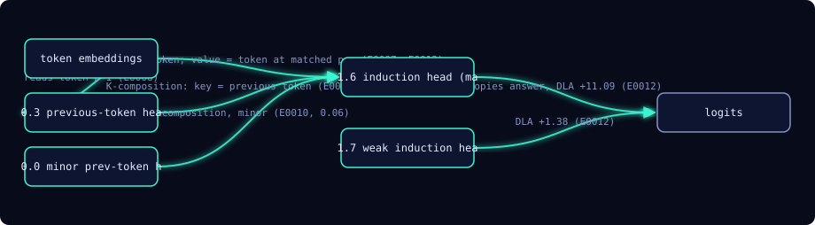
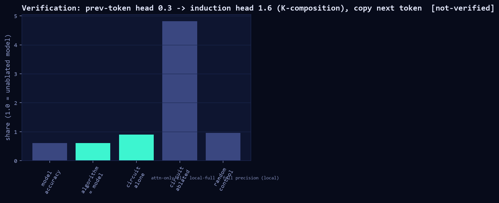
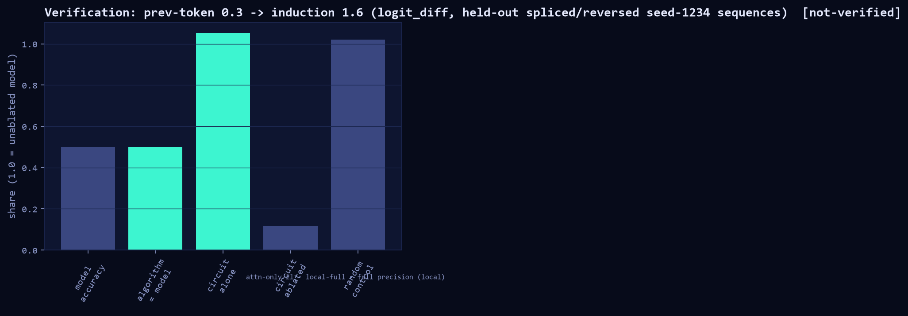
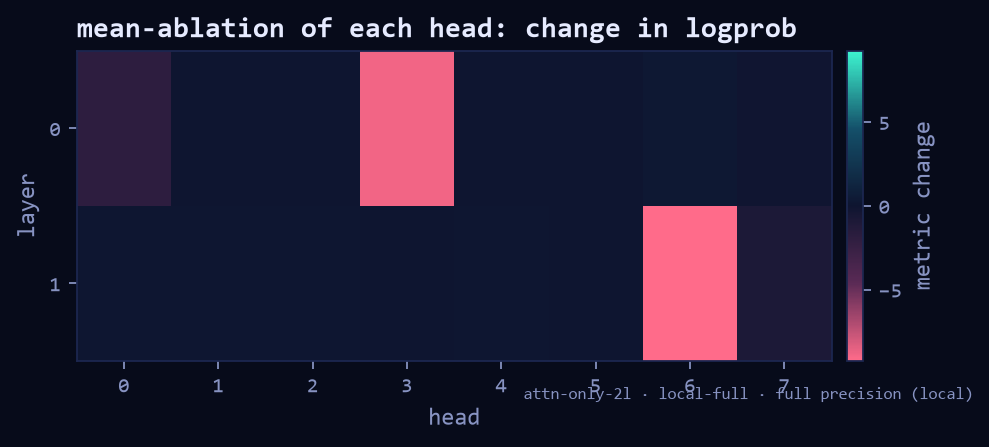
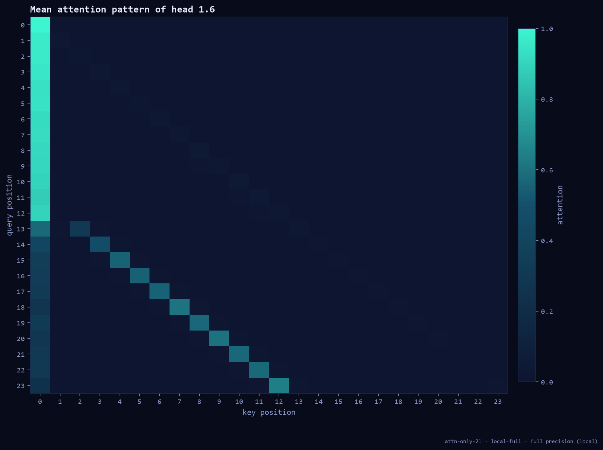
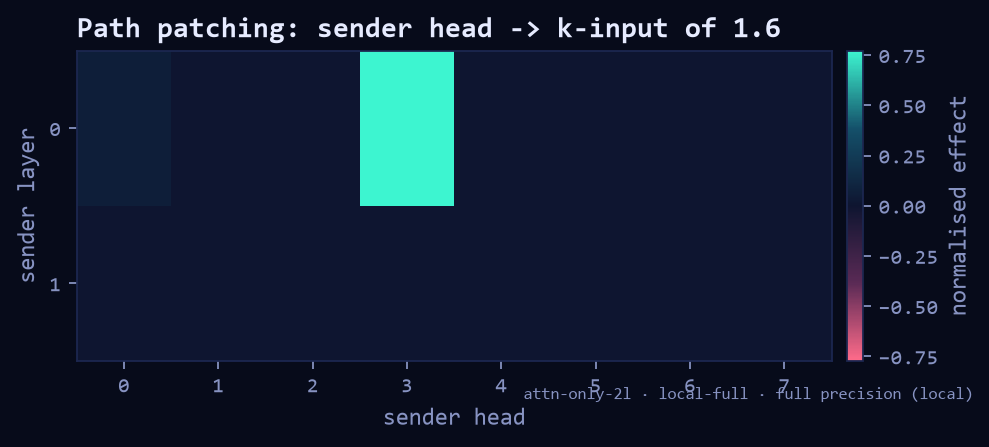
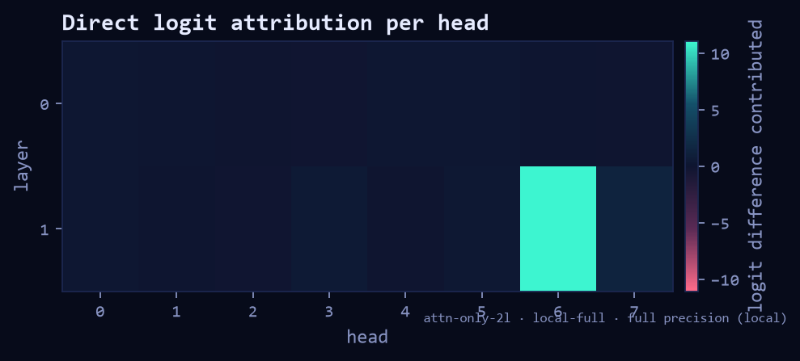
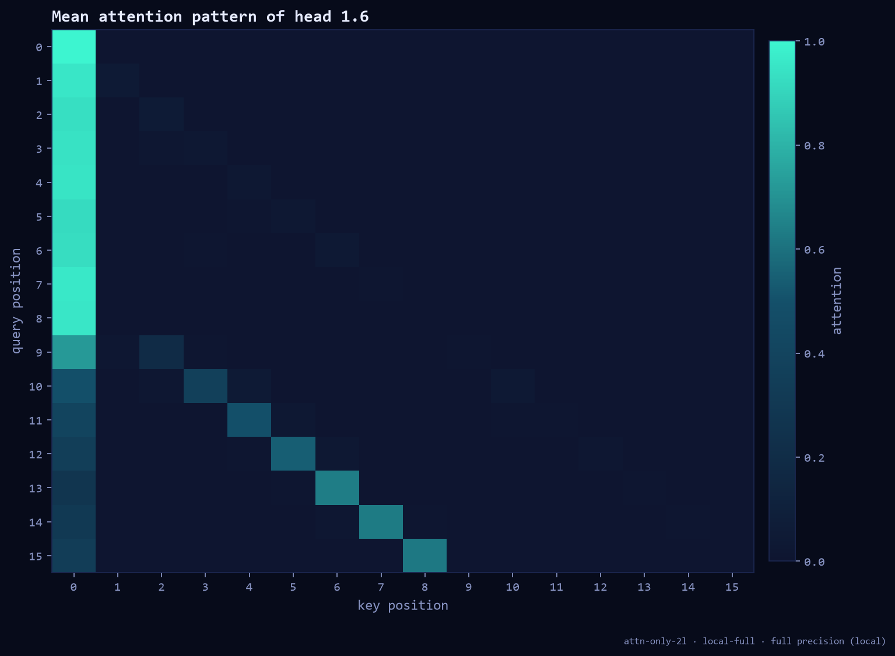

# Induction in attn-only-2l: previous-token head 0.3 -> induction head 1.6

**Behavior:** Given [BOS] + 12 random tokens + the first 11 repeated, attn-only-2l predicts the 12th token. Clean mean logprob -2.80, top-1 accuracy 0.53 (seed 0, n=64). With the first copy replaced, logprob is -15.36 (E0002). All numbers are from local-full (fp32, full precision).  
**Model:** `attn-only-2l` on `local-full`  
**Status:** partial / not verified · partial: causal checks pass at full precision, agreement check fails  
**Experiments run:** 17 · **Backends used:** full precision (local)  
**Written:** 2026-11-12 22:40

## Summary

A two-head circuit carries induction. Layer-0 head 0.3 is a previous-token head: about 0.53 of its attention goes to position p-1 (E0006). Layer-1 head 1.6 is an induction head. From the final query it attends 0.64 to the token right after the earlier occurrence of the current token (E0007). It finds that key by content, not by a fixed offset (E0013), using 0.3's output in its KEY input: patching 0.3 into 1.6.k restores 77% of a predecessor-only corruption, while the value path restores ~0 (E0009, E0010, E0011). 1.6 then writes the copied token straight to the logits (81% of the logit difference, E0012). Head 0.0 (minor previous-token signal) and head 1.7 (weak, diffuse induction) add small contributions (E0005, E0014). Joint mean-ablation of 0.3 and 1.6 collapses the behaviour (E0016). Ablating the other 12 heads improves it (E0015). On held-out prompts the circuit passes every causal check (V0002), but predict() agrees with the model only 50-60% of the time, because the model itself is wrong that often and errs toward common tokens (V0001, V0002, E0017).

## The recovered algorithm

```python
def predict(tokens, prompt):
    cur = tokens[-1]
    # L0 head 0.3: position p stores the identity of token p-1   (E0006)
    # L1 head 1.6: its query (cur) matches keys whose stored previous token == cur,
    #   via K-composition with 0.3 (E0010, E0011); content-based, not positional (E0013)
    for p in range(len(tokens) - 2, 0, -1):
        if tokens[p - 1] == cur:
            # 1.6's OV copies the token at p into the logits (DLA 81%, E0012)
            return tokens[p]
    return cur  # no earlier occurrence: 1.6 rests on BOS (E0007)
# Not modelled: the ~40-50% of cases where the model instead outputs a frequent token (E0017, V0001, V0002).
```

## Circuit



## Claims and evidence

| # | Claim | Evidence | Produced by |
|---|---|---|---|
| 1 | The model does induction far above chance: clean logprob -2.80 and accuracy 0.53 vs corrupt -15.36 (uniform would be -10.8). | E0002 | full precision (local) |
| 2 | Head 1.6 carries most of the effect: patching it alone restores 90% of the clean-corrupt gap and mean-ablating it costs 9.27 nats. Head 1.7 is second (15% restored, 0.90 nats). | E0003, E0004, E0005 | full precision (local) |
| 3 | Layer-0 head 0.3 is critical but invisible to denoising with the dataset corruption. Mean-ablating it in the clean run costs 8.84 nats (70% of the gap). 0.0 costs 1.91 nats; the other L0 heads cost under 0.26. | E0004, E0005 | full precision (local) |
| 4 | Head 0.3 is a previous-token head: mean attention 0.53 to offset -1, with most of the rest on BOS. | E0006 | full precision (local) |
| 5 | Head 1.6 attends from each second-copy token to the token after its earlier occurrence (0.64 from the final query to pos 12), and rests on BOS in the first copy. | E0007 | full precision (local) |
| 6 | The match is content-based: with 8-token repeats 1.6 attends to offset -7 (0.62 at pos 8), not -11. | E0013 | full precision (local) |
| 7 | The model needs the answer's predecessor to match: replacing only that token, with the answer kept in place, drops logprob from -3.01 to -13.37. | E0009 | full precision (local) |
| 8 | 0.3 feeds 1.6 through 1.6's KEY input (K-composition): the 0.3 -> 1.6.k path restores 0.77 of the gap; 0.0 -> 1.6.k restores 0.06; the 0.3 -> 1.6.v path restores ~0. | E0010, E0011 | full precision (local) |
| 9 | 1.6 writes the answer directly: +11.09 of a 13.75 logit difference (81%). 1.7 adds +1.38, and 0.3's direct effect is -0.19, so 0.3 acts only through 1.6. | E0012 | full precision (local) |
| 10 | 1.7 is a weak, diffuse induction head: 0.077 on pos 12 from the final query (its largest non-BOS key), with 0.49 on BOS. | E0014 | full precision (local) |
| 11 | Break tests: jointly ablating 0.3 and 1.6 gives -12.63; ablating the 12 heads outside the circuit gives -1.91, better than clean. | E0015, E0016 | full precision (local) |
| 12 | On held-out sequences with a logit-diff metric, the circuit passes every causal check: circuit ablated 0.12 of clean (accuracy 0), circuit alone 1.05, random 4-head ablations 0.94-1.07. | V0002 | full precision (local) |
| 13 | The agreement check fails: predict() agrees with the model only 0.605 (n=200) and 0.50 (n=10), exactly the model's own accuracy. predict() matches ground truth 100% of the time, and every disagreement is a model error toward a common token. | V0001, V0002 | full precision (local) |
| 14 | On prompts where the model is wrong, 1.6 still finds the right key, just more weakly (0.46 vs 0.64). The failure is a weaker copy signal losing to competitors, not a failed match. | E0017, E0007 | full precision (local) |
| 15 | In V0001 the 'breaks without circuit' check was flagged as failed because the logprob metric is negative (ratio 4.81 means worse). Behaviourally accuracy fell to 0.00; the check passes with logit diff in V0002. | V0001, V0002 | full precision (local) |

## Verification

### V0001: prev-token head 0.3 -> induction head 1.6 (K-composition), copy next token  (full precision (local))

| check | value |
|---|---|
| status | not-verified |
| held-out inputs | 200 |
| model accuracy | 0.605 |
| algorithm agrees with model | 0.605 |
| algorithm accuracy vs ground truth | 1.000 |
| circuit size | 4 of 16 components |
| metric kept with ONLY the circuit | 0.903 |
| metric kept with the circuit ABLATED | 4.811 |
| random same-size ablation (control) | 0.875, 0.850, 1.148 |

At least one check failed; the explanation is partial or wrong. See the numbers.



### V0002: prev-token 0.3 -> induction 1.6 (logit_diff, held-out spliced/reversed seed-1234 sequences)  (full precision (local))

| check | value |
|---|---|
| status | not-verified |
| held-out inputs | 10 |
| model accuracy | 0.500 |
| algorithm agrees with model | 0.500 |
| algorithm accuracy vs ground truth | 1.000 |
| circuit size | 4 of 16 components |
| metric kept with ONLY the circuit | 1.052 |
| metric kept with the circuit ABLATED | 0.116 |
| random same-size ablation (control) | 1.055, 1.069, 0.940 |

At least one check failed; the explanation is partial or wrong. See the numbers.



## Key plots

**E0005: ablation** (full precision (local))



**E0007: attention_patterns** (full precision (local))



**E0010: path_patching** (full precision (local))



**E0012: direct_logit_attribution** (full precision (local))



**E0013: attention_patterns** (full precision (local))



## Limitations

- Status: partial. The causal checks pass at full precision (V0002), but behavioural agreement fails (0.605 in V0001, 0.50 in V0002) because predict() returns the ideal induction answer while the model is wrong 40-50% of the time.
- Custom-prompt experiments (E0009-E0013, V0002) use small n (5-10) built from token ids seen in E0001 and V0001.
- The query-side path (L0 -> 1.6.q) was not tested; the predecessor corruption leaves the query position unchanged by construction.
- The V0001 'breaks without circuit' check failed because the logprob metric is negative; the logit-diff rerun (V0002) passes.
- What supplies the competing frequent tokens in the failure cases (direct embed->unembed path or other heads) was not measured.
- Only one sequence length (12) on the dataset, plus one custom length (8).

## Open questions

- What decides whether 1.6's copy wins? Is it a token-dependent OV copy strength, or competition from the direct path or bigram statistics?
- Why is 1.6's attention weaker on failure prompts (0.46 vs 0.64)? Is it a weaker previous-token signal from 0.3 for some tokens?
- What does 0.0 do beyond its small K-composition share? Ablating it costs 1.91 nats, more than its 0.06 key-path share suggests.
- Does the circuit hold on longer contexts or with multiple earlier occurrences of the current token?

## Experiments

| id | primitive | backend / precision | seconds |
|---|---|---|---|
| E0001 | dataset | full precision (local) | 0.17 |
| E0002 | baseline | full precision (local) | 0.65 |
| E0003 | attribution_patching | full precision (local) | 0.43 |
| E0004 | activation_patching | full precision (local) | 0.56 |
| E0005 | ablation | full precision (local) | 0.65 |
| E0006 | attention_patterns | full precision (local) | 0.6 |
| E0007 | attention_patterns | full precision (local) | 0.48 |
| E0008 | path_patching | full precision (local) | 0.3 |
| E0009 | baseline | full precision (local) | 0.19 |
| E0010 | path_patching | full precision (local) | 0.44 |
| E0011 | path_patching | full precision (local) | 0.22 |
| E0012 | direct_logit_attribution | full precision (local) | 0.13 |
| E0013 | attention_patterns | full precision (local) | 0.23 |
| E0014 | attention_patterns | full precision (local) | 0.45 |
| E0015 | ablation | full precision (local) | 0.39 |
| E0016 | ablation | full precision (local) | 0.3 |
| E0017 | attention_patterns | full precision (local) | 0.27 |
| V0001 | verify | full precision (local) |  |
| V0002 | verify | full precision (local) |  |

## Notebook trail

- `N0001` *decision*: Loaded attn-only-2l on local-full (full precision (local)).
- `N0002` *hypothesis* **[supported]**: H0 (behavior exists): On the induction dataset, attn-only-2l predicts the repeated token well above chance. Against: baseline accuracy near chance (~1/vocab) or logit diff ~0.
- `N0003` *experiment*: dataset (E0001)
- `N0004` *experiment*: baseline (E0002)
- `N0005` *result*: Behavior present (local-full): clean mean logprob of answer -2.80, top-1 acc 0.53 (chance ~1/48262, uniform logprob -10.8). Corrupt (first copy replaced) -15.36. Gap ~12.6 nats depends on the first copy. (E0002)
- `N0006` *hypothesis* **[supported]** -> N0002: H1 (where): The clean-vs-corrupt difference is carried by a few layer-1 heads acting at the final position (pos 23), helped by layer-0 heads acting at the first-copy positions (esp. pos 12, the answer token's first occurrence). Against: attribution spread evenly across many heads/positions, or the dominant attribution in layer 0 at the final position only.
- `N0007` *hypothesis* **[open]**: H1 (where, re-recorded as open; N0006 was only meant to mark H0/N0002 supported by E0002): The clean-vs-corrupt difference is carried by a few layer-1 heads at the final position (pos 23), helped by layer-0 heads that act at first-copy positions. Against: attribution spread evenly over many heads/positions, or the dominant effect sitting in layer 0 at the final position.
- `N0008` *experiment*: attribution_patching (E0003)
- `N0009` *result*: Attribution screen (local-full, denoise corrupt->clean): head 1.6 dominates (1.47), then 1.7 (0.14); all layer-0 heads <0.04. Layer-1 attn effect sits entirely at final pos 23. Residual attribution peaks at pos 12 (answer's first occurrence) in both layers. Layer-0 role may be underestimated by the linear approximation (it would act via L1 attention patterns, a nonlinear path). Needs exact patching. (E0003)
- `N0010` *hypothesis* **[revised]**: H2: Exact activation patching of individual heads (clean into corrupt) recovers most of the clean metric through 1.6 (and some via 1.7), and at least one layer-0 head also restores a substantial share (>20%), which the linear screen missed. Against: no layer-0 head restores >10%, i.e. layer 0 is not specifically needed.
- `N0011` *experiment*: activation_patching (E0004)
- `N0012` *result*: Exact head patching (local-full, denoise, fraction of clean-corrupt gap restored): 1.6 = 0.90, 1.7 = 0.15, every other head |effect| < 0.03 (layer-0 max 0.022 for 0.0). Head 1.6 at final position carries ~90% of the effect. (E0004)
- `N0013` *hypothesis* **[supported]** -> N0010: H2 met its own 'against' condition (no layer-0 head restores >10%, E0004), but the test is confounded. Denoising one L0 head into the corrupt run cannot restore the answer, because in the corrupt run the first-copy tokens (including the answer token at pos 12) are replaced, so any value read from the first copy is wrong anyway. Revised H2': in the CLEAN run, ablating a specific layer-0 head (mean ablation) substantially damages the answer logprob (>30% of the clean-corrupt gap), while the other layer-0 heads do little. Against: no single L0 head ablation costs >10% of the gap.
- `N0014` *experiment*: ablation (E0005)
- `N0015` *result*: Mean ablation in clean run (local-full; clean logprob -2.80, gap to corrupt 12.56 nats): 1.6 -> -12.07 (-9.27, 74% of gap); 0.3 -> -11.65 (-8.84, 70%); 0.0 -> -4.72 (-1.91, 15%); 1.7 -> -3.71 (-0.90, 7%); all other heads |change| <= 0.26. H2' supported: layer-0 head 0.3 is critical, 0.0 secondary. (E0005)
- `N0016` *hypothesis* **[supported]** -> N0013: H2' supported by E0005: ablating 0.3 costs 70% of the gap and 0.0 costs 15%; the other L0 heads cost <2%.
- `N0017` *hypothesis* **[supported]**: H3 (attention of 0.3): Head 0.3 is a previous-token head. At position p it attends mostly to p-1 (mean attention at offset -1 > 0.5 across positions). Against: its attention at offset -1 is < 0.3, or it peaks at another offset or at BOS.
- `N0018` *experiment*: attention_patterns (E0006)
- `N0019` *result*: Attention (local-full, n=64): head 0.3 puts mean 0.53 on offset -1, consistently ~0.48-0.55 at every query pos >=2. The remainder goes mostly to BOS (~0.32-0.36), with ~0.06 each at offset -2 and self. Next highest offset -1 score is 0.0 at 0.23; all others <=0.13. Head 1.6's most-attended key from the final query is pos 12, the token after the earlier occurrence of the current token. H3 supported. (E0006)
- `N0020` *hypothesis* **[supported]** -> N0017: H3 supported by E0006: 0.3 attends 0.53 to offset -1 (BOS soaks up most of the rest).
- `N0021` *hypothesis* **[supported]**: H4 (attention of 1.6 and 1.7 at the final query): from query pos 23 (token seq[10]), head 1.6 puts most attention (>0.5) on key pos 12 (seq[11], the token right after the first occurrence of seq[10]), i.e. offset -(seq_len-1) = -11; 1.7 does likewise more weakly. In the corrupt run this attention to pos 12 collapses. Against: 1.6 attention to pos 12 < 0.3 on clean, or similar on corrupt.
- `N0022` *experiment*: attention_patterns (E0007)
- `N0023` *result*: Head 1.6 full pattern (local-full, clean, n=64): from final query 23 it puts 0.64 on key 12 (seq[11] = answer) and 0.25 on BOS. At every second-copy query q (13..23) it attends ~0.47-0.64 to q-11, the token after the earlier occurrence of the current token. In the first copy (q<=12) it parks on BOS (~0.88-0.97). Query 13 is weaker (0.31 on pos 2, 0.58 BOS). Clean side of H4 supported; corrupt side not measured here. (E0007)
- `N0024` *hypothesis* **[supported]** -> N0021: H4 supported (clean side) by E0007: 1.6 attends 0.64 from pos 23 to pos 12 and shows an offset -11 stripe across the whole second copy. 1.7 at the final query has max 0.49 (key not listed as 12; its top key is 0), so 1.7 is weaker/different and stays open.
- `N0025` *hypothesis* **[supported]**: H5 (composition): 0.3 talks to 1.6 through 1.6's KEY input (K-composition). At key pos 12, 0.3 writes information about the previous token (seq[10]), which 1.6's query at pos 23 (token seq[10]) matches. Test: path patch from 0.3 to 1.6 for each input k / q / v. Prediction: the k path carries a large effect and the q and v paths carry little. Against: the q or v path from 0.3 is as large as k, or the k path is ~0. Caveat: if the tool only denoises, the v-path confound (corrupt first-copy tokens) may suppress every effect; run k first and read the direction.
- `N0026` *experiment*: path_patching (E0008)
- `N0027` *result*: Path patch 0.3 -> 1.6.k (local-full, denoise, dataset corrupt) restores only 0.019 of the gap. Inconclusive by design: in the dataset corrupt run, pos 12 holds a different token, so even perfect attention from 1.6 to pos 12 copies the wrong value. A corruption that keeps the answer token in place is needed. (E0008)
- `N0028` *decision*: Build a custom 'previous-token' corruption from the 36 token ids visible in E0001. Make six 12-token sequences: A, B, C (the three dataset examples) and D, E, F (their reversals). Clean = [BOS]+S+S[:11], answer S[11]. Corrupt = same, except first-copy pos 11 (S[10], the token BEFORE the answer's first occurrence) is replaced by an unrelated token. In the corrupt run the answer token still sits at pos 12, but its predecessor no longer matches the current token at pos 23. If induction works via previous-token K-composition, corrupt should fail, and patching clean 0.3 into 1.6.k should restore it. Small n=6 is a limitation.
- `N0029` *experiment*: custom prev-token corruption (retry with metric key 'target') (E0009)
- `N0030` *result*: Custom prev-token corruption (local-full, n=6): clean logprob -3.01 (acc 0.67) vs corrupt -13.37. Replacing ONLY the token before the answer's first occurrence (answer still present at pos 12) destroys the prediction in 5/6 prompts (one stays at -4.16). The model finds the answer by matching its predecessor to the current token. (E0009)
- `N0031` *experiment*: H5 test with custom prev-token corruption: senders all L0 heads -> 1.6 key (E0010)
- `N0032` *result*: Path patch L0 heads -> 1.6.k (local-full, custom prev-token corruption, n=6, denoise): 0.3 restores 0.77 of the gap, 0.0 restores 0.06, the rest |x|<0.005. K-composition 0.3 -> 1.6 is the main route. (E0010)
- `N0033` *hypothesis* **[open]**: H5b (control): the 0.3 -> 1.6 VALUE path carries little of the effect (<0.15) under the same corruption. Against: v-path effect comparable to k (>0.4). Note: the q path is not tested because this corruption leaves pos 22-23 identical, so the L0 output at the query position is the same in both runs.
- `N0034` *experiment*: H5b control: L0 heads -> 1.6 value (E0011)
- `N0035` *result*: Path patch 0.0/0.3 -> 1.6.v (local-full, same custom corruption): effects 0.0025 and 0.00003. The value path carries nothing here. Caveat: in the corrupt run 1.6 is not attending to pos 12, so this mostly confirms that the effect needs the key to restore attention first. (E0011)
- `N0036` *hypothesis* **[supported]** -> N0025: H5 supported: with a corruption that keeps the answer token, 0.3 -> 1.6.k restores 0.77 (E0010) and 0.3 -> 1.6.v restores ~0 (E0011); prev-token info must be present (E0009). 0.0 contributes a minor 0.06 through k.
- `N0037` *hypothesis* **[supported]**: H6 (what 1.6 writes): 1.6 writes the answer token directly to the logits. Its direct logit attribution along the answer direction at the final position is the largest of all components (> half of total), and 1.7 is second. Against: 1.6's DLA is small and the effect runs through something indirect (impossible for layer 1 except via the unembed, so a small DLA would mean it suppresses alternatives instead).
- `N0038` *experiment*: H6: logit_diff answer vs another in-context token S[5], custom 6 clean prompts (E0012)
- `N0039` *result*: DLA (local-full, 6 custom prompts, logit diff answer vs in-context token S[5], clean diff 13.75): 1.6 = +11.09 (81%), 1.7 = +1.38, 1.3 = +0.43, all others |x|<0.33. 0.3 direct = -0.19, so its role is purely indirect (via 1.6's keys, E0010). 1.6 boosts the specific answer over other tokens in context. H6 supported. (E0012)
- `N0040` *hypothesis* **[supported]** -> N0037: H6 supported by E0012: 1.6 direct contribution +11.09 of 13.75; 1.7 second at +1.38.
- `N0041` *hypothesis* **[supported]**: H7 (content, not position): 1.6 finds the key by content match (key pos's previous token == query token), not by a fixed offset of -11. Test: build sequences of length 8 repeated ([BOS]+S8+S8[:7], final query pos 15). Prediction: from pos 15, 1.6's top key is pos 8 (offset -7) with attention >0.4, and the model still predicts the answer. Against: top key at offset -11 (pos 4), or attention to pos 8 < 0.2.
- `N0042` *experiment*: H7: length-8 repeats, query pos 15, expect 1.6 -> pos 8 (E0013)
- `N0043` *result*: Length-8 repeats (local-full, n=6): from final query 15, 1.6's top key is pos 8 (0.62), the token after the earlier occurrence of the current token, at offset -7 not -11. The second copy shows the same q-7 stripe (0.37-0.64). In the first copy 1.6 again parks on BOS (>0.9). 0.3 still targets q-1 (top key 14). H7 supported: matching is by content (previous-token key), not a fixed offset. (E0013)
- `N0044` *hypothesis* **[supported]** -> N0041: H7 supported by E0013: 1.6 -> pos 8 (0.62) for length-8 repeats.
- `N0045` *hypothesis* **[revised]**: H8 (1.7 = weaker second induction head): from query pos 23 on the induction dataset, 1.7 also attends to pos 12 more than to any non-BOS key (attention to pos 12 > 0.15). Against: 1.7's non-BOS attention mass from pos 23 is spread out or peaks elsewhere (e.g. at pos 22/23).
- `N0046` *experiment*: attention_patterns (E0014)
- `N0047` *result*: Head 1.7 (local-full, n=64) from query 23: BOS 0.49; pos 12 0.077 (largest non-BOS key); every other key 0.01-0.03. Across the second copy it shows a faint q-11 stripe (~0.08-0.10). It is a weak, diffuse induction-like head, which matches its small DLA (1.38, E0012) and ablation cost (0.90 nats, E0005). (E0014)
- `N0048` *hypothesis* **[revised]** -> N0045: H8 revised by E0014: 1.7 does peak (among non-BOS keys) at pos 12, but at only 0.077, below the 0.15 threshold. It is a weak, diffuse auxiliary induction head, not a second strong one.
- `N0049` *hypothesis* **[supported]**: H9 (sufficiency / break test): jointly mean-ablating all 12 heads OUTSIDE {0.0, 0.3, 1.6, 1.7} leaves the clean metric within 1.5 nats of -2.80. Jointly mean-ablating {0.3, 1.6} drops it to near corrupt level (< -11). Against: the complement ablation costs > 3 nats (the hidden helpers matter), or {0.3, 1.6} ablation leaves > -8.
- `N0050` *experiment*: H9a: joint mean ablation of all non-circuit heads (E0015)
- `N0051` *experiment*: H9b: joint mean ablation of 0.3 + 1.6 (E0016)
- `N0052` *result*: Break tests (local-full, n=64, mean ablation): ablating the 12 heads outside {0.0,0.3,1.6,1.7} jointly gives -1.91, BETTER than clean -2.80, so the rest of the model is unnecessary and slightly competes. Ablating {0.3,1.6} jointly gives -12.63 (clean-corrupt gap 12.56, corrupt -15.36, uniform -10.8). H9 supported on both halves. (E0015, E0016)
- `N0053` *hypothesis* **[supported]** -> N0049: H9 supported: complement ablation -1.91 (E0015); {0.3,1.6} ablation -12.63 (E0016).
- `N0054` *decision*: Move to verification on held-out seed 1234 (never used). Circuit = {0.0, 0.3, 1.6, 1.7}, mean ablation. predict(): find the most recent earlier position whose PREVIOUS token equals the current last token (0.3 prev-token key E0006/E0010, content match E0013), and return the token at that position (1.6 copies it to the logits, E0012). Expected weakness: the model is right only ~53% top-1 (E0002), so token agreement with the model will be bounded near that unless predict models its failures, which I have no evidence for.
- `N0055` *verification*: prev-token head 0.3 -> induction head 1.6 (K-composition), copy next token: not-verified. At least one check failed; the explanation is partial or wrong. See the numbers. (V0001)
- `N0056` *result*: V0001 (local-full, held-out seed 1234, n=200): NOT VERIFIED. (1) Agreement with model 0.605 < 0.9. predict() matches ground truth 1.0, and model accuracy is 0.605, so every disagreement is a model error. In those, the model outputs common tokens ('an', 'i', '\n', 'ing', 'ens') instead of the induction answer. (2) Circuit-ablated: metric -14.68, accuracy 0.00. The check reports fail because fraction_of_clean = -14.68/-3.05 = 4.81 > 0.5; with a negative logprob metric that ratio grows as performance gets worse, so behaviourally this is a clear break. I record the check as failed per the tool and give my reading separately. (3) Circuit alone (others ablated): -2.76, fraction 0.90, accuracy 0.65: PASS. Random same-size ablations: 0.85-1.15 (small change). (V0001)
- `N0057` *hypothesis* **[supported]**: H10 (why the model fails ~40%): on the failure prompts, 1.6 still attends to the correct key (pos 12 attention > 0.4), so the failure is in how strongly the copied token beats competing frequent tokens, not in finding the key. Against: on failures 1.6's attention to pos 12 is low (< 0.25), i.e. the matching step itself fails.
- `N0058` *experiment*: H10: 1.6 attention on 5 held-out failure prompts from V0001 (E0017)
- `N0059` *result*: On 5 held-out prompts where the model is wrong (from V0001), 1.6's top key from pos 23 is still pos 12, at 0.46 (vs 0.64 on the seed-0 average, E0007), with 0.44 on BOS. The second-copy q-11 stripe is intact (0.40-0.73). H10 supported with nuance: the matching step works on failures but is weaker. The miss happens when the reduced copy signal loses to common tokens ('an', 'ing', '\n'). Which component supplies those competitors was not measured. (E0017)
- `N0060` *hypothesis* **[supported]** -> N0057: H10 supported (E0017): on failures 1.6 still attends 0.46 to pos 12 (> 0.4 threshold), though less than average.
- `N0061` *decision*: Second verification V0002 using a logit_diff metric (answer vs in-context token S[5]), so that fraction_of_clean is a meaningful ratio (logprob's negative sign broke the 'breaks without circuit' check in V0001). Held-out prompts: 10 NEW sequences built from seed-1234 tokens (5 reversals and 5 cross-splices of the V0001 disagreement prompts; the original failure prompts are excluded so the set is not selected on model failure). Corrupt = the first copy replaced by an unrelated held-out sequence. Same predict() and circuit, default thresholds. I expect agreement still < 0.9 because the model is right only ~60%; that would remain a documented failure.
- `N0062` *verification*: prev-token 0.3 -> induction 1.6 (logit_diff, held-out spliced/reversed seed-1234 sequences): not-verified. At least one check failed; the explanation is partial or wrong. See the numbers. (V0002)
- `N0063` *result*: V0002 (local-full, 10 held-out spliced/reversed sequences, logit_diff answer vs S[5], clean 11.25): CAUSAL checks PASS. Circuit {0.0,0.3,1.6,1.7} mean-ablated: 1.31 (0.12 of clean, acc 0.0). Everything else ablated: 11.83 (1.05 of clean, acc 0.6). Random 4-head ablations: 0.94-1.07. AGREEMENT FAILS: 0.50 < 0.9. predict() matches ground truth 1.0 and model accuracy is 0.50, so all disagreements are model errors toward common tokens ('.', 'i', '\n', 'ogen', 'an'). Overall status: not-verified (tool). Mechanism is causally confirmed; the model's top-1 errors are not explained. (V0002)
- `N0064` *decision*: Stop at 17 experiments + 2 verifications. Raising agreement would require predicting when the induction signal loses to frequent-token competitors. That needs a model of the competitors (likely the direct/bigram path, unmeasured), which a rule-based predict() cannot reproduce without new evidence. Report as PARTIAL: circuit causally verified at full precision, behavioural agreement not.
