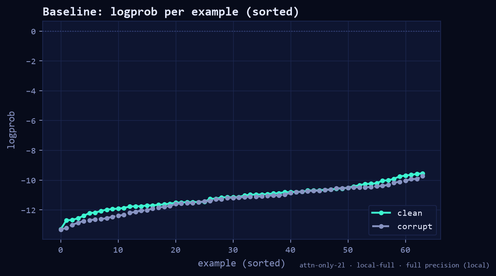
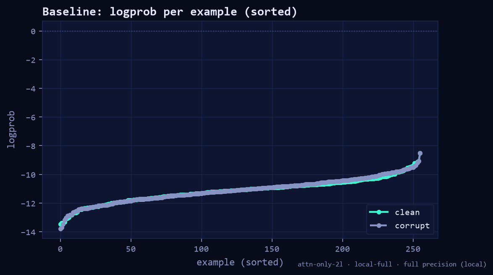

# Null result: attn-only-2l does not perform induction on repeated random tokens

**Behavior:** Claimed: when shown a sequence of random tokens that then repeats, the 2-layer attention-only model predicts the next token of the repeat correctly (dataset task 'induction').  
**Model:** `attn-only-2l` on `local-full`  
**Status:** unverified (no verification run) · null result: behaviour absent, no mechanism  
**Experiments run:** 3 · **Backends used:** full precision (local)  
**Written:** 2026-11-13 12:09

## Summary

The claimed behaviour does not exist in this model (local-full, full precision). On 320 induction prompts across two seeds the model got 0 correct. The mean log-probability of the correct token is -11.13, slightly below what a uniform guess over the 48,262-token vocabulary would give (-10.78). Showing the model the first copy of the sequence gives no measurable benefit over replacing it with unrelated tokens: the clean-minus-corrupt gap was +0.19 nats on seed 0 (n=64) and -0.02 nats on seed 1 (n=256). The investigation stopped after the baseline step because there is no behaviour to explain; no circuit is claimed and no verification was run.

## The recovered algorithm

```python
# No algorithm recovered: the model does not do the task (E0002, E0003).
def predict(tokens, prompt):
    raise NotImplementedError('behaviour absent: 0/320 correct, answer logprob at or below uniform')
```

## Claims and evidence

| # | Claim | Evidence | Produced by |
|---|---|---|---|
| 1 | The model does not predict the next token of the repeat: top-1 accuracy is 0/64 (seed 0) and 0/256 (seed 1) on local-full at full precision. | E0002, E0003 | full precision (local) |
| 2 | The correct token gets a mean log-probability of -11.13 on both seeds, slightly below the uniform level of ln(48262) = -10.78, so the model has no preference for the correct token. | E0002, E0003 | full precision (local) |
| 3 | The first copy of the sequence does not help: clean-minus-corrupt log-probability is +0.19 nats on seed 0 and -0.02 nats on seed 1; the small seed-0 gap did not replicate. | E0002, E0003 | full precision (local) |

## Key plots

**E0002: baseline** (full precision (local))



**E0003: baseline** (full precision (local))



## Limitations

- Only the supplied 'induction' dataset format was tested (BOS + 12 random tokens + the first 11 repeated, 24 positions). Other sequence lengths or natural-text repetition were not tested.
- No internal experiments (attribution, patching, attention patterns) were run, by design: with a clean-vs-corrupt difference of about zero they would only characterise noise.
- The seed-0 pre-registered prediction (accuracy >= 0.5, taking the task statement at face value) was refuted; this is the central finding, not a miss to explain away.
- Why the model fails (for example whether its weights are untrained) was not measured and is not claimed here.

## Open questions

- Is this checkpoint untrained or the wrong file? A weights_svd of W_E / W_U or a baseline on ordinary text would tell.
- Does a different checkpoint of the same architecture do the task? If so, rerun this investigation against it.

## Prediction record

2 experiments were pre-registered, 2 were run: **1 confirmed, 1 refuted, 0 inconclusive**. Hit rate (confirmed / decided): **50%**.

Refuted predictions (shown, not hidden):

| prereg | experiment | hypothesis | predicted | observed |
|---|---|---|---|---|
| N0003 | E0002 | The model performs induction as described: on repeated random-token sequences it predicts the next token of the repeat correctly on most prompts. | `summary.clean_accuracy >= 0.5` | 0.000 |

## Experiments

| id | primitive | backend / precision | seconds | pre-registration |
|---|---|---|---|---|
| E0001 | dataset | full precision (local) | 0.02 | exploratory |
| E0002 | baseline | full precision (local) | 0.49 | N0003: refuted |
| E0003 | baseline | full precision (local) | 1.04 | N0006: confirmed |

## Notebook trail

- `N0001` *decision*: Loaded attn-only-2l on local-full (full precision (local)).
- `N0002` *experiment*: dataset (E0001)
- `N0003` *prereg*: The model performs induction as described: on repeated random-token sequences it predicts the next token of the repeat correctly on most prompts.
- `N0004` *experiment*: The model performs induction as described: on repeated random-token sequences it predicts the next token of the repeat c (E0002)
- `N0005` *result*: Baseline refuted the premise (local-full, full precision): top-1 accuracy 0/64 on induction seed 0; mean logprob of the correct token -11.13 (std 0.83), which is below the uniform-guess level ln(48262) = -10.78. Corrupt prompts: -11.32. Clean-minus-corrupt gap is 0.19 nats (42/64 prompts positive by my hand count of the per-prompt data), small, and confounded: the corrupt first halves are drawn from a different token-id range (~1000-6000) than the clean ones, so the gap is not evidence of copying. Example predictions are unrelated tokens. The model does not do the behaviour. (E0002)
- `N0006` *prereg*: The model does not perform induction at all: the 0/64 result in E0002 is not a seed or sample-size fluke.
- `N0007` *experiment*: The model does not perform induction at all: the 0/64 result in E0002 is not a seed or sample-size fluke. (E0003)
- `N0008` *result*: Replication (local-full, seed 1, n=256): accuracy 0/256, clean logprob -11.13 (std 0.84), corrupt -11.11. The clean-minus-corrupt gap is now -0.02 nats, so the +0.19 gap on seed 0 (E0002) did not replicate and is treated as noise. Across 320 prompts: 0 correct, logprob of the answer slightly below uniform (-10.78), and seeing the first copy of the sequence gives no measurable benefit. The behaviour is absent. (E0002, E0003)
- `N0009` *decision*: Stop after step 1. The model does not do induction, so there is no mechanism to localise; running attribution/patching on a clean-vs-corrupt difference of ~0 would only fit noise. No verify_hypothesis run: there is no algorithm to verify. 37 of 40 experiments left unused. Report as a null result. (E0002, E0003)
