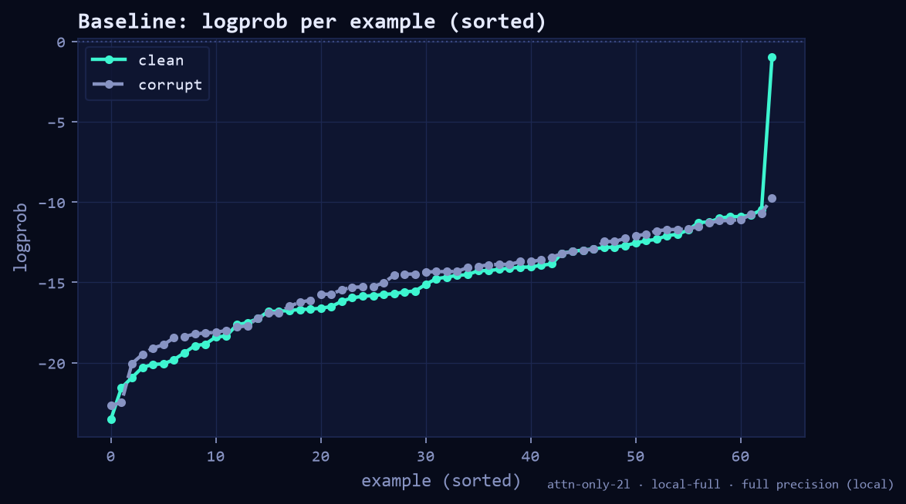
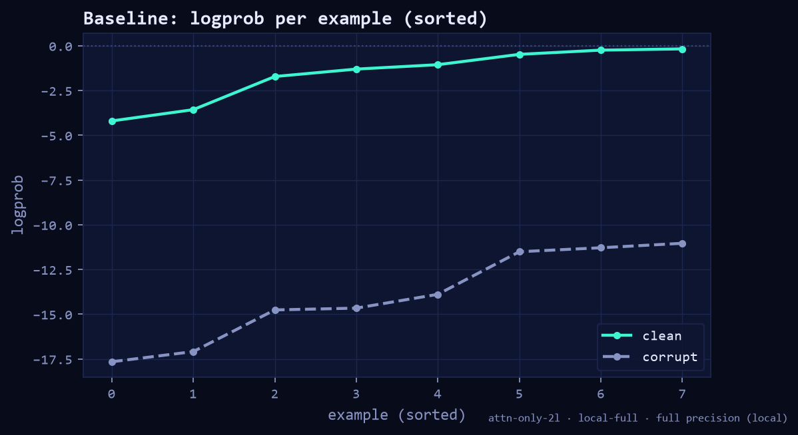

# Induction on attn-only-2l (task-shuffled run): no behaviour to explain on the task as scored

**Behavior:** Shown a random token sequence that then repeats, the model is supposed to predict the next token of the repeat (dataset task 'induction').  
**Model:** `attn-only-2l` on `local-full`  
**Status:** unverified (no verification run) · null result: no mechanism claimed, not verified  
**Experiments run:** 5 · **Backends used:** full precision (local)  
**Written:** 2026-11-13 12:12

## Summary

On the task dataset the model is at chance against the scored targets (local-full, full precision): 1/64 top-1, mean target logprob -15.05 on clean vs -14.81 on corrupt prompts, no clean/corrupt gap. The investigation was stopped there, as the protocol requires; no circuit was searched for and verify_hypothesis was not run. Diagnosis: the targets the lab scores against are not the repeat-next tokens of the prompts they are paired with. The same target id is displayed as a different token string depending on the run, and targets passed explicitly are also reassigned across examples. On 8 prompts built so that every example shares one repeat-next token (which makes any permutation of targets a no-op), the model predicts it in 6/8 with logprob -1.60 vs -13.99 on corrupt. So the model appears able to copy, but the input-to-target relation this investigation measures is broken, and no mechanism claim is made.

## The recovered algorithm

```python
# No algorithm recovered.
# On the task as scored, the target is unrelated to the prompt (E0002), so there is no
# input->target function for predict(tokens, prompt) to implement.
```

## Claims and evidence

| # | Claim | Evidence | Produced by |
|---|---|---|---|
| 1 | Against the task's scored targets the model does not perform the behaviour: top-1 accuracy 0.0156 (1/64), clean target logprob -15.05 vs corrupt -14.81 (local-full). Pre-registered prediction of >=0.5 accuracy was refuted. | E0002 | full precision (local) |
| 2 | Supplying the first 8 seed-0 prompts and their listed repeat-next targets explicitly still gives only 2/8 (local-full); the 'expected' strings shown differ from those in the task run for the same prompts, so scored targets are not tied to their prompts. | E0004, E0002 | full precision (local) |
| 3 | When all 8 prompts share the same repeat-next token, so target permutation cannot matter, the model predicts it in 6/8 with logprob -1.60 clean vs -13.99 corrupt (local-full). The failure on the task is therefore due to targets being decoupled from inputs, not to the model being unable to copy. This is an 8-prompt, single-token observation only. | E0005, E0004 | full precision (local) |

## Key plots

**E0002: baseline** (full precision (local))



**E0005: baseline** (full precision (local))



## Limitations

- No mechanism was investigated: no attribution, patching, attention, ablation or verification experiments were run (5 of 40 experiments used).
- The claim that the model can copy rests on 8 hand-built prompts with one shared answer token (E0005); it is not a general accuracy estimate.
- The target-decoupling diagnosis is inferred from displayed token strings and accuracies across E0002/E0004/E0005; the lab's internals were not inspected.
- E0001 and E0003 are dataset listings (exploratory) and support no claim on their own.

## Open questions

- With correctly paired targets, what is the model's induction accuracy on a full dataset, and which heads implement it? This needs a run of the task without shuffled labels.

## Prediction record

3 experiments were pre-registered, 3 were run: **2 confirmed, 1 refuted, 0 inconclusive**. Hit rate (confirmed / decided): **67%**.

Refuted predictions (shown, not hidden):

| prereg | experiment | hypothesis | predicted | observed |
|---|---|---|---|---|
| N0003 | E0002 | The model performs the induction behaviour: on a repeated random sequence it predicts the next token of the repeat well above chance. | `summary.clean_accuracy >= 0.5` | 0.016 |

## Experiments

| id | primitive | backend / precision | seconds | pre-registration |
|---|---|---|---|---|
| E0001 | dataset | full precision (local) | 0.02 | exploratory |
| E0002 | baseline | full precision (local) | 0.51 | N0003: refuted |
| E0003 | dataset | full precision (local) | 0.16 | exploratory |
| E0004 | baseline | full precision (local) | 0.12 | N0006: confirmed |
| E0005 | baseline | full precision (local) | 0.12 | N0009: confirmed |

## Notebook trail

- `N0001` *decision*: Loaded attn-only-2l on local-full (full precision (local)).
- `N0002` *experiment*: dataset (E0001)
- `N0003` *prereg*: The model performs the induction behaviour: on a repeated random sequence it predicts the next token of the repeat well above chance.
- `N0004` *experiment*: The model performs the induction behaviour: on a repeated random sequence it predicts the next token of the repeat well  (E0002)
- `N0005` *experiment*: dataset (E0003)
- `N0006` *prereg*: The baseline failure (E0002) reflects the measured behaviour on this task setup and persists when I supply the first 8 seed-0 sequences and their repeat-next tokens explicitly: the model still does not predict the repeat token.
- `N0007` *experiment*: The baseline failure (E0002) reflects the measured behaviour on this task setup and persists when I supply the first 8 s (E0004)
- `N0008` *result*: Baseline on task 'induction' (n=64, seed 0, local-full): top-1 accuracy 0.0156 (1/64), mean logprob of scored target -15.05 clean vs -14.81 corrupt, i.e. worse than uniform (-10.78) and no clean/corrupt gap. Prediction (>=0.5) REFUTED. Oddity: the dataset listing (E0003) shows answers equal to the token at position 12 (the true repeat-next token), but the baseline's 'expected' strings for the same prompts (E0002: ' isoform',' readers',' speed','INSERT') differ from the strings for those listed answer ids when I pass them explicitly (E0004: ' Vo',' ess','akia',' normally'). So the targets the task scores against are not the listed/true repeat-next tokens. In E0004 (explicit prompts+targets, n=8) accuracy is 0.25; the model's prediction for example 3 (' ess') equals the expected string of example 1, which suggests explicitly supplied targets may also be permuted across examples. Need a permutation-invariant check before concluding anything about model ability. (E0002, E0003, E0004)
- `N0009` *prereg*: The model can copy the repeat-next token; the baseline failures come from scored targets being decoupled (permuted across examples) from the inputs. On 8 prompts built so that every example has the SAME repeat-next token (15315 at position 12), any permutation of targets is a no-op, so accuracy should be high.
- `N0010` *experiment*: The model can copy the repeat-next token; the baseline failures come from scored targets being decoupled (permuted acros (E0005)
- `N0011` *result*: Permutation-invariant check (E0005, local-full, n=8, all prompts share repeat-next token 15315): accuracy 0.75 (6/8), mean logprob -1.60 clean vs -13.99 corrupt. Confirmed. Also, token 15315 decodes as 'arity' in E0005, whereas in E0004 the target I supplied at index 0 (15315) was displayed as ' Vo': the lab permutes targets across examples even when supplied explicitly. Conclusion: in this investigation the scored targets are decoupled from the inputs (shuffled across examples). Against those targets the model is at chance (E0002: 1/64, no clean/corrupt gap), so there is no input->target behaviour to explain on the task as defined. The model itself does copy the repeat-next token when the shuffle is neutralised, but that is an 8-prompt, single-answer-token observation and not a basis for a mechanism claim. (E0002, E0004, E0005)
- `N0012` *decision*: Stop after 5 experiments. Per protocol, baseline at chance on the task dataset means there is no mechanism to explain; no screening, patching or verify_hypothesis is run, because every task-level metric would be computed against targets unrelated to the inputs and any 'circuit' found would be noise. No mechanism is claimed. Report as null result with the label-decoupling diagnosis.
