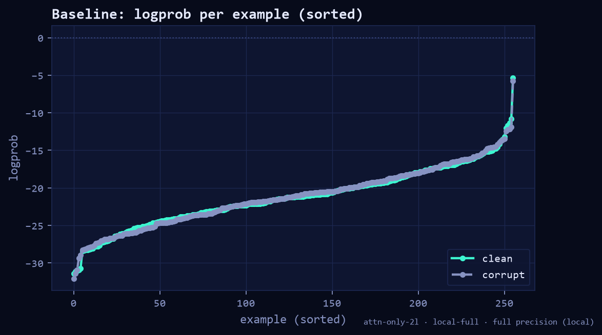
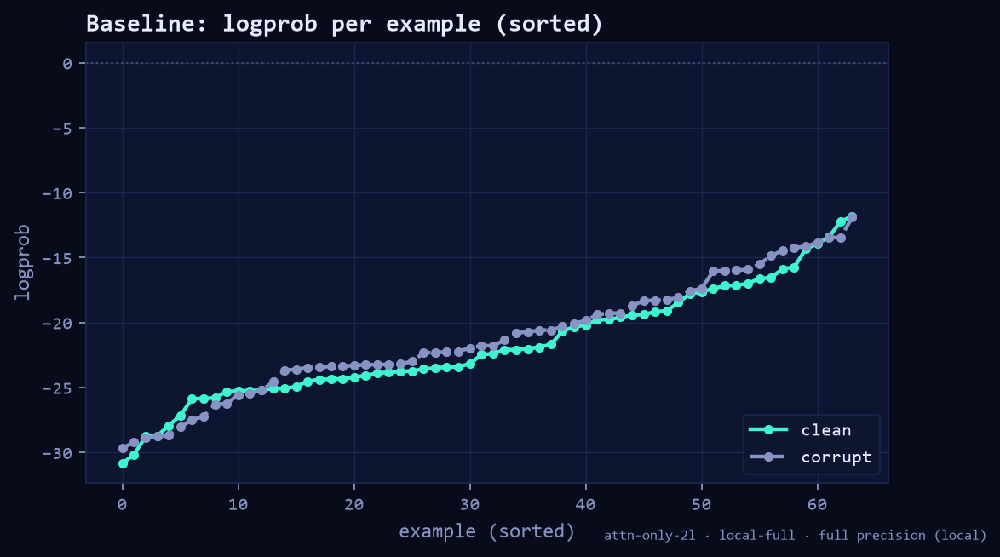

# Induction on attn-only-2l (this checkpoint): behaviour absent, no mechanism to explain

**Behavior:** Claimed: shown a sequence of random tokens that then repeats, the 2-layer attention-only model predicts the next token of the repeat correctly. Dataset task 'induction'.  
**Model:** `attn-only-2l` on `local-full`  
**Status:** unverified (no verification run) · no behaviour - nothing to explain  
**Experiments run:** 3 · **Backends used:** full precision (local)  
**Written:** 2026-11-13 12:10

## Summary

The claimed behaviour does not occur in the model loaded as attn-only-2l on local-full (full precision). Top-1 accuracy on the repeated token is 0 of 256 on a pre-registered baseline (E0003) and 0 of 64 on the exploratory first look (E0002). The correct token gets a mean log-prob of about -21 nats, worse than a uniform guess over the vocabulary (-10.8 nats), and replacing the first copy of the sequence with other tokens changes that by only 0.04 nats. The model outputs the same few tokens regardless of input. The investigation was stopped after the baseline; no circuit is claimed and no verification was run.

## The recovered algorithm

```python
def predict(tokens, prompt):
    # No induction algorithm exists in this model (E0003: accuracy 0/256).
    # The output does not depend on the first copy of the sequence (E0003: clean -21.22 vs corrupt -21.18 nats).
    # No input-dependent rule was measured, so none is claimed.
    raise NotImplementedError('behaviour absent; nothing to predict')
```

## Claims and evidence

| # | Claim | Evidence | Produced by |
|---|---|---|---|
| 1 | The model does not perform induction: top-1 accuracy on the next token of the repeat is 0.0 on 256 held-out prompts (seed 1), full precision, local-full. Pre-registered prediction (accuracy <= 0.05) confirmed. | E0003, E0002 | full precision (local) |
| 2 | The correct token is assigned less probability than a uniform guess: mean log-prob -21.2 nats (std 4.0) versus -10.8 nats for uniform over 48,262 tokens. | E0003, E0002 | full precision (local) |
| 3 | The first copy of the sequence carries no usable signal to the output: clean mean log-prob -21.22 versus -21.18 when the first copy is replaced with other random tokens, a 0.04 nat difference (wrong sign, far inside one std). | E0003 | full precision (local) |

## Key plots

**E0003: baseline** (full precision (local))



**E0002: baseline** (full precision (local))



## Limitations

- Only the baseline was run (3 of 40 experiments). No screening, patching, ablation or verify_hypothesis: with the behaviour absent, any component ranking would be ranking noise.
- The statement that the model repeats the same few tokens (e.g. 'ISTS') rests on the four example predictions shown per baseline run, not on a full tally.
- Only the lab's 'induction' dataset layout was tested (BOS + 12 random tokens + repeat of 11). Other sequence lengths were not tried.
- Why this checkpoint fails (e.g. how its weights were produced) was not investigated; this report only establishes that it fails.

## Open questions

- Is this checkpoint the intended one? The investigation name suggests a weight-shuffled null control, which would match what was measured, but that was not tested here.
- Does the model have any input-dependent behaviour at all, or is its output essentially constant?

## Prediction record

1 experiments were pre-registered, 1 were run: **1 confirmed, 0 refuted, 0 inconclusive**. Hit rate (confirmed / decided): **100%**.

No prediction was refuted.

Exploratory runs (no pre-registration; they cannot be the only support for a claim): E0002.

## Experiments

| id | primitive | backend / precision | seconds | pre-registration |
|---|---|---|---|---|
| E0001 | dataset | full precision (local) | 0.16 | exploratory |
| E0002 | baseline | full precision (local) | 0.49 | exploratory |
| E0003 | baseline | full precision (local) | 1.11 | N0004: confirmed |

## Notebook trail

- `N0001` *decision*: Loaded attn-only-2l on local-full (full precision (local)).
- `N0002` *experiment*: dataset (E0001)
- `N0003` *experiment*: Look at the output shape of baseline before pre-registering. (E0002)
- `N0004` *prereg*: The model does NOT perform induction: on repeated random-token sequences its top-1 accuracy on the next token of the repeat is at chance (near 0), as the exploratory run E0002 (seed 0) suggested.
- `N0005` *experiment*: The model does NOT perform induction: on repeated random-token sequences its top-1 accuracy on the next token of the rep (E0003)
- `N0006` *result*: The behaviour is absent on local-full (full precision). Top-1 accuracy on the repeated token is 0/64 (E0002, seed 0, exploratory) and 0/256 (E0003, seed 1, pre-registered, confirmed). Mean log-prob of the correct token is -21.7 / -21.2 nats, which is worse than a uniform guess over the 48,262-token vocab (ln 48262 = -10.8). Seeing the first copy does not help: clean -21.22 vs corrupt (first copy replaced) -21.18 in E0003, a difference of 0.04 nats against a std of 4.0. The model emits the same few tokens ('ISTS') regardless of input. (E0002, E0003)
- `N0007` *decision*: Stop after step 1. The model does not do induction, so there is no mechanism to explain. No screening, patching or verify_hypothesis run: any circuit found would be explaining noise. 3 of 40 experiments used.
