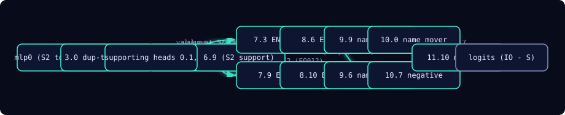
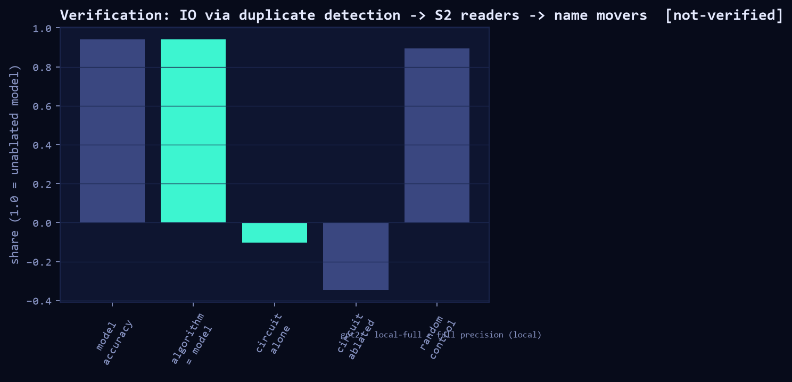
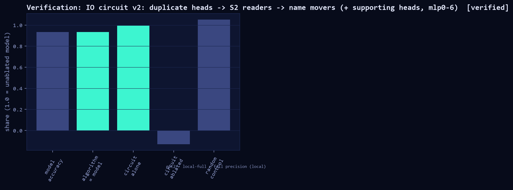
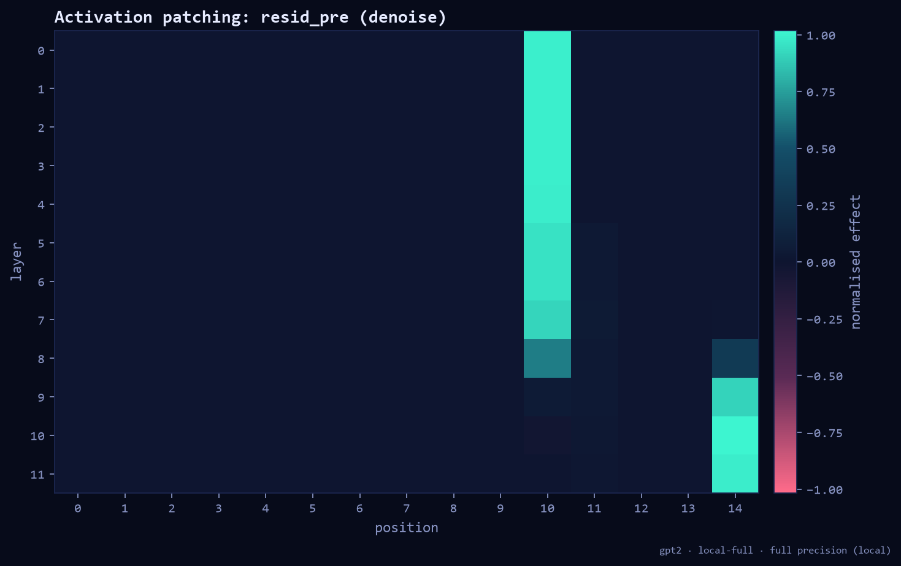
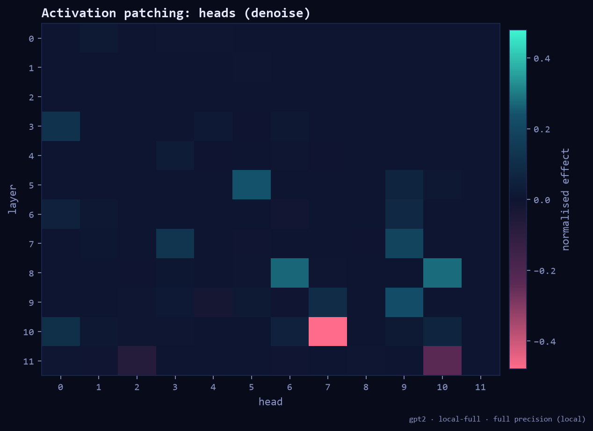
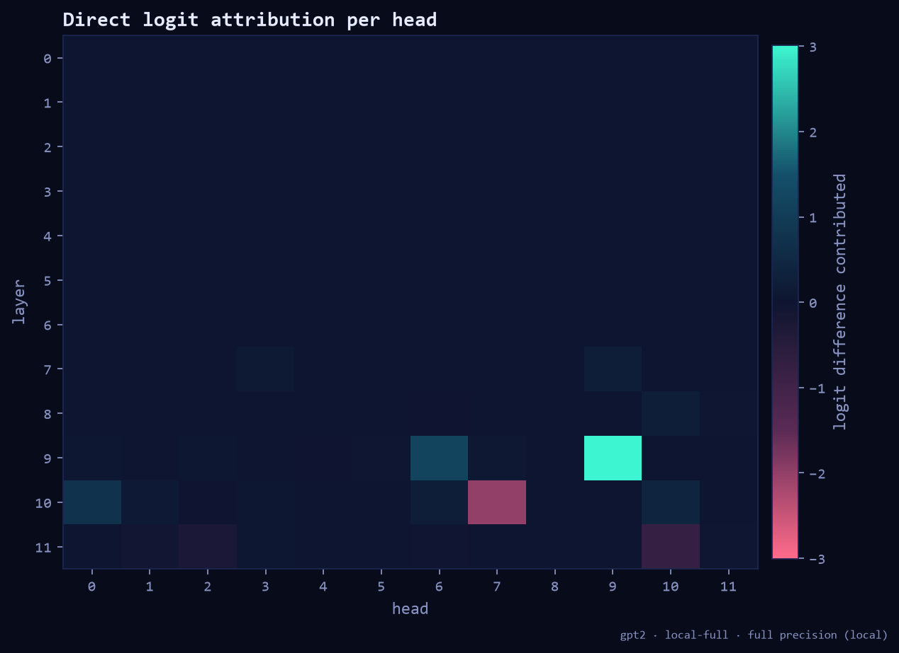
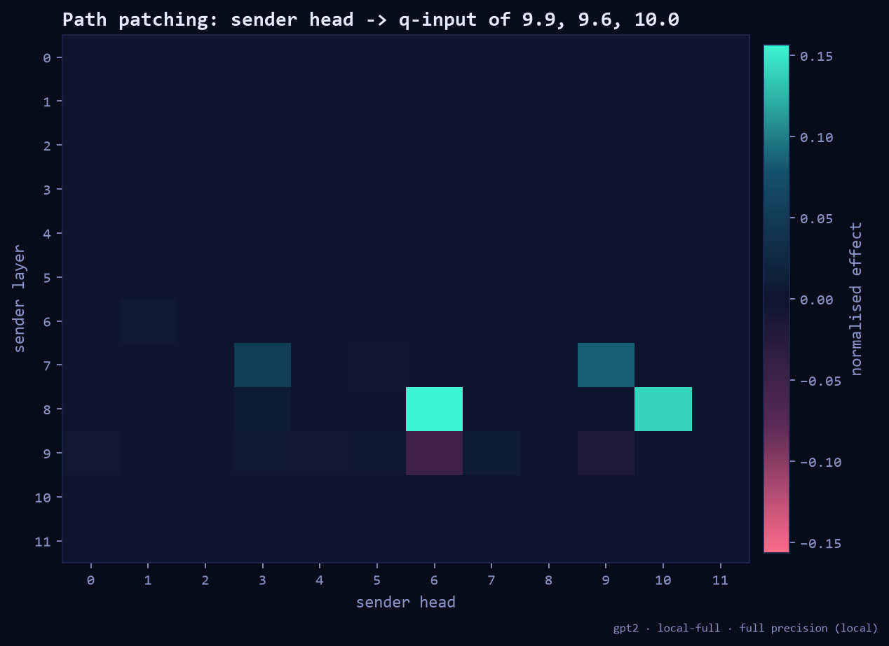
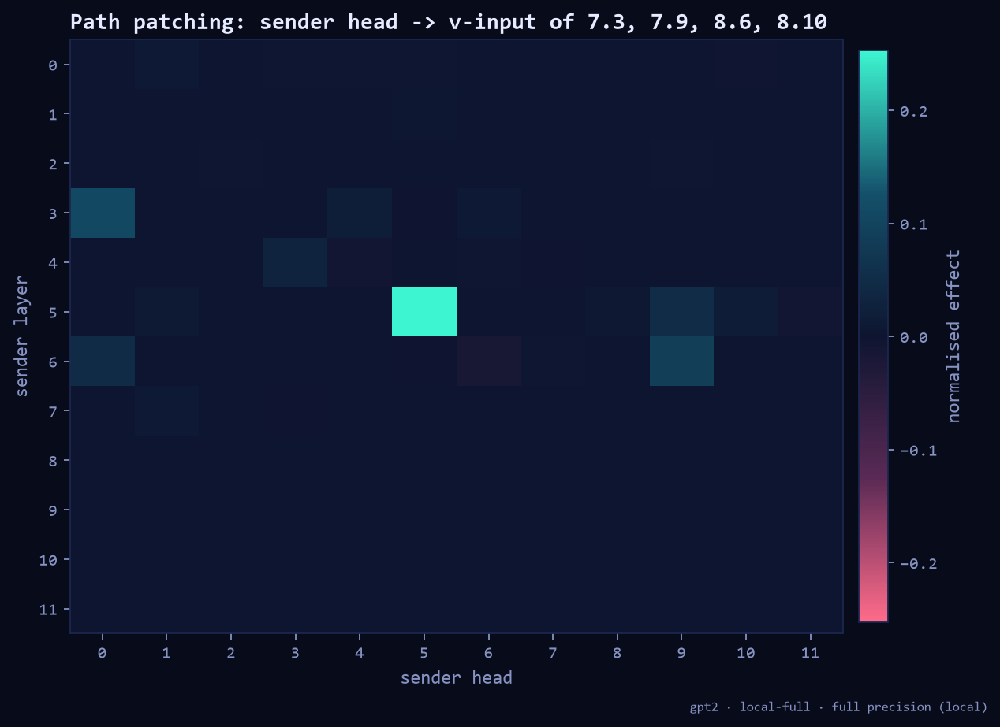
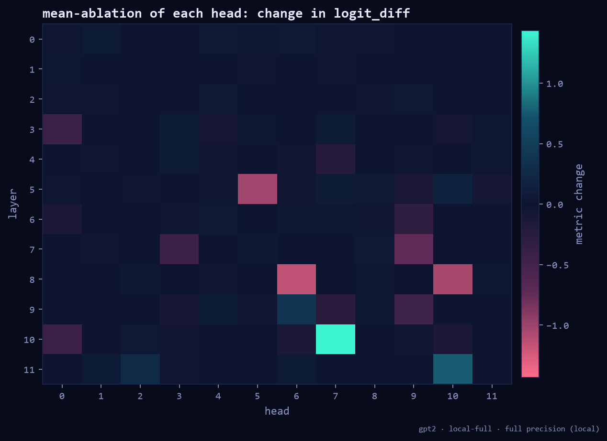

# How GPT-2 small picks the indirect object (IOI)

**Behavior:** Given 'When Mary and John went to the store, John gave a drink to', GPT-2 small (local-full, fp32) continues with the non-repeated name (' Mary'). Baseline on ioi seed 0: accuracy 0.94, mean logit diff (IO - S) 3.77 (E0002).  
**Model:** `gpt2` on `local-full`  
**Status:** partial / not verified · verified (local-full, full precision)  
**Experiments run:** 30 · **Backends used:** full precision (local)  
**Written:** 2026-11-12 22:42

## Summary

The model works out which name to output by spotting which name is repeated, then copying the other one. (1) At the second mention of the subject (S2), early heads notice the repeat: 3.0 attends from S2 back to the earlier copy S1, and 5.5 attends to the token right after S1, induction-style. 6.9 and some supporting heads (0.1, 1.11, 5.8, 4.3, 5.9, 6.0) help. (2) Layer 7-8 heads 7.3, 7.9, 8.6 and 8.10 attend from the final token (END) to S2 and carry the signal 'this name was repeated' to END. Residual patching shows the handoff from S2 to END happening across layers 7-8. (3) This signal sets the queries of the name-mover heads 9.9, 9.6 and 10.0. Those heads attend from END to the non-repeated name and write it into the logits (9.9 alone contributes +3.0 directly). Their attention target flips when the other name is repeated, so it follows repetition, not position. (4) Heads 10.7 and 11.10 attend to the same name but write against it, which damps the answer. Removing the name movers costs little because backup heads in layers 9-11 take over. The upstream repeat signal is the real bottleneck: ablating the four S2 readers leaves only 12% of the logit diff. The 23 heads plus mlp0-6 passed held-out verification (V0002).

## The recovered algorithm

```python
def predict(tokens, prompt):
    names = capitalised words after 'When'      # A, B, ..., C
    first_two, later = names[:2], names[2:]
    # Stage 1 @S2 (E0009, E0012, E0024): heads 3.0 (S2->S1), 5.5 (S2->S1+1), 6.9 mark S2's name as already seen
    repeated = [n for n in first_two if n in later]
    # Stage 2 @END (E0005, E0008, E0011, E0023): 7.3, 7.9, 8.6, 8.10 read S2 and set name-mover queries
    # Stage 3 @END (E0008, E0010, E0020): 9.9, 9.6, 10.0 attend to the non-repeated name and copy it to the logits
    #   10.7, 11.10 attend to the same name and write against it (E0010, E0014); backups in layers 9-11 (E0016, E0019)
    candidates = [n for n in first_two if n not in repeated]
    return ' ' + (candidates[0] if candidates else first_two[0])
```

## Circuit



## Claims and evidence

| # | Claim | Evidence | Produced by |
|---|---|---|---|
| 1 | GPT-2 small does the task: accuracy 0.94, logit diff IO-S 3.77 on ioi seed 0 (local-full). | E0002 | full precision (local) |
| 2 | With a corruption that changes only which name is repeated, the information sits at S2 up to layer 7 and moves to END across layers 7-8 (END recovery 0.32 at resid_pre.8, 0.91 at resid_pre.9; S2 recovery 0.91 at layer 7, 0.06 at layer 9). | E0005 | full precision (local) |
| 3 | Heads 3.0 (S2->S1, 0.77) and 5.5 (S2->S1+1, 0.85) attend from the repeated name back to its earlier occurrence. They, together with 6.9, are the main senders into the values of the S2-reader heads. | E0009, E0012 | full precision (local) |
| 4 | Heads 7.9, 8.6 and 8.10 attend from END to S2, and 7.3 attends to S2+1. These four are the only significant senders into the queries of name movers 9.9, 9.6 and 10.0 (path effects 0.05-0.16; every other head < 0.05). | E0008, E0011 | full precision (local) |
| 5 | 9.9 and 9.6 attend from END to the non-repeated name and write it directly into the logits (DLA +3.0 and +1.2). Their attention target flips from pos 2 to pos 4 when the repeated name changes. | E0008, E0010, E0020 | full precision (local) |
| 6 | 10.7 and 11.10 attend to the same IO name but write against it (DLA -2.0, -0.8). Ablating either one raises the logit diff (+1.43, +0.77). | E0008, E0010, E0014 | full precision (local) |
| 7 | Name movers are redundant: jointly ablating 9.9, 9.6, 10.0, 10.10 and 10.6 keeps 83% of the logit diff, and also ablating 10.7 and 11.10 still keeps 79%. Ablating all attention in layers 9-11 leaves 20%, so backup capacity is spread across layers 9, 10 and 11. | E0013, E0015, E0016, E0018, E0019 | full precision (local) |
| 8 | The repeat signal is the bottleneck: ablating the S2 readers alone leaves 12% of the logit diff, and ablating readers plus duplicate heads leaves 10%. | E0022, E0023, E0024 | full precision (local) |
| 9 | MLPs carry little task-specific information except mlp0, which processes the S2 token (patching recovery 0.89). mlp1-6 are nevertheless needed as general infrastructure for the circuit to work on its own, while mlp7-11 are not. | E0021, E0028, E0029 | full precision (local) |
| 10 | Held-out verification (seed 777, n=200, local-full): predict() agrees with the model on 93.5% of prompts, and every disagreement is the model choosing a non-name token. Ablating the circuit drops the logit diff to -13% of clean. Keeping only the circuit preserves 99% of the logit diff, but top-1 accuracy falls to 0.375. Random ablations of the same size keep 104-106%. | V0002 | full precision (local) |
| 11 | With all MLPs intact, ablating only the 23 circuit heads reverses the preference (logit diff -1.48). | E0030 | full precision (local) |
| 12 | The first 15-component circuit (14 heads + mlp0) failed sufficiency (circuit alone -10%). Adding nine supporting heads and mlp1-6 fixed it. | V0001, E0026, E0027 | full precision (local) |

## Verification

### V0001: IO via duplicate detection -> S2 readers -> name movers  (full precision (local))

| check | value |
|---|---|
| status | not-verified |
| held-out inputs | 200 |
| model accuracy | 0.940 |
| algorithm agrees with model | 0.940 |
| algorithm accuracy vs ground truth | 1.000 |
| circuit size | 15 of 156 components |
| metric kept with ONLY the circuit | -0.103 |
| metric kept with the circuit ABLATED | -0.345 |
| random same-size ablation (control) | 0.930, 0.979, 0.774 |

At least one check failed; the explanation is partial or wrong. See the numbers.



### V0002: IO circuit v2: duplicate heads -> S2 readers -> name movers (+ supporting heads, mlp0-6)  (full precision (local))

| check | value |
|---|---|
| status | verified |
| held-out inputs | 200 |
| model accuracy | 0.935 |
| algorithm agrees with model | 0.935 |
| algorithm accuracy vs ground truth | 1.000 |
| circuit size | 30 of 156 components |
| metric kept with ONLY the circuit | 0.994 |
| metric kept with the circuit ABLATED | -0.130 |
| random same-size ablation (control) | 1.048, 1.041, 1.064 |

Passed at full precision.



## Key plots

**E0005: activation_patching** (full precision (local))



**E0006: activation_patching** (full precision (local))



**E0010: direct_logit_attribution** (full precision (local))



**E0011: path_patching** (full precision (local))



**E0012: path_patching** (full precision (local))



**E0014: ablation** (full precision (local))



## Limitations

- All numbers come from local-full (fp32) on one template family ('When A and B went to the P, C gave a O to'). Other IOI templates were not tested.
- The circuit alone keeps 99% of the logit diff but only 0.375 top-1 accuracy (V0002). It explains the choice of IO over S, not the full drive to output a name instead of ' the'/' her'.
- mlp1-6 are in the verified circuit as general infrastructure (E0028 vs E0029); I did not find a task-specific role for them (E0021). The task-specific necessity of the heads is shown separately (E0030).
- The nine supporting heads (0.1, 1.11, 4.3, 4.11, 5.8, 5.9, 6.0, 9.7, 10.1) were added because of small effects in earlier experiments. Each one's role was not characterised individually.
- Backup name movers were located only by layer (E0016, E0018, E0019), not identified individually. DLA under ablation is unsupported (E0017 ignored the parameter).
- The edges from duplicate heads to individual S2 readers in the diagram are drawn at group level: E0012 measured senders into all four readers jointly, and E0011 measured senders into the three name movers jointly.
- In the IO-first prompts, 9.7 and 10.0 attend mostly to BOS from END (E0008), yet 10.0 writes +0.74 directly. How it does that is unexplained.
- E0025 (what feeds 5.5's keys) was inconclusive by design, so the previous-token feed into 5.5 is not established.

## Open questions

- Which individual heads in layers 9-11 act as backups when the main name movers are ablated, and do they read the same S2-reader signal?
- Does 5.5 rely on a previous-token head (e.g. 4.11) at S1+1? This needs a corruption that changes S1 while keeping S2 matched.
- What exactly do the S2 readers write: a positional signal, a name-identity signal, or both? This could be probed with linear_probe / diff_of_means at END in layer 9.
- Why do 10.7 and 11.10 copy IO negatively, and do they respond to how strongly the name movers wrote?
- Does the circuit carry over to other IOI templates and to longer contexts?

## Experiments

| id | primitive | backend / precision | seconds |
|---|---|---|---|
| E0001 | dataset | full precision (local) | 0.02 |
| E0002 | baseline | full precision (local) | 0.42 |
| E0003 | attribution_patching | full precision (local) | 0.72 |
| E0004 | activation_patching | full precision (local) | 4.31 |
| E0005 | activation_patching | full precision (local) | 3.24 |
| E0006 | activation_patching | full precision (local) | 2.69 |
| E0007 | attention_patterns | full precision (local) | 0.2 |
| E0008 | attention_patterns | full precision (local) | 0.26 |
| E0009 | attention_patterns | full precision (local) | 0.26 |
| E0010 | direct_logit_attribution | full precision (local) | 0.73 |
| E0011 | path_patching | full precision (local) | 4.72 |
| E0012 | path_patching | full precision (local) | 3.86 |
| E0013 | ablation | full precision (local) | 0.41 |
| E0014 | ablation | full precision (local) | 3.4 |
| E0015 | ablation | full precision (local) | 0.48 |
| E0016 | ablation | full precision (local) | 0.49 |
| E0017 | direct_logit_attribution | full precision (local) | 0.56 |
| E0018 | ablation | full precision (local) | 0.17 |
| E0019 | ablation | full precision (local) | 0.66 |
| E0020 | attention_patterns | full precision (local) | 0.27 |
| E0021 | activation_patching | full precision (local) | 0.61 |
| E0022 | ablation | full precision (local) | 0.51 |
| E0023 | ablation | full precision (local) | 0.49 |
| E0024 | ablation | full precision (local) | 0.16 |
| E0025 | path_patching | full precision (local) | 5.82 |
| E0026 | ablation | full precision (local) | 0.4 |
| E0027 | ablation | full precision (local) | 0.44 |
| E0028 | ablation | full precision (local) | 0.47 |
| E0029 | ablation | full precision (local) | 0.44 |
| E0030 | ablation | full precision (local) | 0.47 |
| V0001 | verify | full precision (local) |  |
| V0002 | verify | full precision (local) |  |

## Notebook trail

- `N0001` *decision*: Loaded gpt2 on local-full (full precision (local)).
- `N0002` *hypothesis* **[supported]**: H1 (behavior exists): GPT-2 small prefers the indirect object (non-repeated name) over the subject (repeated name) on the ioi dataset. Counter-evidence: baseline accuracy near 50% or mean logit diff (IO - S) <= 0.
- `N0003` *experiment*: dataset (E0001)
- `N0004` *experiment*: baseline (E0002)
- `N0005` *result*: Baseline (local-full): clean logit diff IO-S = 3.77 +/- 1.45, accuracy 0.94 (n=64, seed 0). Corrupt (all three names replaced by unrelated names) logit diff = 0.29. Behavior is strong; clean-vs-corrupt gap ~3.5 gives room for patching. (E0002)
- `N0006` *hypothesis* **[supported]** -> N0002: E0002: accuracy 0.94, mean logit diff 3.77.
- `N0007` *hypothesis* **[revised]**: H2 (where, screen): The IO-vs-S decision is made by attention heads in the later half (layers ~7-11) at the END position, which move a name into the residual stream; earlier heads act at the S2 position (detecting the repeat). Counter-evidence: attribution concentrated in MLPs or uniformly spread over layers, or nothing at S2/END positions.
- `N0008` *experiment*: attribution_patching (E0003)
- `N0009` *result*: Attribution screen (local-full, first-order estimate): head attribution concentrated in layers 9-11: 9.9 (+0.90), 9.6 (+0.35), 10.0 (+0.24), 10.10 (+0.11), and negative 10.7 (-0.63), 11.10 (-0.21). Attn layer 9 total +1.31; MLPs small except mlp0 (-0.28). Residual: END position (14) carries the effect from resid_pre.10 onward; S2 position (10) shows ~-0.55 across layers 2-9 (estimate; sign may reflect ABC-corruption mismatch). Needs confirmation. (E0003)
- `N0010` *hypothesis* **[revised]**: H3 (information flow): Residual activation patching (clean->corrupt) will show the effect lives at S2 (pos 10) in early/mid layers and moves to END (pos 14) by around layers 8-10, i.e. info about which name is duplicated is computed at S2 then moved to END. Counter-evidence: END-position patching recovers the effect from layer 0 onward with no S2 contribution, or the effect lives at IO/S1 positions until late.
- `N0011` *experiment*: activation_patching (E0004)
- `N0012` *result*: Residual patching (ABC corruption, local-full): END (pos 14) recovers +1.58 at resid_pre.10 and +1.36 at resid_pre.11, but only +0.08/+0.16 at layers 8/9. So the decisive info arrives at END during layer 9 (attn layer 9 per E0003) and layer 10. Patching S2 (pos 10) gives NEGATIVE effects (-0.77 at layer 0 falling to ~-0.06 at 6-7, then -0.2/-0.3 at 9-10). Interpretation: with ABC corruption, inserting the clean S2 name into a prompt whose other names differ makes the model treat that name as fresh/promotable or otherwise mismatches; this corruption confounds S2 analysis. IO/S1 positions ~0. (E0004)
- `N0013` *decision*: Switch to a cleaner contrast: hand-built 24 prompts (alternating ABB/BAB orders, single-token names) where the corrupt prompt is identical except S2 is replaced by the IO name ("..., Mary gave a drink to"), so the duplicated name swaps and the correct answer flips. Only S2 token differs, so any recovery must route through S2 -> END. Metric logit_diff(IO_clean - S_clean).
- `N0014` *hypothesis* **[supported]** -> N0010: E0004: END carries the effect from layer 10 (resid_pre.10), with attn layer 9 doing the moving; S2 role untestable with ABC corruption (negative, confounded). Revised H3': with the S2-swap corruption, patching S2 should give positive recovery in early-mid layers that hands off to END around layers 7-10. Counter: S2 recovery stays ~0 at all layers, or END recovers from very early layers.
- `N0015` *experiment*: activation_patching (E0005)
- `N0016` *result*: S2-swap residual patching (local-full, n=24; corrupt LD -4.70, clean +4.27): normalized recovery at S2 (pos 10) is ~1.0 for resid_pre 0-4, 0.96 at 5-6, 0.91 at 7, 0.65 at 8, 0.06 at 9. At END (pos 14): 0.02 at 7, 0.32 at 8, 0.91 at 9, 1.02 at 10, 0.99 at 11. Clean handoff: the 'which name is duplicated' information sits at S2 until layer 7 and is moved to END by attention in layers 7 and 8 (both halves of the handoff happen across layers 7->9). Other positions ~0 (pos 11 'gave' up to 0.05). (E0005)
- `N0017` *hypothesis* **[supported]** -> N0014: E0005: S2 holds the information through layer 7 and END takes it over across layers 7-8 (END 0.32 at resid_pre.8, 0.91 at resid_pre.9).
- `N0018` *hypothesis* **[revised]**: H4 (two classes of heads): Head-level activation patching on the S2-swap data will show (a) a few heads in layers 7-8 with large positive recovery (they move S2 info to END), and (b) heads in layers 9-10 (9.9, 9.6, 10.0 from E0003) with positive recovery, plus 10.7/11.10 negative. Counter: recovery spread thinly over many heads or concentrated in layers <=6 only.
- `N0019` *experiment*: activation_patching (E0006)
- `N0020` *result*: Head patching on S2-swap (local-full, normalized recovery, single head at all positions): positive 8.10 (.28), 8.6 (.27), 5.5 (.24), 9.9 (.23), 7.9 (.19), 7.3 (.13), 3.0 (.12), 10.0 (.11), 9.7 (.10), 6.9 (.08), 10.10 (.06), 5.9 (.06), 10.6 (.05), 6.0 (.05). Negative 10.7 (-.48), 11.10 (-.24), 11.2 (-.07). 9.6 ~0 here (was +0.35 in E0003 screen with ABC corruption). Heads fall into layer bands: 3-6 (before the S2->END handoff), 7-8 (at the handoff layers found in E0005), 9-10 (after, at END), and negative heads 10.7/11.10. (E0006)
- `N0021` *hypothesis* **[revised]** -> N0018: E0006: layers 7-8 heads (7.3, 7.9, 8.6, 8.10) and layer 9-10 heads (9.9, 10.0, 9.7) recover positively; 10.7/11.10 negative as predicted. Additionally earlier heads 3.0, 5.5, 6.9 matter, which H4 did not predict. 9.6 not confirmed.
- `N0022` *hypothesis* **[supported]**: H5 (attention at END): At the END query, heads 9.9, 10.0, 9.7, 9.6 (and negative 10.7, 11.10) attend mostly to the IO name token (copying it), while 7.3, 7.9, 8.6, 8.10 attend mostly to S2 (reading the duplicate signal). Counter: the late heads attend to S1/S2 as much as IO, or the 7-8 heads attend to IO/BOS rather than S2.
- `N0023` *experiment*: attention_patterns (E0007)
- `N0024` *result*: Attention from END (pos 14), ioi seed 0 (mixed IO-first/S-first orders, so pos 2/4 are IO in half the prompts and S1 in the other half): top keys 7.3 -> pos 11 ('gave', S2+1), 7.9 -> S2 (pos 10), 8.6 -> S2, 8.10 -> S2, 9.6/9.9/10.7/11.10 -> pos 4 (name slot, role ambiguous because of mixed orders), 9.7 and 10.0 -> BOS. Supports the 7-8 heads reading S2; role of the name attended by late heads needs an order-controlled run. Note: E0007 (attention_patterns) required integer query_pos and a 'heads' key; two earlier malformed calls errored without producing experiments. (E0007)
- `N0025` *experiment*: All prompts IO-first: IO=pos 2, S1=pos 4, S2=pos 10, END=14. Tests H5. (E0008)
- `N0026` *result*: Order-controlled attention from END (24 IO-first prompts: IO=2, S1=4, S2=10; local-full): 9.9 -> IO (0.82), 9.6 -> IO (0.65), 10.7 -> IO (0.87), 11.10 -> IO (0.64); 7.9 -> S2 (0.40), 8.6 -> S2 (0.85), 8.10 -> S2 (0.44), 7.3 -> pos 11 'gave' right after S2 (0.29); 9.7 and 10.0 -> BOS (0.47/0.54 max). So the late positive heads 9.9/9.6 and negative heads 10.7/11.10 all attend from END to the IO name; the layer 7-8 heads attend to S2 (or S2+1). (E0008)
- `N0027` *hypothesis* **[supported]** -> N0022: E0008: 9.9/9.6/10.7/11.10 attend END->IO; 7.9/8.6/8.10 attend END->S2 and 7.3 END->S2+1. Exception: 9.7 and 10.0 attend mostly BOS from END, so their role is unexplained.
- `N0028` *hypothesis* **[supported]**: H6 (duplicate detection at S2): Early heads 3.0, 5.5, 6.9 (positive in E0006) at the S2 query attend back to the earlier occurrence of the same name, S1 (pos 4 in IO-first prompts), or the token after it (pos 5) — i.e. they detect that the S2 token is a repeat. Counter: these heads attend from S2 to BOS/previous token/IO instead.
- `N0029` *experiment*: Query = S2 (pos 10); IO=2, S1=4, S1+1=5. Tests H6. (E0009)
- `N0030` *result*: Attention from S2 (pos 10; IO-first prompts, IO=2, S1=4, S1+1=5; local-full): 3.0 -> S1 (0.77); 0.1 -> S1 (0.54); 1.11 -> S1 (0.72); 0.5 -> S1 (0.57); 5.5 -> S1+1 (0.85); 5.8 -> S1+1 (0.61); 5.10 -> S1 (0.39); 6.9 -> BOS (0.53, no name preference visible). So 3.0 (and layer 0-1 heads 0.1, 1.11) look from the repeated name back at its earlier copy; 5.5/5.8 look at the token after the earlier copy (induction-style). (E0009)
- `N0031` *hypothesis* **[supported]** -> N0028: E0009: 3.0 attends S2->S1 (0.77), 5.5 attends S2->S1+1 (0.85). Exception: 6.9 does not show this pattern (BOS), so its role in E0006 is unexplained.
- `N0032` *hypothesis* **[supported]**: H7 (who writes the answer): Direct logit attribution along the IO-S direction at END: 9.9, 9.6 (and 10.0/10.10?) write positively; 10.7, 11.10 write negatively; the layer 7-8 S2-attending heads (7.3, 7.9, 8.6, 8.10) and early heads write ~0 directly. Counter: 7.x/8.x heads have large direct effects, or 9.9 has small direct effect.
- `N0033` *experiment*: direct_logit_attribution (E0010)
- `N0034` *result*: DLA at END along IO-S (ioi seed 0, local-full; total heads 3.43 of 3.77): positive 9.9 (+3.01), 9.6 (+1.20), 10.0 (+0.74), 10.10 (+0.40), 10.6 (+0.25), 10.1 (+0.14); negative 10.7 (-2.00), 11.10 (-0.79), 11.2 (-0.24), 11.1 (-0.11). Layer 7-8 heads write only small amounts directly: 7.9 (+0.23), 8.10 (+0.24), 7.3 (+0.12), 8.6 (-0.04). Layers 0-6 ~0. (E0010)
- `N0035` *hypothesis* **[supported]** -> N0032: E0010: 9.9 (+3.0) and 9.6 (+1.2) dominate the direct write, 10.7 (-2.0) and 11.10 (-0.8) write against; 7.x/8.x direct writes are small (<=0.24). 10.0 writes +0.74 directly even though it mostly attends BOS (E0008).
- `N0036` *hypothesis* **[supported]**: H8 (S2-signal -> name-mover queries): On the S2-swap data, path patching senders -> queries of {9.9, 9.6, 10.0} will be dominated by the layer 7-8 S2-attending heads 7.3, 7.9, 8.6, 8.10 (positive). Counter: these heads have ~0 path effect to the name-mover queries, or the effect comes mainly through keys/values or from other heads.
- `N0037` *experiment*: path_patching (E0011)
- `N0038` *result*: Path patching senders -> queries of {9.9, 9.6, 10.0} on S2-swap (local-full, normalized): 8.6 (+0.156), 8.10 (+0.142), 7.9 (+0.085), 7.3 (+0.053); every other sender |effect| < 0.05 (9.6 -0.05, 9.9 -0.02). Sum of the four ~0.44 of the full clean-corrupt gap flows through just the name-mover queries. The S2-attending layer 7-8 heads are exactly the heads that set what the name movers look for. (E0011)
- `N0039` *hypothesis* **[supported]** -> N0036: E0011: the four predicted heads are the top-4 senders into name-mover queries, all positive; no other head exceeds 0.05.
- `N0040` *hypothesis* **[supported]**: H9 (duplicate signal -> S2 readers): Path patching senders -> values of {7.3, 7.9, 8.6, 8.10} (they read from S2/S2+1) on S2-swap data will be dominated by the S2-position heads 3.0 and 5.5 (plus possibly 6.9, 0.1, 1.11). Counter: the effect comes mainly from the raw token embedding / other heads, with 3.0 and 5.5 ~0.
- `N0041` *experiment*: path_patching (E0012)
- `N0042` *result*: Path patching senders -> values of {7.3, 7.9, 8.6, 8.10} on S2-swap (local-full): 5.5 (+0.25), 3.0 (+0.11), 6.9 (+0.09), 5.9 (+0.05), 6.0 (+0.05), 4.3 (+0.03), 3.4 (+0.02); all else < 0.02. The S2 readers get their signal from the S2-position duplicate heads 3.0 (S2->S1) and 5.5 (S2->S1+1), plus 6.9 whose attention pattern looked like BOS (E0009) yet still passes signal. (E0012)
- `N0043` *hypothesis* **[supported]** -> N0040: E0012: 5.5 (0.25) and 3.0 (0.11) are the top senders into the S2-readers' values; 6.9 (0.09) also contributes. Embedding contribution was not measured by this primitive.
- `N0044` *hypothesis* **[rejected]**: H10 (necessity of each stage): Mean-ablating (over ioi seed 0) the name movers {9.9, 9.6, 10.0, 10.10, 10.6} jointly reduces clean logit diff 3.77 by >50%. Similar tests follow for the S2 readers and duplicate heads. Counter: drop <25% (heavy redundancy or wrong components).
- `N0045` *experiment*: ablation (E0013)
- `N0046` *result*: Joint mean ablation of {9.9, 9.6, 10.0, 10.10, 10.6} (ioi seed 0, local-full): logit diff 3.77 -> 3.12 (83% of clean kept). Despite these heads writing ~+5.6 directly (E0010), removing them costs only 0.66. Strong compensation: something downstream (or in parallel) makes up the difference. (E0013)
- `N0047` *hypothesis* **[rejected]** -> N0044: E0013: joint mean ablation of the five positive direct-writers keeps 83% of the logit diff (drop 17%, below the 25% counter-threshold). The name movers are not individually necessary as a set; the model compensates.
- `N0048` *hypothesis* **[rejected]**: H11 (compensation by late heads): When name movers are removed, the negative heads 10.7/11.10 (which attend IO from END and write against it, E0008/E0010) stop suppressing IO and/or other late heads start copying IO. Test: single-head mean-ablation sweep to see which heads matter alone, then joint ablation of name movers + 10.7 + 11.10. Prediction: single-head ablation of 10.7 or 11.10 raises LD; ablating movers + negatives together leaves LD well below the movers-only ablation, i.e. negatives contributed little of the compensation? (ambiguous - recorded for transparency). Primary test now: sweep. Counter: ablating 10.7 alone lowers LD.
- `N0049` *experiment*: ablation (E0014)
- `N0050` *result*: Single-head mean ablation sweep (ioi seed 0, local-full; clean 3.77). Largest drops: 8.6 (-1.16), 8.10 (-1.05), 5.5 (-1.02), 7.9 (-0.73), 9.9 (-0.47), 7.3 (-0.43), 10.0 (-0.43), 3.0 (-0.42), 6.9 (-0.32), 9.7 (-0.27), 4.11 (-0.23), 6.0/10.6/5.9/10.10 (-0.12..-0.14). Largest increases: 10.7 (+1.43), 11.10 (+0.77), 9.6 (+0.40!), 11.2 (+0.25). Layers 0-2 all |change| < 0.08 (0.1, 1.11 not needed individually). The upstream heads (5.5, 8.6, 8.10, 7.9) matter more individually than any single name mover; 9.6 ablation even helps despite +1.2 DLA (E0010) -> downstream compensation. (E0014)
- `N0051` *hypothesis* **[revised]** -> N0048: E0014: 10.7 (+1.43) and 11.10 (+0.77) ablation raise LD (prediction held). Revised H11': the negative heads 10.7/11.10 partly cancel the name movers; removing the movers also weakens the negatives, hiding the movers' contribution. Test: jointly mean-ablate movers {9.9, 9.6, 10.0, 10.10, 10.6} + negatives {10.7, 11.10}. Prediction: LD falls well below the movers-only value 3.12 (to <2.0). Counter: LD stays >=3.0 (compensation comes from elsewhere).
- `N0052` *experiment*: ablation (E0015)
- `N0053` *result*: Joint mean ablation of movers {9.9, 9.6, 10.0, 10.10, 10.6} + negatives {10.7, 11.10} (ioi seed 0, local-full): LD 2.98 (79% of clean). Only slightly lower than movers-only (3.12, E0013). (E0015)
- `N0054` *hypothesis* **[rejected]** -> N0048: E0015: removing negatives together with movers leaves LD at 2.98, far above the <2.0 prediction. Negative heads alone cannot explain the compensation; other components carry the answer when the listed movers are gone.
- `N0055` *hypothesis* **[supported]**: H12 (late attention is where the answer is written, with backups): Jointly mean-ablating all attention in layers 9, 10, 11 destroys the behavior (LD < 1.0), showing that other (backup) heads in those layers take over when the main movers are removed. Counter: LD stays > 2 -> the answer can be written by MLPs or earlier layers at END.
- `N0056` *experiment*: ablation (E0016)
- `N0057` *result*: Joint mean ablation of all attention in layers 9, 10, 11 (ioi seed 0, local-full): LD 3.77 -> 0.77 (20% of clean). Late attention is necessary as a whole even though the named movers alone are not (E0013, E0015) -> backup heads in layers 9-11 exist. (E0016)
- `N0058` *hypothesis* **[supported]** -> N0055: E0016: LD 0.77 (<1.0) with layer 9-11 attention ablated.
- `N0059` *hypothesis* **[revised]**: H13 (identity of backups): With movers + negatives mean-ablated, DLA will show other layer 10-11 heads (currently ~0 in E0010, e.g. 10.1, 10.2, 11.2, 11.9, 10.6...) now writing positively along IO-S. Counter: no head's DLA rises by >0.3 relative to E0010. (Requires DLA under ablation; if the primitive ignores the ablation parameter, the result will be identical to E0010 and I will record that as a tool gap.)
- `N0060` *experiment*: direct_logit_attribution (E0017)
- `N0061` *result*: TOOL GAP: direct_logit_attribution ignored the 'ablate' parameter; E0017 is numerically identical to E0010. DLA under ablation is not available, so H13 cannot be tested this way. Workaround: locate backup heads by joint ablations (movers+negatives plus the remaining heads of one layer at a time). (E0017)
- `N0062` *hypothesis* **[revised]**: H13' (where the backups sit): On top of the 7 ablated heads (E0015, LD 2.98), additionally ablating the remaining heads of layer 10 (10.1-10.5, 10.8, 10.9, 10.11) drops LD below 2.0, i.e. backups are mainly in layer 10. Counter: LD stays >2.5 (backups in layer 9 or 11 instead).
- `N0063` *experiment*: ablation (E0018)
- `N0064` *result*: 7 heads + rest of layer 10 mean-ablated (local-full): LD 2.40 (64%). Layer-10 remaining heads carry ~0.58 of backup; not enough to explain the drop to 0.77 in E0016. (E0018)
- `N0065` *hypothesis* **[revised]** -> N0062: E0018: LD 2.40, between thresholds: layer 10 holds some backup (~0.6) but not most. Revised: backups are spread over layers 9-11. Next test adds the remaining layer-9 heads (9.0-9.5, 9.7, 9.8, 9.10, 9.11): prediction LD < 1.5. Counter: LD stays > 2.0 (backups in layer 11).
- `N0066` *experiment*: ablation (E0019)
- `N0067` *result*: 7 heads + all other layer 9 and 10 heads mean-ablated (local-full): LD 2.02 (53%). Adding the rest of layer 11 (= all of attn 9-11, E0016) gives 0.77. So backup capacity is spread: ~0.58 in other layer-10 heads (E0018), ~0.38 in other layer-9 heads, ~1.25 in other layer-11 heads. Individual identities not resolved (DLA-under-ablation unavailable, E0017). (E0019, E0016, E0018)
- `N0068` *hypothesis* **[revised]** -> N0062: E0019 (LD 2.02, not <1.5): backups are spread across layers 9, 10 and 11, with the largest share in layer 11 (~1.25 between E0019 and E0016). No single backup layer.
- `N0069` *hypothesis* **[supported]**: H14 (name movers follow duplication, not position): On prompts with the same layout but the first name repeated ("When Mary and John ..., Mary gave a drink to"; IO now at pos 4, S1 at pos 2), heads 9.9 and 9.6 from END attend mostly to pos 4 (the non-repeated name), the reverse of E0008 (pos 2). Counter: they still attend pos 2 (positional preference).
- `N0070` *experiment*: S-first layout: S1=pos 2, IO=pos 4, S2=pos 10. Compare with E0008 (IO-first). (E0020)
- `N0071` *result*: Attention from END on S-first layout (S1=pos 2, IO=pos 4; local-full): 9.9 -> pos 4 (0.91), 9.6 -> pos 4 (0.78), 10.7 -> pos 4 (0.86), 11.10 -> pos 4 (0.61); 8.6 still -> S2 pos 10 (0.89). With the IO-first layout (E0008) the same heads attended pos 2. Their target flips with which name is repeated, not with position. (E0020, E0008)
- `N0072` *hypothesis* **[supported]** -> N0069: E0020 vs E0008: name movers and negative heads attend to whichever name is not repeated (pos 4 here, pos 2 there).
- `N0073` *hypothesis* **[supported]**: H15 (MLPs are minor): Activation patching of mlp_out on the S2-swap data recovers little (<0.15 normalized) for every MLP except possibly mlp0 (which processes the S2 token itself). Counter: some mid/late MLP recovers >0.3.
- `N0074` *experiment*: activation_patching (E0021)
- `N0075` *result*: mlp_out patching on S2-swap (all positions, local-full): mlp0 recovers 0.89; mlp5 0.12; mlp9 0.07; all others |x| <= 0.05. Only S2 token differs between clean and corrupt, so mlp0's effect is its processing of the S2 token itself (an early token-identity stage everything downstream reads). Mid/late MLPs are minor. (E0021)
- `N0076` *hypothesis* **[supported]** -> N0073: E0021: all MLPs except mlp0 (0.89) recover <=0.12; mlp0 is the exception anticipated (S2 token processing).
- `N0077` *hypothesis* **[supported]**: H16 (upstream bottleneck): Because backups in layers 9-11 also have to know which name is repeated, jointly mean-ablating the upstream heads {3.0, 5.5, 6.9, 7.3, 7.9, 8.6, 8.10} hurts more than ablating the name movers: LD < 1.5 (vs 3.12 for movers, E0013). Counter: LD > 2.5.
- `N0078` *experiment*: ablation (E0022)
- `N0079` *result*: Joint mean ablation of the 7 upstream heads {3.0, 5.5, 6.9, 7.3, 7.9, 8.6, 8.10} (ioi seed 0, local-full): LD 3.77 -> 0.39 (10% of clean). Far larger than removing the name movers (83% kept, E0013). The repeat signal is a bottleneck that the backups also depend on. (E0022)
- `N0080` *hypothesis* **[supported]** -> N0077: E0022: LD 0.39 < 1.5.
- `N0081` *hypothesis* **[supported]**: H17 (each upstream stage is needed separately): (a) ablating only the S2 readers {7.3, 7.9, 8.6, 8.10} gives LD < 2.0; (b) ablating only the S2 duplicate heads {3.0, 5.5, 6.9} gives LD < 2.5. Counter: either stage alone leaves LD >= 3.0.
- `N0082` *experiment*: ablation (E0023)
- `N0083` *experiment*: ablation (E0024)
- `N0084` *result*: Stage-wise ablations (ioi seed 0, local-full, mean): S2 readers {7.3, 7.9, 8.6, 8.10} alone -> LD 0.44 (12% of clean). S2 duplicate heads {3.0, 5.5, 6.9} alone -> LD 1.80 (48%). The layer 7-8 S2 readers are an almost complete bottleneck; the duplicate stage has additional, unlisted contributors (E0012 also showed 5.9, 6.0, 4.3 sending into the readers). (E0023, E0024)
- `N0085` *hypothesis* **[supported]** -> N0081: E0023: 0.44 < 2.0; E0024: 1.80 < 2.5. Both stages are needed.
- `N0086` *hypothesis* **[revised]**: H18 (how 5.5 finds the repeat): 5.5 attends from S2 to S1+1 (E0009), induction-style. Its keys at S1+1 must carry 'the previous token was name X'. Head 4.11 attends to the immediately previous token (E0009: from S2 its top key is pos 9 with 0.9998). Prediction: path patching senders -> keys of 5.5 on the ABC dataset (names differ, so key content differs) is dominated by 4.11. Counter: 4.11 effect ~0 and other senders dominate.
- `N0087` *experiment*: path_patching (E0025)
- `N0088` *result*: Path patching senders -> keys of 5.5 on ABC data (local-full): every sender |effect| < 0.0002. INCONCLUSIVE, not a rejection: in the ABC corrupt run the S2 query name matches no earlier name, so restoring only 5.5's keys cannot restore an induction match; the design cannot detect a previous-token feed. (S2-swap data would not work either: keys at S1+1 are identical there.) The source of 5.5's key signal stays an open question; 4.11 (previous-token attention) only reduces LD by 0.23 when ablated alone (E0014). (E0025)
- `N0089` *hypothesis* **[revised]** -> N0086: E0025 inconclusive due to experiment design (query/key interaction under ABC corruption). H18 left untested; moved to open questions.
- `N0090` *hypothesis* **[supported]**: H19 (full algorithm, for verification): Algorithm: (1) at S2, duplicate heads 3.0 (S2->S1) and 5.5 (S2->S1+1), with 6.9, write 'this name occurred before' (E0009, E0012); (2) S2 readers 7.3, 7.9, 8.6, 8.10 at END attend to S2 and move this into END (E0005, E0008, E0011); (3) it sets the queries of name movers 9.9, 9.6, 10.0 (E0011), which attend to the non-repeated name and copy it to the logits (E0008, E0010, E0020); 10.10, 10.6 add a little; (4) 10.7, 11.10 attend the same IO and write against it (E0010, E0014). Output = the name among the first two that is not repeated. Predictions on held-out ioi seed 123 (n=200): predict() agrees with the model >= 90%; ablating the circuit (mean) drops LD to < 30% of clean; ablating everything else keeps > 50%; random control of the same size keeps > 70%. Counter: any of these fails.
- `N0091` *verification*: IO via duplicate detection -> S2 readers -> name movers: not-verified. At least one check failed; the explanation is partial or wrong. See the numbers. (V0001)
- `N0092` *result*: V0001 (held-out ioi seed 123, n=200, local-full, mean ablation with corrupt reference): agreement 0.94 (pass; the 12 disagreements are the model outputting ' the'/' her'/' them' rather than the S name). Circuit ablated: LD -1.33 (-35% of clean, accuracy 0) -> pass. Random 15-component ablations keep 0.93/0.98/0.77. Circuit alone (other 141 components mean-ablated): LD -0.40 (-10%) -> FAIL. The 15-component circuit is necessary but not sufficient. (V0001)
- `N0093` *hypothesis* **[revised]** -> N0090: V0001: agreement and necessity pass, sufficiency fails. Revised H19': the circuit needs supporting components omitted from the list. Diagnostic H20 next: is it the MLPs (generic processing) or missing heads?
- `N0094` *hypothesis* **[rejected]**: H20 (sufficiency gap is mostly MLPs): Keeping all 12 MLPs plus the 14 circuit heads and mean-ablating (corrupt reference) the other 130 heads gives LD > 50% of clean on ioi seed 0. Counter: LD stays < 25% -> missing heads, not MLPs, are the gap.
- `N0095` *experiment*: ablation (E0026)
- `N0096` *result*: Keeping all MLPs + 14 circuit heads, other 130 heads mean-ablated (corrupt reference, ioi seed 0, local-full): LD 1.20 (32% of clean). Keeping MLPs lifts sufficiency from -10% (V0001) to 32%, so MLPs are part of the gap, but heads are also missing. (E0026)
- `N0097` *hypothesis* **[rejected]** -> N0094: E0026: 32%, below the 50% prediction (though above the 25% counter line). MLPs alone do not close the gap; missing heads matter too.
- `N0098` *hypothesis* **[supported]**: H21 (missing supporting heads): Adding the heads that already have evidence but were left out (0.1, 1.11 [S2->S1 attention, E0009]; 5.8 [S2->S1+1, E0009]; 4.11 [prev-token, single-ablation -0.23, E0014]; 4.3, 5.9, 6.0 [senders into S2 readers, E0012]; 9.7 [E0006, E0014]; 10.1 [DLA +0.14, E0010]) and keeping all MLPs raises the circuit-alone LD above 50% of clean. Counter: stays < 40%.
- `N0099` *experiment*: ablation (E0027)
- `N0100` *result*: Keeping all MLPs + 23 heads (14 core + 0.1, 1.11, 5.8, 4.11, 4.3, 5.9, 6.0, 9.7, 10.1), other 121 heads mean-ablated (corrupt reference, ioi seed 0, local-full): LD 3.98 (105% of clean). The nine supporting heads close the sufficiency gap (32% -> 105% vs E0026). (E0027)
- `N0101` *hypothesis* **[supported]** -> N0098: E0027: 105% of clean (> 50%).
- `N0102` *hypothesis* **[rejected]**: H22 (which MLPs are needed for sufficiency): With the 23 heads kept, also mean-ablating mlp1-mlp11 (keeping only mlp0) keeps LD > 50% of clean, i.e. only mlp0 is part of the circuit (consistent with E0021). Counter: LD < 30% -> later MLPs do necessary generic work.
- `N0103` *experiment*: ablation (E0028)
- `N0104` *result*: Same as E0027 but also mean-ablating mlp1-mlp11 (only mlp0 kept): LD 0.16 (4% of clean). Later MLPs are required for the circuit to work, even though patching them between S2-swap prompts transfers almost no task information (E0021: <=0.12 each). Interpretation: they do generic, task-independent processing that the heads depend on (mean-replacing them pushes activations off-distribution). (E0028)
- `N0105` *hypothesis* **[rejected]** -> N0102: E0028: 4% < 30%. MLPs 1-11 are needed (as infrastructure) for sufficiency.
- `N0106` *hypothesis* **[supported]**: H23 (early MLPs suffice): With the 23 heads and mlp0-mlp6 kept, mean-ablating mlp7-mlp11 plus the other 121 heads still keeps LD > 50%. Counter: < 30% (late MLPs needed too).
- `N0107` *experiment*: ablation (E0029)
- `N0108` *result*: 23 heads + mlp0-mlp6 kept, mlp7-mlp11 and other 121 heads mean-ablated (corrupt reference, ioi seed 0, local-full): LD 3.81 (101%). Late MLPs 7-11 are not needed; the early MLPs 1-6 are needed infrastructure (E0028 vs E0029). (E0029)
- `N0109` *hypothesis* **[supported]** -> N0106: E0029: 101% of clean with mlp7-11 ablated.
- `N0110` *decision*: Re-verify on a fresh held-out seed (777; seeds 0 and 123 already used) with the expanded circuit: 23 heads (core 14 + supporting 0.1, 1.11, 5.8, 4.11, 4.3, 5.9, 6.0, 9.7, 10.1) + mlp0-mlp6. Same predict() code. Caveat recorded in advance: mlp1-6 are included as generic infrastructure (E0028/E0029), not as task-specific steps (E0021), so the 'circuit ablated' check is partly trivial; E0022/E0023 give the task-specific necessity evidence for the head stages.
- `N0111` *verification*: IO circuit v2: duplicate heads -> S2 readers -> name movers (+ supporting heads, mlp0-6): verified. Passed at full precision. (V0002)
- `N0112` *result*: V0002 VERIFIED (held-out ioi seed 777, n=200, local-full): agreement with model 0.935 (all 13 disagreements are the model choosing a non-name token like ' the'/' her'/' his'; algorithm accuracy vs ground truth 1.0). Circuit ablated: LD -0.51 (-13% of clean, accuracy 0). Everything else ablated: LD 3.92 (99% of clean) BUT top-1 accuracy only 0.375: the circuit alone keeps the IO-over-S preference but often does not make a name the overall top token. Random 30-component ablations keep 1.05/1.04/1.06. (V0002)
- `N0113` *hypothesis* **[supported]**: H24 (task-specific necessity, excluding MLP infrastructure): Mean-ablating (corrupt reference) only the 23 circuit heads while leaving every MLP intact drops LD below 20% of clean on ioi seed 0. Counter: LD > 40% (the head circuit is not the necessary part; the V0002 necessity result was driven by MLPs).
- `N0114` *experiment*: ablation (E0030)
- `N0115` *result*: Mean-ablating (corrupt reference) only the 23 circuit heads, all MLPs intact (ioi seed 0, local-full): LD 3.77 -> -1.48 (-39%; the model now prefers the repeated name). The necessity result does not depend on the MLPs. (E0030)
- `N0116` *hypothesis* **[supported]** -> N0113: E0030: -39% of clean, well below 20%.
- `N0117` *hypothesis* **[supported]** -> N0090: V0002 (seed 777) passes all checks with the expanded circuit (23 heads + mlp0-6); E0030 confirms necessity of the heads alone. Caveat: circuit-alone top-1 accuracy is 0.375 although LD is 99%.
- `N0118` *hypothesis* **[revised]** -> N0007: Final: the answer is written by layer 9-11 heads at END (E0010, E0016) as H2 said, but the decisive computation starts earlier: S2-position duplicate heads in layers 0-6 (E0009, E0012) and layer 7-8 heads that move the signal to END (E0005, E0011, E0023).
- `N0119` *hypothesis* **[revised]** -> N0059: Untestable as posed (DLA ignores ablation, E0017). Joint ablations located backup capacity across layers 9-11 (E0018, E0019, E0016) without naming individual heads.
